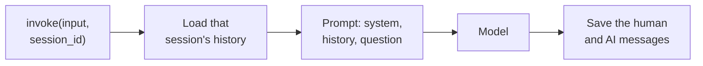
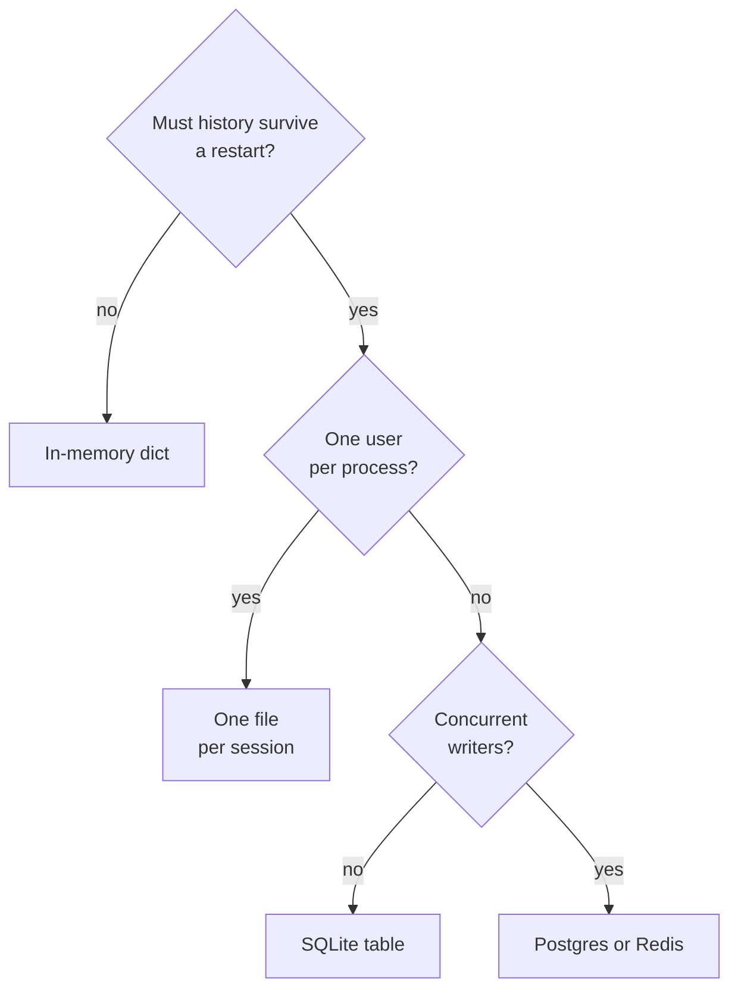

# M33.2 Theory: RunnableWithMessageHistory, multi-user sessions and persistence

*[M33 theory](../README.md) · Lesson 33.2 · Notebooks: [`02a_runnable_with_message_history.ipynb`](../../notebook/02a_runnable_with_message_history.ipynb), [`02b_multi_user_sessions_and_persistence.ipynb`](../../notebook/02b_multi_user_sessions_and_persistence.ipynb) · [All theory pages](../../../../../THEORY.md)*
<!-- subtitle: One chain serves every customer: the session id picks the history, and the store decides whether it survives a restart -->

## Two customers, one list

> **What you'll learn**
>
> - **Explain** how a wrapper loads and saves one conversation's history around any chain.
> - **Trace** two interleaved customers through one chain and count what each history holds.
> - **Diagnose** a session id taken from the wrong place, and a store that forgets on restart.
> - **Choose** a history backend by restart, user count and concurrent writers.

Lesson 33.1 kept the conversation in one list and resent it every turn. That works for a single customer in a notebook.

Put the Larkspur assistant behind a web endpoint and two customers arrive at once. Customer A says she is on the annual Team plan; customer B asks *Which plan am I on?* With one shared list, B's call carries A's turns and the model answers with A's plan. Restart the server and both lists are gone.

Two jobs follow from that failure. Each conversation needs its own history, chosen by something the server trusts. And the history has to live somewhere that outlasts the process.

## One history per session

`RunnableWithMessageHistory` does the load and save of lesson 33.1 around any runnable. You give it the chain and a **session factory**, a function that takes a session id and returns that conversation's history object. Every call then carries the id in its config, under `session_id`, next to the input:

*Figure 1: One wrapped call. The wrapper loads the session's history before the chain runs and saves both new messages after it.*

When the chain takes a dict, three keys tell the wrapper where things go:

| Key | What it names | What goes wrong without it |
|---|---|---|
| `input_messages_key` | The input field holding the new user message, saved after the call | The wrapper cannot find the message to store |
| `history_messages_key` | The `MessagesPlaceholder` in the prompt that receives the stored history | The history loads but never reaches the prompt |
| `output_messages_key` | Which field of a dict output to save as the AI message | A chain that returns a dict, such as lesson 33.4's retrieval chain, has no single reply to store |

*Table 1: The wrapper's keys. The model receives the system message, the history at the placeholder and the new question, in that order.*

### Tracing two interleaved customers

The notebook runs two users through the same chain with their turns interleaved, then asks each for a summary. Counting what each call loads:

| Call | Session | Message | History loaded | Stored after |
|---|---|---|---|---|
| 1 | `sourav` | Explain AI in 3 bullet points | 0 | 2 |
| 2 | `arnab` | Explain an LLM in 2 bullet points | 0 | 2 |
| 3 | `sourav` | Now do the same for deep learning | 2 | 4 |
| 4 | `sourav` | Summarize what we have discussed | 4 | 6 |
| 5 | `arnab` | Summarize what we have discussed | 2 | 4 |

*Table 2: Five calls on one chain. Each count follows from the wrapper saving one human and one AI message per call; the answers themselves come from the model.*

Call 3 resolves *the same* only because `sourav`'s first exchange was loaded. Call 5 summarises LLMs alone, because `arnab`'s history never contained the other topics. Streaming works through the wrapper as well: the answer streams out, and the full text is saved to the session once the stream ends.

### Planted failures: where the id comes from

The `session_id` is the only thing separating one customer's conversation from another's. Whoever supplies it chooses which history loads, which makes its source matter more than its format:

| Session id taken from | What happens |
|---|---|
| The authenticated server session | Each customer reads only their own history |
| A field in the request body the user can edit | Any customer can load another customer's chat by changing one string: a **borrowed session** |
| The user id alone | One customer's separate chats merge into a single history |
| A fresh value on every request | Every turn starts empty, and the app forgets as in lesson 33.1 |

*Table 3: Four sources for the session id. Only the first is safe and correct.*

Any string works as an id: a user id, a chat id, or both combined, which lets one customer hold several separate chats. Build it on the server from the authenticated user, never from text the user can edit.

## Where the history lives

Only the factory changes when the store changes. The chain and the wrapper stay the same, and Table 4 compares the three backends the notebook uses:

| Backend | Survives a restart | Many users | Typical use |
|---|---|---|---|
| `InMemoryChatMessageHistory` in a dict | No | Yes, one per key | Tests and notebooks |
| `FileChatMessageHistory` | Yes | One JSON file per session | Single-user CLI or desktop tools |
| `SQLChatMessageHistory` | Yes | Yes, one table keyed by `session_id` | Web apps and services |

*Table 4: Three history backends behind the same interface.*

Figure 2 turns the table into a check order:

*Figure 2: Choosing a history backend. Every answer leaves the chain untouched; only the factory changes.*

### Proving the database remembers

The notebook separates the chain from the store by throwing the chain away. Run 1 builds a chain on SQLite, sends two messages about a user's preferences and deletes the chain object. Run 2 builds a brand-new chain with no Python-side state and asks three questions about those preferences:

| Moment | Rows in `message_store` | Where the answer can come from |
|---|---|---|
| After run 1 (2 turns) | 4 | |
| Run 2 asks *What's my name?* | 4 loaded | Only the database |
| After run 2 (3 more turns) | 10 | |

*Table 5: Row counts across the restart test. Each turn writes two rows, one per message.*

Any correct recall in run 2 came from the rows, because nothing else survived. The rows also outlive the kernel: rerun only the second half after a restart and the answers still come from the file. A file-backed history works the same way for one session, and the notebook resumes a saved JSON conversation from a copy.

> **Pitfall: the positional connection.** The second positional argument of `SQLChatMessageHistory` is `table_name`. Passing the database URL second creates no connection, and the error appears only at the first call. Pass it by keyword, as `connection`.

SQLite is fine for one process. For a service with concurrent writers, use the same interface on Postgres or Redis. These history classes come from the sunset `langchain-community` package, and `RunnableWithMessageHistory` is deprecated in `langchain-core` 1.3.3 and removed in 2.0. Lesson 33.6 does the same job with a LangGraph checkpointer, which is where new code should go.

## In practice: Larkspur's support endpoint

Applying both halves to the Larkspur assistant:

1. **Keying.** The endpoint builds the session id from the logged-in account and the chat, for example the customer `cust-4821` plus a chat number, and never reads it from the request body.
2. **Storing.** The factory returns a SQL-backed history for that id. A deploy that restarts the service loses no conversation.
3. **Checking.** A test interleaves two customers and asserts that each summary mentions only its own topics, the same check as Table 2.

> **What changes next:** every stored message still goes back to the model on every turn. Lesson 33.3 bounds that list with trimming, windows and a running summary.

## Key Takeaways

- `RunnableWithMessageHistory` loads and saves history around any runnable, and the `session_id` in the call's config alone separates conversations. Take that id from the authenticated server session, never from text the user can edit.
- Changing the store means changing only the factory: an in-memory dict for tests, one file per session for single-user tools, and SQL, Postgres or Redis for services that must survive restarts.
- Pass the database URL to `SQLChatMessageHistory` by keyword, because the second positional argument is `table_name`. Put new code on a LangGraph checkpointer, since `RunnableWithMessageHistory` is deprecated.

## Check yourself

1. Two customers send interleaved turns to the same chain wrapped in RunnableWithMessageHistory. What keeps their conversations apart?

The `session_id` in each call's config. The wrapper passes it to the session factory, which returns that conversation's history, loads it before the call and saves the new messages after it. A new `session_id` starts empty, so each customer's summary sees only their own turns.

2. A notebook prototype keeps histories in a dict of InMemoryChatMessageHistory. It must now serve a web app and survive restarts. What do you change?

Only the factory: return `SQLChatMessageHistory` keyed by `session_id`, and the chain and wrapper stay the same. The in-memory store loses everything on restart. For a service with concurrent writers, use the same interface on Postgres or Redis rather than SQLite.

3. SQLChatMessageHistory built with the session id and the database URL as two positional arguments fails on the first invoke. What went wrong?

The second positional argument is `table_name`, not the connection, so this form creates no database connection and fails only when invoked. Pass the URL by keyword, as `connection`, next to `session_id`.

---
*Previous: [33.1 Why LLMs forget; classic memory classes](../01_why_llms_forget_classic_memory_classes/README.md). Next: [33.3 Trimming, windowing and summary memory](../03_trimming_windowing_and_summary_memory/README.md).*
