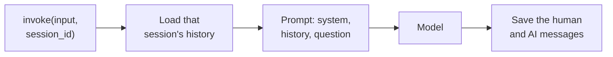
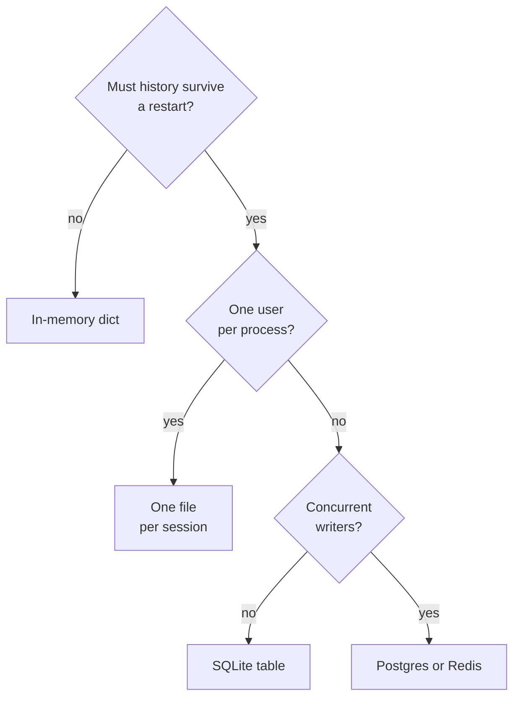

# M33.2 Theory: RunnableWithMessageHistory, multi-user sessions and persistence

*[M33 theory](../README.md) · Lesson 33.2 · Notebooks: [`02a_runnable_with_message_history.ipynb`](../../notebook/02a_runnable_with_message_history.ipynb), [`02b_multi_user_sessions_and_persistence.ipynb`](../../notebook/02b_multi_user_sessions_and_persistence.ipynb) · [All theory pages](../../../../../THEORY.md)*
<!-- subtitle: One chain serves every customer: the session id picks the history, and the store decides whether it survives a restart -->
<!-- format: approved -->

## Start with two customers on one list

> **What you'll learn**
>
> - **Explain** how a wrapper loads and saves one conversation's history around any chain.
> - **Trace** two interleaved customers through one chain and count what each history holds.
> - **Diagnose** a session id taken from the wrong place, and a store that forgets on restart.
> - **Choose** a history backend by restart, user count and concurrent writers.

Lesson 33.1 kept the conversation in one list and resent it every turn. That works for a single customer in a notebook.

Put the Larkspur assistant behind a web endpoint and two customers arrive at once. Customer A says she is on the annual Team plan; customer B asks *Which plan am I on?* With one shared list, B's call carries A's turns and the model answers with A's plan. Restart the server and both lists are gone.

Two jobs follow from that failure. Each conversation needs its own history, chosen by something the server trusts. And the history has to live somewhere that outlasts the process.

## One history per session

`RunnableWithMessageHistory` does the load and save of lesson 33.1 around any runnable. You give it the chain and a **session factory**, a function that takes a session id and returns that conversation's history object. Every call then carries the id in its config, under `session_id`, next to the input:

*Figure 1: One wrapped call. The wrapper loads the session's history before the chain runs and saves both new messages after it.*

When the chain takes a dict, three keys tell the wrapper where things go:

| Key | What it names | What goes wrong without it |
|---|---|---|
| `input_messages_key` | The input field holding the new user message, saved after the call | The wrapper cannot find the message to store |
| `history_messages_key` | The `MessagesPlaceholder` in the prompt that receives the stored history | The history loads but never reaches the prompt |
| `output_messages_key` | Which field of a dict output to save as the AI message | A chain that returns a dict, such as lesson 33.4's retrieval chain, has no single reply to store |

*Table 1: The wrapper's keys. The model receives the system message, the history at the placeholder and the new question, in that order.*

### Tracing two interleaved customers

The notebook runs two users through the same chain with their turns interleaved, then asks each for a summary. The walkthrough counts what each call loads; each count follows from the wrapper saving one human and one AI message per call, and the answers themselves come from the model.

Follow five interleaved calls on one wrapped chain. Each stage shows the session, the history it loads and what is stored after it.

<button type="button" data-step="0" aria-pressed="false" aria-controls="sessions-step-0">1. sourav</button><button type="button" data-step="1" aria-pressed="false" aria-controls="sessions-step-1">2. arnab</button><button type="button" data-step="2" aria-pressed="false" aria-controls="sessions-step-2">3. sourav</button><button type="button" data-step="3" aria-pressed="false" aria-controls="sessions-step-3">4. sourav</button><button type="button" data-step="4" aria-pressed="false" aria-controls="sessions-step-4">5. arnab</button>

<section id="sessions-step-0" class="step-panel" aria-labelledby="sessions-heading-0"><h4 id="sessions-heading-0">1. sourav: explain AI in 3 bullet points</h4><dl><dt>History loaded</dt><dd>0 messages</dd><dt>Stored after</dt><dd>2</dd></dl></section><section id="sessions-step-1" class="step-panel" aria-labelledby="sessions-heading-1"><h4 id="sessions-heading-1">2. arnab: explain an LLM in 2 bullet points</h4><dl><dt>History loaded</dt><dd>0 messages. A new session id starts empty.</dd><dt>Stored after</dt><dd>2</dd></dl></section><section id="sessions-step-2" class="step-panel" aria-labelledby="sessions-heading-2"><h4 id="sessions-heading-2">3. sourav: now do the same for deep learning</h4><dl><dt>History loaded</dt><dd>2 messages. <em>The same</em> resolves only because the first exchange was loaded.</dd><dt>Stored after</dt><dd>4</dd></dl></section><section id="sessions-step-3" class="step-panel" aria-labelledby="sessions-heading-3"><h4 id="sessions-heading-3">4. sourav: summarise what we discussed</h4><dl><dt>History loaded</dt><dd>4 messages: AI and deep learning</dd><dt>Stored after</dt><dd>6</dd></dl></section><section id="sessions-step-4" class="step-panel" aria-labelledby="sessions-heading-4"><h4 id="sessions-heading-4">5. arnab: summarise what we discussed</h4><dl><dt>History loaded</dt><dd>2 messages: LLMs only</dd><dt>Stored after</dt><dd>4. The summary covers LLMs alone, because this history never held the other topics.</dd></dl></section>

<button type="button" data-walk="previous">Previous</button>

<button type="button" data-walk="next">Next step</button>

Streaming works through the wrapper as well: the answer streams out, and the full text is saved to the session once the stream ends.

### Planted failures: where the id comes from

The `session_id` is the only thing separating one customer's conversation from another's. Whoever supplies it chooses which history loads, which makes its source matter more than its format.

Compare four sources for the session id on the same endpoint.

<button type="button" data-mode="server" aria-pressed="false" aria-controls="sid-server">Server session</button>
<button type="button" data-mode="body" aria-pressed="false" aria-controls="sid-body">Request body</button>
<button type="button" data-mode="user" aria-pressed="false" aria-controls="sid-user">User id alone</button>
<button type="button" data-mode="fresh" aria-pressed="false" aria-controls="sid-fresh">Fresh per request</button>

<section id="sid-server" class="mode-panel" data-announcement="Authenticated server session selected. Each customer reads only their own history."><h4>The authenticated server session</h4>
Each customer reads only their own history. This is the only source that is both safe and correct.
</section>
<section id="sid-body" class="mode-panel" data-announcement="Request body selected. Any customer can load another customer's chat."><h4>A field in the request body the user can edit</h4>
Any customer can load another customer's chat by changing one string. Call this a <strong>borrowed session</strong>.
</section>
<section id="sid-user" class="mode-panel" data-announcement="User id alone selected. Separate chats merge."><h4>The user id alone</h4>
One customer's separate chats merge into a single history.
</section>
<section id="sid-fresh" class="mode-panel" data-announcement="Fresh value per request selected. Every turn starts empty."><h4>A fresh value on every request</h4>
Every turn starts empty, and the app forgets as in lesson 33.1.
</section>

Any string works as an id: a user id, a chat id, or both combined, which lets one customer hold several separate chats. Build it on the server from the authenticated user, never from text the user can edit.

## Where the history lives

Only the factory changes when the store changes. The chain and the wrapper stay the same, and Table 2 compares the three backends the notebook uses:

| Backend | Survives a restart | Many users | Typical use |
|---|---|---|---|
| `InMemoryChatMessageHistory` in a dict | No | Yes, one per key | Tests and notebooks |
| `FileChatMessageHistory` | Yes | One JSON file per session | Single-user CLI or desktop tools |
| `SQLChatMessageHistory` | Yes | Yes, one table keyed by `session_id` | Web apps and services |

*Table 2: Three history backends behind the same interface.*

Figure 2 turns the table into a check order:

*Figure 2: Choosing a history backend. Every answer leaves the chain untouched; only the factory changes.*

### Proving the database remembers

The notebook separates the chain from the store by throwing the chain away. Run 1 builds a chain on SQLite, sends two messages about a user's preferences and deletes the chain object. Run 2 builds a brand-new chain with no Python-side state and asks three questions about those preferences:

| Moment | Rows in `message_store` | Where the answer can come from |
|---|---|---|
| After run 1 (2 turns) | 4 | |
| Run 2 asks *What's my name?* | 4 loaded | Only the database |
| After run 2 (3 more turns) | 10 | |

*Table 3: Row counts across the restart test. Each turn writes two rows, one per message.*

Any correct recall in run 2 came from the rows, because nothing else survived. The rows also outlive the kernel: rerun only the second half after a restart and the answers still come from the file. A file-backed history works the same way for one session, and the notebook resumes a saved JSON conversation from a copy.

> **Pitfall: the positional connection.** The second positional argument of `SQLChatMessageHistory` is `table_name`. Passing the database URL second creates no connection, and the error appears only at the first call. Pass it by keyword, as `connection`.

SQLite is fine for one process. For a service with concurrent writers, use the same interface on Postgres or Redis. These history classes come from the sunset `langchain-community` package, and `RunnableWithMessageHistory` is deprecated in `langchain-core` 1.3.3 and removed in 2.0. Lesson 33.6 does the same job with a LangGraph checkpointer, which is where new code should go.

### A session policy for Larkspur

For the Larkspur support endpoint, the two halves give three rules. The endpoint builds the session id from the logged-in account and the chat, for example the customer `cust-4821` plus a chat number, and never reads it from the request body. The factory returns a SQL-backed history for that id. A deploy that restarts the service loses no conversation. A test interleaves two customers and asserts that each summary mentions only its own topics, the same check as the walkthrough.

> **What changes next:** every stored message still goes back to the model on every turn. Lesson 33.3 bounds that list with trimming, windows and a running summary.

## Limits of this evidence

- **Counts, not answers.** The walkthrough's and Table 3's counts follow from the wrapper's save rule and the notebook's code. What each summary says depends on the model.
- **Illustrative failures.** The shared-list opening, the four session-id sources and the `cust-4821` id are illustrations, not runs.
- **Version-bound claims.** The deprecation versions and the `table_name` signature were read from the installed `langchain-core` 1.7.0 and `langchain-community` source; later releases may change them.

## References

1. LangChain, [Short-term memory](https://docs.langchain.com/oss/python/langchain/short-term-memory), accessed 13 November 2026.
2. LangGraph, [Persistence](https://docs.langchain.com/oss/python/langgraph/persistence), accessed 13 November 2026.

## Key Takeaways

- `RunnableWithMessageHistory` loads and saves history around any runnable, and the `session_id` in the call's config alone separates conversations. Take that id from the authenticated server session, never from text the user can edit.
- Changing the store means changing only the factory: an in-memory dict for tests, one file per session for single-user tools, and SQL, Postgres or Redis for services that must survive restarts.
- Pass the database URL to `SQLChatMessageHistory` by keyword, because the second positional argument is `table_name`. Put new code on a LangGraph checkpointer, since `RunnableWithMessageHistory` is deprecated.

## Check yourself

1. Two customers send interleaved turns to the same chain wrapped in RunnableWithMessageHistory. What keeps their conversations apart?

The `session_id` in each call's config. The wrapper passes it to the session factory, which returns that conversation's history, loads it before the call and saves the new messages after it. A new `session_id` starts empty, so each customer's summary sees only their own turns.

2. A notebook prototype keeps histories in a dict of InMemoryChatMessageHistory. It must now serve a web app and survive restarts. What do you change?

Only the factory: return `SQLChatMessageHistory` keyed by `session_id`, and the chain and wrapper stay the same. The in-memory store loses everything on restart. For a service with concurrent writers, use the same interface on Postgres or Redis rather than SQLite.

3. SQLChatMessageHistory built with the session id and the database URL as two positional arguments fails on the first invoke. What went wrong?

The second positional argument is `table_name`, not the connection, so this form creates no database connection and fails only when invoked. Pass the URL by keyword, as `connection`, next to `session_id`.

---
*Previous: [33.1 Why LLMs forget; classic memory classes](../01_why_llms_forget_classic_memory_classes/README.md). Next: [33.3 Trimming, windowing and summary memory](../03_trimming_windowing_and_summary_memory/README.md).*
