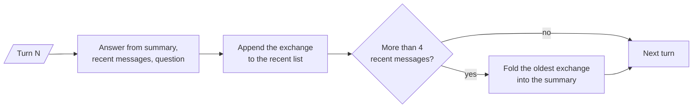

# M33.3 Theory: Trimming, windowing and summary memory

*[M33 theory](../README.md) · Lesson 33.3 · Notebooks: [`03a_trimming_windowing_and_summary.ipynb`](../../notebook/03a_trimming_windowing_and_summary.ipynb) · [All theory pages](../../../../../THEORY.md)*
<!-- subtitle: Bounding a long chat means choosing between dropping early facts for free and keeping them compressed for an extra call per fold -->

## When the plan falls out of the window

> **What you'll learn**
>
> - **Explain** how summary memory folds old exchanges into a running summary while recent turns stay word for word.
> - **Trace** a token trim and a window on real message lists, and name exactly which facts they drop.
> - **Compare** trimming, windowing and summarising on early-fact recall, extra calls and what is stored.
> - **Choose** a bound for a conversation by its length and by which facts must survive.

Lesson 33.2 gave every customer a history that survives a restart. Every stored message still goes back to the model on every turn, and lesson 33.1 showed that turn N sends 2N − 1 of them.

A Larkspur billing ticket shows why the cheapest fix hurts. On turn 1 the customer says they are on the annual Team plan. Turns 2 to 4 discuss a duplicate charge. On turn 5 they ask *Which plan am I on, and can I get the refund on that plan?* An assistant that keeps only the last two exchanges sends turns 3 and 4 and has lost the plan.

The oldest messages are often the ones that set the context: the plan, the region, the account the ticket is about. That makes them the worst ones to drop first, and this page compares three ways to bound the history by what each does to them.

## Summary memory

**Summary memory keeps a short running summary of the older turns, written by a second LLM call, plus the most recent messages word for word.** Old exchanges are compressed instead of dropped, which keeps facts like the plan within reach of the model.

The notebook keeps the last `MAX_RECENT = 4` messages, two exchanges, verbatim. After each answer it appends the exchange to the recent list. When the list passes four messages, the oldest exchange goes to a summariser chain together with the current summary, and the updated summary replaces the old one in the system prompt:

<!-- animated: diagrams/summary-fold.anim.html -->

*Figure 1: One turn of summary memory. The fold runs after the answer, and the next turn starts from the updated summary.*

### Tracing the five-turn ticket

Running the Larkspur ticket through that loop, the counts follow from the code alone:

| Turn | Prompt holds | Recent list after the answer | Fold? | Summary now covers |
|---|---|---|---|---|
| 1 | Question only | 2 messages | No | Nothing |
| 2 | 2 recent + question | 4 | No | Nothing |
| 3 | 4 recent + question | 6, folded to 4 | Yes | Turn 1 |
| 4 | Summary + 4 recent + question | 6, folded to 4 | Yes | Turns 1 and 2 |
| 5 | Summary + 4 recent + question | 6, folded to 4 | Yes | Turns 1 to 3 |

*Table 1: Summary memory with four recent messages over five turns. The summariser runs three times.*

On turn 5 the recent messages are turns 3 and 4, exactly what a two-exchange window would send. The plan from turn 1 reaches the model only through the summary. The notebook runs the same loop with a user who gives their name, city, job and cats, then asks for everything they said; the final answer can list the first-turn facts because they survived the folds.

### What the summary costs

Three costs come with the fold:

- **Extra calls.** Each fold is one more LLM call. On a short chat that never passes the threshold, or barely does, summary memory costs about as much as keeping everything.
- **Lossy compression.** Names and decisions survive; exact wording does not, and a summariser can drop a fact you needed. Call this **summary drift**: the memory still sounds confident after the detail has gone.
- **Slow growth.** The summary gets a little longer with every fold. The prompt stays bounded only while the summariser keeps it short.

Lesson 33.6 builds the same idea as a LangGraph node, and agents built with `create_agent` get it ready-made as `SummarizationMiddleware`. The two cheaper bounds are next.

## Trim, window or summarise

### Trimming by tokens

`trim_messages` cuts a list to a token budget on its way to the model. The notebook's settings keep the newest messages that fit, always keep the system message, never cut a message in half, and make the kept part start on a user message so it reads as a conversation. It runs locally; the model object serves only as the token counter.

The notebook's chat has eleven messages, starting with a system message and *hi! I'm bob*, then vanilla ice cream, *whats 2 + 2*, *thanks* and *having fun?*. With `gpt-4o-mini`'s counter in `langchain-openai` 1.7.3 the whole list counts 80 tokens. Trimmed to 45:

| Input | Budget | Kept | Kept messages | Lost facts |
|---|---|---|---|---|
| The 11-message chat (80 tokens) | 45 | 5 messages, 36 tokens | System, *thanks*, *no problem!*, *having fun?*, *yes!* | Bob's name, vanilla ice cream, the sum |
| The chat + *What ice cream do I like?* | 45 | 4 of 12 | System, *having fun?*, *yes!*, the question | The answer to the question |
| The chat + *What math problem did I ask?* | 45 | 4 of 12 | System, *having fun?*, *yes!*, the question | The answer to the question |

*Table 2: The notebook's trimmer, run in the scratchpad. Another token counter gives other cuts.*

Adding the question costs the trimmer one more exchange, which shows a trap of token budgets: a longer question pushes more history out. Both questions ask about facts outside the budget, and neither can be answered from the conversation. Call this **silent truncation**: nothing errors, and the model either says it does not know or guesses.

### Windowing the store

A window does the same job in storage. The notebook's windowed history keeps only the last `k = 2` exchanges and deletes the rest as new messages arrive:

| After the user says | Window holds (user side) |
|---|---|
| My name is Paulo | Paulo |
| I live in Seattle | Paulo, Seattle |
| I work as an AI engineer | Seattle, AI engineer |
| I have 2 cats | AI engineer, 2 cats |
| What do you remember about me? | Answered from the job and the cats only |

*Table 3: A two-exchange window. The name and the city slide out before the question arrives.*

### Comparing the three bounds

Table 4 puts the strategies side by side, with full history as the baseline:

| Strategy | What the model receives | Keeps early facts | Extra LLM calls | Stored history |
|---|---|---|---|---|
| Keep everything | Every message | Yes | None | Grows forever |
| Trim by tokens (`trim_messages`) | Newest messages within the budget | No | None | Complete; only the prompt is cut |
| Window of `k` exchanges | Last `2k` messages | No | None | Only the window |
| Running summary | Summary plus recent messages | Yes, compressed | One per fold | Summary plus recent |

*Table 4: Four ways to decide what reaches the model.*

Wrap a trimming chain in `RunnableWithMessageHistory` and the store keeps the full history while the model sees only the trimmed part. That split between what is stored and what is sent is the question lesson 33.6 asks of a LangGraph thread.

## In practice: picking a bound for Larkspur tickets

For the Larkspur support assistant, the choice follows from two facts about its tickets:

1. **Early facts matter.** Plan, region and account appear in the first turn and decide later answers. A window or a trim alone would fail the turn-5 question in the opening example.
2. **Most tickets are short.** While a chat fits the budget, keeping everything is cheapest and loses nothing.
3. **The rule.** Keep everything up to the budget, then fold older turns into a summary, and test that the turn-1 plan still reaches the model late in a long ticket.

> **What changes next:** the retriever is a second reader of the conversation, and it sees only the latest message. Lesson 33.4 rewrites follow-ups before retrieval.

## Key Takeaways

- Windows and token trims drop the oldest messages, which often set the context, such as the customer's plan. Summary memory folds old exchanges into a running summary and keeps the last few messages word for word.
- Each fold is an extra LLM call and keeps names and decisions but not exact wording. On a short chat, summary memory costs as much as keeping everything.
- `trim_messages` cuts only the prompt and leaves the stored history complete, while a window of `k` exchanges keeps only the last `2k` messages in storage. Neither keeps early facts.

## Check yourself

1. On turn 5 of the Larkspur billing ticket, the customer asks for the plan they gave in turn 1. Why can summary memory answer when a two-exchange window cannot?

A window drops the oldest messages, so it holds only turns 3 and 4 and the plan is gone. Summary memory folds old exchanges into a running summary instead of dropping them, and turn 1's plan survives there. The model sees the summary, the last four messages and the question.

2. The notebook's eleven-message chat counts 80 tokens. With a 45-token trim_messages budget, what does the model keep, and can it say which ice cream Bob likes?

It keeps five messages (36 tokens): the system message and the last two exchanges. Bob's name and his vanilla ice cream fall outside the budget, so it cannot answer. Those counts depend on the token counter; another counter gives other cuts.

3. A team adds summary memory to a support bot whose chats rarely pass three turns, hoping to cut cost. Is that a good choice?

No. Each fold is an extra LLM call, so on a short chat summary memory is no cheaper than keeping everything, and it is lossy: exact wording does not survive and a summariser can drop a fact you needed. Keep everything while the chat fits the budget.

---
*Previous: [33.2 RunnableWithMessageHistory, multi-user sessions and persistence](../02_runnablewithmessagehistory_multi_user_sessions_and_persistence/README.md). Next: [33.4 Conversational RAG with history-aware retrieval](../04_conversational_rag_with_history_aware_retrieval/README.md).*
