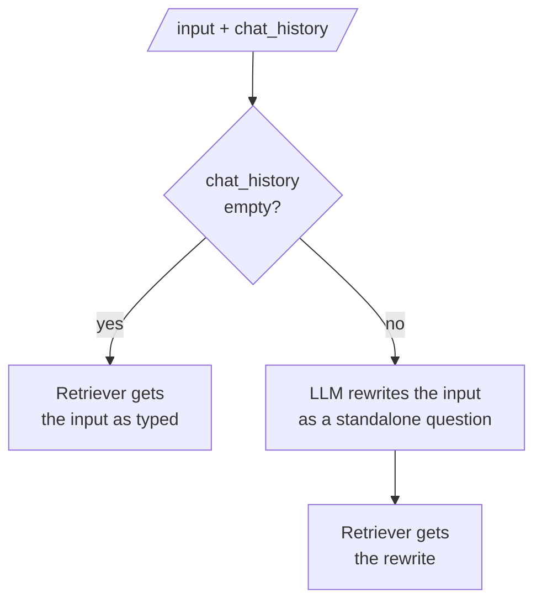

# M33.4 Theory: Conversational RAG with history-aware retrieval

*[M33 theory](../README.md) · Lesson 33.4 · Notebooks: [`04a_conversational_rag_with_history.ipynb`](../../notebook/04a_conversational_rag_with_history.ipynb) · [All theory pages](../../../../../THEORY.md)*
<!-- subtitle: A retriever reads only the literal follow-up, and the question has to be rewritten into a standalone one before the search -->

## A follow-up with no subject

> **What you'll learn**
>
> - **Explain** why a follow-up retrieves the wrong chunks even when the model holds the whole history.
> - **Trace** how a history-aware retriever turns a follow-up into a standalone question, and when it skips the rewrite.
> - **Compare** three retrieval inputs on turns 2 and 3: the latest message, appended history and a rewrite.
> - **Diagnose** the misses a rewrite cannot fix.

Lessons 33.1 to 33.3 gave the history to the model. In retrieval-augmented generation (RAG) a second component reads the question: the retriever. It reads only the literal text.

A Larkspur customer asks *How do I export my data?*, then *Is that possible after I cancel?*, and gets good answers to both. Then they ask *How long do I have?* The one useful term left after stop words is "long", and no chunk of the Larkspur handbook contains it: every chunk scores zero. The model receives the history and knows the customer means their data after cancelling. The chunks it receives were chosen for a question with no subject.

We will call this **subject loss**. The notebook shows the same failure on Lilian Weng's post about agents: after *What is Self-Reflection?*, the follow-up *How do we achieve it?* retrieves chunks about "it". The fix has to happen before the search.

## History-aware retriever

**A history-aware retriever adds one step before retrieval: an LLM reads the chat history and the latest message and writes a standalone question, one that makes sense without the history, and the retriever searches for that.** The notebook's prompt tells the LLM to reformulate the question if needed, return it unchanged otherwise, and not answer it.

*Figure 1: The history-aware retriever's branch. Turn 1 has no history and costs no rewrite call.*

The rewrite turns each follow-up back into a question the retriever can score. Table 1 shows what it does to Larkspur follow-ups from the lab's chats:

| History so far | Latest message | Standalone question (representative) |
|---|---|---|
| Can I get a refund on my annual plan? | How long until the money is back? | How long until the money from an annual plan refund is back? |
| How do I export my data? Is that possible after I cancel? | How long do I have? | How long is my data kept after I cancel my plan? |
| When is a monthly plan billed? And the annual one? | Can I get money back on it? | Can I get a refund on an annual plan? |

*Table 1: Three follow-ups from the lab and their rewrites. The rewrites are written by hand to show the shape; the lab's rankings for them are computed.*

`create_history_aware_retriever` builds exactly the branch in Figure 1. `create_retrieval_chain` then joins it to a chain that stuffs the retrieved documents into an answer prompt, and that prompt carries the chat history too. The answer step sees the conversation as well. Wrapped in `RunnableWithMessageHistory` with the answer field named as the output to save, the chain loads and saves the history itself, as in lesson 33.2.

### What the rewrite costs, and how it fails

The extra step brings its own failure modes:

| Failure | What happens | Example |
|---|---|---|
| **Rewrite latency** | One LLM call runs on every follow-up before retrieval can start | Twelve follow-ups in the lab, twelve calls |
| **Dropped constraint** | The rewrite loses a detail the customer gave | *Can I get money back on it?* rewritten without "annual" no longer points at the annual refund window (illustrative) |
| **Over-carried history** | The rewrite drags the old topic into a new question | A cancel question keeps "refund" and "annual plan" and ranks the refund chunk first |
| **Empty history at runtime** | A wiring bug passes no history, the branch takes the "yes" path, and every follow-up is searched as typed | Follow-up hit rate drops to the latest-message baseline with no error |

*Table 2: Four ways a history-aware retriever goes wrong. The last one looks like a retrieval regression and is a memory bug.*

The lab measures how much the rewrite buys against the two cheaper inputs.

## Rewrite, append or neither

The [interactive lab](interactive/follow-up-retrieval-lab.html) runs six three-turn Larkspur support chats against the twelve handbook chunks from the M10 lab, with the same TF-IDF index (it matches scikit-learn's `TfidfVectorizer` to within 5e-16 on all 648 scores). It compares three things the retriever can receive on turns 2 and 3: the latest message as typed, the earlier questions with the latest appended, and a standalone rewrite. The customer messages are hand-written and the rewrites are representative; the rankings are computed.

| Retriever receives | Turn 2 hits, `k = 1` | Turn 3 hits, `k = 1` | Hit rate, `k = 1` | Hit rate, `k = 2` |
|---|---|---|---|---|
| The latest message | 2 / 6 | 4 / 6 | 0.50 | 0.58 |
| Earlier questions + latest | 5 / 6 | 1 / 6 | 0.50 | 0.92 |
| A rewritten question | 5 / 6 | 5 / 6 | 0.83 | 0.92 |

*Table 3: Evidence found on the 12 follow-up turns, recomputed from the lab's own scoring code. A hit means the labelled evidence chunk is in the top k.*

- **The latest message misses the turns that point back.** *What do I get if you miss it?*, *How long do I have?* and *Can I get money back on it?* score zero against every chunk, and *Is that possible after I cancel?* finds the `cancel` chunk instead of the export evidence. Follow-ups that name their own subject, such as *Do my promo credits expire?*, hit either way.
- **Appending fixes turn 2 and breaks turn 3.** Turn 2 usually continues turn 1's topic, and the extra words help. Turn 3 often changes topic, and two earlier questions outweigh one new one: at `k = 1` the old topic takes the only slot in 5 of 6 chats. Call this **topic drag**. At `k = 2` appending catches up, by spending a context slot on the old topic every time.
- **The rewrite wins at `k = 1` and pays for it with 12 LLM calls**, one per follow-up. Its two misses are worth reading. *How long until the money is back?* misses whatever the query says, because the evidence chunk says "Refunds" and "business days" and no phrasing of the question uses those words. A rewrite restores the subject but not the handbook's vocabulary, which is M10's representation problem and the reason for embeddings in [M13](../../../../../p04_rag_foundations/m13_embeddings/mandatory/theory/README.md). And *What happens if I cancel my annual plan instead of getting a refund?* is the over-carried rewrite from Table 2: "refund" and "annual plan" pull the refund chunk above `cancel` at `k = 1`.

<!-- lab: interactive/follow-up-retrieval-lab.html -->

### Measuring turns 2 and 3 separately

The lab is the module's lab brief in miniature. On your own corpus, write multi-turn conversations, label the evidence for each turn, and report hit rate on turns 2 and 3 separately from turn 1, with and without the rewrite. A single average over all turns hides the follow-ups, because first questions are usually standalone and score well either way.

The same split catches a regression early. If a refactor stops passing the history, the turn-1 numbers stay put while the turn-2 and turn-3 numbers fall to the latest-message row of Table 3.

## In practice: Larkspur's export chat

Following the export conversation through the full chain:

1. **Turn 1.** *How do I export my data?* arrives with an empty history, the branch skips the rewrite, and the retriever finds the export chunk.
2. **Turn 2.** *Is that possible after I cancel?* arrives with one exchange of history. As typed it finds the `cancel` chunk; rewritten as *Can I export my data after I cancel my plan?* it finds the export evidence.
3. **Turn 3.** *How long do I have?* scores zero as typed. The rewrite, *How long is my data kept after I cancel my plan?*, finds the retention chunk: data is kept for 30 days after cancelling.
4. **Answer.** The answer prompt receives the retrieved chunk and the history. The reply can then say *your data* and mean the account from turn 1.
5. **Monitoring.** The logs keep the raw message, the rewrite and the retrieved chunk ids per turn, which lets the team check the rewrite as well as the retrieval.

> **What changes next:** these chains keep history with the deprecated wrapper from lesson 33.2. Lesson 33.6 moves conversation state into a LangGraph thread, where the same bounding choices become nodes.

## Key Takeaways

- A retriever reads only the literal question, so a follow-up such as *How long do I have?* can score zero against every chunk even when the model holds the history.
- A history-aware retriever has an LLM rewrite each follow-up as a standalone question and skips the rewrite on turn 1. Each rewrite adds a call and can drop a constraint or carry an old topic forward.
- In the lab, rewriting raised the `k = 1` hit rate from 0.50 to 0.83, while appending earlier questions helped turn 2 and broke turn 3. Report follow-up turns separately from turn 1, which is usually standalone.

## Check yourself

1. The model receives the chat history, yet the follow-up How long do I have? retrieves nothing useful. Why, and what does a history-aware retriever add?

The retriever reads only the literal question, and its one useful term, "long", appears in no handbook chunk. Every chunk scores zero. A history-aware retriever first has an LLM rewrite the latest message as a standalone question from the history, and the retriever searches for that. On turn 1, with an empty history, it skips the rewrite.

2. In the lab at k = 1, appending earlier questions hits on 5 of 6 turn-2 messages but only 1 of 6 on turn 3. Why the collapse?

Turn 2 usually continues turn 1's topic, so the extra words help. Turn 3 often changes topic, and two earlier questions outweigh one new one, so the old topic takes the only slot in 5 of 6 chats. At `k = 2` appending catches up to 0.92, but only by spending a slot on the old topic every time.

3. With the rewrite, How long until the money is back? still misses its evidence. Would a better rewrite prompt fix it?

No. The evidence chunk says "Refunds" and "business days", and no phrasing of the question uses those words. A rewrite restores the subject, not the handbook's vocabulary; that is a representation problem, which embeddings (M13) address.

---
*Previous: [33.3 Trimming, windowing and summary memory](../03_trimming_windowing_and_summary_memory/README.md). Next: [33.5 Memory apps: product recommender and research agent with SQL memory](../../../optional/theory/05_memory_apps_product_recommender_and_research_agent_with_sql_memory/README.md).*
