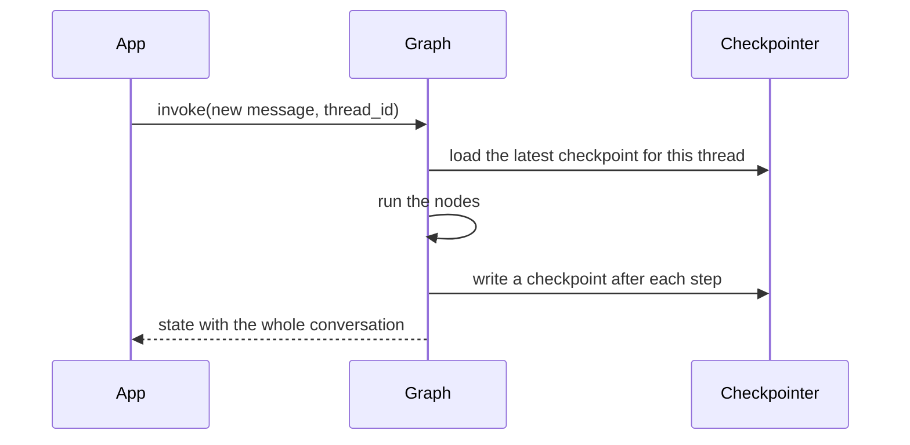
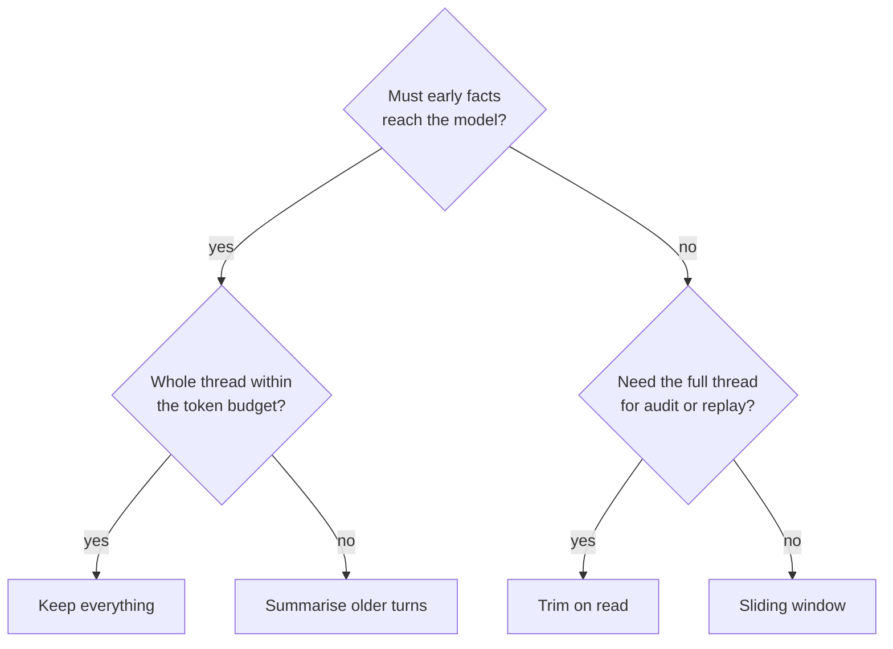

# M33.6 Theory: LangGraph threads, checkpoints and memory optimisations

*[M33 theory](../README.md) · Lesson 33.6 · Notebooks: [`06a_memory_and_conversational_agent.ipynb`](../../notebook/06a_memory_and_conversational_agent.ipynb), [`06b_memory_optimizations.ipynb`](../../notebook/06b_memory_optimizations.ipynb) · [All theory pages](../../../../../THEORY.md)*
<!-- subtitle: A checkpointer saves a thread's state after every step, and a bound decides whether old turns are deleted from it or only hidden from the model -->

## Forget it, but keep the log

> **What you'll learn**
>
> - **Explain** how a checkpointer and a `thread_id` give a LangGraph graph per-conversation memory.
> - **Trace** the checkpoints a turn writes and the messages four memory strategies send on a six-turn ticket.
> - **Compare** deleting old messages from state with hiding them from the model.
> - **Diagnose** a running summary that resets itself every turn.

Lessons 33.2 to 33.4 kept history with `RunnableWithMessageHistory`, which is deprecated. LangGraph keeps the conversation in the graph's own state instead, and the bounding choices of lesson 33.3 become nodes.

A Larkspur customer opens a ticket about a duplicate charge. Six turns later the prompt has grown on every call, and the team wants it bounded. Support leads also want the whole ticket available for review and for replaying a bad answer. A bound that deletes old turns satisfies the first request and silently breaks the second.

This page first shows where a LangGraph conversation lives, then measures four strategies on one ticket and separates the two things a bound can cut: what the model reads and what the thread stores.

## Checkpointer / thread_id

A LangGraph graph keeps the conversation in its state, typically a `messages` channel with the `add_messages` reducer: each node returns only its new messages, and the reducer appends them. **A checkpointer saves a snapshot of that state, a checkpoint, after every step, and the `thread_id` in the call's config names the sequence of checkpoints a run reads and extends.** Compile the graph with a checkpointer once; every call then picks its conversation by thread:

*Figure 1: One turn on a checkpointed graph. The app sends only the new message; the thread supplies the rest.*

This replaces `RunnableWithMessageHistory` and `session_id` from lesson 33.2, and LangChain recommends it for new code. A one-node graph that answers every message with a fixed reply shows the isolation without a model call:

| Call | Thread | New message | Messages in the returned state |
|---|---|---|---|
| 1 | `dana` | Annual plan | 2 |
| 2 | `dana` | Which plan? | 4 |
| 3 | `omar` | Hello | 2 |

*Table 1: Three calls on one compiled graph with an in-memory checkpointer, run in the scratchpad with a scripted reply.*

Call 2 returns four messages because `dana`'s first exchange was loaded from the thread. Call 3 starts from nothing, although it uses the same graph object. The notebook shows the same thing with a model: `user001` asks *Explain AI in 1 line* and then *Do the same for ML*, which only makes sense because the first turn is replayed, and `user001`'s memory is untouched after `user002` talks on another thread.

### Counting checkpoints

Checkpoints are snapshots of every step, not only of the end of a turn. A turn writes one for the input, one at the start of the run and one per node step:

| Graph | Checkpoints per turn | After six turns |
|---|---|---|
| One node (answer) | 3 | 18 |
| Two nodes (bound, then answer) | 4 | 24 |
| The notebook's tool-calling agent (model, tool, model) | about 5 | |

*Table 2: Checkpoints written per turn, counted with a stub model in the scratchpad for the first two rows.*

`get_state` returns the latest checkpoint; `get_state_history` walks all of them, newest first, which is what replay, forking and debugging use. Where they are written depends on the checkpointer:

| Checkpointer | Survives a restart | Use |
|---|---|---|
| `InMemorySaver` | No | Notebooks and tests |
| `SqliteSaver` | Yes, a plain SQLite file with `checkpoints` and `writes` tables | One process; it is a context manager, and the graph is compiled inside its block |
| `PostgresSaver` (`langgraph-checkpoint-postgres`) | Yes | Deployments with concurrent writers |

*Table 3: Three checkpointers behind the same compile call.*

Two rules follow from this design. *Short-term* describes scope, not lifetime: a thread on SQLite or Postgres stays on disk until you delete it, which makes it customer data with retention rules like any other. And the `thread_id` must come from trusted server-side config, never from user text, because whoever picks the id reads that thread.

## Delete or hide

A thread that keeps everything sends every earlier message on every turn. The notebook runs one six-turn support ticket through four graphs. Turn 1 reports the duplicate charge and mentions in passing that the customer's favourite colour is blue; turn 3 asks for the colour back. Counted in messages, the model receives:

| Turn | Sequential | Sliding window | Trim on read | Summary |
|---|---|---|---|---|
| 1 | 1 | 1 | 1 | 1 |
| 2 | 3 | 3 | 3 | 3 |
| 3 | 5 | 3 | 3 | summary + 1 |
| 4 | 7 | 3 | 3 | summary + 3 |
| 5 | 9 | 3 | 3 | summary + 1 |
| 6 | 11 | 3 | 3 | summary + 3 |
| Stored after turn 6 | 12 | 4 | 12 | summary + 4 |

*Table 4: Messages sent to the model per turn, not counting system messages. Counted by running the notebook's four graphs with a stub model in place of `gpt-4o-mini`; the graph logic decides these numbers, and a real model gives the same counts with different token totals.*

Sequential can answer turn 3, and so can the summary graph if its summariser kept the colour. Sliding window and trim on read cannot, since both send only the last `MAX_MESSAGES = 3` messages: the previous exchange and the new question.

### Same prompt, different thread

The two bounded strategies send the same prompt and differ in what they keep:

- **Sliding window deletes.** A truncate node returns a `RemoveMessage` for every message older than the window, and the `add_messages` reducer removes them from the checkpointed state. They are gone for every later turn, for `get_state` and for anyone auditing the ticket. The reducer is the mechanism: plain list concatenation can only append. A deleting window needs `add_messages`.
- **Trim on read hides.** The model node calls `trim_messages` on a copy of the list and leaves state alone. The thread still holds all 12 messages, turn 1's colour included. Trimming the prompt never trims the checkpoint: with `SqliteSaver` the full thread is written to disk on every step.

Call the first one **audit loss**: the answer quality is identical, and the damage shows up only when someone needs the full ticket.

### The summary graph

The summary graph keeps a `summary` string next to a `buffer` of recent messages. Once the buffer reaches `MESSAGE_THRESHOLD = 4`, a node folds all but the newest message into the summary and removes them. It folds every other turn, turns 3 and 5 in Table 4, and each fold is an extra LLM call. Counting those calls, the notebook notes that on a thread this short summarisation costs about as much as the sequential baseline; it pays off on long threads.

The `summary` channel has no reducer, so any value written to it replaces the old one. Pass the empty summary only on the first turn. An app that sends it on every turn wipes the memory it is building, a failure we will call the **summary reset**: the folds run, the logs look busy, and each turn starts from nothing.

### Choosing a strategy

Figure 2 turns Table 4 into questions:

*Figure 2: Choosing a memory strategy for a thread. Prefer hiding over deleting whenever someone may need the full ticket.*

For agents built with `create_agent`, LangChain 1.x ships the summary strategy as `SummarizationMiddleware`.

## In practice: Larkspur's duplicate-charge ticket

Applying the page to the opening ticket:

1. **Thread.** The endpoint derives the `thread_id` from the authenticated customer and ticket, and compiles the graph once with `PostgresSaver`.
2. **Bound.** Support leads need the whole ticket, which rules out the sliding window. Trim on read caps the prompt and keeps all 12 messages in the thread.
3. **Early facts.** The billing-address change from turn 2 and the amount from turn 4 matter for the refund at the end. Long tickets switch to a summary seeded once, on the first turn.
4. **Retention.** The thread stays in Postgres after the ticket closes and follows the same deletion rules as the rest of the customer's data.

> **What changes next:** a thread ends with its conversation. [M34](../../../../m34_long_term_agentic_memory/mandatory/theory/README.md) adds the memory a thread cannot hold: facts about a customer that should carry over to their next conversation.

## Key Takeaways

- Compile the graph with a checkpointer and take the `thread_id` from trusted server config. A checkpoint is written after every step, three per turn for a one-node chat graph, for replay and debugging.
- A sliding window deletes old messages from state through `RemoveMessage` and `add_messages`; trim on read hides them from the model and keeps the full thread. Use trim on read when audit or replay needs every message.
- Keep everything while the thread fits the budget, and summarise older turns once it does not. A persisted thread stays on disk until you delete it, so treat it as customer data with retention rules.

## Check yourself

1. The sliding-window and trim-on-read graphs both send the model the last three messages. What differs between them, and when does it matter?

The sliding window deletes: a truncate node returns `RemoveMessage` instructions and the `add_messages` reducer removes those messages from checkpointed state. Trim on read hides: it trims a copy for the model, and the thread still holds all 12 messages. Pick trim on read when you need the full thread for audit or replay.

2. How many checkpoints does a one-node chat graph write per turn, and why more than one?

Three: one for the input, one at the start of the run and one per node step. Checkpoints snapshot every step, not just the end of a turn. A two-node graph writes 4 and the notebook's tool-calling agent about 5. `get_state_history` walks them newest first for replay, forking and debugging.

3. A summary graph runs its folds, yet each turn starts with an empty summary. What is the likely cause?

The app passes an empty summary on every turn. The `summary` channel has no reducer, so any value written to it replaces the old one and wipes the memory being built. Pass the empty summary only on the first turn.

---
*Previous: [33.5 Memory apps: product recommender and research agent with SQL memory](../../../optional/theory/05_memory_apps_product_recommender_and_research_agent_with_sql_memory/README.md). Next: [M33 interview questions](../README.md#interview-spotlight-5-questions-you-might-get-asked).*
