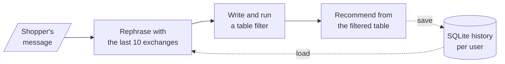

# M33.5 Theory: Memory apps: product recommender and research agent with SQL memory

*[M33 theory](../../../mandatory/theory/README.md) · Lesson 33.5 · Notebooks: [`05a_multi_user_product_recommender.ipynb`](../../notebook/05a_multi_user_product_recommender.ipynb) (optional), [`05b_multi_user_research_agent_sql_memory.ipynb`](../../notebook/05b_multi_user_research_agent_sql_memory.ipynb) (optional) · [All theory pages](../../../../../THEORY.md)*
<!-- subtitle: A small project: per-user SQL memory and a standalone rewrite, applied to a product recommender and a tool-calling research agent -->

## The project: two memory apps

> **What you'll build**
>
> - **A product recommender** that turns a shopper's follow-ups into one standalone request, filters a 30-product catalogue and recommends from what is left.
> - **A research agent** with a web-search tool and a weather tool that answers follow-ups such as *What about Intel?* from the user's own history.
> - **Per-user SQLite memory** around both, keyed by a session id per user.
> - **Guards** on the model-written filter and on slow web pages.

This project adds no new memory pattern. It points the session-keyed SQL history from lesson 33.2 and the standalone rewrite from lesson 33.4 at a shop assistant and a web-searching agent.

What changes is what the memory holds. Both apps store only the user's raw message and the final reply; rewrites, filtered tables and tool calls are rebuilt each turn.

## Architecture

The recommender runs three LLM steps per turn inside one wrapped chain:

*Figure 1: The recommender. The wrapper loads the user's history for the rephraser and saves the raw message and the recommendation afterwards.*

The research agent swaps the three steps for a tool-calling agent with the same wrapper around it. Table 1 lists the pieces of both builds:

| Piece | What it does | Built on |
|---|---|---|
| **Per-user SQL history** | Stores each user's messages as rows keyed by session id, in a file that survives a restart | Lesson 33.2 |
| **Query rephraser** | Rewrites the latest request as a standalone one from the user's last 10 exchanges | The history-aware retriever, lesson 33.4; the window, lesson 33.3 |
| **Text-to-pandas filter** | The model writes a filter on category, price and rating; a guarded executor runs it | New here |
| **Recommender chain** | Picks products from the filtered table only, using their descriptions | A prompt, model and parser chain |
| **Research agent** | Decides between a web search that extracts the result pages and a current-weather lookup, for up to 10 iterations | The tool loop from [M22](../../../../../p06_agent_foundations/m22_agent_loop_and_tools/mandatory/theory/README.md) |
| **Output key on the agent** | Saves only the agent's final answer as the AI message | The output key from lesson 33.2 |

*Table 1: The pieces of both apps and the lessons they reuse.*

## Following one shopper

The notebook's first shopper narrows down a tablet over three turns. Display size and storage are not columns in the catalogue. The filter can narrow only by category, and the recommender reads the descriptions for the rest:

| Turn | Shopper says | Standalone request (illustrative) | Filter can use | Tablets that fit, from the catalogue |
|---|---|---|---|---|
| 1 | looking for a tablet | A tablet | Category | BetaTab Lite (10 inch, 32GB, $400), BetaTab S (15 inch, 64GB, $500), SpectraTab Max (12 inch, 128GB, $600) |
| 2 | want one which has display larger than 10 inches | A tablet with a display larger than 10 inches | Category only | BetaTab S, SpectraTab Max |
| 3 | need at least 128GB disk space | A tablet larger than 10 inches with at least 128GB storage | Category only | SpectraTab Max |

*Table 2: One shopper's three turns. Catalogue facts come from the project's CSV (30 products, three in each of 10 categories); the rewrites are illustrative, and the recommendations vary by run.*

Turn 3 alone says nothing about tablets; only the rewrite keeps the filter on the right category. A second shopper, on another session id, asks for a highly rated laptop and then for 16GB of memory, and stays on laptops. The history file ends with 6 rows for the first shopper and 4 for the second, two per turn.

The research agent follows the same shape with live data. One user asks about Nvidia's Q4 2024 earnings call, then *What about Intel?*, then *Which company seems to be doing better?* With history, the second search targets Intel's Q4 2024 earnings, and the third answer compares the two from stored answers without searching. A second user does the same with the weather in Bangalore and Mumbai. Only the call order repeats between runs.

## Design choices worth copying

Each choice below protects against a failure named in an earlier lesson:

| Choice | Why |
|---|---|
| **Rewrite before the filter, from the raw stored turns** | A follow-up such as *need at least 128GB disk space* names no product type: the subject loss of lesson 33.4 |
| **Window the rephraser's history to 10 exchanges** | Bounds the replay cost from lesson 33.1 on long shopping sessions |
| **Guarded filter executor** | Only the table is in scope, with no built-ins; a filter that fails, returns a non-table or returns no rows falls back to the full 30-product table and the chat continues |
| **Save only the agent's final answer** | Tool results stay out of the history, which keeps later prompts short |
| **Timeouts on every network call** | Page downloads give up after 30 seconds and fall back to the search snippet, the weather call after 10; one hung page cannot stall a turn |
| **Session id per user** | Lesson 33.2's isolation rule; in a real app the id comes from the login |

*Table 3: Six choices and what each protects against.*

## Limits

- **The filter is model-written code.** An empty set of built-ins is not a sandbox. In production, have the model return a structured filter and apply it in code.
- **Specs live in free text.** The recommender model enforces display size and storage, and its prompt tells it to recommend five random products when nothing matches.
- **The agent forgets its sources.** Only final answers are saved; asking where a figure came from needs a new search.
- **Deprecated APIs.** `RunnableWithMessageHistory`, the community history class and the classic `AgentExecutor`; lesson 33.6's checkpointer replaces them.
- **Narrow tools.** The weather tool looks up Indian cities only, and SQLite suits one process.

Both notebooks need an OpenAI key. The research agent also needs a Tavily key and an OpenWeatherMap key, and every run issues real searches.

## Key Takeaways

- Per-user SQL history and a standalone rewrite are enough to make a product filter and a tool-calling agent follow a conversation: the rewrite rebuilds each follow-up from that user's stored turns.
- Decide what the memory stores. These apps keep the raw messages and final replies, and rebuild rewrites, tables and tool calls each turn, which keeps the history short and loses the sources.
- Never run model-written code with only an empty set of built-ins as protection; return a structured filter and apply it in code.

## Check yourself

1. The shopper's third message is need at least 128GB disk space. Why does the filter still look only at tablets?

The rephraser reads that shopper's stored turns, at most the last 10 exchanges, and rewrites the message as a standalone request for a tablet larger than 10 inches with at least 128GB. The filter narrows by category; the recommender reads the descriptions for size and storage.

2. In the catalogue, which tablet satisfies all three of the shopper's requests, and why can the filter not find it alone?

SpectraTab Max: a 12-inch display and 128GB of storage. Display size and storage appear only in the free-text descriptions. The filter can narrow to the three tablets, and the recommender has to read the descriptions to pick it.

3. A user asks the research agent which page its Intel figures came from, and it searches again. Is that a bug?

No, it follows from the design. The wrapper saves only the user's question and the agent's final answer, so the tool calls and pages from the earlier turn are not in the history. Keeping sources would mean saving them with the answer, at the cost of a longer history.

---
*Previous: [33.4 Conversational RAG with history-aware retrieval](../../../mandatory/theory/04_conversational_rag_with_history_aware_retrieval/README.md). Next: [33.6 LangGraph threads, checkpoints and memory optimisations](../../../mandatory/theory/06_langgraph_threads_checkpoints_and_memory_optimisations/README.md).*
