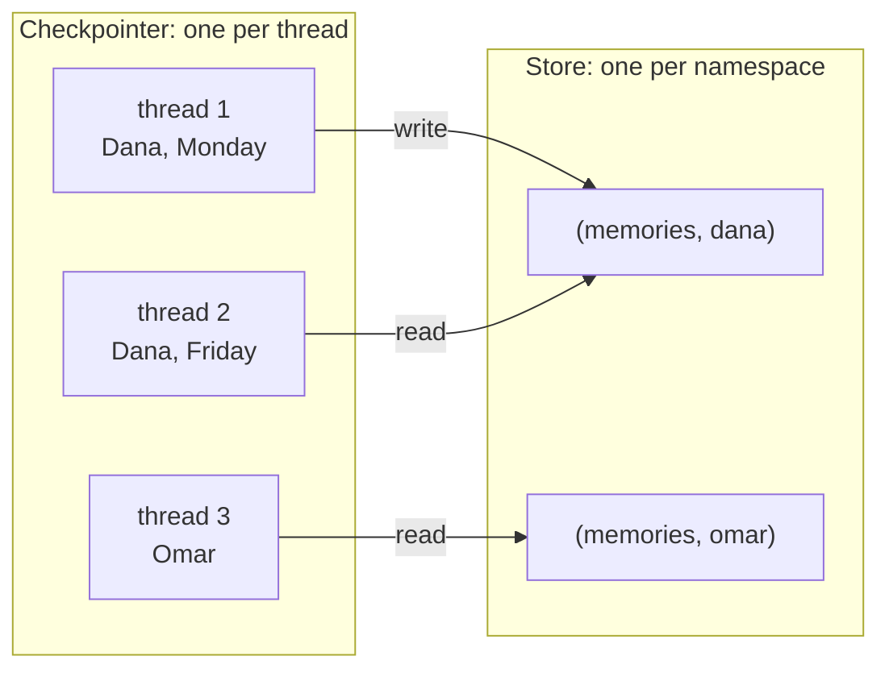
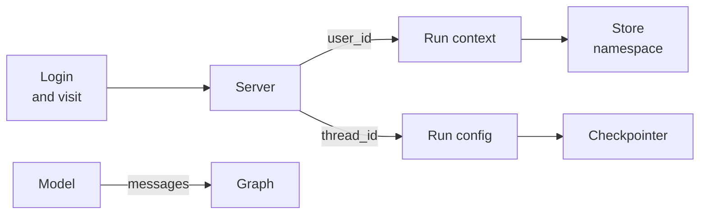

# M34.1 Theory: Cross-thread memory with a Store

*[M34 theory](../README.md) · Lesson 34.1 · Notebooks: [`01a_cross_thread_memory_store.ipynb`](../../notebook/01a_cross_thread_memory_store.ipynb) · [All theory pages](../../../../../THEORY.md)*
<!-- subtitle: A checkpointer remembers one chat, a Store remembers a customer, and the namespace is the only wall between customers -->

## Store namespaces

> **What you'll learn**
>
> - **Explain** why a new thread starts with no memory, and which persistence primitive brings a fact back.
> - **Trace** one fact written in one thread and read in another, and a second user who finds nothing.
> - **Diagnose** the namespace mistakes that leak one customer's memory or forget it in every chat.
> - **Choose** a namespace for each kind of memory from the scope it should live in.

[M33](../../../../m33_short_term_memory_conversation_state/mandatory/theory/README.md) gave an agent memory inside one conversation: a checkpointer saves the state after every step, keyed by `thread_id`. This lesson asks what happens when the same customer opens a second conversation.

On Monday Dana tells the Larkspur Cloud assistant that her shop is on an annual business plan. On Friday she opens a new chat and asks whether she can still get a refund. The assistant asks which plan she is on. Nothing is broken. The new chat has a new `thread_id`, and a checkpointer keyed by thread starts it empty.

LangGraph has two persistence primitives, and they answer different questions:

| | Checkpointer | Store |
|---|---|---|
| Remembers | One conversation's messages and state | Anything you put in it, across conversations |
| Scoped by | `thread_id`, in the run's config | A namespace tuple you choose |
| Written by | The graph, after every step | Your nodes, tools and admin code |
| Attached with | `compile(checkpointer=...)` | `compile(store=...)` |

*Table 1: The two persistence primitives. Only the Store outlives a thread.*

A **Store** holds JSON items, each addressed by three parts. The **namespace** is a tuple such as `("memories", "dana")`. The **key** names the item inside it. The **value** is a JSON-serialisable dict. Three operations cover most uses:

- **`put(namespace, key, value)`**: creates the item, or overwrites it if the key exists.
- **`get(namespace, key)`**: reads one item, or returns nothing.
- **`search(namespace, filter=...)`**: lists a namespace, optionally filtered on value fields.

Threads and namespaces are independent axes. A thread can read and write any namespace its run is allowed to touch:

*Figure 1: Dana's two threads share one namespace. Omar's thread reads a different one and finds it empty.*

### Following one fact across three threads

The notebook builds a one-node graph that reads and writes the store on every turn. To keep the focus on the store, its write rule is deliberately naive: a message containing "remember" is saved as a memory. The node then loads every item in the user's namespace into the system prompt. Three calls exercise it:

| Call | Thread | User | What the system prompt holds |
|---|---|---|---|
| "Remember my name is Alice." | 1 | `user123` | The memory written this turn |
| "What is my name?" | 2 (new) | `user123` | "my name is alice", loaded from the store |
| "What is my name?" | 3 (new) | `userxyz` | No user info at all |

*Table 2: The notebook's three calls. The checkpointer has nothing for threads 2 and 3. Any recall there comes from the store.*

Thread 2 answers correctly although its checkpoint is empty. Thread 3 cannot, because nothing was ever written under its user's namespace. The second row is what the store is for, and the third row is the property you must protect.

### The default page of ten

`search` has a default that bites later. We wrote 11 synthetic facts into `("semantic", "dana")` and read them back with an in-memory store:

| Read | Items returned |
|---|---|
| `search` with no limit | 10 |
| `search` with `limit=100` | 11 |
| `get` on key `"0"` in `("semantic", "omar")` | None |

*Table 3: Eleven facts, three reads. Run in the scratchpad against the repo's locked langgraph 1.2.18.*

A read without `limit=` drops the 11th item and raises no error. We call this the **silent cap**, and lesson 34.3 meets it again when an agent preloads a customer's facts.

### Where the ids come from

Nothing inside the store separates customers. Who may read what is decided entirely by how the namespace tuple is built. Every part of it must come from trusted input:

*Figure 2: The server sets both ids. The model only ever contributes messages.*

Three rules follow from the figure:

- **Ids travel in the run's context.** The graph declares a context schema, a small dataclass with a `user_id` field, and the server fills it from the login on every call. A node reads the id and the store through its `runtime` parameter.
- **Ids stay out of tool schemas.** From lesson 34.2 on, memory tools receive the store and the context through an injected `ToolRuntime` parameter that is not part of the schema the model sees. The model cannot ask for `user_id="admin"`, because there is no such argument.
- **`thread_id` stays with the checkpointer.** It belongs in the run's config, where the checkpointer reads it, and never becomes part of a long-term namespace.

Older LangGraph code declares a `store` parameter on a node instead. It receives the same store but no context, which leaves the node to find the user id somewhere less trustworthy.

### Planted failures: building the wrong tuple

Each row plants one namespace mistake in the Larkspur assistant and follows it to what a customer sees:

| Planted mistake | What Dana or Omar sees | Name |
|---|---|---|
| One global namespace, `("memories",)` | Omar's assistant mentions Dana's annual plan | **Cross-customer leak** |
| Namespace built from `thread_id` | Dana's Friday chat finds an empty namespace and asks for her plan again | **Per-chat amnesia** |
| `user_id` as an ordinary tool argument | A model that writes `user_id="dana"` in Omar's chat reads her memories | **Cross-customer leak** |
| A preload with no `limit=` | Dana's 11th fact never reaches the prompt | **Silent cap** |

*Table 4: Planted namespace failures (illustrative), each traced to what the customer sees.*

The first and third rows produce the same leak by different routes. The fix for both sits at the source of the id, never in a filter added after the read.

### Choosing a namespace by scope

The namespace also decides how long a memory lives, because each id has its own lifetime. A tuple keyed by the visit ends with the visit, and one keyed by the user lasts until someone deletes it:

| Namespace | Scope | Larkspur example | Wrong key, and what breaks |
|---|---|---|---|
| `("semantic", user_id)` | One customer, every visit | Dana is on an annual business plan | Global: leaks Dana's plan to Omar |
| `("episodic", user_id)` | One customer, every visit | Showed Dana how to export from Settings, then Data | `thread_id`: gone in the next chat |
| `("session", session_id)` | One visit, any number of threads | Reply in French for this visit | `user_id`: the visit never ends |
| `("procedures", agent_id)` | One agent or tenant | The approved refund procedure | `user_id`: a customer could own a rule |

*Table 5: One namespace per memory layer. Lesson 34.2 gives each layer its own write rule.*

### Swapping the backend

`InMemoryStore` disappears with the process. `PostgresStore` implements the same interface: the graph is recompiled with a different store and no node changes. Opened from a connection string, it is a context manager that closes the connection when its block ends, and a one-time setup call creates the tables. The notebook probes for a local Postgres first and skips that part when none is running.

## In practice: Dana's Friday chat

For Dana's refund question, the ideas above become four decisions:

1. **Write her plan under her user.** The fact goes to `("semantic", user_id)` with Dana's id, a namespace no thread owns.
2. **Read it before the model runs.** The Friday chat has a new `thread_id` and an empty checkpoint, and the node loads her namespace into the system prompt with an explicit `limit=`.
3. **Take the id from the login.** The server puts Dana's `user_id` in the run's context. No tool and no message can name a different user.
4. **Test isolation in code.** A second user in a fresh thread asks what the assistant knows about them, and a check asserts that nothing of Dana's appears.

> **Key distinction:** the checkpointer answers "what was said in this chat", and the store answers "what do we know about this customer". Mixing up their keys is how memory either leaks or vanishes.

The notebook's write rule saves anything after the word "remember". Lesson 34.2 replaces it with a separate write rule for facts, events, visit settings and procedures.

## Key Takeaways

- A checkpointer remembers one thread, and a Store holds items under a namespace tuple across threads. Only the store brings a fact back when Dana opens a new chat.
- The namespace is the only access boundary in the store. Build it from ids the server puts in the run's context, keep ids out of tool schemas, and never key long-term memory by `thread_id`.
- Choose the namespace by scope: `user_id` for facts and episodes, `session_id` for one visit, `agent_id` for procedures. Pass `limit=` to every search, because the default page holds 10 items.

## Check yourself

1. Dana gives the Larkspur assistant her plan in one chat and opens a new chat the next day. Why can the checkpointer not recall it, and what can?

The checkpointer is scoped by `thread_id`, and a new thread starts with an empty checkpoint. A store is scoped by a namespace tuple you choose, such as `("memories", "dana")`, so a node in the new thread can read what an earlier thread wrote there.

2. A memory tool takes user_id as an ordinary argument that the model fills in. What is the risk, and how should the id reach the tool instead?

The namespace is the only access boundary in the store, so a model that can choose `user_id` can read or write another customer's memories, a cross-customer leak. The server should put the id in the run's context from the login, and the tool should receive it through an injected `ToolRuntime` parameter that is not part of the schema the model sees.

3. A team keys the episodic namespace by thread_id, and customers say the assistant forgets past help in every new chat. What went wrong?

Every new chat has a new `thread_id`. Each chat therefore writes to and reads from a fresh, empty namespace: per-chat amnesia. Key episodes by `("episodic", user_id)` and keep `thread_id` for the checkpointer only.

---
*Previous: [M34 overview](../README.md). Next: [34.2 Session, semantic, episodic and procedural memory on SQLite](../02_session_semantic_episodic_and_procedural_memory_on_sqlite/README.md).*
