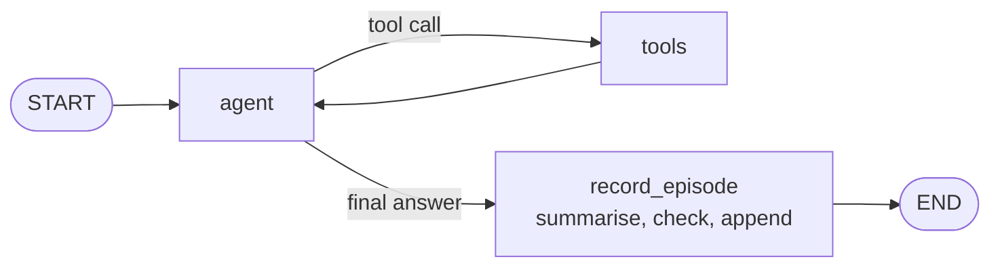
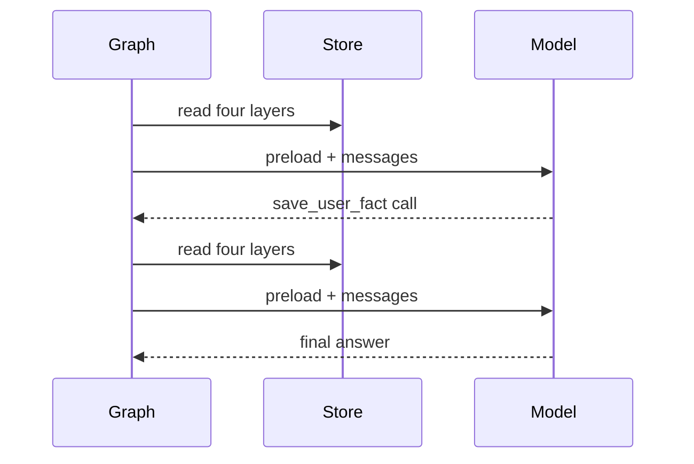

# M34.3 Theory: A combined-memory agent

*[M34 theory](../README.md) · Lesson 34.3 · Notebooks: [`03a_combined_memory_agent_sqlite.ipynb`](../../notebook/03a_combined_memory_agent_sqlite.ipynb) · [All theory pages](../../../../../THEORY.md)*
<!-- subtitle: Five memory layers in one agent work when each layer has exactly one writer and the preload has a budget -->

## Who writes each layer

> **What you'll learn**
>
> - **Assign** exactly one writer to each of the five memory layers, and say why the model writes only one of them.
> - **Explain** why episodes are recorded by a graph node after the answer instead of by a tool the model may call.
> - **Measure** what the memory preload adds to every model call, and where it silently drops items.
> - **Compare** the SQLite build with its Postgres and plain-SQL alternatives.

Lesson 34.2 built each memory layer in its own notebook. This capstone puts all of them into one agent and one SQLite file, and most of the design work goes into deciding who may write each layer.

Picture Larkspur's assistant with every layer switched on. Dana's plan is a fact, last week's export help is an episode, "keep replies short, I'm on my phone" is a session setting, the refund rule is a procedure, and the current chat is a thread. If the model may write all of them, it can rewrite a procedure mid-chat, forget to log an episode, or turn a visit setting into a permanent fact. The capstone's answer is a rule: each layer has exactly one writer.

The agent keeps everything in one file, `agent_memory.db`. `SqliteSaver` owns the `checkpoints` and `writes` tables, `SqliteStore` owns the `store` table, and four layers share that one table, kept apart by namespace. The last column below is the one that matters:

| Layer | Scope id | Passed as | Read as | Writer |
|---|---|---|---|---|
| Short-term | `thread_id` | Run config | Full replay of the thread | The checkpointer, every step |
| Session | `session_id` | Run context | Preloaded | The app, with a 30-minute TTL |
| Semantic | `user_id` | Run context | Preloaded with keys | The model, through `save_user_fact` |
| Episodic | `user_id` | Run context | Newest first, preloaded | A graph node after each answer |
| Procedural | `agent_id` | Run context | Highest approved version | A human, after review |

*Table 1: Five layers, five scope ids, five writers.*

The agent never writes session items or procedures. The capstone stores a `checklist` procedure as v1 approved and v2 still `proposed`. The agent reads v1 and ignores v2, because only the highest **approved** version counts.

### Recording an episode in code

The episodic notebook in lesson 34.2 gave the model a save tool, and the user asked for the save. Without that request the tool goes unused: in six test runs of this agent, with the tool bound and a system-prompt rule to use it, gpt-4o-mini never saved one episode. We call this the **forgotten write**. A memory layer that depends on the model remembering to write it stays empty.

The capstone moves the write into the graph. A node runs once per turn, after the final answer:

*Figure 1: The capstone graph. A final answer goes to the episode writer instead of straight to the end.*

`record_episode` asks the model for a structured summary with three fields: `work_request`, `task` and `outcome`. Code then makes the decision. A turn counts as a task only if `work_request` quotes the user's own message, which code checks by looking for the quote's first 20 characters in it. We ran that check against the capstone's credentials request, "Draft a checklist for rotating our production database credentials.":

| `work_request` the model returns | First 20 characters | Recorded |
|---|---|---|
| The request, copied word for word | "Draft a checklist fo" | ✓ |
| "none" (a greeting or a fact) | | ✗ |
| "Create a checklist for credential rotation" | "Create a checklist f" | ✗ |
| "draft a checklist" | "draft a checklist" | ✓ |

*Table 2: The quote check on four model outputs. The rule runs in code, so a paraphrase cannot pass as a request.*

A real task becomes a new episode under a fresh key, and episodes past `MAX_EPISODES = 3` are deleted, oldest first. Priya starts with three episodes from a month ago. When the credentials checklist is recorded, the prune deletes "Explain blue-green deploys", the oldest of them.

### Checking every layer across two visits

The end-to-end run checks each layer in code, with no human reading the replies:

| Call | Ids | What the code checks |
|---|---|---|
| Priya, visit 1: introduces herself | `priya-thread-1`, `priya-visit-1` | Her facts are saved under stable keys |
| Priya, visit 1: asks for a credentials-rotation checklist | Same | The checklist ends with the procedure's `Risk:` line and stays within the session's 60-word limit; the task is the newest episode and 3 are kept |
| Priya, visit 2: asks her role and last task | `priya-thread-2`, `priya-visit-2` | The reply names her role and the credentials checklist |
| Priya, visit 2: switches from Terraform to Pulumi | Same | The fact count is unchanged and exactly one fact changed |
| Marco, visit 1: asks what the assistant knows | `marco-thread-1`, `marco-visit-1` | Nothing of Priya's appears; his namespaces are empty |

*Table 3: The capstone's end-to-end checks. The replies come from a live model; the checks are the repeatable part.*

Marco gets the same procedure as Priya, because procedures are scoped to the agent, while his facts and episodes stay in his own namespaces.

## The preload budget

Every model call starts by reading memory. The capstone preloads all four store layers into the system prompt: facts with their keys, episodes newest first, the session instruction and the approved procedures. The tool loop means one turn can make several model calls, and each call carries the whole preload again:

*Figure 2: A turn with one tool call makes two model calls and pays for the preload twice.*

We rebuilt Priya's first system prompt of visit 1 from the notebook's template and seeded data, and counted characters, estimating tokens at four characters each:

| Prompt part | Characters | About this many tokens |
|---|---|---|
| Template with every layer empty | 535 | 134 |
| Priya's first call: 3 episodes, the session note, checklist v1 | 877 | 219 |
| What memory adds | 342 | 86 |

*Table 4: The preload on Priya's first call. Computed in the scratchpad from the notebook's template and data.*

That is cheap while memory is small. It has two limits, each with a name:

- **The silent cap.** `store.search()` returns 10 items unless you pass `limit=`, as lesson 34.1 measured. The capstone passes `limit=100` everywhere, and a preload without it drops the 11th fact with no error.
- **The growing bill.** Every preloaded item is paid for on every call, tool-loop calls included. Cap each layer (pruning, `MAX_EPISODES`), and when a layer outgrows the prompt, retrieve from it by meaning instead of loading all of it, as lesson 34.4 does.

### Keeping the agent contract when the backend changes

SQLite is one file for one process. The production path changes the backend, not the agent: `PostgresSaver` and `PostgresStore` replace the two SQLite primitives, and nodes and tools stay untouched because they only see the store and checkpointer the graph was compiled with. The move buys three things:

- **Concurrent writers**, without SQLite's `database is locked` errors.
- **A working `omit_expired`**, so expired session items disappear from reads even before a sweep.
- **Recall by meaning**, through a pgvector index that lets a search take a query instead of preloading everything.

The notebook shows the Postgres version without running it, because it needs a database server.

The same layers can also be two hand-written SQL tables. A primary key on user and key with an insert-or-replace gives the semantic upsert, and a fresh id per row gives the episodic append. Tables give you joins, constraints and indexes you choose. The Store gives you namespaces, per-item TTLs, embedding search and the Postgres swap without touching the agent. `SqliteStore` keeps its items in its own `store` table, but that schema is internal and may change between versions: read it only through `get` and `search`.

## In practice: Dana's assistant with every layer

For Larkspur, the capstone's rules become five settings:

1. **The checkpointer owns the chat.** Each of Dana's chats is a thread, replayed in full.
2. **The app owns the visit.** "I'm on my phone" is written with a 30-minute TTL and swept afterwards.
3. **The model owns her facts.** It saves her plan through the one tool it holds, reusing keys it sees in the preload.
4. **A node owns her history.** After each answer, code decides whether the turn was a task and appends the summary.
5. **A reviewer owns the refund procedure.** The agent reads only the highest approved version.

> **Key distinction:** a writer is whoever decides that something is worth remembering. Giving that decision to code for episodes, and to people for procedures, is what makes the layers trustworthy.

Lesson 34.4 replaces the blind preload with retrieval by similarity, and adds graph memory for questions that chain facts.

## Key Takeaways

- Give each memory layer exactly one writer: the checkpointer for the thread, the app for the session, the model for facts, a graph node for episodes and a human for procedures.
- In six test runs gpt-4o-mini never called the save tool unprompted, a forgotten write. Record episodes in a node after each answer and let code decide whether the turn was a real task.
- The preload is paid on every model call: about 86 tokens of memory on Priya's first call, more as layers grow. Pass `limit=` to `search`, cap each layer, and retrieve once a layer outgrows the prompt.

## Check yourself

1. Why does the capstone record episodes in a graph node instead of relying on the model to call a save_episode tool?

In six test runs with the tool and a system-prompt rule to use it, gpt-4o-mini never saved one episode, a forgotten write. So `record_episode` runs in code once per turn, after the final answer: the model writes a structured summary, and code decides it is a task only if `work_request` quotes the user's own message. Each layer then has exactly one writer.

2. The store holds the checklist procedure as v1 approved and v2 proposed. Which version does the agent follow for Priya, and which for Marco?

Both get v1, because only the highest approved version counts and v2 is still `proposed`. Marco gets the same procedure as Priya because procedures are scoped to `agent_id`, not to the user, while her facts and episodes stay in her own namespaces.

3. A customer has 14 saved facts, but the agent never uses the last few and nothing logs an error. What is the likely cause?

The silent cap: the preload calls `store.search()` without `limit=`, and it returns 10 items by default, so the 11th fact onwards is dropped. The capstone passes `limit=100` everywhere. When a layer grows past what the prompt should carry on every call, retrieve from it instead of preloading it all (lesson 34.4).

---
*Previous: [34.2 Session, semantic, episodic and procedural memory on SQLite](../02_session_semantic_episodic_and_procedural_memory_on_sqlite/README.md). Next: [34.4 Episodic + semantic stack and multi-hop graph memory](../04_episodic_semantic_stack_and_multi_hop_graph_memory/README.md).*
