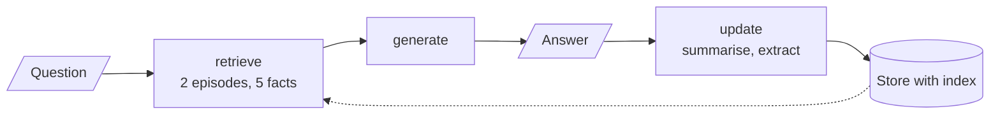
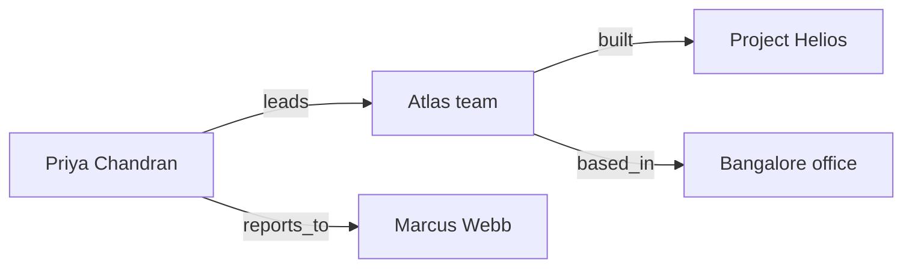
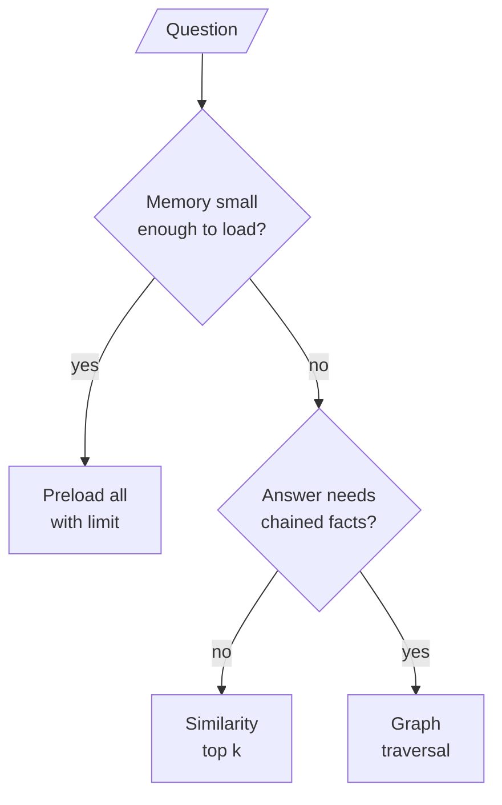

# M34.4 Theory: Episodic + semantic stack and multi-hop graph memory

*[M34 theory](../README.md) · Lesson 34.4 · Notebooks: [`04a_episodic_with_semantic_memory.ipynb`](../../notebook/04a_episodic_with_semantic_memory.ipynb), [`04b_graph_memory_multi_hop.ipynb`](../../../optional/notebook/04b_graph_memory_multi_hop.ipynb) (optional) · [All theory pages](../../../../../THEORY.md)*
<!-- subtitle: When memory outgrows the preload, recall it by similarity, and when an answer needs a chain of facts, walk a graph -->

## Recall by similarity

> **What you'll learn**
>
> - **Explain** why a newest-N preload misses old but relevant memories, and how an embedding index recalls them.
> - **Trace** a follow-up question that names neither the goal nor the stock through retrieval and time ordering.
> - **Diagnose** fact extraction that stores the model's own suggestions as things the user said.
> - **Compare** similarity search with graph traversal on a question that needs three facts in a chain.

Lesson 34.3 preloaded every layer, and its episodic layer kept only the newest three episodes. Both choices stop working as a customer's history grows.

Three months ago the Larkspur assistant walked Dana through moving a server to a bigger plan. Today she asks "can we do the same for the second server?". A newest-three preload holds last week's export question and two billing questions; the migration is gone, however relevant. This lesson recalls memory the way a RAG pipeline recalls chunks: embed the question, return the nearest items.

The store keeps the same API with an index switched on. Every `put` embeds the value's `text` field with `text-embedding-3-small` (1,536 dimensions), and a search that takes a query ranks a namespace's items by similarity, returning the top `limit`. Each user has two namespaces, `(user_id, "episodic")` and `(user_id, "semantic")`; note that this notebook puts the user id first, the reverse of lesson 34.2's tuples. A durable store with a vector index, such as `PostgresStore` with pgvector, takes the same calls.

The notebook uses the store rather than a separate vector library for two reasons: one memory API across the module, and keyed writes that make deduplicating facts free. Its agent is three nodes:

*Figure 1: Retrieve, generate, update. Every turn reads by similarity and writes both memories after the answer.*

### Writing events and facts separately

The **update** node writes both memories after every answer, in the same graph call:

- **Episodic**: a one-sentence summary of the exchange, under a UUID key.
- **Semantic**: facts extracted from the **user's message only**, written as `user --RELATION--> object`. Code writes the subject `user`, which keeps "Alex", "I" and "the user" one person. The key is the fact's normalised text: restating a fact overwrites it.

The second rule closes a failure we call the **echoed suggestion**. If the extractor read the assistant's reply, a sentence like "you might consider index funds" could come back next month as "user is interested in index funds", a fact the user never stated. Questions are excluded for the same reason: "what about Apple?" is a request, not a preference.

### Resolving "that stock" from ordered evidence

The memory test is three turns. Alex says he is a conservative investor interested in established tech companies, then asks about Apple, then asks "Based on my goals, what's a good alternative to that stock?". The third question names neither the goal nor the stock:

| Turn | What Alex says | What retrieval must supply | What the update node writes |
|---|---|---|---|
| 1 | Name, conservative investor, established tech | Nothing yet | One episode; facts with subject `user` |
| 2 | "What do you think about Apple (AAPL)?" | The investor facts | One episode; no new facts |
| 3 | "...a good alternative to that stock?" | The Apple episode and the conservative-investor fact | One episode; no new facts |

*Table 1: The three-turn memory test. The notebook checks the turn-3 retrieval and the unchanged fact count in code.*

Retrieval picks the memories, and time orders them. The retrieve node sorts its two recalled episodes oldest first, and the prompt tells the model to resolve "that stock" from the most recent conversation. Similarity alone would rank the episodes by closeness to the question, which says nothing about which one was last.

Similarity search has one blind spot, and the second notebook is built around it.

## Graph memory for multi-hop questions

Similarity search returns items that look like the question. It has no way to chase a relation from one fact to the next. **Graph memory** stores facts as `(subject, relation, object)` edges and answers by **traversal**: start at an entity the question names, walk edges outward a bounded number of **hops**, and answer only from the edges reached.

The notebook ingests five separate sentences about a fictional company. No sentence mentions both Project Helios and Marcus Webb, yet the test question needs both: "Who manages the person who leads the team that built Project Helios?". A similarity search for that question finds the Project Helios sentence and nothing that connects it to a manager. We call that the **missing middle**:

*Figure 2: Four of the edges extracted from the five sentences. The fifth sentence adds Marcus Webb's role.*

### Three rules that make the graph usable

Each rule prevents a failure the notebook describes:

| Rule | Failure without it | Name |
|---|---|---|
| A small relation vocabulary: `leads`, `manages`, `reports_to`, `member_of`, `built`, `works_on`, `holds_role`, `based_in` | One relation turns into `is`, `has` and `holds_role` on different edges | **Relation drift** |
| The subject performs the action: "built by the Atlas team" becomes `(Atlas team, built, Project Helios)` | The model keeps sentence order and writes an edge saying the project built the team | **Reversed edge** |
| Indexes in both directions, names normalised (case, a leading "the"), a repeated fact stored once | Traversal cannot walk `built` backwards from the project to the team | **One-way graph** |

*Table 2: The graph's design rules and the planted failure each one prevents.*

### Tracing the traversal

The reader asks the model for one start entity, traverses up to `max_hops`, and answers only from the triples it reached. Traversal itself is plain code. We loaded the five edges the notebook checks for (plus one restated duplicate, which the store dropped) into its graph class and walked it from Project Helios:

| Hop | Edge reached | Direction from the frontier |
|---|---|---|
| 1 | Atlas team built Project Helios | Incoming |
| 2 | Atlas team based_in Bangalore office | Outgoing |
| 2 | Priya Chandran leads Atlas team | Incoming |
| 3 | Priya Chandran reports_to Marcus Webb | Outgoing |

*Table 3: Breadth-first traversal from Project Helios, run in the scratchpad with the notebook's graph code.*

At `max_hops=3` the reader holds all three edges of the chain and the answer names Marcus Webb. At `max_hops=1` the traversal stops at the team, and the reader is told to say the facts are insufficient rather than guess. The printed path is the evidence: you can see which edges produced the answer, which a similarity score never shows.

An optional part of the notebook loads the same triples into Neo4j and lets the model write Cypher against the graph's schema. Model-written Cypher is untrusted code. The notebook asks the query planner whether a query only reads before running it, runs it in a read transaction, and recommends a read-only database role as the control the server enforces. [M43](../../../../../p12_knowledge_graphs_and_graph_rag/m43_knowledge_graphs_neo4j/mandatory/theory/README.md) builds on that.

### Choosing how to read memory

The three read patterns of this module answer different questions:

*Figure 3: Preload while memory is small, retrieve by similarity once it grows, and traverse when facts must be joined.*

| | Preload | Similarity search | Graph traversal |
|---|---|---|---|
| Finds an old, relevant episode | ✗ past the newest N | ✓ | Only if it became edges |
| Joins facts from separate sentences | ✗ | ✗ missing middle | ✓ |
| Extra cost per turn | Every item, every call | One embedding and one search | A start-entity call and a walk |
| Main risk | Silent cap, growing bill | Echoed suggestions | Reversed edges, relation drift |

*Table 4: Three ways to read memory, compared on the failures this module has named.*

## In practice: Dana's second server

For Dana's "can we do the same for the second server?", the pieces combine:

1. **Recall the episode by meaning.** Her question is embedded and searched against her episodic namespace, which surfaces the three-month-old migration summary.
2. **Recall her facts by meaning.** Her plan and her server count come back from the semantic namespace, all stated by her.
3. **Order the episodes by time.** "The same" resolves against the most recent recalled conversation.
4. **Walk a graph when facts chain.** "Which team approved my last upgrade, and who manages them?" needs traversal, with a hop limit and an honest "insufficient".

> **Pitfall: the echoed suggestion.** Extraction that reads the assistant's reply turns the model's ideas into the customer's preferences. Keep the extractor on the user's words.

Lesson 34.5 hands memory management to the agent itself, then stores skills and workflows instead of facts.

## Key Takeaways

- Index the store on a text field and a search with a query recalls memories by meaning: an old but relevant episode can surface where a newest-N preload cannot. Sort what is recalled by time when the question refers back.
- Extract facts from the user's message only, write the subject `user` in code and key on the normalised fact. The model's suggestions never return as user statements, and a restated fact overwrites the old one.
- Similarity cannot chase a relation from fact to fact. Graph memory traverses `(subject, relation, object)` edges for multi-hop questions: keep the relation vocabulary small, make the subject the actor, index edges both ways and bound the hops.

## Check yourself

1. Why does the update node extract semantic facts from the user's message only, and never from the assistant's reply?

So the model's own suggestions cannot come back later as things the user said, the echoed suggestion. Code also writes the subject as `user`, which keeps "Alex", "I" and "the user" one person, and keys each fact by its normalised text, so restating a fact overwrites it instead of adding a copy.

2. Alex asks for a good alternative to that stock, naming neither his goal nor the stock. What must retrieval return, and how is that stock resolved?

It must return the Apple episode and the conservative-investor fact, and the notebook checks both in code. The retrieve node sorts the two recalled episodes oldest first, so the prompt can tell the model to resolve "that stock" from the most recent conversation.

3. Graph memory says the facts are insufficient to answer the Project Helios question. What setting do you check, and why would similarity search not answer it either?

Check `max_hops`: at 1 the traversal stops at the Atlas team, and the chain needs three hops (the team, Priya Chandran, Marcus Webb). Similarity search returns items that look like the question, and no single sentence mentions both Project Helios and Marcus Webb: the missing middle.

---
*Previous: [34.3 A combined-memory agent](../03_a_combined_memory_agent/README.md). Next: [34.5 MemGPT tiers, Voyager skill library, Agent Workflow Memory](../05_memgpt_tiers_voyager_skill_library_agent_workflow_memory/README.md).*
