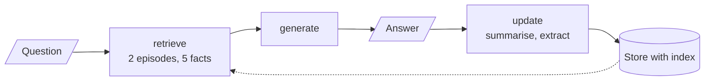
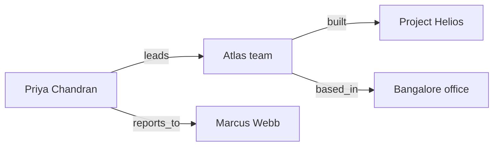
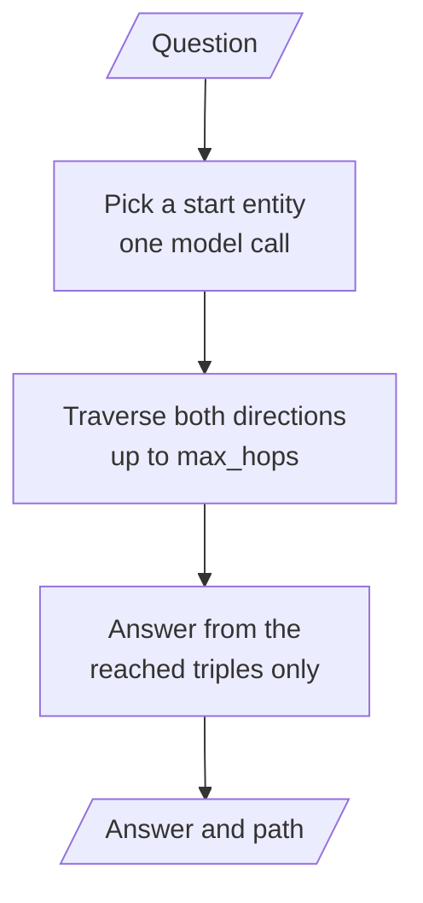
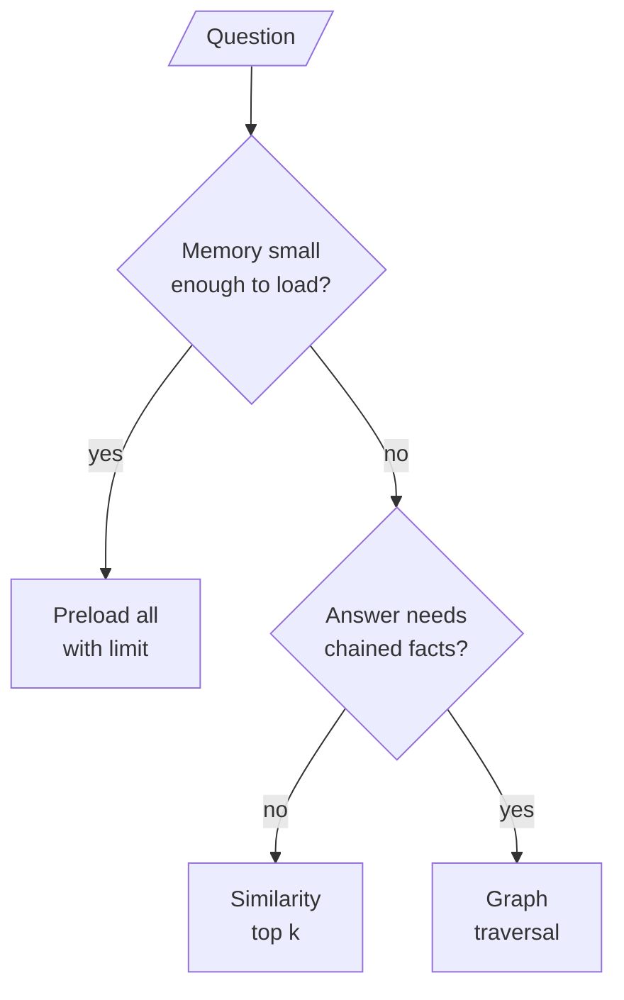

# M34.4 Theory: Episodic + semantic stack and multi-hop graph memory

*[M34 theory](../README.md) · Lesson 34.4 · Notebooks: [`04a_episodic_with_semantic_memory.ipynb`](../../notebook/04a_episodic_with_semantic_memory.ipynb), [`04b_graph_memory_multi_hop.ipynb`](../../../optional/notebook/04b_graph_memory_multi_hop.ipynb) (optional) · [All theory pages](../../../../../THEORY.md)*
<!-- subtitle: When memory outgrows the preload, recall it by similarity, and when an answer needs a chain of facts, walk a graph -->
<!-- format: approved -->

## Start with a migration the preload forgot

> **What you'll learn**
>
> - **Explain** why a newest-N preload misses old but relevant memories, and how an embedding index recalls them.
> - **Trace** a follow-up question that names neither the goal nor the stock through retrieval and time ordering.
> - **Diagnose** fact extraction that stores the model's own suggestions as things the user said.
> - **Compare** similarity search with graph traversal on a question that needs three facts in a chain.

Lesson 34.3 preloaded every layer, and its episodic layer kept only the newest three episodes. Both choices stop working as a customer's history grows.

Three months ago the Larkspur assistant walked Dana through moving a server to a bigger plan. Today she asks "can we do the same for the second server?". A newest-three preload holds last week's export question and two billing questions. The migration is gone, however relevant it is.

Nothing failed loudly. The memory existed, and the read rule never reached it. That sets this lesson's two jobs:

- **Recall by meaning**: find the stored item that matches the question, however old it is.
- **Join facts**: answer a question whose answer is spread over several stored facts.

## Recall by similarity

This lesson recalls memory the way a RAG pipeline recalls chunks: embed the question, return the nearest items.

The store keeps the same API with an index switched on. Every `put` embeds the value's `text` field with `text-embedding-3-small` (1,536 dimensions), and a search that takes a query ranks a namespace's items by similarity, returning the top `limit`. Each user has two namespaces, `(user_id, "episodic")` and `(user_id, "semantic")`. This notebook puts the user id first, the reverse of lesson 34.2's tuples. A durable store with a vector index, such as `PostgresStore` with pgvector, takes the same calls.

The notebook uses the store rather than a separate vector library for two reasons: one memory API across the module, and keyed writes that make deduplicating facts free. Its agent is three nodes:

*Figure 1: Retrieve, generate, update. Every turn reads by similarity and writes both memories after the answer.*

### Writing events and facts separately

The **update** node writes both memories after every answer, in the same graph call:

- **Episodic**: a one-sentence summary of the exchange, under a UUID key.
- **Semantic**: facts extracted from the **user's message only**, written as `user --RELATION--> object`. Code writes the subject `user`, which keeps "Alex", "I" and "the user" one person. The key is the fact's normalised text: restating a fact overwrites it.

The second rule closes a failure we call the **echoed suggestion**. If the extractor read the assistant's reply, a sentence like "you might consider index funds" could come back next month as "user is interested in index funds", a fact the user never stated. Questions are excluded for the same reason: "what about Apple?" is a request, not a preference.

### Resolving "that stock" from ordered evidence

The notebook's memory test is three turns. The third question, "Based on my goals, what's a good alternative to that stock?", names neither the goal nor the stock. Step through what each turn reads and writes:

Follow Alex's three turns. Each stage shows what retrieval must supply and what the update node writes.

<button type="button" data-step="0" aria-pressed="false" aria-controls="stock-step-0">1. Goals</button><button type="button" data-step="1" aria-pressed="false" aria-controls="stock-step-1">2. Apple</button><button type="button" data-step="2" aria-pressed="false" aria-controls="stock-step-2">3. Recall</button><button type="button" data-step="3" aria-pressed="false" aria-controls="stock-step-3">4. Order</button>

<section id="stock-step-0" class="step-panel" aria-labelledby="stock-heading-0"><h4 id="stock-heading-0">1. Alex states his goals</h4><dl><dt>Alex says</dt><dd>His name, that he is a conservative investor, and that he likes established tech companies</dd><dt>Retrieval supplies</dt><dd>Nothing yet: both namespaces are empty</dd><dt>Update writes</dt><dd>One episode, and facts with the subject <code>user</code></dd></dl></section><section id="stock-step-1" class="step-panel" aria-labelledby="stock-heading-1"><h4 id="stock-heading-1">2. Alex asks about Apple</h4><dl><dt>Alex says</dt><dd>"What do you think about Apple (AAPL)?"</dd><dt>Retrieval supplies</dt><dd>The investor facts</dd><dt>Update writes</dt><dd>One episode; no new facts, because a question is a request, not a preference</dd></dl></section><section id="stock-step-2" class="step-panel" aria-labelledby="stock-heading-2"><h4 id="stock-heading-2">3. Recall for "that stock"</h4><dl><dt>Alex says</dt><dd>"Based on my goals, what's a good alternative to that stock?"</dd><dt>Retrieval supplies</dt><dd>The 2 nearest episodes, including the Apple one, and up to 5 facts, including the conservative-investor fact</dd><dt>Checked in code</dt><dd>Both recalls, and a fact count unchanged by turns 2 and 3</dd></dl></section><section id="stock-step-3" class="step-panel" aria-labelledby="stock-heading-3"><h4 id="stock-heading-3">4. Order by time, then answer</h4><dl><dt>Sort</dt><dd>The two recalled episodes oldest first, by creation time</dd><dt>Prompt</dt><dd>Resolve "that stock" from the most recent conversation</dd><dt>Why</dt><dd>Similarity ranks episodes by closeness to the question, which says nothing about which one came last</dd></dl></section>

<button type="button" data-walk="previous">Previous</button>

<button type="button" data-walk="next">Next step</button>

Retrieval picks the memories, and time orders them. Similarity search has one blind spot, and the second notebook is built around it.

## Graph memory for multi-hop questions

Similarity search returns items that look like the question. It has no way to chase a relation from one fact to the next. **Graph memory** stores facts as `(subject, relation, object)` edges and answers by **traversal**: start at an entity the question names, walk edges outward a bounded number of **hops**, and answer only from the edges reached.

The notebook ingests five separate sentences about a fictional company. No sentence mentions both Project Helios and Marcus Webb, yet the test question needs both: "Who manages the person who leads the team that built Project Helios?". A similarity search for that question finds the Project Helios sentence and nothing that connects it to a manager. We call that the **missing middle**:

*Figure 2: Four of the edges extracted from the five sentences. The fifth sentence adds Marcus Webb's role.*

### Three rules that make the graph usable

Each rule prevents a failure the notebook describes:

| Rule | Failure without it | Name |
|---|---|---|
| A small relation vocabulary: `leads`, `manages`, `reports_to`, `member_of`, `built`, `works_on`, `holds_role`, `based_in` | One relation turns into `is`, `has` and `holds_role` on different edges | **Relation drift** |
| The subject performs the action: "built by the Atlas team" becomes `(Atlas team, built, Project Helios)` | The model keeps sentence order and writes an edge saying the project built the team | **Reversed edge** |
| Indexes in both directions, names normalised (case, a leading "the"), a repeated fact stored once | Traversal cannot walk `built` backwards from the project to the team | **One-way graph** |

*Table 1: The graph's design rules and the planted failure each one prevents.*

### Tracing the traversal

The reader is a short pipeline of its own, beside Figure 1's similarity agent:

*Figure 3: The graph reader. Only the start entity comes from the model; the walk is plain code.*

We loaded the five edges the notebook checks for, plus one restated duplicate (which the store dropped), into its `GraphMemoryStore` and walked it from Project Helios:

| Hop | Edge reached | Direction from the frontier |
|---|---|---|
| 1 | Atlas team built Project Helios | Incoming |
| 2 | Atlas team based_in Bangalore office | Outgoing |
| 2 | Priya Chandran leads Atlas team | Incoming |
| 3 | Priya Chandran reports_to Marcus Webb | Outgoing |

*Table 2: Breadth-first traversal from Project Helios, run in the scratchpad with the notebook's graph code.*

The hop limit decides whether the chain closes. The reader's default is `max_hops=2`; the notebook's test passes 3 and its short-limit check passes 1:

Pick a hop limit and see which edges the reader holds for the Project Helios question.

<button type="button" data-mode="h1" aria-pressed="false" aria-controls="hops-h1">max_hops = 1</button>
<button type="button" data-mode="h2" aria-pressed="false" aria-controls="hops-h2">max_hops = 2, the default</button>
<button type="button" data-mode="h3" aria-pressed="false" aria-controls="hops-h3">max_hops = 3</button>

<section id="hops-h1" class="mode-panel" data-announcement="One hop selected. One edge, no manager."><h4>One hop</h4><ul><li>1 edge: Atlas team built Project Helios.</li><li>The reader knows the team, not who leads it. It is told to say the facts are insufficient rather than guess.</li></ul></section>
<section id="hops-h2" class="mode-panel" data-announcement="Two hops selected. Three edges, still no manager."><h4>Two hops, the reader's default</h4><ul><li>3 edges: the team, its office, and Priya Chandran leading it.</li><li>The leader is reached, her manager is not. The reader should still say "insufficient", one hop short.</li></ul></section>
<section id="hops-h3" class="mode-panel" data-announcement="Three hops selected. Four edges, Marcus Webb reached."><h4>Three hops, the notebook's test</h4><ul><li>4 edges, including Priya Chandran reports_to Marcus Webb.</li><li>The chain closes and the answer names Marcus Webb, with the printed path as its evidence.</li></ul></section>

The printed path shows which edges produced the answer, which a similarity score never shows.

An optional part of the notebook loads the same triples into Neo4j and lets the model write Cypher against the graph's schema. Model-written Cypher is untrusted code. The notebook asks the query planner whether a query only reads before running it, runs it in a read transaction, and recommends a read-only database role as the control the server enforces. [M43](../../../../../p12_knowledge_graphs_and_graph_rag/m43_knowledge_graphs_neo4j/mandatory/theory/README.md) builds on that.

## Choosing how to read memory

The three read patterns of this module answer different questions:

*Figure 4: Preload while memory is small, retrieve by similarity once it grows, and traverse when facts must be joined.*

| | Preload | Similarity search | Graph traversal |
|---|---|---|---|
| Finds an old, relevant episode | No, past the newest N | Yes | Only if it became edges |
| Joins facts from separate sentences | No | No: missing middle | Yes |
| Extra cost per turn | Every item, every call | One embedding and one search | A start-entity call and a walk |
| Main risk | Silent cap, growing bill | Echoed suggestions | Reversed edges, relation drift |

*Table 3: Three ways to read memory, compared on the failures this module has named.*

For Dana's "can we do the same for the second server?", the pieces combine:

1. **Recall the episode by meaning.** Her question is embedded and searched against her episodic namespace, which surfaces the three-month-old migration summary.
2. **Recall her facts by meaning.** Her plan and her server count come back from the semantic namespace, all stated by her.
3. **Order the episodes by time.** "The same" resolves against the most recent recalled conversation.
4. **Walk a graph when facts chain.** "Which team approved my last upgrade, and who manages them?" needs traversal, with a hop limit and an honest "insufficient".

> **Pitfall: the echoed suggestion.** Extraction that reads the assistant's reply turns the model's ideas into the customer's preferences. Keep the extractor on the user's words.

## Limits of this evidence

- **No recorded model run.** Notebooks ship without outputs. The turn-3 recall is what the notebook checks in code, not a logged result; which facts the model extracts can vary.
- **Traversal is replayed, extraction is not.** Table 2 and the hop switcher come from the notebook's graph class on the five checked edges. A live extractor can still produce relation drift or a reversed edge.
- **Dana's server is illustrative.** The Larkspur migration story shows the pattern; it is not a notebook test.

## References

1. LangGraph, [Memory](https://langchain-ai.github.io/langgraph/concepts/memory/), semantic and episodic memory in a store.
2. LangGraph, [Persistence](https://langchain-ai.github.io/langgraph/concepts/persistence/), the store and its semantic search index.
3. Rasmussen, P. et al. (2025). *Zep: A Temporal Knowledge Graph Architecture for Agent Memory*. [arXiv:2501.13956](https://arxiv.org/abs/2501.13956). Further reading on graph memory in production.

## Key Takeaways

- Index the store on a text field and a search with a query recalls memories by meaning: an old but relevant episode can surface where a newest-N preload cannot. Sort what is recalled by time when the question refers back.
- Extract facts from the user's message only, write the subject `user` in code and key on the normalised fact. The model's suggestions never return as user statements, and a restated fact overwrites the old one.
- Similarity cannot chase a relation from fact to fact. Graph memory traverses `(subject, relation, object)` edges for multi-hop questions: keep the relation vocabulary small, make the subject the actor, index edges both ways and bound the hops.

## Check yourself

1. Why does the update node extract semantic facts from the user's message only, and never from the assistant's reply?

So the model's own suggestions cannot come back later as things the user said, the echoed suggestion. Code also writes the subject as `user`, which keeps "Alex", "I" and "the user" one person, and keys each fact by its normalised text, so restating a fact overwrites it instead of adding a copy.

2. Alex asks for a good alternative to that stock, naming neither his goal nor the stock. What must retrieval return, and how is that stock resolved?

It must return the Apple episode and the conservative-investor fact, and the notebook checks both in code. The retrieve node sorts the two recalled episodes oldest first, so the prompt can tell the model to resolve "that stock" from the most recent conversation.

3. Graph memory says the facts are insufficient to answer the Project Helios question. What setting do you check, and why would similarity search not answer it either?

Check `max_hops`: at 1 the traversal stops at the Atlas team, and the chain needs three hops (the team, Priya Chandran, Marcus Webb). Similarity search returns items that look like the question, and no single sentence mentions both Project Helios and Marcus Webb: the missing middle.

---
*Previous: [34.3 A combined-memory agent](../03_a_combined_memory_agent/README.md). Next: [34.5 MemGPT tiers, Voyager skill library, Agent Workflow Memory](../05_memgpt_tiers_voyager_skill_library_agent_workflow_memory/README.md).*
