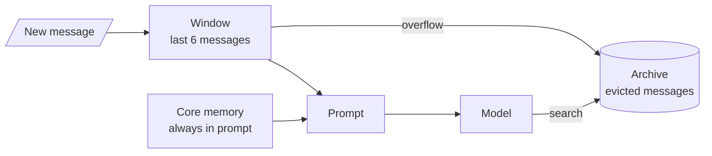
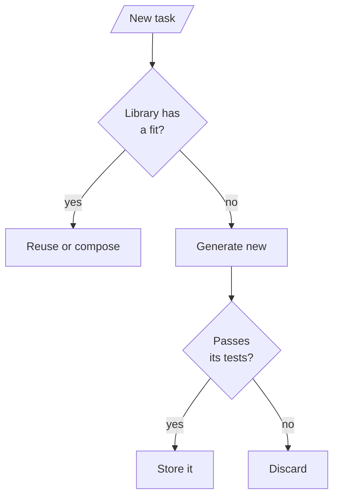
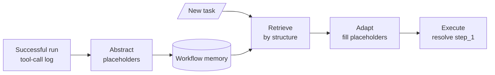

# M34.5 Theory: MemGPT tiers, Voyager skill library, Agent Workflow Memory

*[M34 theory](../README.md) · Lesson 34.5 · Notebooks: [`05a_memgpt_tiered_memory.ipynb`](../../notebook/05a_memgpt_tiered_memory.ipynb), [`05b_voyager_skill_library.ipynb`](../../../optional/notebook/05b_voyager_skill_library.ipynb) (optional), [`05c_agent_workflow_memory.ipynb`](../../../optional/notebook/05c_agent_workflow_memory.ipynb) (optional) · [All theory pages](../../../../../THEORY.md)*
<!-- subtitle: An agent that pages its own context, and agents that remember what worked as code or as tool-call templates -->

## Tiered memory

> **What you'll learn**
>
> - **Explain** how MemGPT splits memory into an always-visible core, a message window and a searchable archive.
> - **Measure** what a bigger window costs per call against what it keeps in view, using the lab's numbers.
> - **Diagnose** an archived fact that never comes back because of the words in the agent's own query.
> - **Compare** remembering facts with remembering skills (Voyager) and workflows (Agent Workflow Memory).

Lessons 34.1 to 34.4 decided in code what to remember and when to read it. This lesson hands part of that decision to the agent, then looks at memories that are capabilities rather than facts.

Dana opens a Larkspur chat by saying her shop is on an annual business plan. In her second message she adds that they bought it 12 days ago and have used 80 GB of outbound traffic. Three unrelated questions later she asks whether she can still get a full refund. The handbook's rule needs both numbers: a full refund within 30 days of purchase if the account used less than 100 GB. By then the traffic message has scrolled out of a short context window.

MemGPT (Packer et al., 2023; the framework is now called Letta) treats the context window the way an operating system treats RAM. A small **main context** is always in the prompt. An unbounded **archival memory** sits outside it, like disk. The agent moves information between the two with tools, so the agent decides what stays close, where the earlier lessons used a fixed rule:

| Tier | Holds | In the prompt? | In the notebook |
|---|---|---|---|
| Core memory | A few durable facts, in named blocks (`persona`, `human`) | Always | A dict, edited by tools |
| Message window | The last N messages | Always | A list capped at `max_messages = 6` |
| Archival memory | Evicted messages and anything inserted on purpose | Only what a search returns | A list with a keyword-overlap search, top 3 |

*Table 1: MemGPT's three tiers as the notebook implements them.*

The model gets four tools. Two edit core memory (`core_memory_append`, `core_memory_replace`), and two move things to and from the archive (`archival_memory_insert`, `archival_memory_search`). Every turn rebuilds the system prompt from the current core memory, runs any tool calls for at most `MAX_TOOL_ROUNDS = 5` rounds, and then appends the answer to the window, which evicts the oldest messages once the window is full:

<!-- animated: diagrams/paging.anim.html -->

*Figure 1: Paging. Overflow moves the oldest messages to the archive, and only a search the model makes brings them back.*

The notebook runs the same pattern on a trip planner whose $2,500 budget is evicted before a sixth turn asks for it. Its system prompt has to keep one-off details out of core memory: without that rule gpt-4o-mini tends to store every detail there, and the archive stops mattering.

### The window is a budget

The lab replays Dana's six turns through the notebook's own window and archive classes, ported to JavaScript and checked against the Python classes on every window size from 1 to 12 and 408 queries (4,932 comparisons, 0 mismatches). It reports the conversation at turn 6 for each window size:

| Window (`max_messages`) | Messages in view at turn 6 | Archived | Prompt, about this many tokens | Turn-2 message |
|---|---|---|---|---|
| 1 | 1 | 10 | 44 | Archived |
| 6 | 6 | 5 | 117 | Archived |
| 9 | 9 | 2 | 156 | In view |
| 11 or more | 11 | 0 | 195 | In view |

*Table 2: Window size against what the model sees, from the lab. Tokens are characters of core memory plus the window, divided by four.*

A window of 9 keeps the traffic message in view at about 156 tokens of conversation per call, against 117 at the notebook's window of 6. Those 39 extra tokens are paid on every call of every turn, whether or not the next question needs the old message.

### Recall depends on the query

At a window of 6 the traffic message is in the archive, and the answer depends on a search the model must decide to make and on the words it chooses. The notebook's search lower-cases both sides, splits on spaces and counts shared words, so punctuation stays attached:

| Query the agent sends | Turn-2 message | Why |
|---|---|---|
| `outbound traffic` | Rank 1 | Shares 2 words |
| `refund annual plan` | Rank 3 of 3 | Shares only `plan`; both turn-1 messages also score 1, on `annual`, and come first |
| `how much traffic?` | Missed | `traffic?` is not `traffic`; the search returns "How do I reboot a server?" on `how` |
| `data usage this month` | Missed | No shared word at all |

*Table 3: Four archive queries at a window of 6, from the lab.*

We call the last two rows the **wrong-words miss**: the fact is stored, the agent searched, and the answer still lacks it. Open the [tiered memory lab](interactive/tiered-memory-lab.html), set the window to 6 and switch between `outbound traffic` and `how much traffic?`, then slide the window to 9:

<!-- lab: interactive/tiered-memory-lab.html -->

### Three costs of letting the agent page

Three separate things can fail Dana here:

- **The window is paid on every call.** A bigger window removes the search at the price of tokens on every turn.
- **Recall depends on the agent asking.** The notebook checks in code whether the model called `archival_memory_search` in turn 6. If it did not, the answer comes without the figure, a failure we call the **unasked search**.
- **The search is part of memory quality.** Keyword overlap keeps punctuation and ties easily. A real system embeds archive entries and searches by meaning, the same retrieval choices as any RAG index ([M13](../../../../../p04_rag_foundations/m13_embeddings/mandatory/theory/README.md)).

The earlier layers, tiers included, remember facts and events. The next two architectures remember capabilities.

## Skill library

A **skill library** stores capabilities that worked: code in Voyager, tool-call sequences in Agent Workflow Memory. Both follow one loop: look in the library first, build something new only when nothing fits, check it, and store only what passed:

*Figure 2: The skill-library loop shared by Voyager and Agent Workflow Memory.*

### Voyager: executable skills behind tests

Voyager (Wang et al., 2023) played Minecraft without fine-tuning by saving each working piece of code as a named skill. The notebook moves the idea to small Python text tasks:

| Task | Library decision | What happens |
|---|---|---|
| 1. Count uppercase letters | No fit | A new skill is generated, passes 3 tests, and is stored |
| 2. Remove all whitespace | No fit | A fourth skill is generated, tested and stored |
| 3. Remove whitespace, then reverse | Reuse two skills | Task 2's skill is composed with the seeded `reverse_string`, with no code-generation call |
| 4. Palindrome check ignoring case and spaces | No fit | New code that calls library skills inside it |

*Table 4: The notebook's four tasks and the decisions it expects; a live model makes them. The library starts with two seeds, `count_vowels` and `reverse_string`.*

Before generating, a model call reads the library's descriptions and decides whether to reuse. Every new skill, and every reuse, runs against test cases before it counts, and the tests must be able to fail. When every expected answer is `True`, a function that always returns `True` passes and the library stores a skill that checks nothing. We call that the **vacuous test**. Task 4's tests mix both answers; run against them, an always-`True` candidate fails on its second case, "Voyager", which expects `False`.

Generated code is untrusted. The notebook screens it with a denylist of 21 tokens, runs it with 25 permitted builtins in a child `python -I` process with an empty environment, and kills it after 5 seconds. It also says plainly that a denylist is not a sandbox: code from a model you do not control belongs in a container or a hosted sandbox with no network and no secrets.

### Agent Workflow Memory: templates from successful runs

Agent Workflow Memory (Wang et al., 2024) stores procedures instead of code:

*Figure 3: Workflow memory. Only successful trajectories become templates.*

A small ReAct loop logs every tool call. After a success, a model call turns the trajectory into a template with placeholders: look up `{entity}`, then multiply by `{factor}`. For a new task, one model call picks the structurally similar template, a second fills in the placeholders, and the executor runs the plan, filling `{step_1}` from the first observation. A task with a new shape matches no template and falls back to planning from scratch. Templates can also overfit to the first task's wording, or go stale when the tools change.

The payoff is in the call count: adapting costs a fixed two calls, and planning from scratch costs one per step plus the final answer:

| Steps in the workflow | Adapt a template | Plan from scratch |
|---|---|---|
| 2 (the notebook's lookup-then-scale) | 2 | 3 |
| 5 | 2 | 6 |
| 10 | 2 | 11 |

*Table 5: LLM calls per task, from the notebook's stated call counts. Rows past 2 steps extend its formula.*

### Three kinds of procedural memory

All three store "how to do it", with different writers and checks:

| | Remembers | Written by | Checked by |
|---|---|---|---|
| Procedural memory (lesson 34.2) | Instructions | A staff proposal | A human, through `interrupt()` |
| Voyager skill library | Python functions | The agent | Test cases that can fail |
| Agent Workflow Memory | Tool-call templates | The agent, after a success | The success of the run it came from |

*Table 6: Procedures, skills and workflows compared.*

Both notebooks retrieve with a model call over a short list, which works at their size. With hundreds of skills or workflows, embed the descriptions and retrieve by similarity, as lesson 34.4 does for facts.

## In practice: Dana's refund in a paged context

For a MemGPT-style Larkspur assistant answering Dana's refund question, the choices become four settings:

1. **Put the plan in core memory.** "Annual business plan" is durable and identity-level; it stays in every prompt.
2. **Size the window from cost.** A window of 6 keeps about 117 tokens of conversation; 9 keeps the traffic message for 39 more on every call.
3. **Check the search in code.** Log whether turn 6 called the archive search, and alert when a question about past numbers answers without one.
4. **Replace the keyword search.** Embed archive entries, so `how much traffic?` and `data usage this month` both find the 80 GB message.

> **Interview tip:** when asked how an agent remembers, separate what it knows (facts), what happened (episodes) and what it can do (skills and workflows). Each needs its own writer and its own check.

## References

1. Packer, C. et al. (2023). *MemGPT: Towards LLMs as Operating Systems*. [arXiv:2310.08560](https://arxiv.org/abs/2310.08560).
2. Wang, G. et al. (2023). *Voyager: An Open-Ended Embodied Agent with Large Language Models*. [arXiv:2305.16291](https://arxiv.org/abs/2305.16291).
3. Wang, Z. Z. et al. (2024). *Agent Workflow Memory*. [arXiv:2409.07429](https://arxiv.org/abs/2409.07429).

## Key Takeaways

- MemGPT keeps core memory and a short message window in the prompt and moves everything else to an archive the agent searches with tools. The window is a budget paid on every call: 117 tokens at 6 messages, 156 at 9, in the lab.
- Archived facts come back only if the agent searches, with words that match. At a window of 6, Dana's 80 GB message ranked first for `outbound traffic` and was missed for `how much traffic?` and `data usage this month`.
- Voyager and Agent Workflow Memory store what worked, as code or tool-call templates. Check the library first, store only what passed tests that can fail, and treat generated code as untrusted.

## Check yourself

1. In MemGPT-style tiered memory, what has to happen for a message evicted from the window to reach the prompt again?

The agent has to call `archival_memory_search` with words that match it, and the message returns only among the top 3 results. Core memory is always in the prompt, but the archive appears only through a search the model decides to make. Recall therefore depends on the agent asking, and on the search itself.

2. At a window of 6, Dana's turn-2 traffic message is archived by turn 6. Which lab query ranks it first, and why do some queries miss it?

`outbound traffic` finds it at rank 1, because it shares two words. `how much traffic?` misses because the keyword overlap keeps punctuation, so `traffic?` is not `traffic`, and `data usage this month` shares no word with it at all. A window of 9 would keep the message in view, at about 156 tokens per call against 117.

3. A Voyager-style agent generates a palindrome check that always returns True. What should keep it out of the skill library?

Test cases that can fail. The notebook runs every new skill, and every reuse, against tests before it counts, and Task 4's tests include `False` answers. The always-`True` candidate fails on its second case, "Voyager", and is never stored.

---
*Previous: [34.4 Episodic + semantic stack and multi-hop graph memory](../04_episodic_semantic_stack_and_multi_hop_graph_memory/README.md). Next: [M34 interview questions](../README.md#interview-spotlight-5-questions-you-might-get-asked).*
