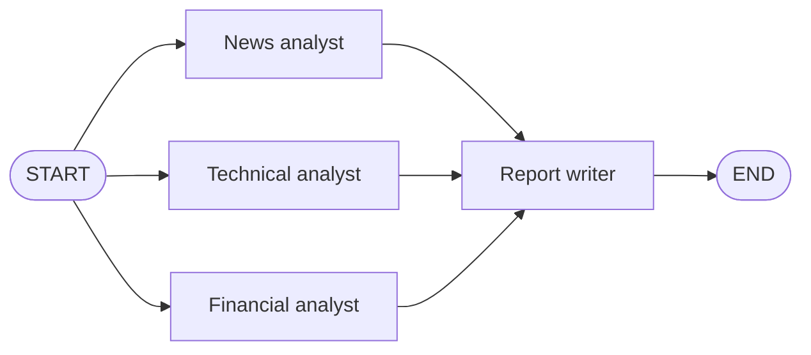
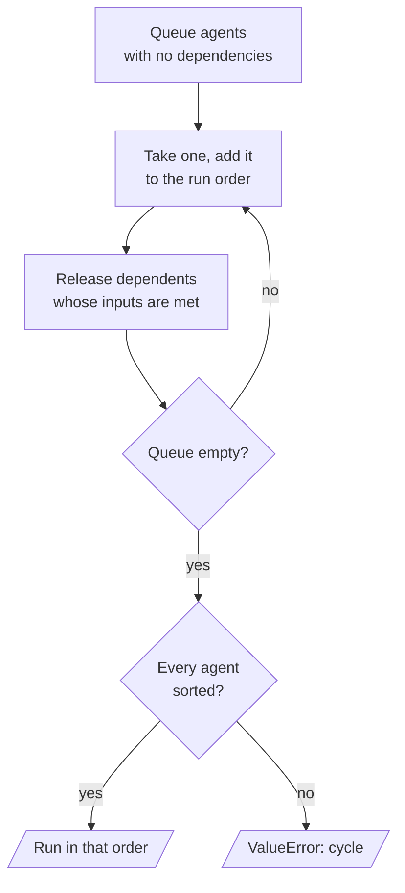

# M35.1 Theory: Monolithic vs multi-agent; a crew from scratch

*[M35 theory](../README.md) · Lesson 35.1 · Notebooks: [`01a_multi_agent_vs_monolithic_agent.ipynb`](../../notebook/01a_multi_agent_vs_monolithic_agent.ipynb), [`01b_multiagent_pattern_from_scratch.ipynb`](../../../optional/notebook/01b_multiagent_pattern_from_scratch.ipynb) (optional) · [All theory pages](../../../../../THEORY.md)*
<!-- subtitle: When one agent with every tool should become a team of specialists, and how a fixed team runs its members in dependency order -->

## When one agent becomes a team

> **What you'll learn**
>
> - **Compare** a monolithic agent with a team of specialists on prompts, tool choice, model calls and latency.
> - **Explain** fan-out and fan-in, and why the team's latency is set by its slowest specialist.
> - **Diagnose** a comparison that rests on one judge score for one request.
> - **Trace** a crew of agents through a topological sort, and see why a cycle fails before any model runs.

M34 gave one agent a memory that lasts across sessions. This module asks a different question: when should the work be split across several agents at all?

Larkspur's support assistant is one agent with the whole handbook and every tool. A customer writes *My server went down last night. Do I get service credits?* On every step the agent chooses among billing, outage, export and sizing material in one long prompt. The question needs two parts of the handbook: the outage rules, then the credit rule (10% of the month's server charges when availability falls below 99.95%, claimed by ticket within 30 days). One prompt that covers everything has to get both parts right in one loop.

A **monolithic agent** is one ReAct loop with one system prompt and every tool. A **specialist team** splits the request among agents that each have one domain, a narrow persona and a few tools, plus a step that merges their work. The comparison notebook builds both for a market report with three sections (news and sentiment, a technical read of the price trend, financial performance). The monolith gets a web search tool that returns 3 results per search. The team gets a news analyst, a technical analyst and a financial analyst, each a ReAct agent with the same tool, and a report writer that merges their sections.

The two designs differ on five points:

| | Monolithic agent | Specialist team |
|---|---|---|
| Prompts | one, covering every domain | one per specialist, each about one domain |
| Tool choice | every tool, every step | a few tools per agent |
| Model calls | one ReAct loop | three ReAct loops and a synthesis call, which the notebook puts it at roughly four times the calls |
| Latency | sequential | the specialists run in parallel, so the slowest one sets the time |
| Failure you debug | one long transcript | which specialist went wrong, and whether the writer used its section |

*Table 1: One agent against a team of three specialists and a writer.*

The call count follows from the shape. If every ReAct loop takes about the same number of calls, three loops plus one synthesis call come to roughly four times one loop. The notebook caps each loop with a `recursion_limit` of 12, which bounds how far any one analyst can run.

The team runs as **fan-out and fan-in**. `START` has an edge to all three analysts, and each analyst has an edge to the writer:

*Figure 1: The specialist team. The three analysts share one super-step, and the writer waits for all of them.*

LangGraph runs nodes in **super-steps**: every node whose inputs are ready runs in the same step, and the next step starts only when they have all finished. The three analysts share the first step and the writer runs in the second. Latency is the slowest analyst plus the synthesis call.

### Comparing the two reports fairly

The notebook does not declare a winner from one run. It measures both reports in two ways:

| Evidence | What it records | What it can claim |
|---|---|---|
| Code measures | word count, markdown headings, and whether the text covers news, technicals and financials (keyword checks such as "revenue" or "moving average") | facts about the text |
| Judge scores | 1 to 10 for clarity and structure, analytical depth and completeness, plus a justification | one model's opinion of one sample |

*Table 2: The two kinds of evidence. The judge scores each report as "the report" and never learns which design wrote it.*

We call the trap here the **single-sample verdict**. One request on one company is one sample, and a gap of a point or two on the judge alone is noise. When the code measures and the judge point the same way, the difference is worth testing on more requests. When only the judge prefers one report, it is not.

> **Key distinction:** a team buys focus and parallelism with more model calls. Whether it also buys better answers is an empirical question, settled by measuring many of your own requests.

For Larkspur the same test decides whether to split the support assistant. Three agents (billing, operations, data) each search one part of the handbook, at the price of a decision about which of them should answer. The rest of this module is about that decision. Before it, the next section looks at the simplest kind of team, one whose order is fixed before it runs.

## A crew is a dependency graph

The optional notebook rebuilds the core of CrewAI without a framework, on the raw OpenAI SDK. Two ideas carry it: an **Agent** and a **Crew**.

An agent has a backstory (its system prompt), a task description, an expected output and a context slot. Dependencies are declared with operators borrowed from Airflow:

| Declaration | Meaning | What happens at run time |
|---|---|---|
| `a >> b` | b depends on a | a's output lands in b's context, labelled "Output of a" |
| `b << a` | the same dependency, written the other way | the same |
| `a >> b >> c` | a chain | each agent feeds the next |
| `[a, b] >> c` | fan-in: c depends on both | c waits for both and reads both outputs |

*Table 3: The crew's dependency operators.*

A **crew** collects every agent created inside its block and runs them in **topological order**: an agent runs only after everything it depends on. The notebook sorts with Kahn's algorithm, which also detects cycles:

*Figure 2: Kahn's algorithm as the crew uses it. Agents caught in a cycle never reach the queue.*

Creating and sorting agents makes no model call, so we ran the notebook's sort with a stub in place of the ReAct agent:

| Crew | Declared | Result |
|---|---|---|
| Fan-in | `[pros, cons] >> editor` | run order Pros Analyst, Cons Analyst, Editor |
| Planted cycle | `ping >> pong` and `pong >> ping` | `ValueError`: circular dependencies detected |

*Table 4: The crew's sort on two planted crews (notebook cells run in the scratchpad with a stub agent).*

The cycle fails at the sort, before any agent runs and before any model call. A crew is a fixed dependency graph, and a cycle has no topological order.

The sort fixes an order and nothing more. In the crew, the pros and cons analysts still run one after the other, even though neither needs the other. The notebook's last part rebuilds the same fan-in as a LangGraph `StateGraph`, with stub nodes that log what they had seen:

| Super-step | Node | Had seen |
|---|---|---|
| 1 | cons | nothing |
| 1 | pros | nothing |
| 2 | editor | cons, pros |

*Table 5: The fan-in crew as a StateGraph (the notebook's bridge cell, run as written).*

The two analysts share a super-step and the editor runs once, with both entries in state. Each crew piece has a LangGraph counterpart: an agent is a node, `a >> b` is `add_edge("a", "b")`, `[a, b] >> c` is one edge from a list of nodes, the growing context string becomes typed state with a reducer, and the sort plus run becomes `compile()` and `invoke()`.

> **Pitfall: parallel in name only.** A dependency graph says what may run together. Whether it does is up to the runtime: Kahn's sort feeding a plain loop is sequential, and LangGraph's super-steps run ready nodes together.

LangGraph also adds what a fixed graph lacks: conditional edges, loops and checkpoints. Every architecture from lesson 35.2 on uses them to add a node that chooses the next agent at run time.

## Key Takeaways

- A specialist team gives each agent one domain and a few tools, at roughly four times the model calls of one ReAct loop. Running the specialists in one super-step keeps latency near the slowest one.
- Compare a team with a single agent using code measures and a judge that does not know which design wrote each report. A gap of a point or two on the judge from one request is noise.
- A crew is a fixed dependency graph run in topological order, and a cycle fails at the sort before any model is called. Choosing the next agent at run time is what the later architectures add.

## Check yourself

1. The specialist team makes roughly four times the monolithic agent's model calls. Why is its latency set by the slowest analyst, not the sum of all three?

`START` has an edge to all three analysts, so LangGraph runs them in the same super-step, in parallel. The report writer has an edge from each analyst and starts only when all three have finished. The time is the slowest analyst plus the synthesis call.

2. On one company, the team's report scores a point higher than the monolithic report from the judge. Is that enough to switch to the team?

No. One request on one company is one sample, and a gap of a point or two on the judge alone is noise. Check whether the code measures (word count, headings, topic coverage) point the same way, and repeat on more requests before deciding.

3. A crew declares writer >> reviewer and reviewer >> writer. What happens when you run it, and at which point?

The crew raises a `ValueError` at the topological sort, before any agent runs or any model is called. Kahn's algorithm never queues an agent caught in a cycle, and the sorted list comes up short. Choosing the next agent at run time, loops included, needs the graph-based patterns from lesson 35.2 on.

---
*Previous: [M35 overview](../README.md). Next: [35.2 The five multi-agent architectures and agent communication](../02_the_five_multi_agent_architectures_and_agent_communication/README.md).*
