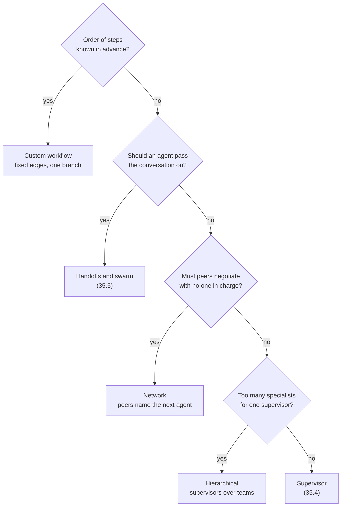
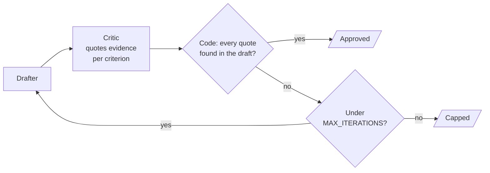

# M35.2 Theory: The five multi-agent architectures and agent communication

*[M35 theory](../README.md) · Lesson 35.2 · Notebooks: [`02a_five_multi_agent_architectures.ipynb`](../../notebook/02a_five_multi_agent_architectures.ipynb), [`02b_agent_communication.ipynb`](../../../optional/notebook/02b_agent_communication.ipynb) (optional) · [All theory pages](../../../../../THEORY.md)*
<!-- subtitle: Five ways to decide which agent runs next, all built from one return value, and three ways for agents to pass work to each other -->

## Five architectures, one primitive

> **What you'll learn**
>
> - **Explain** the one primitive under every LangGraph architecture: a node that writes to state and names the next node.
> - **Compare** network, supervisor, tool-calling supervisor, hierarchical and custom workflow by who decides what runs next.
> - **Diagnose** a runaway loop, and stop it with `recursion_limit`.
> - **Choose** what agents exchange: messages, typed fields or a draft and its critique.

Lesson 35.1 ended on a fixed graph: a crew whose order is known before it runs. Larkspur's support requests do not come in a fixed order. *How long does a refund take?* needs billing alone. *My server went down last night. Do I get service credits?* needs operations, then billing. The M30 router picks one knowledge base once, and on the outage request it answers the outage and never reaches the credits. Something has to decide, at run time, which agent runs next.

### The command that transfers control

Every architecture in the routing notebook is built from one return value. A **`Command`** is what a node returns to do two jobs at once: write an update to state and name the node that runs next. Its parts:

| Part | Example | What it decides |
|---|---|---|
| `goto` | `"writer"` | the next node, chosen at run time |
| `update` | `{"messages": [reply]}` | what this node writes to state |
| Return annotation | `Command[Literal["writer", "__end__"]]` | the nodes this one may jump to; LangGraph draws them as the graph's edges |

*Table 1: The fields of a `Command` and the annotation that declares its targets.*

`add_edge` fixes a path when the graph is built, and `Command(goto=...)` picks one at run time. Most real systems use both. A target listed in the annotation that the code never returns still appears as an edge, which is why the notebook keeps each `Literal` to the branches the function can take.

The five architectures impose different rules on that one capability:

| Architecture | Who decides what runs next | Fails when | Reach for it when |
|---|---|---|---|
| Network | each agent, for itself | nothing guarantees the run ends | agents need to negotiate |
| Supervisor | one central node | the supervisor becomes a bottleneck | routing must be auditable |
| Tool-calling supervisor | the model, by choosing tools | the same input can route differently | intent classification is the hard part |
| Hierarchical | a coordinator over team coordinators | step budgets grow and team internals are hidden | the problem is shaped like an org chart |
| Custom workflow | mostly the graph, with one dynamic branch | the work is too open-ended for fixed paths | the sequence is known in advance |

*Table 2: The five architectures by who holds the routing decision.*

We ran the notebook's four `StateGraph` builds with the model replaced by a stub that answers "ok". Routing in the notebook keys off role tags the code adds to each reply, never off the model's wording. The paths below are the ones a live run takes:

| Architecture | Static edges | Messages written, in order |
|---|---|---|
| Network | `START` to researcher only | researcher, writer, reviewer, writer, reviewer |
| Supervisor | `START` to supervisor only | creator, editor (the supervisor writes nothing) |
| Hierarchical | `START` to top supervisor; each team back to it | backend, frontend, tester, security |
| Custom workflow | `START` to parser only | parser, analyzer, text processor, summarizer |

*Table 3: Paths from the notebook's graphs with a stub model. The network's reviewer sends the draft back once, then ends on its second visit.*

The reviewer-to-writer hop in the network is wired by no `add_edge`. The reviewer chooses it. In the supervisor run only the workers' messages appear, because the supervisor routes without appending a message. A **router that writes nothing keeps the transcript readable**: it holds only the work.

The **tool-calling supervisor** needs no routing code. Each specialist (billing, technical, general) is wrapped as a tool, and `InjectedState` hands it the graph's state without the model passing it as an argument. The tool's docstring is the routing rule, because it is the description the model reads. The notebook's mixed query, "trouble with my bill and the app keeps crashing", may call one specialist or two from one run to the next. That variability is the trade: routing quality becomes a prompt and description problem, and you can no longer read the rules in code.

### Planted failure: the runaway loop

A network has no node that can say "stop". The notebook plants a **runaway loop**: two nodes, ping and pong, that hand off to each other forever. LangGraph counts super-steps and stops a run at `recursion_limit`:

| Setting | What happens to ping and pong |
|---|---|
| Default limit | 10,007 super-steps before `GraphRecursionError` |
| `recursion_limit = 25`, as every notebook run passes | `GraphRecursionError` after 25 super-steps; 0.002 s in our stub run |
| Hierarchy run | the notebook doubles the cap to 50, because each team spends steps of its own |

*Table 4: The ping-pong loop under each limit. The default comes from LangGraph's installed source.*

The limit caps steps, not time. Twenty-five steps of a graph that calls a model at every node is still slow. The limit guards against runaway loops and is no timeout. Pass it on every run.

For Larkspur, the choice comes down to a few questions in order:

*Figure 1: Choosing an architecture. Each "no" moves one question down.*

The support assistant's order is not known in advance (a question may need one specialist or two), so it starts at the second question. The answer depends on whether conversations stay with one specialist across turns. A swarm is a network in which the handoffs are tools and the graph remembers who holds the conversation. Lesson 35.4 builds the supervisor and the hierarchy, and lesson 35.5 builds the swarm. Who runs next is half the design, and the next section covers the other half.

## Agent communication

While agents run, they pass work to each other through state. The optional notebook builds three patterns for that:

| Pattern | State | Each agent reads | Trade-off |
|---|---|---|---|
| Message passing | one `messages` list with the `add_messages` reducer | the whole conversation so far | simple and transparent, but every agent re-reads and parses prose |
| Typed fields | one field per stage (`raw_data`, `analysis`, `confidence_score`, `recommendations`) | only the fields it needs | structured output fills each field with a validated Pydantic object, and the schema is rigid |
| Generator and critic | running lists of `drafts` and `critiques` (`operator.add`) | the last draft and the feedback on it | iterates to a better draft and needs a cap |

*Table 5: Three ways agents exchange work.*

With typed fields, a malformed reply fails validation instead of silently becoming a wrong value. The analyst's confidence must lie between 0.0 and 1.0, and the collector must return points with a source and a finding. Downstream agents read those fields directly and parse nothing.

### A critic that quotes its evidence

The generator and critic loop shows how to keep a model from ending its own loop. A critic that answers yes or no can approve a draft that misses a criterion, and nothing checks it. We call this the **lenient critic**. The notebook's critic never gives the verdict. For each of three criteria (a named LangGraph feature, a concrete use case, a trade-off) it copies the sentence from the draft that meets it, or writes `none`. Code computes the verdict:

*Figure 2: The generator and critic loop. The model supplies quotes, and code decides.*

We ran the notebook's check function on a three-sentence Larkspur draft ("LangGraph checkpointers let a support thread resume. A billing agent and an outage agent can share one graph. The cost is more model calls per request.") with planted critiques:

| Planted critique | Missing criteria returned | Why |
|---|---|---|
| All three sentences quoted exactly | none | every quote is in the draft, and the feature quote names "checkpoint" |
| Trade-off quote invented ("It is slower than plain code.") | trade-off | the quote is not in the draft |
| Use-case quote is `none` | use case | `none` counts as missing |
| Feature quote is the use-case sentence | feature | the quote names no feature from the notebook's list |
| A critic that always answers `none`, in the full loop | all three | the loop stops after 3 drafts with `capped` set |

*Table 6: The critic check on planted critiques (notebook functions run with a stub model).*

An invented quote cannot pass, because membership in the draft is tested in code. `MAX_ITERATIONS = 3` ends the loop whether or not the critic ever approves.

> **Key distinction:** this loop is not a blackboard. Its order is fixed (draft, critique, draft), and only the exit is decided at run time. A blackboard has a controller that picks which of several specialists acts next from what is on the shared board. M36 builds one.

## Key Takeaways

- Build every architecture from one primitive, a node returning `Command(goto=..., update=...)`. `add_edge` fixes a path at build time, `Command` picks one at run time, and most systems use both.
- Pick the architecture by who should decide what runs next. Use a custom workflow when the order is known, handoffs when the conversation should move with an agent, and a supervisor when routing must be auditable.
- Always pass `recursion_limit`, since the default is 10,007 super-steps. In a generator and critic loop, have the critic quote evidence per criterion, compute the verdict in code and cap the iterations.

## Check yourself

1. What does a node return to choose the next agent at run time, and how does LangGraph know which edges to draw for it?

It returns `Command(goto="writer", update={...})`: the update goes into state and the named node runs next. The return annotation, such as `Command[Literal["writer", "__end__"]]`, lists the nodes it may jump to, and LangGraph draws those as edges. `add_edge` fixes a path at build time, while `Command(goto=...)` picks one at run time.

2. Larkspur's support assistant may need one specialist or two, so the order is not known in advance. Which question then decides between a swarm and a supervisor?

Whether an agent should pass the conversation on, which comes down to whether conversations stay with one specialist across turns. If yes, use handoffs and a swarm (35.5). If no, and peers need not negotiate and one supervisor can handle the specialists, use a supervisor (35.4).

3. A yes-or-no critic sometimes approves drafts that miss a criterion. How does the notebook's critic design prevent that, and what ends the loop?

The critic never gives the verdict. For each of three criteria it quotes the sentence from the draft that meets it, or writes `none`. Code checks that each quote is really in the draft and computes the verdict. An invented quote counts as missing. `MAX_ITERATIONS = 3` ends the loop whether or not the critic approves.

---
*Previous: [35.1 Monolithic vs multi-agent; a crew from scratch](../01_monolithic_vs_multi_agent_a_crew_from_scratch/README.md). Next: [35.3 Supervisor workflow with human review](../../../optional/theory/03_supervisor_workflow_with_human_review/README.md).*
