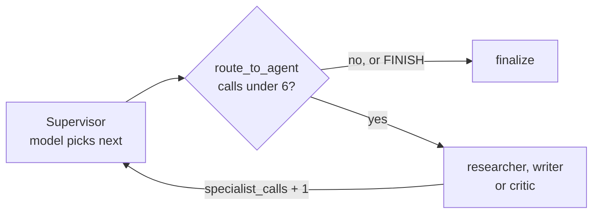
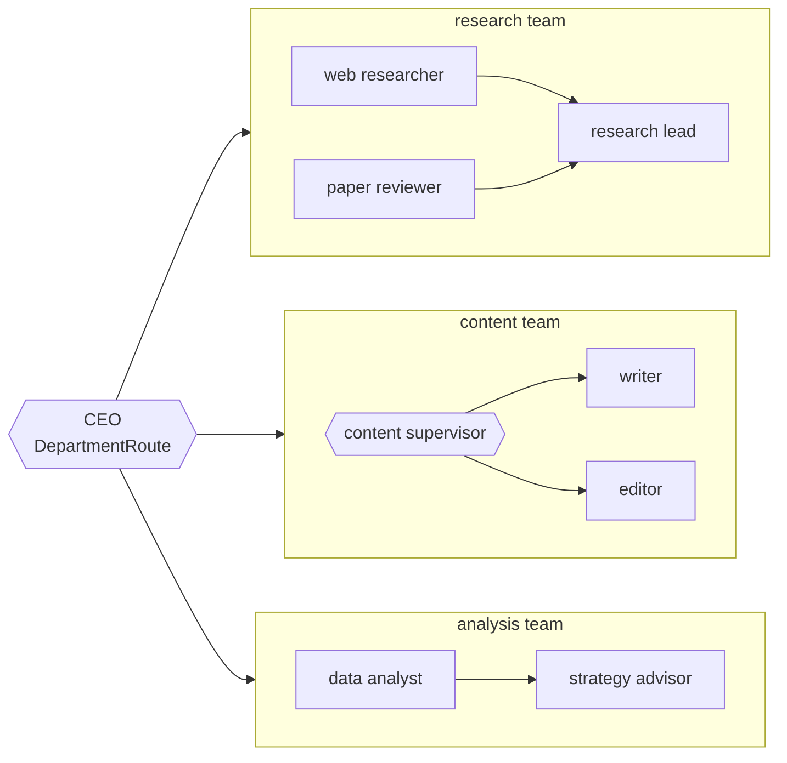
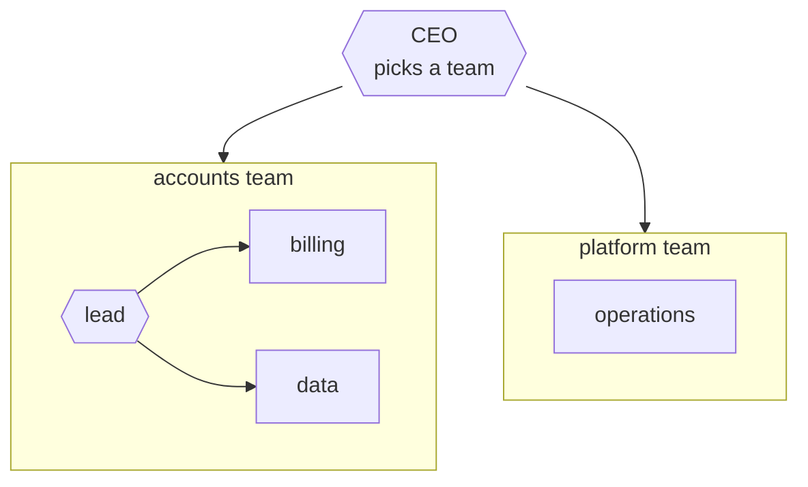

# M35.4 Theory: Supervisors and hierarchical teams

*[M35 theory](../README.md) · Lesson 35.4 · Notebooks: [`04a_supervisor_pattern.ipynb`](../../notebook/04a_supervisor_pattern.ipynb), [`04b_hierarchical_agents.ipynb`](../../notebook/04b_hierarchical_agents.ipynb) · [All theory pages](../../../../../THEORY.md)*
<!-- subtitle: A model picks the next specialist, code caps how many run, and teams of specialists nest under one coordinator only when a flat supervisor stops coping -->
<!-- format: approved -->

## Start with a request that needs two specialists

> **What you'll learn**
>
> - **Explain** how a supervisor splits deciding (a model) from routing and capping (code).
> - **Trace** a run whose supervisor never finishes, and see the counter stop it with a result.
> - **Count** the routing calls a supervisor and a hierarchy spend on one Larkspur request.
> - **Diagnose** a counter that comes out too high after crossing a team boundary.

Lesson 35.3 routed with a fixed rule: the first failing check. This lesson lets a model choose the next specialist, and keeps the parts that must not fail in code.

A Larkspur customer writes: *My server went down last night. Do I get service credits?* The M30 router classifies the request once and sends it to one specialist. Operations explains the outage, nothing comes back to the router, and nobody answers the credit claim. The request needs two specialists in turn, and something has to notice that the first answer left half of it open.

## Supervisor

A **supervisor** decides again after every specialist. It is a node that reads the work so far and picks the next specialist, or decides the task is done, and every specialist reports back to it.

### Deciding, routing and counting

The supervisor notebook's supervisor is a model with structured output. Its decision type, `RouteDecision`, holds `next`, a closed `Literal["researcher", "writer", "critic", "FINISH"]`, and a one-line `reasoning`. A typed choice cannot name a node that does not exist, and the graph never parses prose to find out where to go.

The notebook then splits the work three ways:

| Piece | Calls a model | Writes to state |
|---|---|---|
| **Supervisor** | yes, once per decision | `next_agent`, `task_complete` and one `route_log` entry; never `messages` |
| **Specialist** (researcher, writer, critic) | yes | its output to `messages`, and `specialist_calls: 1` |
| **`route_to_agent`** (on the conditional edge) | no | nothing: it reads state and returns the next node |

*Table 1: Who decides, who works and who routes in the supervisor graph.*

Two details make this hold. The `operator.add` reducer sums each specialist's `specialist_calls: 1`, which means the count never depends on reading message text. And `route_to_agent` reads that counter first. Once it reaches `MAX_SPECIALIST_CALLS = 6`, the run goes to `finalize`, whatever the model chose. Only then does it follow `task_complete` and `next_agent`:

*Figure 1: The supervisor loop. The model's choice is read only after the counter.*

Keeping decisions out of `messages` gives two clean records: the transcript holds only the work, and `route_log` holds every routing decision with its reason. The routing log is what you read when a request went to the wrong specialist.

### Planted failure: the supervisor that never finishes

A supervisor whose critic never says APPROVED keeps sending work back to the writer. The notebook proves the cap without a model: it rebuilds the same graph with a supervisor that always picks the writer and never says `FINISH`, and a writer that returns numbered drafts. We ran that cell, unchanged, in langgraph 1.2.18:

| Measure | Value |
|---|---|
| Supervisor decisions | 7, every one "writer" |
| Specialist calls | 6 (the cap) |
| Messages | the task, then drafts 1 to 6 |
| Final response | "draft 6" |
| Model calls | 0 |

*Table 2: The never-finishing supervisor, stopped by the counter (the notebook's stub cell, run as written).*

The seventh decision is the one `route_to_agent` overrides. `recursion_limit = 25` stays as the backstop, but it ends a run with an error, while the counter ends it with a result.

### Trace the outage request through a supervisor

The supervisor's price is one routing decision before each specialist and one more to finish. The [routing cost lab](../05_handoffs_and_swarms/interactive/routing-cost-lab.html) counts it call by call on the outage request. Retrieval tool calls are left out.

Step through the outage request under a flat supervisor. Each stage is one model call, as the lab counts it.

<button type="button" data-step="0" aria-pressed="false" aria-controls="sup-step-0">1. Route</button><button type="button" data-step="1" aria-pressed="false" aria-controls="sup-step-1">2. Operations</button><button type="button" data-step="2" aria-pressed="false" aria-controls="sup-step-2">3. Route again</button><button type="button" data-step="3" aria-pressed="false" aria-controls="sup-step-3">4. Billing</button><button type="button" data-step="4" aria-pressed="false" aria-controls="sup-step-4">5. Finish</button>

<section id="sup-step-0" class="step-panel" aria-labelledby="sup-heading-0"><h4 id="sup-heading-0">1. The supervisor picks operations</h4><dl><dt>Call</dt><dd>1, routing</dd><dt>Decision</dt><dd>operations, for the outage part; one entry joins <code>route_log</code></dd></dl></section><section id="sup-step-1" class="step-panel" aria-labelledby="sup-heading-1"><h4 id="sup-heading-1">2. Operations answers its part</h4><dl><dt>Call</dt><dd>2, answer</dd><dt>State</dt><dd>The outage explanation joins <code>messages</code>; control returns to the supervisor on a static edge.</dd></dl></section><section id="sup-step-2" class="step-panel" aria-labelledby="sup-heading-2"><h4 id="sup-heading-2">3. The supervisor reads the work so far</h4><dl><dt>Call</dt><dd>3, routing</dd><dt>Decision</dt><dd>billing: the credit claim is still open. This is the step the M30 router never takes.</dd></dl></section><section id="sup-step-3" class="step-panel" aria-labelledby="sup-heading-3"><h4 id="sup-heading-3">4. Billing answers the credit claim</h4><dl><dt>Call</dt><dd>4, answer</dd><dt>Specialists reached</dt><dd>2 of 2, against 1 of 2 for the router</dd></dl></section><section id="sup-step-4" class="step-panel" aria-labelledby="sup-heading-4"><h4 id="sup-heading-4">5. The supervisor chooses FINISH</h4><dl><dt>Total</dt><dd>5 calls, 3 of them routing</dd><dt>Next follow-up</dt><dd>Starts at the supervisor again: route, answer, finish, 3 more calls</dd></dl></section>

<button type="button" data-walk="previous">Previous</button>

<button type="button" data-walk="next">Next step</button>

In exchange for those 3 routing calls, every routing decision sits in one log with its reason, the routing rules live in one prompt you can test, and one counter caps the whole run.

## Hierarchical teams

When one supervisor has too many workers to choose among well, group the workers into teams with a supervisor each, and put a coordinator over the team supervisors. That is a **hierarchy**. In LangGraph each team is its own `StateGraph`, compiled on its own, and added to the parent graph with `add_node` like any function node. The parent never sees inside it.

The hierarchy notebook has a CEO over three departments:

*Figure 2: The hierarchy notebook. Each department is a compiled graph, and control returns to the CEO after each one.*

A team's inside is its own choice. Research fans out to two specialists and merges in a lead, content has its own supervisor, and analysis is a fixed pipeline. After each department the run returns to the CEO, which can send the work on to a second department ("research X, then write Y" goes to research, then content) or finish.

### The state contract between levels

Four rules make the hierarchy compose:

- **One shared contract.** `TeamState` (`messages` and `final_answer`) is what the parent and every team speak. A compiled team drops in as a node with no adapter code.
- **Extensions stay at their level.** The CEO's `CEOState` adds `department`, `route_log` and `ceo_turns`. The content team's `ContentState` adds `next_step` and `content_turns`. Keys outside `TeamState` never cross the boundary.
- **Counters stay out of the shared contract.** A team hands its whole final state back to the parent, and the parent applies its reducers to it.
- **Cap every level.** `MAX_CEO_TURNS = 4` and `MAX_CONTENT_TURNS = 4`, each read by a pure routing function from its own counter.

The third rule guards against the **double-counted counter**. We planted it in a two-node test in the scratchpad: one increment in the parent, then one inside a team, with the counter declared in two places.

Compare where the counter is declared. The parent adds 1, then the team adds 1.

<button type="button" data-mode="shared" aria-pressed="false" aria-controls="counter-shared">In the shared contract</button>
<button type="button" data-mode="own" aria-pressed="false" aria-controls="counter-own">At each level</button>

<section id="counter-shared" class="mode-panel" data-announcement="Counter in the shared contract selected. The parent reads 3."><h4>In the shared contract</h4><ul><li>After the parent's step: 1.</li><li>The team adds 1 and returns its whole state, count 2, to the parent.</li><li>The parent's adding reducer adds that 2 to its own 1: the count reads 3, not 2.</li></ul>
A CEO cap that reads this counter stops the run early, and the turn count in the log is wrong.
</section>
<section id="counter-own" class="mode-panel" data-announcement="Counter at each level selected. The parent reads 1."><h4>At each level</h4><ul><li>The parent's <code>ceo_turns</code> reads 1 after its own step.</li><li>The team's own counter stays inside the team: it never appears in the parent's state.</li><li>Only the shared keys, here the messages, cross the boundary.</li></ul>
This is the notebook's design: <code>ceo_turns</code> in <code>CEOState</code>, <code>content_turns</code> in <code>ContentState</code>.
</section>

Test each team on its own before you assemble the hierarchy. The notebook runs the research team and the content team alone first, because a team that misbehaves is much harder to diagnose once it is one node in a larger graph. The cost is visibility and steps: the parent sees what a team appended, not why, and the five-architectures notebook doubles `recursion_limit` from 25 to 50 for its two-level run.

### A hierarchy for Larkspur

Larkspur's three specialists do not need a hierarchy. To see the overhead, the lab puts billing and data in an accounts team with its own lead, and operations in a platform team that runs as a fixed pipeline:

*Figure 3: The lab's two-team Larkspur hierarchy. The accounts lead decides before and after each of its specialists; the platform team has no lead.*

On the same outage request, the two designs spend:

Compare the calls each design spends on the outage request, from the routing cost lab.

<button type="button" data-mode="flat" aria-pressed="false" aria-controls="design-flat">Flat supervisor (Figure 1)</button>
<button type="button" data-mode="tree" aria-pressed="false" aria-controls="design-tree">Two-team hierarchy (Figure 3)</button>

<section id="design-flat" class="mode-panel" data-announcement="Flat supervisor selected. 5 calls, 3 of them routing."><h4>Flat supervisor</h4><ul><li>Calls: supervisor, operations, supervisor, billing, supervisor.</li><li>5 calls on the request, 3 of them routing.</li><li>Each follow-up to billing: 3 calls.</li></ul></section>
<section id="design-tree" class="mode-panel" data-announcement="Two-team hierarchy selected. 7 calls, 5 of them routing."><h4>Two-team hierarchy</h4><ul><li>Calls: CEO, operations, CEO, accounts lead, billing, accounts lead, CEO.</li><li>7 calls on the request, 5 of them routing.</li><li>Each follow-up to billing: 5 calls.</li></ul></section>

The hierarchy adds the CEO's decisions before and after each team, and the accounts lead's decisions around billing. A hierarchy starts to pay only when the flat supervisor's prompt has to describe so many specialists that its routing accuracy drops. Measure that drop on a golden set of routed requests before adding the layer.

## Limits of this evidence

- **The lab counts a script, not a model.** Its call counts follow from each design's wiring with every routing decision taken correctly. It measures no routing accuracy, and retrieval tool calls are left out.
- **The live runs depend on the model.** The notebooks' supervisor and CEO paths come from `gpt-4o-mini` at temperature 0; only the stub cell in Table 2 and the counter test run without a model.
- **The counter test is a minimal graph.** It reproduces the reducer behaviour with two nodes in langgraph 1.2.18, not the notebook's full hierarchy.

## References

1. LangChain, [Multi-agent](https://docs.langchain.com/oss/python/langchain/multi-agent) and [Subagents](https://docs.langchain.com/oss/python/langchain/multi-agent/subagents), LangChain documentation.
2. LangChain, [Subgraphs](https://docs.langchain.com/oss/python/langgraph/use-subgraphs), LangGraph documentation.
3. LangChain, [langgraph-supervisor](https://github.com/langchain-ai/langgraph-supervisor-py), a prebuilt supervisor library.
4. Wu et al., [AutoGen: Enabling Next-Gen LLM Applications via Multi-Agent Conversation](https://arxiv.org/abs/2308.08155), 2023.

## Key Takeaways

- Give the supervisor a closed `Literal` of next nodes and keep its decisions out of `messages`. A pure routing function reads a specialist-call counter first, so the cap ends a run with a result instead of an error.
- A supervisor pays one routing call before each specialist and one to finish: 5 calls for the outage request, 3 of them routing. In return, every decision sits in one log with its reason.
- Compose hierarchies through one shared state contract, keep counters out of it and cap every level. Add a layer only after measuring that a flat supervisor's routing accuracy has dropped.

## Check yourself

1. Why does route_to_agent check specialist_calls before it reads the supervisor's decision?

So the cap holds whatever the model chooses: once `specialist_calls` reaches `MAX_SPECIALIST_CALLS = 6`, the run goes to `finalize`. In the stub run the supervisor never said FINISH, and the run still stopped after 6 drafts with "draft 6" as the result. `recursion_limit = 25` is only a backstop and ends a run with an error.

2. For Larkspur's outage request (operations, then billing), how many model calls does a flat supervisor make, and how many does a two-team hierarchy make?

The flat supervisor makes 5, 3 of them routing. Splitting into an accounts team and a platform team raises it to 7, 5 of them routing. Larkspur's three specialists do not need the hierarchy, which pays only when the flat supervisor's routing accuracy drops with too many specialists.

3. A developer adds a turn counter with an adding reducer to TeamState, and the CEO's count comes out too high. What went wrong?

A team hands its whole final state back to the parent, so a counter in the shared contract is added a second time on the way up. In the planted test, two increments produced a count of 3. Keep counters at their own level, as `ceo_turns` in `CEOState` and `content_turns` in `ContentState`, outside `TeamState`.

---
*Previous: [35.3 Supervisor workflow with human review](../../../optional/theory/03_supervisor_workflow_with_human_review/README.md). Next: [35.5 Handoffs and swarms](../05_handoffs_and_swarms/README.md).*
