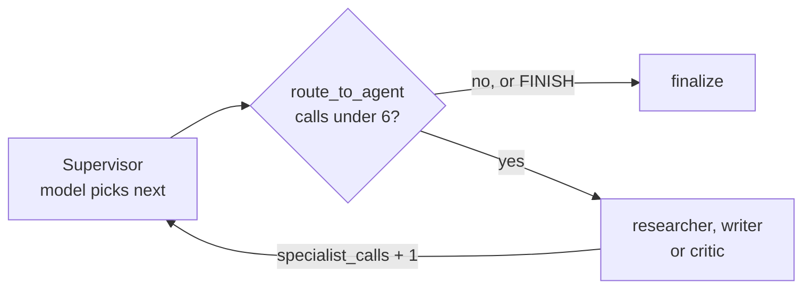
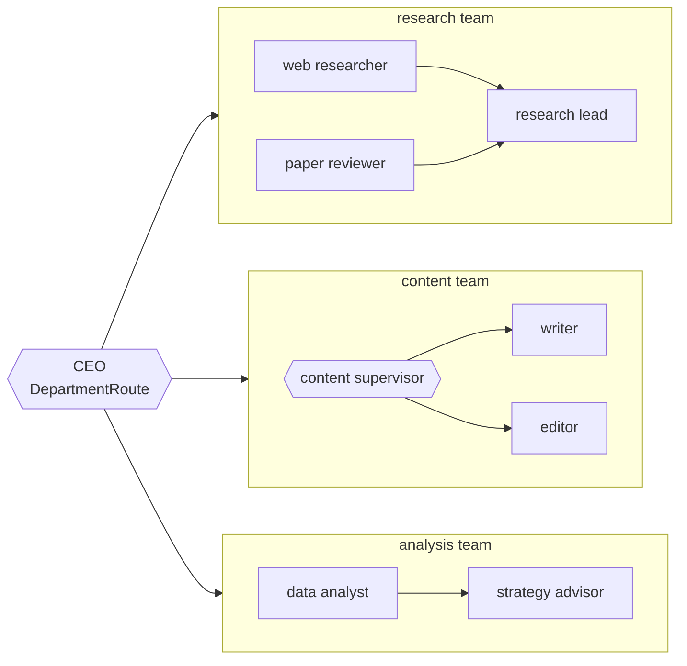

# M35.4 Theory: Supervisors and hierarchical teams

*[M35 theory](../README.md) · Lesson 35.4 · Notebooks: [`04a_supervisor_pattern.ipynb`](../../notebook/04a_supervisor_pattern.ipynb), [`04b_hierarchical_agents.ipynb`](../../notebook/04b_hierarchical_agents.ipynb) · [All theory pages](../../../../../THEORY.md)*
<!-- subtitle: A model picks the next specialist, code caps how many run, and teams of specialists nest under one coordinator only when a flat supervisor stops coping -->

## Supervisor

> **What you'll learn**
>
> - **Explain** how a supervisor splits deciding (a model) from routing and capping (code).
> - **Trace** a run whose supervisor never finishes, and see the counter stop it with a result.
> - **Count** the routing calls a supervisor and a hierarchy spend on one Larkspur request.
> - **Diagnose** a counter that comes out too high after crossing a team boundary.

Lesson 35.3 routed with a fixed rule: the first failing check. This lesson lets a model choose the next specialist, and keeps the parts that must not fail in code.

Back to Larkspur's outage request: *My server went down last night. Do I get service credits?* The M30 router sends it to one specialist and stops. Operations explains the outage and nobody mentions the credit claim. A **supervisor** fixes that by deciding again after every specialist. It is a node that reads the work so far and picks the next specialist, or decides the task is done, and every specialist reports back to it.

### Deciding, routing and counting

The supervisor notebook's supervisor is a model with structured output. Its decision type, `RouteDecision`, holds `next`, a closed `Literal["researcher", "writer", "critic", "FINISH"]`, and a one-line `reasoning`. A typed choice cannot name a node that does not exist, and the graph never parses prose to find out where to go.

The notebook then splits the work three ways:

| Piece | Calls a model | Writes to state |
|---|---|---|
| **Supervisor** | yes, once per decision | `next_agent`, `task_complete` and one `route_log` entry; never `messages` |
| **Specialist** (researcher, writer, critic) | yes | its output to `messages`, and `specialist_calls: 1` |
| **`route_to_agent`** (on the conditional edge) | no | nothing: it reads state and returns the next node |

*Table 1: Who decides, who works and who routes in the supervisor graph.*

Two details make this hold. The `operator.add` reducer sums each specialist's `specialist_calls: 1`, so the count never depends on reading message text. And `route_to_agent` reads that counter first. Once it reaches `MAX_SPECIALIST_CALLS = 6`, the run goes to `finalize`, whatever the model chose. Only then does it follow `task_complete` and `next_agent`:

*Figure 1: The supervisor loop. The model's choice is read only after the counter.*

Keeping decisions out of `messages` gives two clean records: the transcript holds only the work, and `route_log` holds every routing decision with its reason. The routing log is what you read when a request went to the wrong specialist.

### Planted failure: the supervisor that never finishes

A supervisor whose critic never says APPROVED keeps sending work back to the writer. The notebook proves the cap without a model: it rebuilds the same graph with a supervisor that always picks the writer and never says `FINISH`, and a writer that returns numbered drafts. We ran that cell:

| Measure | Value |
|---|---|
| Supervisor decisions | 7, every one "writer" |
| Specialist calls | 6 (the cap) |
| Messages | the task, then drafts 1 to 6 |
| Final response | "draft 6" |
| Model calls | 0 |

*Table 2: The never-finishing supervisor, stopped by the counter (the notebook's stub cell, run as written).*

The seventh decision is the one `route_to_agent` overrides. `recursion_limit = 25` stays as the backstop, but it ends a run with an error, while the counter ends it with a result.

### What a supervisor costs

The supervisor's price is one routing decision before each specialist and one more to finish. The [routing cost lab](../05_handoffs_and_swarms/interactive/routing-cost-lab.html) counts it call by call on the outage request:

| Call | Node | Kind |
|---|---|---|
| 1 | supervisor | routing |
| 2 | operations | answer |
| 3 | supervisor | routing |
| 4 | billing | answer |
| 5 | supervisor | routing (finish) |

*Table 3: The outage request under a supervisor, as the lab counts it. Each row is one model call. Retrieval tool calls are left out.*

That is 5 calls, 3 of them routing. Each follow-up on the same thread costs 3 more (route, answer, finish), because every turn starts at the supervisor again. In exchange, every routing decision sits in one log with its reason, the routing rules live in one prompt you can test, and one counter caps the whole run.

## Hierarchical teams

When one supervisor has too many workers to choose among well, group the workers into teams with a supervisor each, and put a coordinator over the team supervisors. That is a **hierarchy**. In LangGraph each team is its own `StateGraph`, compiled on its own, and added to the parent graph with `add_node` like any function node. The parent never sees inside it.

The hierarchy notebook has a CEO over three departments:

*Figure 2: The hierarchy notebook. Each department is a compiled graph, and control returns to the CEO after each one.*

A team's inside is its own choice. Research fans out to two specialists and merges in a lead, content has its own supervisor, and analysis is a fixed pipeline. After each department the run returns to the CEO, which can send the work on to a second department ("research X, then write Y" goes to research, then content) or finish.

### The state contract between levels

Four rules make the hierarchy compose:

- **One shared contract.** `TeamState` (`messages` and `final_answer`) is what the parent and every team speak. A compiled team drops in as a node with no adapter code.
- **Extensions stay at their level.** The CEO's `CEOState` adds `department`, `route_log` and `ceo_turns`. The content team's `ContentState` adds `next_step` and `content_turns`. Keys outside `TeamState` never cross the boundary.
- **Counters stay out of the shared contract.** A team hands its whole final state back to the parent, and the parent applies its reducers to it.
- **Cap every level.** `MAX_CEO_TURNS = 4` and `MAX_CONTENT_TURNS = 4`, each read by a pure routing function from its own counter.

The third rule guards against the **double-counted counter**. We planted it in a two-node test: a counter with an adding reducer in the shared state, one increment in the parent and one inside the team:

| Step | Expected count | Actual count |
|---|---|---|
| Parent node adds 1 | 1 | 1 |
| Team node adds 1; the team returns its whole state (count 2) to the parent | 2 | 3 |

*Table 4: A counter in the shared contract, run in the scratchpad. The parent adds the team's final total on top of its own.*

A CEO cap that reads that counter would stop the run early, and the turn count in the log would be wrong.

Test each team on its own before you assemble the hierarchy. The notebook runs the research team and the content team alone first, because a team that misbehaves is much harder to diagnose once it is one node in a larger graph. The cost is visibility and steps: the parent sees what a team appended, not why, and the five-architectures notebook raises `recursion_limit` from 25 to 50 for its two-level run.

### A hierarchy for Larkspur

Larkspur's three specialists do not need a hierarchy. To see the overhead, the lab puts billing and data in an accounts team with its own lead, and operations in a platform team that runs as a fixed pipeline:

| Architecture | Calls on the outage request | Routing calls | Calls per follow-up |
|---|---|---|---|
| Flat supervisor | 5 | 3 | 3 |
| Two-team hierarchy | 7 | 5 | 5 |

*Table 5: The outage request under both designs, from the routing cost lab.*

The hierarchy adds the CEO's decisions before and after each team, and the accounts lead's decisions around billing. A hierarchy starts to pay only when the flat supervisor's prompt has to describe so many specialists that its routing accuracy drops. Measure that drop before adding the layer.

## Key Takeaways

- Give the supervisor a closed `Literal` of next nodes and keep its decisions out of `messages`. A pure routing function reads a specialist-call counter first, so the cap ends a run with a result instead of an error.
- A supervisor pays one routing call before each specialist and one to finish: 5 calls for the outage request, 3 of them routing. In return, every decision sits in one log with its reason.
- Compose hierarchies through one shared state contract, keep counters out of it and cap every level. Add a layer only after measuring that a flat supervisor's routing accuracy has dropped.

## Check yourself

1. Why does route_to_agent check specialist_calls before it reads the supervisor's decision?

So the cap holds whatever the model chooses: once `specialist_calls` reaches `MAX_SPECIALIST_CALLS = 6`, the run goes to `finalize`. In the stub run the supervisor never said FINISH, and the run still stopped after 6 drafts with "draft 6" as the result. `recursion_limit = 25` is only a backstop and ends a run with an error.

2. For Larkspur's outage request (operations, then billing), how many model calls does a flat supervisor make, and how many does a two-team hierarchy make?

The flat supervisor makes 5, 3 of them routing. Splitting into an accounts team and a platform team raises it to 7, 5 of them routing. Larkspur's three specialists do not need the hierarchy, which pays only when the flat supervisor's routing accuracy drops with too many specialists.

3. A developer adds a turn counter with an adding reducer to TeamState, and the CEO's count comes out too high. What went wrong?

A team hands its whole final state back to the parent, so a counter in the shared contract is added a second time on the way up. In the planted test, two increments produced a count of 3. Keep counters at their own level, as `ceo_turns` in `CEOState` and `content_turns` in `ContentState`, outside `TeamState`.

---
*Previous: [35.3 Supervisor workflow with human review](../../../optional/theory/03_supervisor_workflow_with_human_review/README.md). Next: [35.5 Handoffs and swarms](../05_handoffs_and_swarms/README.md).*
