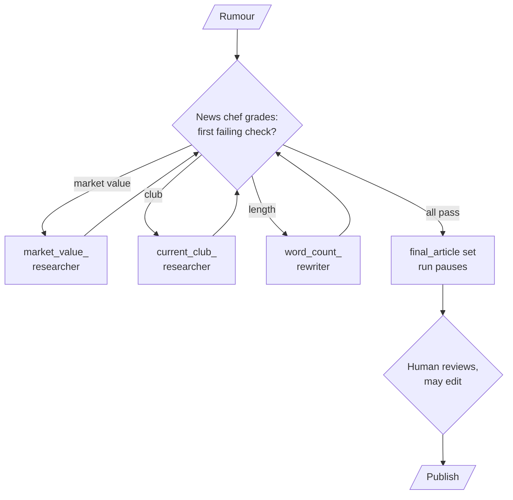
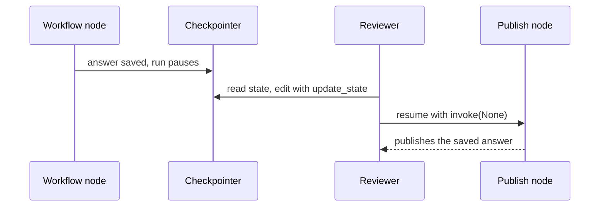
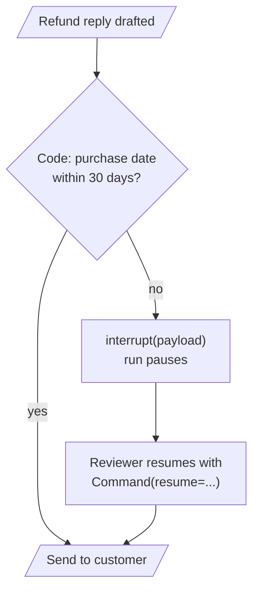

# M35.3 Theory: Supervisor workflow with human review

*[M35 theory](../../../mandatory/theory/README.md) · Lesson 35.3 · Notebooks: [`03a_supervisor_workflow_with_human_review.ipynb`](../../notebook/03a_supervisor_workflow_with_human_review.ipynb) (optional) · [All theory pages](../../../../../THEORY.md)*
<!-- subtitle: A supervisor that routes each draft to the specialist that fixes its first failing check, and a pause where a person can edit the result before it ships -->
<!-- format: approved -->

## Start with a refund reply nobody read

> **What you'll learn**
>
> - **Explain** a supervisor loop that grades a draft and routes it to the first failing check.
> - **Separate** checks code can do exactly from checks that need a model's judgement.
> - **Trace** a draft through the loop, the pass cap and the single place the approved output is written.
> - **Choose** between a static pause on every run and a dynamic pause that only some runs take.

Lesson 35.2 sketched a supervisor with hard-coded routing. This lesson gives it real specialists, a grader and a person at the end.

Larkspur's billing agent drafts refund replies. An annual plan gets a full refund within 30 days of purchase if the account used less than 100 GB of outbound traffic. After day 30 the refund is prorated, minus a 15% early-termination fee. A reply that promises a full refund on day 45 commits Larkspur to money the handbook does not allow. Someone has to read those replies before the customer does. The pattern needs three parts: a loop that keeps fixing a draft until it meets its rules, a cap on that loop, and a pause for review.

## Human review in a supervisor loop

The notebook builds the same pattern on news articles. A short transfer rumour ("Lionel Messi will join Real Madrid in 2025") has to become a publishable article. A supervisor, the "news chef", grades the article and routes it to the specialist that can fix what is missing. A person reads the result before it is published.

### Grading in code and in a model

An article passes when four checks pass. The notebook splits them by who can check each one reliably:

| Check | Checked by | Specialist that fixes it |
|---|---|---|
| About football transfers | model, structured output | none: an off-topic article ends the run |
| Mentions the market value | model, structured output | `market_value_researcher` (a one-tool agent over a small lookup table) |
| Mentions the current club | model, structured output | `current_club_researcher` (the same shape) |
| At least 100 words | code, by counting words | `word_count_rewriter` (asked for at least 120 words) |

*Table 1: The four publication checks. Only the word count never reaches a model.*

**Grade in code what code can check.** Topic, club and value need judgement. The word count is exact, and a model asked to count words is a second source of error. Each researcher's first model call is also forced to call its tool and cannot skip the lookup to answer from a guess.

After every specialist, control returns to the news chef, which grades the updated article again:

*Figure 1: The supervisor loop and the review step. Every specialist reports back to the news chef.*

The chef routes to the **first failing check**, in a fixed order: market value, then club, then length. An off-topic article ends the run at once.

### Tracing a rumour through the loop

We ran the notebook's workflow graph with the model-backed pieces replaced by stubs: a grader that checks for "join", "€" and "Inter Miami", researchers that return the lookup-table values, and a rewriter that pads the text to 120 words. The routing, the word count and the cap are the notebook's own code:

Follow the Messi rumour through the news chef's loop. Each pass shows the checks still failing and where the chef sends the article.

<button type="button" data-step="0" aria-pressed="false" aria-controls="rumour-step-0">Pass 1</button><button type="button" data-step="1" aria-pressed="false" aria-controls="rumour-step-1">Pass 2</button><button type="button" data-step="2" aria-pressed="false" aria-controls="rumour-step-2">Pass 3</button><button type="button" data-step="3" aria-pressed="false" aria-controls="rumour-step-3">Pass 4</button>

<section id="rumour-step-0" class="step-panel" aria-labelledby="rumour-heading-0"><h4 id="rumour-heading-0">Pass 1: three checks fail</h4><dl><dt>Failing</dt><dd>market value, club, length</dd><dt>Routed to</dt><dd><code>market_value_researcher</code>, which adds €50 million</dd><dt>final_article</dt><dd>not set</dd></dl></section><section id="rumour-step-1" class="step-panel" aria-labelledby="rumour-heading-1"><h4 id="rumour-heading-1">Pass 2: value fixed</h4><dl><dt>Failing</dt><dd>club, length</dd><dt>Routed to</dt><dd><code>current_club_researcher</code>, which adds Inter Miami</dd><dt>final_article</dt><dd>not set</dd></dl></section><section id="rumour-step-2" class="step-panel" aria-labelledby="rumour-heading-2"><h4 id="rumour-heading-2">Pass 3: only length fails</h4><dl><dt>Failing</dt><dd>length</dd><dt>Routed to</dt><dd><code>word_count_rewriter</code></dd><dt>final_article</dt><dd>not set</dd></dl></section><section id="rumour-step-3" class="step-panel" aria-labelledby="rumour-heading-3"><h4 id="rumour-heading-3">Pass 4: every check passes</h4><dl><dt>Failing</dt><dd>none</dd><dt>Routed to</dt><dd>end of the workflow</dd><dt>final_article</dt><dd>set to the 120-word article that passed</dd></dl></section>

<button type="button" data-walk="previous">Previous</button>

<button type="button" data-walk="next">Next step</button>

Two more inputs complete the picture. "Today in Munich will be 9°C" fails the topic check on pass 1 and ends with no article. A 109-word article that already names the club and the value passes on pass 1, and no specialist runs.

Two guards keep the loop safe to run unattended up to the human step:

- **A pass cap.** `MAX_PASSES = 5`. A live grader sometimes marks a check "no" twice, and the same specialist runs again. A grader that never says "yes" cannot keep the loop going past five passes.
- **One place for the output.** Only a full pass copies the article into `final_article`. The published text is always the version that passed, whether or not any specialist ran. The 109-word article reaches publication unchanged for that reason.

The planted failure here is the **stale output**: a variable set before the last specialist ran, published after it. Writing the output in exactly one place, on a full pass, rules it out.

## Pausing before publication

The workflow becomes one node of an outer graph, followed by a node that publishes. Compiling the outer graph with a checkpointer and `interrupt_after=["newsagent_node"]` pauses every run after the article is written:

*Figure 2: A static pause. The reviewer works on the saved state, and the run resumes from the pause.*

The notebook runs three threads to the pause and resumes each one, which we reproduced with the stubbed workflow:

| Thread | Answer at the pause | Reviewer action | Published |
|---|---|---|---|
| weather | "Article not relevant for news agency" | resume as is | the same text |
| messi | the four-pass article | `update_state` sets "Fake news!!!" | "Fake news!!!" |
| clean | the 109-word article | resume as is | the article, word for word |

*Table 2: Three paused threads (notebook review graph, stubbed workflow).*

The edited answer reaches the publishing call, not the model's. The checkpointer holds each thread's state by `thread_id`, and the reviewer can take the threads in any order.

### Static or dynamic review

`interrupt_after` is **static**: fixed at compile time, it pauses every run at the named node. A **dynamic** pause calls `interrupt(payload)` inside a node. It pauses only when the node decides to, shows the reviewer the payload, and resumes with `Command(resume=...)`. The notebook builds only the static kind; the dynamic design below is an addition.

*Figure 3: Added alternative. A dynamic pause that stops only the refunds outside the window.*

Compare the two pauses on two Larkspur refund replies, one on day 12 and one on day 45 (illustrative cases).

<button type="button" data-mode="static" aria-pressed="false" aria-controls="pause-static">Static interrupt_after (Figure 2)</button>
<button type="button" data-mode="dynamic" aria-pressed="false" aria-controls="pause-dynamic">Dynamic interrupt (Figure 3)</button>

<section id="pause-static" class="mode-panel" data-announcement="Static pause selected. Both replies wait for a person."><h4>Static <code>interrupt_after</code></h4><dl><dt>Decided</dt><dd>At compile time</dd><dt>Day 12 reply</dt><dd>Pauses, although the handbook already allows a full refund</dd><dt>Day 45 reply</dt><dd>Pauses</dd><dt>Reviewer sees</dt><dd>The saved state, and resumes with <code>invoke(None)</code> after any <code>update_state</code></dd></dl></section>
<section id="pause-dynamic" class="mode-panel" data-announcement="Dynamic pause selected. Only the day 45 reply waits."><h4>Dynamic <code>interrupt(payload)</code></h4><dl><dt>Decided</dt><dd>At run time, inside the node</dd><dt>Day 12 reply</dt><dd>Goes straight to the customer</dd><dt>Day 45 reply</dt><dd>Pauses, with the purchase date and the proposed amount in the payload</dd><dt>Reviewer sees</dt><dd>The payload the node sends, and resumes with <code>Command(resume=...)</code></dd></dl></section>

Larkspur needs the dynamic kind. A static pause would stop every refund reply, including the ones the handbook already allows. The check that decides to pause compares the purchase date with today in code, for the same reason the word count does.

## Limits of this evidence

- **Stubbed judgement.** The traces use a keyword grader and fixed researcher outputs. A live grader can mark a check "no" twice, which the pass cap absorbs but this trace never shows.
- **One domain in the notebook.** The routing runs on news articles. The Larkspur refund replies and the day 12 and day 45 cases are illustrations of the same pattern.
- **The dynamic pause is not in the notebook.** Figure 3 and its panel follow LangGraph's documented `interrupt` and `Command(resume=...)` behaviour and were not run here.

## References

1. LangChain, [Interrupts](https://docs.langchain.com/oss/python/langgraph/interrupts) (static and dynamic pauses, `Command(resume=...)`).
2. LangChain, [Persistence](https://docs.langchain.com/oss/python/langgraph/persistence) (checkpointers, threads and `update_state`).

## Key Takeaways

- Grade in code whatever code can check exactly, such as word count, and use a model with structured output only for checks that need judgement. Route to the first failing check and cap the passes.
- Write the published output in one place, set only on a full pass, so the text that ships is always the version that passed.
- A static `interrupt_after` pauses every run at a node, while a dynamic `interrupt(payload)` pauses only when the node decides. Use the dynamic kind for a refund outside the 30-day window, and compare the dates in code.

## Check yourself

1. Why does the news chef use a model to judge topic, club and market value, but leave the 100-word check to code?

Topic, club and market value need judgement, so a model answers them with structured output. The word count is exact. Code computes it and the model is never asked. A check that code can do exactly should never depend on a model's answer.

2. An article names the player's current club but has no market value and only 80 words. Which specialists run, and in what order?

The news chef routes to the first failing check, in the order market value, club, length. `market_value_researcher` runs first. Control returns to the chef, which grades again. The club passes, and `word_count_rewriter` runs next. `MAX_PASSES = 5` caps the loop if a check keeps failing.

3. Larkspur wants a person to review only refunds proposed outside the 30-day window. Should it use a static interrupt_after or a dynamic interrupt?

A dynamic `interrupt(payload)` inside the node. A static `interrupt_after` is fixed at compile time and pauses every run, while the dynamic one pauses only when the node decides to, and the run resumes with `Command(resume=...)`. The check that decides to pause compares the dates in code.

---
*Previous: [35.2 The five multi-agent architectures and agent communication](../../../mandatory/theory/02_the_five_multi_agent_architectures_and_agent_communication/README.md). Next: [35.4 Supervisors and hierarchical teams](../../../mandatory/theory/04_supervisors_and_hierarchical_teams/README.md).*
