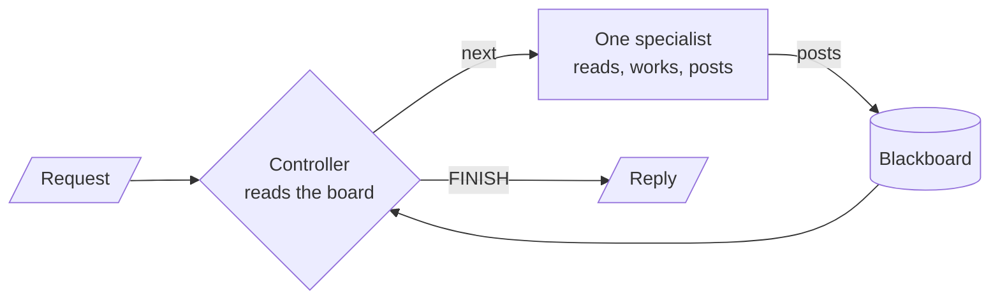
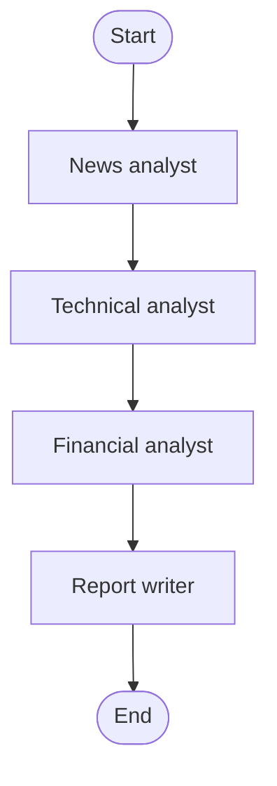
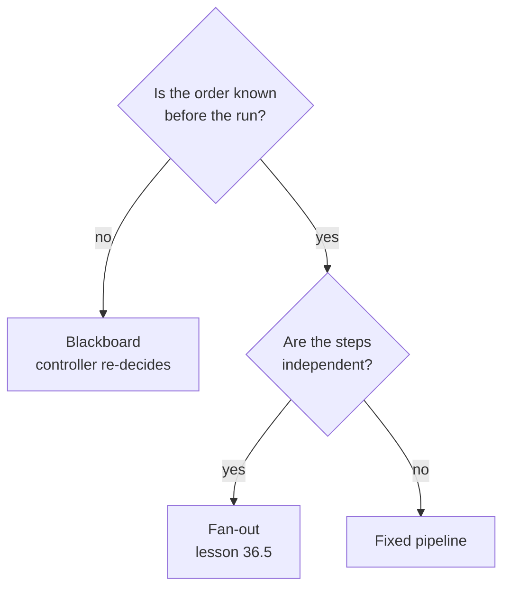

# M36.1 Theory: Blackboard architectures

*[M36 theory](../README.md) · Lesson 36.1 · Notebooks: [`01a_blackboard_intro.ipynb`](../../notebook/01a_blackboard_intro.ipynb), [`01b_blackboard_research_team.ipynb`](../../../optional/notebook/01b_blackboard_research_team.ipynb) (optional) · [All theory pages](../../../../../THEORY.md)*
<!-- subtitle: A controller that re-reads a shared board after every post can skip the branch a fixed pipeline always pays for -->
<!-- format: approved -->

## Start with an escalation that needs one of two analysts

> **What you'll learn**
>
> - **Explain** how a blackboard coordinates specialists through one shared store, with a controller as the only part that decides order.
> - **Compare** a blackboard controller with a fixed pipeline on a request whose next step depends on an earlier finding.
> - **Diagnose** the ways an LLM controller goes wrong: an invalid name, an impossible step, a loop that never finishes.
> - **Choose** between a blackboard, a pipeline and a fan-out by asking when the order of work is known.

Larkspur's support team gets an escalation: *a customer says their server went down twice this week. If the outages pushed availability below the 99.95% SLA, draft a service-credit reply, otherwise draft a reply that points to the status page and the root-cause report.*

A fixed pipeline of analysts runs the credits analyst and the status analyst on every escalation, because its edges cannot skip a node. Half that work is wasted on each request, and the writer has to ignore one of the two reports. The next step depends on what the first analyst finds, and the pipeline fixed its order before the run started.

M35 built supervisors and handoffs, where one agent passes control to the next. This lesson adds shared state: several specialists contribute to one record, and something decides who goes next.

## Blackboard

A **blackboard system** coordinates specialists through one shared store, the **blackboard**. Specialists never call each other. Each one reads the board, does its own job and appends its result. A **controller** reads the whole board after every contribution and picks the next specialist, or `FINISH`:

<!-- animated: diagrams/blackboard-loop.anim.html -->

*Figure 1: The blackboard loop. Every specialist turn sits between two controller turns.*

The design comes from the HEARSAY-II speech-understanding system (Erman et al., 1980). There the specialists watched the board for their own trigger conditions and a scheduler chose among them. In this lesson's implementations the controller does all the watching.

The controller is the only part that decides order. The specialists stay narrow, and adding one means adding a node and a name the controller may choose. Nothing else is rewired.

### Follow the Larkspur escalation

Here is the escalation through a blackboard with three specialists. The trace is scripted, and the facts come from the Larkspur handbook's SLA and outage pages. The counts track specialist calls and controller model calls separately:

Follow the outage escalation across the board. Each stage shows the newest post and the running call counts.

<button type="button" data-step="0" aria-pressed="false" aria-controls="escalation-step-0">1. Board</button><button type="button" data-step="1" aria-pressed="false" aria-controls="escalation-step-1">2. Incident</button><button type="button" data-step="2" aria-pressed="false" aria-controls="escalation-step-2">3. Credits</button><button type="button" data-step="3" aria-pressed="false" aria-controls="escalation-step-3">4. Writer</button><button type="button" data-step="4" aria-pressed="false" aria-controls="escalation-step-4">5. Finish</button>

<section id="escalation-step-0" class="step-panel" aria-labelledby="escalation-heading-0"><h4 id="escalation-heading-0">1. Post the request</h4><dl><dt>Board</dt><dd>The request and the customer's account and region</dd><dt>Controller reads</dt><dd>No findings yet: call the incident analyst</dd><dt>Calls so far</dt><dd>0 specialist, 1 controller</dd></dl></section><section id="escalation-step-1" class="step-panel" aria-labelledby="escalation-heading-1"><h4 id="escalation-heading-1">2. The incident analyst posts</h4><dl><dt>Newest post</dt><dd>What the status page probes recorded for the region this month, and the month's availability</dd><dt>Controller reads</dt><dd>Availability below 99.95%: call the credits analyst, skip the status analyst</dd><dt>Calls so far</dt><dd>1 specialist, 2 controller</dd></dl></section><section id="escalation-step-2" class="step-panel" aria-labelledby="escalation-heading-2"><h4 id="escalation-heading-2">3. The credits analyst posts</h4><dl><dt>Newest post</dt><dd>Credits of 10% of that month's server charges in the region, or 25% below 99.0%, claimed through a Billing ticket within 30 days</dd><dt>Controller reads</dt><dd>A finding and the credit rule are on the board: call the writer</dd><dt>Calls so far</dt><dd>2 specialist, 3 controller</dd></dl></section><section id="escalation-step-3" class="step-panel" aria-labelledby="escalation-heading-3"><h4 id="escalation-heading-3">4. The writer posts a draft</h4><dl><dt>Newest post</dt><dd>A service-credit reply built only from the two posts above</dd><dt>Controller reads</dt><dd>A draft exists: return FINISH</dd><dt>Calls so far</dt><dd>3 specialist, 4 controller</dd></dl></section><section id="escalation-step-4" class="step-panel" aria-labelledby="escalation-heading-4"><h4 id="escalation-heading-4">5. Check the run in code</h4><dl><dt>Checks</dt><dd>Exactly one of the two analysts ran, it matches the availability figure, and the run stayed under the call cap</dd><dt>Had availability stayed at or above 99.95%</dt><dd>The status analyst would post the status-page link and the 72-hour root-cause report instead, at the same cost</dd><dt>Calls in all</dt><dd>3 specialist, 4 controller</dd></dl></section>

<button type="button" data-walk="previous">Previous</button>

<button type="button" data-walk="next">Next step</button>

## Branching on what the board says

The intro notebook gives both designs one request with an either/or condition: find the latest news about a company, then run a technical analysis if the news is neutral or positive, or a financial analysis if it is negative. Figure 1 is the blackboard. Figure 2 is the fixed pipeline the notebook builds beside it:

*Figure 2: The notebook's fixed pipeline. Its four edges are set before the run, so both analysts run on every request.*

The notebook does not ask another model whether the instruction was followed. It computes two checks from `steps`, the list of specialists that ran. To grade the branch, it classifies the news post's sentiment once with a narrow structured-output call: negative expects the financial analyst, anything else the technical one.

Run the notebook's either/or request through each design and read the code-computed checks.

<button type="button" data-mode="pipeline" aria-pressed="false" aria-controls="design-pipeline">Fixed pipeline (Figure 2)</button>
<button type="button" data-mode="blackboard" aria-pressed="false" aria-controls="design-blackboard">Blackboard (Figure 1)</button>

<section id="design-pipeline" class="mode-panel" data-announcement="Fixed pipeline selected. Both branches run and both checks fail."><h4>Fixed pipeline</h4><ul><li>Order of work: news, technical, financial, writer.</li><li>Branches that run: both, on every request.</li><li>Followed the either/or: never, both branches run by construction.</li><li>Correct branch: never, for the same reason.</li></ul>
The pipeline fails by structure, not by a model error.
</section>
<section id="design-blackboard" class="mode-panel" data-announcement="Blackboard selected. One branch runs, chosen after the news post lands."><h4>Blackboard</h4><ul><li>Order of work: controller, news, controller, one analyst, controller, writer, controller.</li><li>Branches that run: one, chosen after the news post lands.</li><li>Followed the either/or: whatever this run's controller chose.</li><li>Correct branch: checked against the sentiment label from the news post.</li></ul>
The blackboard can fail by judgment, because the controller is an LLM.
</section>

A run where the controller calls both analysts, or the wrong one, shows up as a failed check instead of a plausible report. That is why the check runs on every run rather than once.

## Guarding an LLM controller

A controller that re-decides at every step can also loop, stall or name a step that cannot run yet. We name the three failures and reuse the names:

- **Phantom route**: the controller names a specialist that does not exist.
- **Premature step**: it names a real specialist whose input is not on the board yet, such as a writer with no findings.
- **Runaway controller**: it keeps choosing specialists and never returns `FINISH`.

The implementations guard each one in code. The planted cases below come from the research-team notebook, which feeds hand-written boards to its pure guard functions with no model call. A scratch run of that cell passes all six checks:

| Planted case | What the guard returned | Guard |
|---|---|---|
| Fact-Checker chosen on an empty board | Refused: there is no finding to check | Precondition |
| Outline-Writer chosen with 1 verified finding | Refused: fewer than 2 verified findings | Precondition |
| `FINISH` chosen with no draft | Refused: there is no draft yet | Precondition |
| A flagged finding followed by its revision | Only the revision counts as verified | Structured posts |
| Fallback after an unchecked finding | Fact-Checker | Rule-based next step |
| Fallback after a `needs_revision` verdict | Researcher | Rule-based next step |

*Table 1: Guard checks on hand-written blackboards, from a scratch run of the research-team notebook's pure functions.*

Four guards cover the three failures:

- **A typed decision** stops the phantom route. The decision field is a `Literal` of the specialist names plus `FINISH`, so the model can only name a real node. The node writes the decision to state, and a separate, pure routing function reads it.
- **Preconditions checked in code** stop the premature step. In the research team, `precondition_problem()` rejects impossible choices and `rule_based_next()` substitutes the rule-based choice. Every override is printed and counted.
- **A cap in code** stops the runaway controller. The intro notebook's controller returns `FINISH` without calling the model once `MAX_SPECIALIST_CALLS = 6` specialists have run (the research team allows 12 contributions). LangGraph's `recursion_limit` (20 in the intro, 40 in the research team) is only the backstop: it ends the run with an error rather than a clean stop.
- **Structured contributions** let code read the board. Posts in the research team are records with `agent`, `type` and `content`. Code can then tell a finding from a fact-check from a draft, and pair each finding with its own verdict.

Specialists that search must execute their tool. The intro notebook runs each analyst as a small `create_agent` loop. Binding a tool to the model alone only lets the model request a search, and nothing runs it.

> **Pitfall: an ungrounded fact-check.** The research team's Researcher and Fact-Checker have no search tool. The Fact-Checker judges clarity and internal consistency, and a fluent but wrong finding can still come out `verified`. Give the Researcher sources and have the Fact-Checker compare claims against them before trusting the label.

## What the controller costs

Every specialist turn sits between two controller turns. A run with `k` specialists makes up to `k + 1` controller calls on top of the specialists' own:

| Run | Specialist calls | Controller model calls |
|---|---|---|
| Incident analyst, credits analyst, writer | 3 | 4 |
| Pipeline running both analysts | 4 | 0 |
| Intro notebook at its cap | 6 | 6 (the seventh decision is made in code) |

*Table 2: Calls per run, counting each specialist as one call even when its own tool loop makes more. The first two rows are illustrative.*

The blackboard saves a specialist and pays for it in controller calls. That trade pays when the skipped specialist is expensive, such as a search loop, or when its output would mislead the writer.

Traces are harder to read than a pipeline's, because the path changes from run to run. In the research team a fact-check that flags a finding sends the controller back to the Researcher, a loop-back no edge in the graph spells out. The notebook counts loop-backs and overrides from the final board. A run with zero loop-backs is valid: every finding passed its first check.

## Choosing a coordination shape

The deciding question is when the next step becomes known:

*Figure 3: A blackboard earns its controller calls only when the order depends on what earlier steps find.*

| | Fixed pipeline | Fan-out | Blackboard |
|---|---|---|---|
| Who decides order | The graph's edges | The graph's edges | An LLM controller, every turn |
| Can skip a branch | No | No | Yes |
| Extra model calls | None | None | Up to `k + 1` |
| Same path every run | Yes | Yes | No |
| Main risk | Wasted branches | Joins and shared keys | Runaway or wrong choices |

*Table 3: Three coordination shapes for several specialists.*

Use a blackboard for diagnosis, triage and research with verification. When the order is known before the run starts, a pipeline or a fan-out ([lesson 36.5](../05_parallel_agents_async_nodes_and_streaming/README.md)) is cheaper and easier to test. Lesson 36.2 swaps cooperation for disagreement: two agents argue opposite sides and a judge weighs them.

## Limits of this evidence

- The notebooks print no recorded runs: they ship without outputs. The controller's choices on the news request vary from run to run, and this page reports only what the code computes, not how often a real controller picks the right branch.
- The guard checks in Table 1 come from a scratch run of the research team's pure functions on hand-written boards, with no model call. They show the guards work, not how often a model triggers them.
- The Larkspur escalation and the first two rows of Table 2 are scripted illustrations built from the handbook's SLA and outage pages. No notebook runs that escalation.

## References

- Erman, L. D., Hayes-Roth, F., Lesser, V. R. and Reddy, D. R. (1980). The Hearsay-II Speech-Understanding System: Integrating Knowledge to Resolve Uncertainty. *ACM Computing Surveys* 12(2). [doi:10.1145/356810.356816](https://doi.org/10.1145/356810.356816)
- LangGraph documentation: [Graph API](https://docs.langchain.com/oss/python/langgraph/graph-api), for conditional edges and `recursion_limit`.
- LangChain documentation: [Multi-agent systems](https://docs.langchain.com/oss/python/langchain/multi-agent).

## Key Takeaways

- A blackboard coordinates specialists through one shared store, and only the controller decides order. It can pick one branch from what earlier posts found, where a fixed pipeline runs every branch by construction.
- Guard the controller in code: a typed `Literal` choice against phantom routes, precondition checks against premature steps, and a specialist-call cap against a runaway controller. `recursion_limit` is only the backstop, because it ends the run with an error.
- A run with `k` specialists makes up to `k + 1` controller calls, and its path changes from run to run. When the order is known before the run, a pipeline or fan-out is cheaper and easier to test.

## Check yourself

1. A request asks for a technical or a financial analysis depending on the news sentiment. Why does the fixed pipeline never follow it, while the blackboard can?

The pipeline's edges cannot skip a node, so news, technical, financial and writer run on every request and both analyses always happen. The blackboard controller reads the news analyst's post and then picks one branch. It can still choose wrong, because it is an LLM, and the implementation computes the check from `steps` on every run.

2. In the Larkspur outage escalation, the incident analyst posts that availability stayed above the 99.95% SLA. Which specialists should run next?

The controller should call the status analyst, not the credits analyst, and then the writer drafts a reply that points to the status page and the root-cause report. That run makes three specialist calls and four controller calls. A fixed pipeline would pay for both analysts on every escalation.

3. A blackboard controller keeps picking specialists and never returns FINISH. What in the implementations stops the run, and why is that better than relying on recursion_limit?

A cap in code: once `MAX_SPECIALIST_CALLS = 6` specialists have run, the controller returns `FINISH` without calling the model, and the run ends with a reply. `recursion_limit = 20` is only the backstop, and it ends the run with an error rather than a clean stop.

---
*Previous: [M36 overview](../README.md). Next: [36.2 Debate](../../../optional/theory/02_debate/README.md).*
