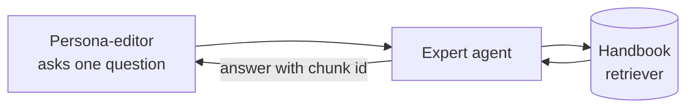

# M36.3 Theory: STORM: multi-perspective research and writing

*[M36 theory](../README.md) · Lesson 36.3 · Notebooks: [`03a_storm.ipynb`](../../notebook/03a_storm.ipynb) · [All theory pages](../../../../../THEORY.md)*
<!-- subtitle: Research a topic from several personas before writing, carry only typed facts forward, and count the calls before the run -->
<!-- format: approved -->

## Start with an article written from one angle

> **What you'll learn**
>
> - **Explain** STORM's four stages and why each one consumes the previous stage's typed output.
> - **Diagnose** the two steps that decide article quality: persona design and outline synthesis.
> - **Calculate** a run's model calls from its parameters before it starts, and its latency once the interviews run in parallel.
> - **Identify** where retrieval has to plug in before the article's facts can be trusted.

Larkspur's documentation team wants a help-centre article on what happens to an account when a customer cancels. A single "write an article about cancelling" prompt returns fluent, generic prose from one angle. It mentions refunds in a sentence, skips the 30-day data-retention window entirely, and no one can tell which claim came from where.

Lesson 36.2 used two perspectives to argue toward a decision. STORM uses several perspectives that cooperate, to research a topic before anyone writes about it.

## STORM

**STORM** (Synthesis of Topic Outlines through Retrieval and Multi-perspective question asking; Shao et al., NAACL 2024) writes a long article on a topic the writer knows little about. It researches first, from several perspectives, and writes only from what the research found:

*Figure 1: STORM's pipeline. Each arrow carries a typed object, not free text.*

1. **Perspective generation.** One structured-output call proposes `P` distinct editor personas, each a different professional lens on the topic.
2. **Simulated interviews.** For each persona, a persona-editor asks one focused question at a time and an expert answers, for `T` turns. Both roles are the same model with different system prompts. A third call extracts the transcript's facts into a typed list.
3. **Outline synthesis.** An editor-in-chief call merges every persona's facts into one ordered outline of 4 to 6 sections.
4. **Section drafting.** A writer call drafts each section from the research notes. A last call writes the title.

The notebook runs this on the impact of remote work on urban commercial real estate, with three perspectives and two interview turns each.

### Follow the cancellation article through a run

Here is the Larkspur cancellation article through the notebook's configuration, `P = 3` and `T = 2`, with an outline of 4 sections. The personas and sections are illustrative; the call counts follow the notebook's code:

Follow one STORM run on the cancellation article. Each stage shows what it produces and the running call count.

<button type="button" data-step="0" aria-pressed="false" aria-controls="storm-step-0">1. Perspectives</button><button type="button" data-step="1" aria-pressed="false" aria-controls="storm-step-1">2. Interviews</button><button type="button" data-step="2" aria-pressed="false" aria-controls="storm-step-2">3. Outline</button><button type="button" data-step="3" aria-pressed="false" aria-controls="storm-step-3">4. Drafts</button><button type="button" data-step="4" aria-pressed="false" aria-controls="storm-step-4">5. Title</button>

<section id="storm-step-0" class="step-panel" aria-labelledby="storm-heading-0"><h4 id="storm-heading-0">1. Propose three personas</h4><dl><dt>Produces</dt><dd><code>PerspectiveList</code>: a billing editor, a data editor and an account-security editor, the disciplines named in the prompt</dd><dt>LLM calls so far</dt><dd>1</dd></dl></section><section id="storm-step-1" class="step-panel" aria-labelledby="storm-heading-1"><h4 id="storm-heading-1">2. Interview each persona</h4><dl><dt>Produces</dt><dd>Per persona: two questions, two answers and one extraction into <code>ResearchFindings</code></dd><dt>Example fact</dt><dd>Data editor: data is kept for 30 days after cancellation, then permanently deleted</dd><dt>LLM calls so far</dt><dd>16 (1 + 3 × 5)</dd></dl></section><section id="storm-step-2" class="step-panel" aria-labelledby="storm-heading-2"><h4 id="storm-heading-2">3. Merge the facts into one outline</h4><dl><dt>Produces</dt><dd><code>ArticleOutline</code>: before you cancel, the refund, your data, closing the account</dd><dt>LLM calls so far</dt><dd>17</dd></dl></section><section id="storm-step-3" class="step-panel" aria-labelledby="storm-heading-3"><h4 id="storm-heading-3">4. Draft each section</h4><dl><dt>Produces</dt><dd>Prose for each of the 4 sections, each written from the research notes</dd><dt>LLM calls so far</dt><dd>21</dd></dl></section><section id="storm-step-4" class="step-panel" aria-labelledby="storm-heading-4"><h4 id="storm-heading-4">5. Write the title and check the count</h4><dl><dt>Produces</dt><dd>A title, then the assembled article</dd><dt>Check</dt><dd>The callback's count matches <code>1 + 3 × (2 × 2 + 1) + 1 + 4 + 1</code></dd><dt>LLM calls in all</dt><dd>22</dd></dl></section>

<button type="button" data-walk="previous">Previous</button>

<button type="button" data-walk="next">Next step</button>

## Typed findings, not transcripts

Each stage hands the next one a typed object produced with structured output, and no stage parses free text:

| Stage | Consumes | Produces |
|---|---|---|
| Perspective generation | The topic | `PerspectiveList`: persona and focus for each editor |
| Interview and extraction | One persona | A transcript, and `ResearchFindings`: a list of facts |
| Outline synthesis | Every persona's facts | `ArticleOutline`: ordered sections, each with a scope |
| Section drafting | One section and every persona's facts | Prose for that section |

*Table 1: What travels between STORM's stages in the notebook.*

Only the extracted facts travel into the outline and the drafts. The transcripts stay behind for audit, and you can trace which question surfaced which fact. Two steps decide quality, and each has a named failure:

- **Echo panel.** Three reworded generalists produce redundant research. If the personas overlap, tighten the perspective prompt, for example by listing the disciplines to draw from.
- **Stapled outline.** Outline synthesis is where `P` research threads become one narrative. An outline with one section per persona is a concatenation, and the synthesis prompt needs to ask for a merged structure.

The same research, two outlines for the cancellation article. Illustrative sections.

<button type="button" data-mode="stapled" aria-pressed="false" aria-controls="outline-stapled">Stapled</button>
<button type="button" data-mode="merged" aria-pressed="false" aria-controls="outline-merged">Merged</button>

<section id="outline-stapled" class="mode-panel" data-announcement="Stapled outline selected. One section per persona."><h4>Stapled: one section per persona</h4><ol><li>What the billing editor found</li><li>What the data editor found</li><li>What the account-security editor found</li></ol>
Three reports in a row. The refund window and the retention window sit in different sections, and the reader has to join them.
</section>
<section id="outline-merged" class="mode-panel" data-announcement="Merged outline selected. One article's table of contents."><h4>Merged: one article's table of contents</h4><ol><li>Before you cancel</li><li>The refund</li><li>Your data</li><li>Closing the account</li></ol>
Each section draws on whichever personas found something about it, and the order follows the customer's path.
</section>

## The missing retrieval boundary

The notebook's expert is the model playing a knowledgeable role, with no retrieval. Its prompt asks it to label a guess as an estimate, but its "facts" are still only as reliable as the model's memory. We call this the **memory expert**, and it is the pattern's main weakness. The original STORM retrieves from the web at this step. The notebook swaps that out to keep the run self-contained:

*Figure 2: The notebook's memory expert. Facts enter the pipeline from the model's memory.*

Swapping the expert's plain call for a tool-using agent grounds it without changing any later stage:

*Figure 3: Added alternative. A grounded expert answers from a retriever and returns the chunk each fact came from.*

On the Larkspur handbook, each persona would then surface its own facts with the chunk they came from:

| Persona | Question it asks | Fact it should surface | Handbook chunk |
|---|---|---|---|
| Billing editor | Can an annual plan be refunded on cancellation? | Full refund within 30 days of purchase if outbound traffic stayed under 100 GB | Refunds |
| Billing editor | How long does the money take? | 5 to 10 business days to the original payment method | Refunds |
| Data editor | What happens to the data? | Kept for 30 days after cancellation, then permanently deleted | Data export and retention |

*Table 2: What a grounded expert would return for the cancellation article. Illustrative questions, facts from the Larkspur handbook.*

> **Interview tip:** when asked how to make STORM trustworthy, name the step. The interview's expert is the only place facts enter the pipeline, and it is where retrieval and citations go.

## Budgeting a STORM run

The cost is fixed by the parameters before the run starts: one call for the perspectives, `2T + 1` per interview (`T` questions, `T` answers, one extraction), one for the outline, one per section and one for the title. In total the run makes `1 + P × (2T + 1) + 1 + S + 1` calls:

| Perspectives `P` | Turns `T` | Calls | With `S` = 4 to 6 sections |
|---|---|---|---|
| 3 | 2 | 18 + S | 22 to 24 (this configuration) |
| 3 | 3 | 24 + S | 28 to 30 |
| 5 | 2 | 28 + S | 32 to 34 |
| 5 | 3 | 38 + S | 42 to 44 |

*Table 3: Model calls per STORM run, from the formula.*

The notebook attaches a callback that counts every chat-model call, structured-output calls included, and compares the count with this arithmetic. Two caps keep the cost bounded when the model returns more than it was asked for: the perspective list is cut to `P`, and the outline to `MAX_SECTIONS = 6`.

Latency is a different number from cost. The interviews are independent of each other, but the notebook runs them in a Python loop, and their waits add up. Dispatching one branch per persona with `Send` ([lesson 36.5](../05_parallel_agents_async_nodes_and_streaming/README.md#map-reduce--async)'s map-reduce) puts them in one superstep. The section drafts are independent in the same way. Counting the calls that must wait for one another:

| Stage | Calls in sequence, as written | Calls in sequence, with `Send` |
|---|---|---|
| Perspectives | 1 | 1 |
| Interviews (`P` = 3, `T` = 2) | 15 | 5 |
| Outline | 1 | 1 |
| Sections (`S` = 5) | 5 | 1 |
| Title | 1 | 1 |
| **Total** | **23** | **9** |

*Table 4: The longest chain of dependent calls in one run, assuming every call takes about the same time (illustrative).*

The same 23 calls are made either way, and the bill does not change. The reader waits for 9 calls in a row instead of 23. The title prompt reads only the topic, so starting it beside the perspectives call shortens the chain to 8.

## Limits of this evidence

- The notebook ships without outputs. Its personas, facts and article change on every run, and this page quotes none of them. The cancellation-article trace, its personas and its outlines are illustrations.
- The call formula comes from reading the notebook's code. The notebook checks it against its callback counter on a live run; this page did not repeat that run.
- Table 4 assumes every call takes about the same time. Drafting calls write several paragraphs and take longer than an editor's one-line question, so real waits differ.
- The memory expert's facts are unverified by design. Table 2's facts are from the Larkspur handbook, not from a STORM run.

## References

- Shao, Y. et al. (2024). Assisting in Writing Wikipedia-like Articles From Scratch with Large Language Models. NAACL 2024. [arXiv:2402.14207](https://arxiv.org/abs/2402.14207)
- LangChain documentation: [Structured output](https://docs.langchain.com/oss/python/langchain/structured-output).
- LangGraph documentation: [Graph API](https://docs.langchain.com/oss/python/langgraph/graph-api), for `Send` and supersteps.

## Key Takeaways

- STORM researches before it writes. `P` personas each run a `T`-turn interview, their extracted facts merge into one outline, and each section is drafted from what the research found.
- Quality rests on distinct personas and an outline that merges the research threads. An echo panel repeats itself, a stapled outline is a concatenation, and a memory expert is only as reliable as the model's memory.
- Cost is fixed before the run at `1 + P × (2T + 1) + 1 + S + 1` calls, 22 to 24 in the recorded configuration. Dispatch the interviews and sections with `Send` to cut the chain of dependent calls without changing the bill.

## Check yourself

1. In STORM, why do only the extracted facts travel into the outline and the drafts, while the interview transcripts stay behind?

Each stage consumes the previous stage's typed object (`PerspectiveList`, `ResearchFindings`, `ArticleOutline`), and no stage parses free text. The facts list is the payload. The transcripts are kept for audit, so you can trace which question surfaced which fact.

2. How many model calls does a STORM run make with 5 perspectives, 2 interview turns and 5 sections?

33 calls: 1 for the perspectives, 5 × (2 × 2 + 1) = 25 for the interviews, 1 for the outline, 5 for the sections and 1 for the title. The table's row for `P` = 5 and `T` = 2 gives 28 + S, which is 33 at `S` = 5.

3. A STORM outline comes back with exactly one section per persona. What has gone wrong, and where do you fix it?

The outline is stapled: a concatenation of the research threads, not a synthesis. Outline synthesis is where `P` threads become one narrative, and the fix is the editor-in-chief's synthesis prompt, which must ask for a merged structure. If the sections also repeat each other, the personas overlap, and the perspective prompt needs tightening.

---
*Previous: [36.2 Debate](../../../optional/theory/02_debate/README.md). Next: [36.4 Meta-controllers, ensembles and emergent systems](../../../optional/theory/04_meta_controllers_ensembles_and_emergent_systems/README.md).*
