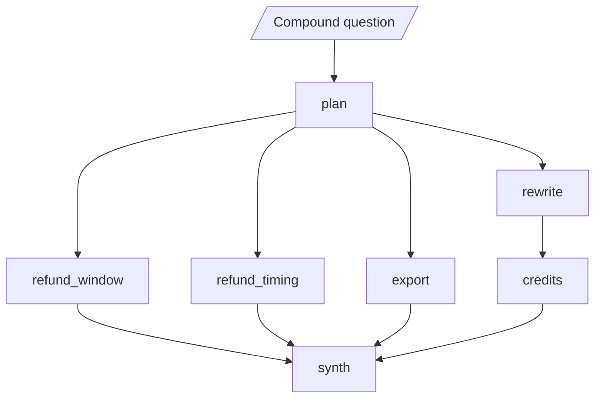
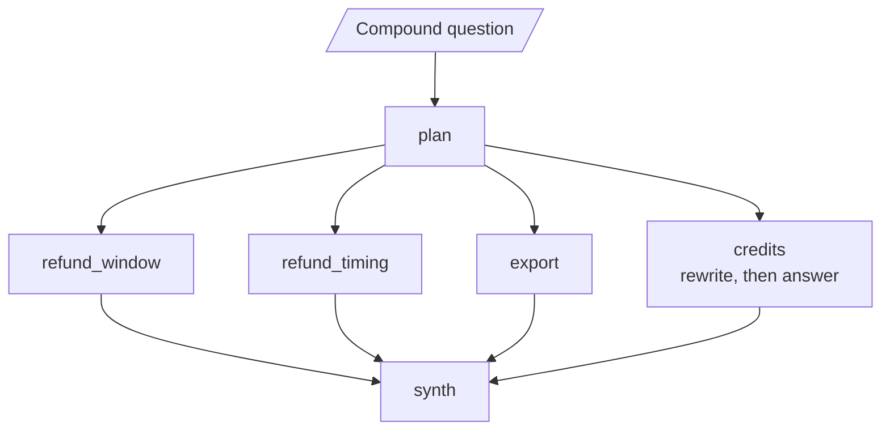
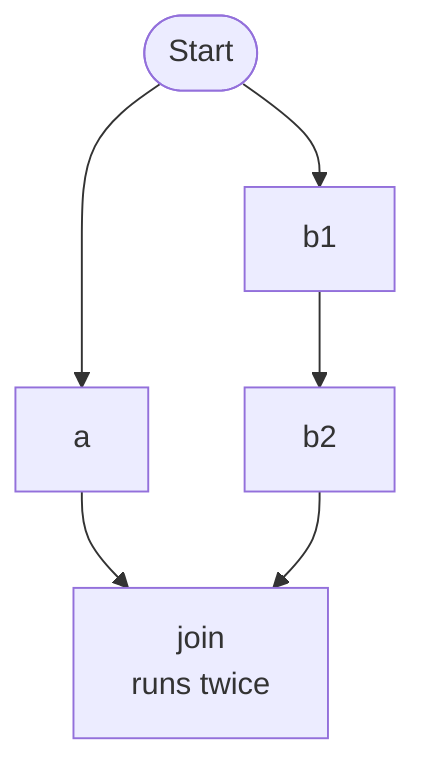
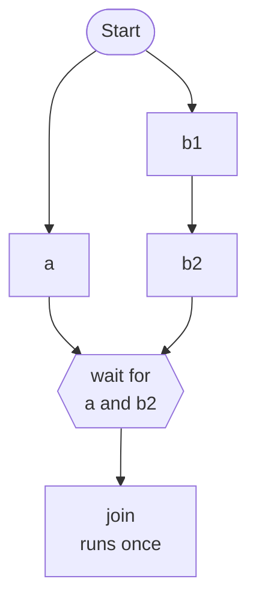
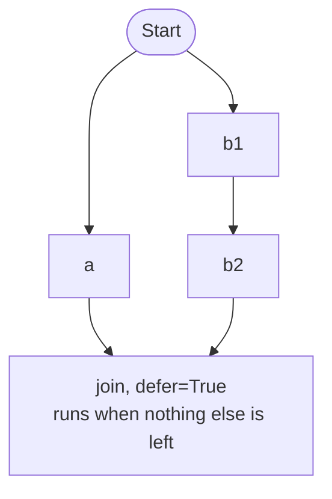
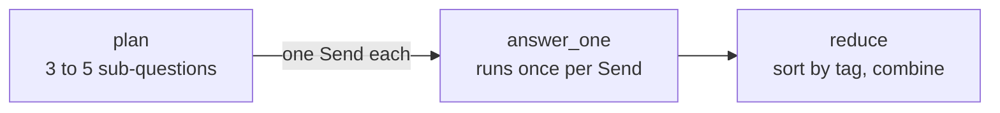

# M36.5 Theory: Parallel agents, async nodes and streaming

*[M36 theory](../README.md) · Lesson 36.5 · Notebooks: [`05a_parallel_agents.ipynb`](../../notebook/05a_parallel_agents.ipynb), [`05b_async_multi_agent_streaming.ipynb`](../../notebook/05b_async_multi_agent_streaming.ipynb) · [All theory pages](../../../../../THEORY.md)*
<!-- subtitle: Parallel branches overlap their waits, superstep by superstep, and a join or a shared key set up wrong answers from half the evidence -->
<!-- format: approved -->

## Start with a four-part refund question

> **What you'll learn**
>
> - **Explain** how LangGraph runs parallel branches in supersteps, and why the slowest branch sets the pace.
> - **Choose** a join that waits for every branch, and a reducer for every key that parallel branches share.
> - **Use** `Send` for a fan-out whose size is known only at run time.
> - **Compare** what `async` nodes, `astream` modes and a concurrency cap change, and when parallelism buys nothing.

Larkspur's assistant receives a compound question: *"I'm cancelling my annual plan after this week's outages. Can I get a full refund, how long will it take, can I still export my data, and do I get credits for the outages?"*

It splits into four sub-questions with independent evidence. Answered one at a time, the reply takes as long as every model call added together. Answered in parallel with the wrong join, the first reply goes out with nothing about outage credits.

## Map-reduce / async

The pattern is map-reduce: split the question, answer the parts in parallel (map), then combine them (reduce). An agent spends almost all of its time waiting, for a model, a search or a database. Three agents that each wait one second take 3 s one after another and 1 s together, because the waits overlap; nothing runs faster. The async notebook measures this with a one-second sleep standing in for a model call, and a scratch run prints 3.00 s and 1.00 s.

Three of the four sub-questions are answered directly. The outage one first rewrites "outages" into the handbook's own words (availability, service credits), because TF-IDF missed that evidence in M10:

<!-- animated: diagrams/supersteps.anim.html -->

*Figure 1: The lab's graph. A planner fans out to four branches, and the outage branch is one node longer than the rest.*

## Supersteps and the barrier

LangGraph runs a graph in **supersteps**. In each superstep it runs every node that the previous superstep triggered, waits for all of them, applies their state updates together, and only then works out what runs next. Several edges out of one node, a **fan-out**, put all their targets in the same superstep, and they run in parallel: `async def` nodes on the event loop, plain `def` nodes in a thread pool.

The parallel notebook proves the layout with model-free stub nodes and a debug stream that reports the superstep of every task. A scratch run on a planner, three searchers and a report gives:

| Superstep | Nodes that ran |
|---|---|
| 1 | plan |
| 2 | search_db, search_docs, search_web |
| 3 | report |

*Table 1: Superstep layout of a one-planner, three-searcher fan-out, from a scratch run (LangGraph 1.2.18).*

The barrier at the end of a superstep costs time when branches have different lengths. The lab gives each node a fixed stub latency:

| Node | plan | refund_window | refund_timing | export | rewrite | credits | synth |
|---|---|---|---|---|---|---|---|
| Seconds | 0.4 | 1.0 | 0.8 | 1.2 | 0.5 | 1.0 | 0.8 |

*Table 2: The lab's stub latencies.*

Step through the compound question on Figure 1's graph, joined so that the synthesizer waits for all four answers:

The lab's schedule for Figure 1 with a list-edge join. Times are the stub latencies of Table 2, not model calls.

<button type="button" data-step="0" aria-pressed="false" aria-controls="superstep-step-0">1. Plan</button><button type="button" data-step="1" aria-pressed="false" aria-controls="superstep-step-1">2. Fan-out</button><button type="button" data-step="2" aria-pressed="false" aria-controls="superstep-step-2">3. Barrier</button><button type="button" data-step="3" aria-pressed="false" aria-controls="superstep-step-3">4. Credits</button><button type="button" data-step="4" aria-pressed="false" aria-controls="superstep-step-4">5. Synth</button>

<section id="superstep-step-0" class="step-panel" aria-labelledby="superstep-heading-0"><h4 id="superstep-heading-0">1. Superstep 1: plan</h4><dl><dt>Runs</dt><dd><code>plan</code>, 0.0 to 0.4 s</dd><dt>Writes</dt><dd>Four sub-questions</dd><dt>Triggers</dt><dd>Four branches: the three answers and <code>rewrite</code></dd></dl></section><section id="superstep-step-1" class="step-panel" aria-labelledby="superstep-heading-1"><h4 id="superstep-heading-1">2. Superstep 2: four branches at once</h4><dl><dt>Runs</dt><dd><code>refund_timing</code> to 1.2 s, <code>refund_window</code> to 1.4 s, <code>export</code> to 1.6 s, <code>rewrite</code> to 0.9 s, all from 0.4 s</dd><dt>Streams</dt><dd>The first sub-answer, <code>refund_timing</code>, at 1.2 s</dd><dt>Ends</dt><dd>At 1.6 s, when the slowest node, <code>export</code>, finishes</dd></dl></section><section id="superstep-step-2" class="step-panel" aria-labelledby="superstep-heading-2"><h4 id="superstep-heading-2">3. The barrier</h4><dl><dt>Waiting</dt><dd><code>rewrite</code> finished at 0.9 s, but <code>credits</code> cannot start until the superstep ends at 1.6 s</dd><dt>Cost</dt><dd>0.7 s spent waiting for work the outage branch does not depend on: the <strong>barrier tax</strong></dd></dl></section><section id="superstep-step-3" class="step-panel" aria-labelledby="superstep-heading-3"><h4 id="superstep-heading-3">4. Superstep 3: credits alone</h4><dl><dt>Runs</dt><dd><code>credits</code>, 1.6 to 2.6 s</dd><dt>State after</dt><dd>All four sub-answers</dd></dl></section><section id="superstep-step-4" class="step-panel" aria-labelledby="superstep-heading-4"><h4 id="superstep-heading-4">5. Superstep 4: synth</h4><dl><dt>Runs</dt><dd><code>synth</code>, 2.6 to 3.4 s, once, with all four answers</dd><dt>Answer lands</dt><dd>At 3.4 s, against 5.7 s for the same nodes one at a time</dd></dl></section>

<button type="button" data-walk="previous">Previous</button>

<button type="button" data-walk="next">Next step</button>

The fix is to keep every branch one node long. Moving the rewrite inside the credits agent makes `credits` a 1.5 s node that starts with the others:

*Figure 2: The rewrite inside the credits agent. Four branches of one node each, three supersteps.*

`credits` now finishes at 1.9 s, and the answer lands at 2.7 s instead of 3.4 s.

## Joins that wait for every branch

A **join** is a node with several incoming branches. The parallel notebook builds one unequal-branch graph three ways: branch `a` is one node long, branch `b1` then `b2` is two.

With **separate edges**, the join runs once for every superstep in which one of its predecessors finished:

*Figure 3: Separate edges. Each finished predecessor triggers the join on its own.*

A **list edge** waits for every node it names. Use it when you know the predecessors at build time. If a conditional edge skips one of them, the join never runs.

*Figure 4: A list edge. One barrier in front of the join that opens when every named node has finished.*

**`defer=True`** keeps the separate edges and holds the join until the run has nothing else to do. It also suits branches chosen at run time.

*Figure 5: `defer=True`. The same edges as Figure 3, with the join held back.*

Pick a join style:

One graph, three join styles. Stub-run counts come from a scratch run of the notebook's join graphs; the lab rows come from its schedule.

<button type="button" data-mode="separate" aria-pressed="false" aria-controls="join-separate">Separate edges</button>
<button type="button" data-mode="list" aria-pressed="false" aria-controls="join-list">List edge</button>
<button type="button" data-mode="defer" aria-pressed="false" aria-controls="join-defer">defer=True</button>

<section id="join-separate" class="mode-panel" data-announcement="Separate edges selected. The join runs twice, the first time with half the inputs."><h4>Separate edges</h4><ul><li>Notebook: the join runs 2 times, seeing <code>a</code>, then <code>a</code> + <code>b2</code>. Supersteps: {a, b1}, {b2, join}, {join}.</li><li>Lab: the synthesizer runs in superstep 3 with 3 of 4 sub-answers and writes a reply with nothing about outage credits, then runs again after <code>credits</code>. This is the <strong>half-evidence answer</strong>.</li></ul></section>
<section id="join-list" class="mode-panel" data-announcement="List edge selected. The join runs once with every input."><h4>List edge</h4><ul><li>Notebook: 1 run, seeing <code>a</code> + <code>b2</code>. Supersteps: {a, b1}, {b2}, {join}.</li><li>Lab: one synthesizer run with all four answers, at 3.4 s.</li></ul></section>
<section id="join-defer" class="mode-panel" data-announcement="defer=True selected. The join runs once when the run goes quiet."><h4>defer=True</h4><ul><li>Notebook: 1 run, seeing <code>a</code> + <code>b2</code>, with the same supersteps as the list edge.</li><li>Lab: one synthesizer run at 3.4 s, with no list of predecessors to maintain.</li></ul></section>

A model-free test that counts the synthesizer's runs keeps a fixed join fixed.

## Reducers for shared keys

Nodes of one superstep write their updates together when it ends. If two of them write the same key and the key has no reducer, LangGraph cannot choose a winner. It raises `InvalidUpdateError` with the message "At key 'findings': Can receive only one value per step." A **reducer** in the state schema says how to combine the writes:

| Key type | Reducer | What two parallel writes become |
|---|---|---|
| List | `operator.add` | One list: every branch appends its sub-answer |
| Counter | `operator.add` | The sum |
| Dict | A dict merge, or `operator.or_` | One dict keyed by branch |

*Table 3: Reducers for keys that parallel branches share.*

The notebook runs the same two nodes against both schemas: the plain one raises, the reduced one keeps both writes. The combined list comes out in the same order on every run, because LangGraph applies a superstep's writes in a fixed order. A key that only one node per superstep writes needs no reducer.

## Fan-out sized at run time

Fixed edges cannot express a fan-out whose size is known only at run time: one branch per document, or one per sub-question when the decomposer (M17) returns three for one question and five for the next. A routing function that returns a list of `Send` objects can. Each `Send` names a node and a private input for it:

*Figure 6: Map-reduce with `Send`. All the `answer_one` runs land in one superstep.*

An `operator.add` reducer collects the results. Branches can finish in any order, and the reduce step sorts them by their tag before combining. The parallel notebook maps an LLM summary over three documents this way and counts one map branch per document. A fourth document adds a fourth branch with no change to the graph.

## Async nodes and streaming

Making nodes `async def` and awaiting the graph changes nothing about which nodes are parallel. Edges from one source decide that, and a chain of async nodes still runs in order. What async adds is overlap on one event loop, and `astream` lets you watch it:

| Stream mode | Emits | Use it for |
|---|---|---|
| `updates` | One event per node, as that node finishes | Progress: "the refund branch is done" |
| `values` | The full state: the input, then once per superstep | Debugging the shared state |
| `messages` | Model output token by token, tagged with the node | Showing two agents writing at once |

*Table 4: What each stream mode reports.*

In the async notebook three agents wired to `START` sleep 1.0, 1.5 and 0.5 s. A scratch run gives:

| Time | `updates` reports | `values` reports |
|---|---|---|
| 0.0 s | | State with 0 notes |
| 0.5 s | hydro finished | |
| 1.0 s | solar finished | |
| 1.5 s | wind finished | State with 3 notes |

*Table 5: The same run through two stream modes. The team takes 1.50 s against 3.0 s for the sum.*

`updates` reports in finish order, which is the proof the agents ran together. `values` stays silent between the two snapshots, because all three agents share one superstep.

In the lab, with the rewrite inside the agent, `updates` streams the first sub-answer at 1.2 s, while `values` stays silent until `credits` ends the superstep at 1.9 s. The [interactive lab](interactive/parallel-subquestions-lab.html) runs this graph with Table 2's latencies and draws every superstep. Its schedule matches LangGraph 1.2.18 running the same graph with sleeps:

| Setting in the lab | Answer lands | Synthesizer runs | Supersteps |
|---|---|---|---|
| One at a time, rewrite as its own node | 5.7 s | 1 | 7 |
| In parallel, rewrite as its own node, separate edges | 3.4 s | 2 (the first saw 3 of 4) | 4 |
| In parallel, rewrite as its own node, list edge or `defer=True` | 3.4 s | 1 | 4 |
| In parallel, rewrite inside the agent | 2.7 s | 1 | 3 |
| In parallel, rewrite inside the agent, `max_concurrency` 2 | 3.7 s | 1 | 3 |
| In parallel, rewrite inside the agent, `max_concurrency` 1 | 5.7 s | 1 | 3 |
| In parallel, rewrite as its own node, separate edges, `max_concurrency` 1 | 6.5 s | 2 | 4 |

*Table 6: The lab's schedule at seven settings.*

<!-- lab: interactive/parallel-subquestions-lab.html -->

`max_concurrency` in the run config caps how many tasks run at once, which keeps you under a provider's rate limit. LangGraph starts a superstep's tasks in node-name order: at a cap of 2, `credits` and `export` start first and the refund branches wait. At a cap of 1 the parallel graph takes as long as the chain, and with separate edges longer (6.5 s), because the synthesizer still runs twice.

## When parallelism buys nothing

- **A chain.** If the writer needs the researcher's output, it cannot start early. The async notebook's three dependent one-second steps take about 3 s, async or not.
- **A single agent.** One agent waiting is one wait. Streaming can still show progress, but there is no time to win.
- **Fast local work.** Arithmetic and string handling are work, not waiting. Async adds overhead to them.

Whole runs can overlap too: gathering three complete team runs on one event loop takes 1.50 s in a scratch run, against about 4.5 s one after another. Inside a running event loop, such as a notebook, await the graph directly: starting a second loop there fails.

M37 builds full multi-agent applications on these pieces.

## Limits of this evidence

- **Stub latencies, not model calls.** The lab and Tables 5 and 6 use fixed sleeps. Real calls vary, and the slowest branch's tail sets p95.
- **Replays, not recorded runs.** Tables 1 and 5 and the join switcher come from running the notebooks' model-free cells with LangGraph 1.2.18. Table 6 was rerun with sleep nodes at half scale and matched the lab at every row.
- **Token streaming is not replayed.** The `messages` mode needs a model.

## References

1. LangGraph, [Graph API](https://docs.langchain.com/oss/python/langgraph/graph-api), supersteps, reducers, `Send` and deferred nodes.
2. LangGraph, [Streaming](https://docs.langchain.com/oss/python/langgraph/streaming), the `updates`, `values` and `messages` modes.
3. Malewicz, G. et al. (2010). *Pregel: A System for Large-Scale Graph Processing*. SIGMOD. [doi:10.1145/1807167.1807184](https://doi.org/10.1145/1807167.1807184). The superstep model LangGraph's runtime is named after.
4. Dean, J. and Ghemawat, S. (2008). *MapReduce: Simplified Data Processing on Large Clusters*. Communications of the ACM 51(1). [doi:10.1145/1327452.1327492](https://doi.org/10.1145/1327452.1327492).

## Key Takeaways

- Parallel agents overlap their waits and run no faster: three one-second waits take 1 s together against 3 s in sequence. A chain, a single agent or fast local work gains nothing.
- LangGraph runs fan-out targets in one superstep and waits for all of them before the next. Keep branches the same length, and join with a list edge or `defer=True` so the join runs once with every input.
- Give any key that several nodes write in one superstep a reducer, or LangGraph raises `InvalidUpdateError`. Use `Send` for fan-outs sized at run time, and `max_concurrency` to stay under rate limits.

## Check yourself

1. Three agents that each wait one second finish in about one second together. Why, and what does making nodes async not change?

The waits overlap, and nothing runs faster. Edges from one source put nodes in the same superstep, and that is what makes them parallel. Making nodes `async def` adds overlap on one event loop but does not change which nodes are parallel. A chain of async nodes still runs in order.

2. In the lab, moving the rewrite inside the credits node brings the answer from 3.4 s to 2.7 s. Where does the saving come from?

As its own node, `rewrite` finishes at 0.9 s, but `credits` cannot start until the superstep ends at 1.6 s, when `export` finishes. The outage branch pays a 0.7 s barrier tax for work it does not depend on. Inside one node, every branch is one node long and that wait disappears.

3. The synthesizer writes a reply with nothing about outage credits, then runs a second time. What causes this, and how do you fix it?

The join uses separate edges, and it runs once for every superstep in which a predecessor finished. Its first run saw 3 of 4 sub-answers. Use a list edge when the predecessors are known at build time, or `defer=True` when branches are chosen at run time. A list edge never runs if a conditional edge skips one of its named nodes.

---
*Previous: [36.4 Meta-controllers, ensembles and emergent systems](../../../optional/theory/04_meta_controllers_ensembles_and_emergent_systems/README.md). Next: [M36 interview questions](../README.md#interview-spotlight-5-questions-you-might-get-asked).*
