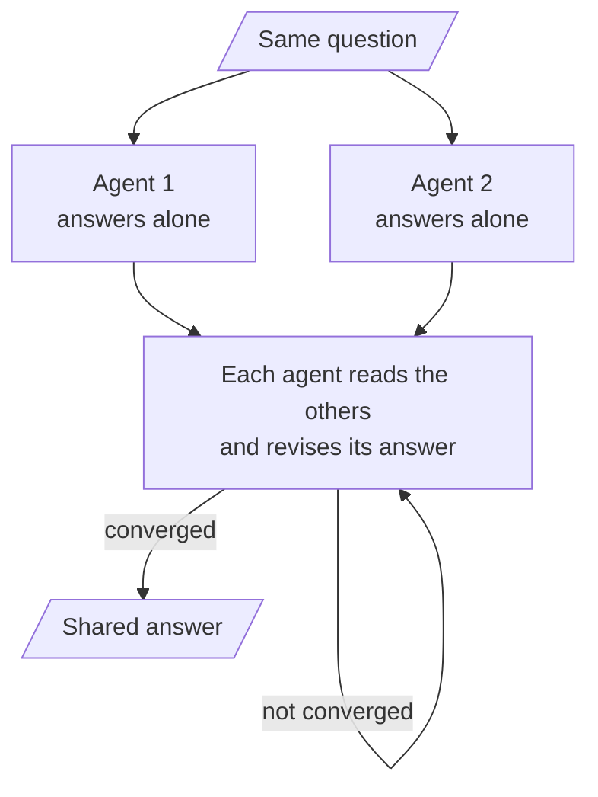
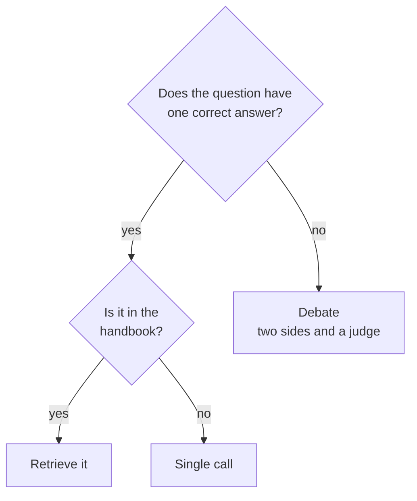

# M36.2 Theory: Debate

*[M36 theory](../../../mandatory/theory/README.md) · Lesson 36.2 · Notebooks: [`02a_debate.ipynb`](../../notebook/02a_debate.ipynb) (optional) · [All theory pages](../../../../../THEORY.md)*
<!-- subtitle: Two agents arguing opposite sides and a judge who reasons past both earn their seven calls on trade-offs, never on facts -->
<!-- format: approved -->

## Start with a recommendation nobody argued against

> **What you'll learn**
>
> - **Explain** the debate loop: two fixed sides, a round counter and a judge with a structured verdict.
> - **Compare** the debate this lesson builds with the other research setup that shares its name.
> - **Diagnose** a debate that adds nothing: parallel monologues, a lopsided persona, a biased judge.
> - **Choose** between debate, a single call and retrieval by asking whether the question has one correct answer.

Larkspur's product team asks the support assistant: *should we stop retrieving and put the whole handbook in a long-context prompt?* One model call returns a tidy recommendation. It may be right, but it shows one framing of a question with real costs on both sides: cost per call, accuracy on facts buried mid-context, and access control (the fifth interview question on the [M10 module page](../../../../../p04_rag_foundations/m10_rag_lifecycle/mandatory/theory/README.md#interview-spotlight-5-questions-you-might-get-asked)). The team wants the counter-case argued properly before it commits.

Lesson 36.1's specialists cooperated on one board. Here two agents disagree on purpose, and the reader of the result sees the strongest case for each side before a decision.

## Debate

In a **debate** two agents argue opposite sides of a question over several rounds. Each reads the whole transcript and rebuts the other's latest point. A neutral **judge** then writes the verdict:

*Figure 1: The round-robin debate graph. Only the two sides and the judge call a model.*

This shape follows **MAD** (Liang et al., EMNLP 2024): fixed affirmative and negative sides, and a judge that reads the debate and extracts the answer. MAD's judge may also end the debate early. The notebook always runs every round.

A second research setup shares the name. In **multiagent debate** (Du et al., 2023) every agent gets the same prompt and answers on its own, then reads the others' answers and revises until they converge. There are no assigned sides and no judge:

*Figure 2: Added for comparison. Multiagent debate in the style of Du et al., with no sides and no judge. The notebook does not build it.*

MAD is built to surface the strongest case on each side of a trade-off. Multiagent debate is built to make agents check each other's reasoning toward one answer. The notebook builds the MAD shape, on a classic trade-off: should a six-person team building a new B2B SaaS product start with microservices or a monolith.

## A bounded round-robin

The control flow is a small graph with one counter in state. After the second side speaks, an `advance_round` node adds one to the counter, and a routing function sends the graph back to the first side or on to the judge. That function is plain Python, and the notebook checks it without a model call. A scratch run of the whole graph with a stub model makes six debater turns and one judge call:

Step through the debate with <code>MAX_ROUNDS = 3</code>. Each stage shows the round counter, the route and the running call count.

<button type="button" data-step="0" aria-pressed="false" aria-controls="debate-step-0">1. Round 1</button><button type="button" data-step="1" aria-pressed="false" aria-controls="debate-step-1">2. Round 2</button><button type="button" data-step="2" aria-pressed="false" aria-controls="debate-step-2">3. Round 3</button><button type="button" data-step="3" aria-pressed="false" aria-controls="debate-step-3">4. Judge</button>

<section id="debate-step-0" class="step-panel" aria-labelledby="debate-heading-0"><h4 id="debate-heading-0">1. Round 1: two opening turns</h4><dl><dt>Turns</dt><dd>Pro-microservices opens, pro-monolith rebuts and argues</dd><dt>Counter after advance_round</dt><dd>2, at most 3: route back to the first side</dd><dt>LLM calls so far</dt><dd>2</dd></dl></section><section id="debate-step-1" class="step-panel" aria-labelledby="debate-heading-1"><h4 id="debate-heading-1">2. Round 2: two rebuttals</h4><dl><dt>Turns</dt><dd>Each side answers the other's newest point before adding one or two of its own</dd><dt>Counter after advance_round</dt><dd>3, at most 3: route back to the first side</dd><dt>LLM calls so far</dt><dd>4</dd></dl></section><section id="debate-step-2" class="step-panel" aria-labelledby="debate-heading-2"><h4 id="debate-heading-2">3. Round 3: the last two turns</h4><dl><dt>Turns</dt><dd>Two more rebuttals; the transcript now holds six turns</dd><dt>Counter after advance_round</dt><dd>4, above 3: route to the judge</dd><dt>LLM calls so far</dt><dd>6</dd></dl></section><section id="debate-step-3" class="step-panel" aria-labelledby="debate-heading-3"><h4 id="debate-heading-3">4. The judge fills a verdict</h4><dl><dt>Output</dt><dd>A <code>DebateVerdict</code>: the strongest point from each side, the weak claims, a recommendation and a confidence</dd><dt>Counter</dt><dd>Not read again; the graph ends</dd><dt>LLM calls in all</dt><dd>7</dd></dl></section>

<button type="button" data-walk="previous">Previous</button>

<button type="button" data-walk="next">Next step</button>

A counter in code bounds the debate. No agent decides when to stop, and the loop cannot run away the way a blackboard controller can.

## What makes a debate worth reading

Three rules carry the pattern. Each one guards against a named failure:

- **Sides that engage.** Each persona argues its side without inventing facts. After its opening turn it must rebut the opponent's strongest recent point before adding one or two of its own, in at most 120 words in this configuration. Without that rule the debate turns into **parallel monologues**: two cases stated side by side, and nothing for the judge to weigh.
- **A judge that reasons past the debate.** The judge fills a `DebateVerdict`: the strongest point from each side, the weak or overstated claims, a final recommendation and a confidence. Its prompt asks it not to name a winner. The recommendation may be conditional, such as "start with a monolith, split out services when a named pressure appears".
- **A baseline beside it.** The notebook asks the same question in one call with a neutral prompt and prints both answers. A capable model often hedges on its own, and then the debate adds little.

Three weaknesses remain, and the rules above only reduce them:

| Planted weakness | What happens | Why |
|---|---|---|
| **Shared blind spot** | Neither side raises a consideration | Neither persona was primed to look for it |
| **Lopsided debate** | One side wins every exchange | Its persona prompt is stronger than the other's |
| **Biased judge** | The verdict leans one way regardless of the transcript | The judge is one model call and a single point of bias |

*Table 1: Failures the debate pattern does not remove, from the notebook's own analysis.*

> **Pitfall: treating the verdict as ground truth.** A judged recommendation is an argued opinion. When both sides miss a consideration, the judge cannot weigh it.

## Counting the calls

Each round costs two debater turns, and the judge adds one call at the end:

| Approach | LLM calls | What you get |
|---|---|---|
| Single call | 1 | One answer, often already balanced |
| Debate, `N` rounds | `2N + 1` | A transcript, the strongest point from each side, a judged recommendation |
| Debate, `N = 3` (this configuration) | 7 | Six turns and one verdict |

*Table 2: The cost of a debate against a single call. The `advance_round` node makes no model call.*

Latency grows with the calls too, because every turn waits for the one before it. The deliverable is the auditable trail: what each side said, what the judge found strongest and what it rejected.

## Choosing when to debate

Debate earns its cost on questions with legitimate trade-offs and no single correct answer, such as architecture choices, build or buy, and policy. For a factual question with one correct answer, the single call or retrieval is the better choice:

*Figure 3: Route facts to retrieval or one call, and keep debate for trade-offs.*

Three Larkspur questions, three different right tools. Pick one to see where Figure 3 sends it.

<button type="button" data-mode="refund" aria-pressed="false" aria-controls="question-refund">Refund time</button>
<button type="button" data-mode="context" aria-pressed="false" aria-controls="question-context">Long context</button>
<button type="button" data-mode="policies" aria-pressed="false" aria-controls="question-policies">Two policies</button>

<section id="question-refund" class="mode-panel" data-announcement="Refund time selected. One correct answer, so retrieve it."><h4>How long does a refund take?</h4>
One correct answer, in the handbook: 5 to 10 business days to the original payment method. Retrieve it. A debate would spend 7 calls arguing about a fact.
</section>
<section id="question-context" class="mode-panel" data-announcement="Long context selected. A trade-off, so debate it."><h4>Should the assistant stop retrieving and use a long-context prompt?</h4><ol><li>Frame it with two sides: keep retrieval, or move the whole handbook into the prompt.</li><li>Write two personas of equal strength, each told to rebut before adding a point.</li><li>Run three rounds: seven calls in all.</li><li>Run the single-call baseline and look for what the judge adds: named conditions, a staged path, a missed counter-argument.</li><li>List what neither side raised before treating the verdict as a decision.</li></ol></section>
<section id="question-policies" class="mode-panel" data-announcement="Two policies selected. Not a debate: fix the index."><h4>Two retrieved chunks give an old and a new refund policy</h4>
This looks like a debate and is not one: one of the chunks is out of date. Fix the index first with version metadata and a filter (M11) rather than asking two agents to argue about which one is current.
</section>

Lesson 36.3 keeps several perspectives but makes them cooperate: STORM uses them to research an article instead of arguing.

## Limits of this evidence

- The notebook ships without outputs, and this page quotes no transcript or verdict. The call count and the round routing come from a scratch run of the notebook's own graph with a stub model, so they show the control flow, not argument quality.
- The weaknesses in Table 1 come from the notebook's own analysis. No experiment here measures how often a judge is biased or a side lopsided.
- Whether a debate beats the single call is the notebook's open question: it prints both answers for you to compare and scores neither.

## References

- Liang, T. et al. (2024). Encouraging Divergent Thinking in Large Language Models through Multi-Agent Debate. EMNLP 2024. [arXiv:2305.19118](https://arxiv.org/abs/2305.19118)
- Du, Y. et al. (2023). Improving Factuality and Reasoning in Language Models through Multiagent Debate. [arXiv:2305.14325](https://arxiv.org/abs/2305.14325)
- LangChain documentation: [Structured output](https://docs.langchain.com/oss/python/langchain/structured-output), the mechanism behind `DebateVerdict`.

## Key Takeaways

- A debate runs two opposing sides over `N` rounds, each rebutting the other's latest point, then a judge fills a structured verdict. It costs `2N + 1` calls, 7 at three rounds, against 1 for a single call.
- Require each side to rebut before adding its own points, or the debate becomes parallel monologues. Ask the judge for the strongest point from each side and a recommendation rather than a winner.
- Debate questions with real trade-offs, such as build or buy. Send factual questions like the refund time to retrieval, and fix disagreeing chunks in the index with version metadata.

## Check yourself

1. Why must each debater rebut the opponent's strongest recent point before adding one or two of its own?

Without the rebuttal rule the debate turns into parallel monologues, and the judge has nothing to weigh. Engagement is what lets the judge's verdict name the strongest point from each side and the weak or overstated claims.

2. How many LLM calls does the three-round debate cost against a single call, and what do the extra calls buy?

`2N + 1` calls, which is 7 for `N = 3` (six turns and one verdict), against 1. They buy a transcript, the strongest point from each side and a judged recommendation. A capable model often hedges on its own, and the single call is the baseline to compare against.

3. Two retrieved Larkspur chunks give an old and a new refund policy. Should two agents debate which one is current?

No. Fix the index first with version metadata and a filter (M11). Debate earns its cost on trade-offs with no single correct answer. A factual question such as how long a refund takes (5 to 10 business days) belongs to retrieval.

---
*Previous: [36.1 Blackboard architectures](../../../mandatory/theory/01_blackboard_architectures/README.md). Next: [36.3 STORM: multi-perspective research and writing](../../../mandatory/theory/03_storm_multi_perspective_research_and_writing/README.md).*
