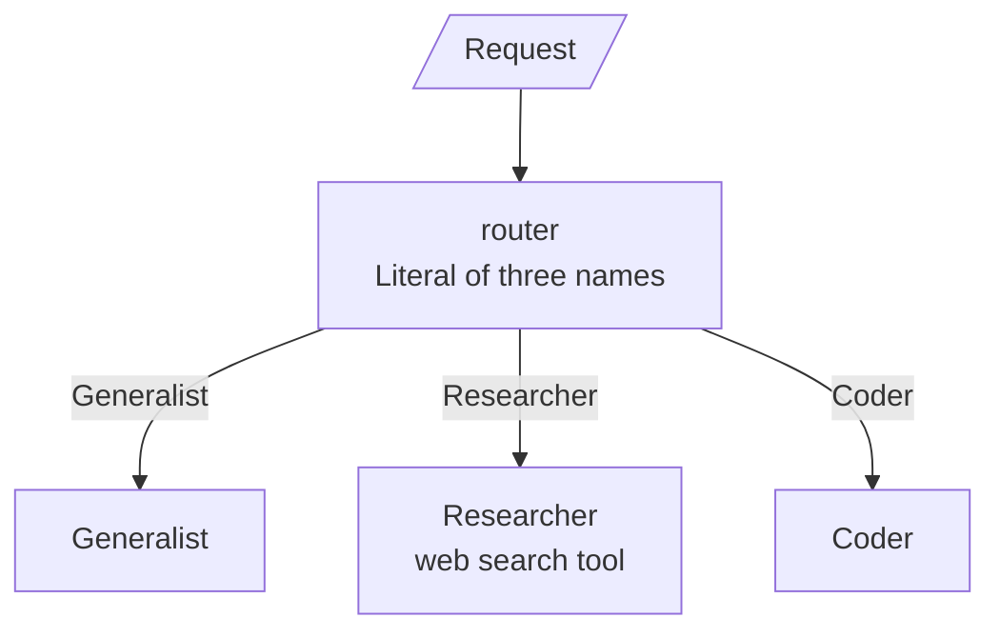
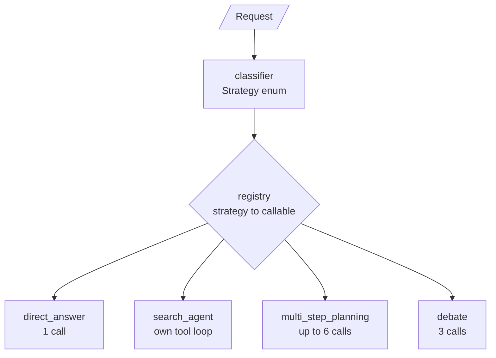
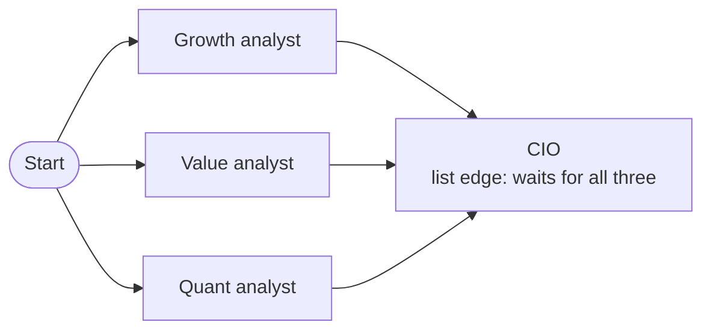
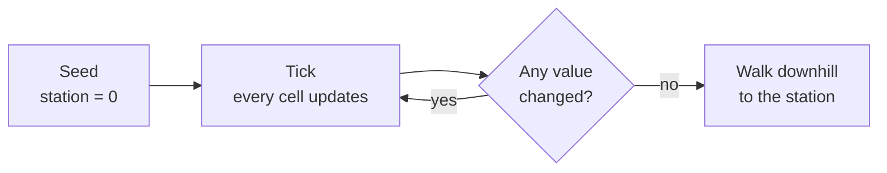

# M36.4 Theory: Meta-controllers, ensembles and emergent systems

*[M36 theory](../../../mandatory/theory/README.md) · Lesson 36.4 · Notebooks: [`04a_meta_controller.ipynb`](../../notebook/04a_meta_controller.ipynb) (optional), [`04b_ensemble_parallel_exploration.ipynb`](../../notebook/04b_ensemble_parallel_exploration.ipynb) (optional), [`04c_cellular_automata.ipynb`](../../notebook/04c_cellular_automata.ipynb) (optional) · [All theory pages](../../../../../THEORY.md)*
<!-- subtitle: How much control a multi-agent system needs, from a controller that picks a whole architecture to cells that follow one local rule -->
<!-- format: approved -->

## Start with a queue that gets every kind of request

> **What you'll learn**
>
> - **Distinguish** a router, a meta-controller and a blackboard controller by what they choose and how often.
> - **Diagnose** a misrouted request, which still gets an answer, with a table of expected routes checked in code.
> - **Compare** an ensemble's independent votes with its aggregator's verdict.
> - **Explain** how a grid of cells with one local rule finds shortest paths with no controller at all.

Larkspur's support assistant now receives every kind of request in one queue: "What is a vCPU?", "Is there an incident right now?", a four-part refund question, "Should we move to an annual plan?".

Any single architecture is wrong for part of that queue. One model call guesses at the live incident. A search loop spends calls on the vCPU definition, which the model already knows. A debate over the refund window wastes three calls on a question with one answer.

Lessons 36.1 to 36.3 each fixed one way of coordinating agents. This lesson asks who chooses that way, then removes the chooser altogether.

## Three kinds of controller

A router, a meta-controller and a blackboard controller are all one structured-output call that picks from a fixed set. They differ in what they pick and how often:

| Controller | What it decides | When | Calls per request |
|---|---|---|---|
| Router | Which specialist answers, inside one fixed graph | Once, before any specialist runs | 1 |
| Meta-controller | Which whole architecture runs: one call, a search agent, a planner or a debate | Once, before any architecture runs | 1 |
| Blackboard controller (36.1) | Which specialist acts next, given the whole board | After every contribution, until done | Up to one per specialist turn, plus one |

*Table 1: Three controllers, one mechanism. The difference is the level and the frequency of the choice.*

### A router picks a specialist

The notebook's router has three specialists: a generalist for conversation, a researcher with web search (three results per search), and a coder. Its decision is a `Literal` of the three names, and a conditional edge dispatches to the chosen node.

*Figure 1: The router. One decision, then one specialist inside one fixed graph.*

A router differs from a handoff (M35) in who holds the decision. The router decides before any specialist runs, and the specialist cannot pass the request on. In a handoff, the agent holding the conversation transfers it by calling a tool.

### A meta-controller picks an architecture

A **meta-controller** makes the same choice one level up. It wraps each architecture as a plain callable that takes the request text and returns an answer, and it never sees inside one. Its decision is a `Strategy` enum, and a registry maps each member to its callable instead of a chain of `if`s. A check in code catches a strategy with no callable.

*Figure 2: The meta-controller. One classification, then a whole architecture it treats as a black box.*

The registry is what makes the design grow: a new strategy is one callable and one line in the classifier prompt. Pick a strategy to see which Larkspur request it suits:

The notebook's four strategies, mapped onto Larkspur traffic. The classifier adds one call in front of each. Larkspur requests are illustrative; call counts are from the notebook's code.

<button type="button" data-mode="direct" aria-pressed="false" aria-controls="strategy-direct">direct_answer</button>
<button type="button" data-mode="search" aria-pressed="false" aria-controls="strategy-search">search_agent</button>
<button type="button" data-mode="plan" aria-pressed="false" aria-controls="strategy-plan">multi_step_planning</button>
<button type="button" data-mode="debate" aria-pressed="false" aria-controls="strategy-debate">debate</button>

<section id="strategy-direct" class="mode-panel" data-announcement="direct_answer selected. One call for a self-contained fact."><h4>direct_answer</h4><ul><li>Shape: a self-contained fact the model already knows.</li><li>Larkspur request: "What is a vCPU?" (general knowledge, no handbook needed).</li><li>Model calls inside: 1.</li></ul></section>
<section id="strategy-search" class="mode-panel" data-announcement="search_agent selected. Its own tool loop decides how many searches."><h4>search_agent</h4><ul><li>Shape: live or external information.</li><li>Larkspur request: "Is there an incident right now?" (only the live status page knows).</li><li>Model calls inside: its own tool loop decides, capped at 12 graph steps.</li></ul></section>
<section id="strategy-plan" class="mode-panel" data-announcement="multi_step_planning selected. At most six calls."><h4>multi_step_planning</h4><ul><li>Shape: several bundled sub-questions.</li><li>Larkspur request: the refund, timing, export and credits question of lesson 36.5.</li><li>Model calls inside: at most 6 (a plan, up to 4 sub-answers, a synthesis). The plan is cut to 4 sub-questions.</li></ul></section>
<section id="strategy-debate" class="mode-panel" data-announcement="debate selected. Three calls."><h4>debate</h4><ul><li>Shape: a trade-off with no single answer.</li><li>Larkspur request: "Should we move from a monthly to an annual plan?".</li><li>Model calls inside: 3 (for, against, a judge).</li></ul></section>

### When the route is wrong

The main weakness is a **silent misroute**. A misrouted request still gets an answer, from the wrong specialist or architecture, and nothing downstream notices. A `direct_answer` reply to "Is there an incident right now?" reads fine and is a guess.

The notebook's guard is a table of requests with the route each was written for, compared in code with the route each controller chose:

| Request | Written for | What a wrong route costs |
|---|---|---|
| Chemical symbol for gold | `direct_answer` | Extra calls, same answer |
| Price of Bitcoin today | `search_agent` | A confident guess at a live value |
| Largest planet: which, why so large, compared with Earth | `multi_step_planning` | One of the three parts shortchanged |
| Fully remote work against office attendance | `debate` | One side presented as simply correct |

*Table 2: The meta-controller's route check from the notebook. The same table, with the router's three requests, is the regression test to run on every prompt or model change.*

Two limits remain. One choice per request cannot handle a mixture ("look up X, then debate whether it is a good idea"). The classification call also adds latency before any real work starts.

## Ensembles: vote against verdict

An **ensemble** runs several independent agents on the same question at the same time, each with a different persona, and an aggregator combines their conclusions. The notebook's committee has a bullish growth analyst, a cautious value analyst and a quantitative analyst, each a search agent. A chief investment officer (CIO) writes the recommendation.

*Figure 3: The ensemble graph. Three branches in one superstep, and a join that waits for all of them.*

The graph uses every piece of lesson 36.5. One edge from `START` to each analyst puts all three in one superstep. All three write the shared `analyses` key in that superstep, and the key carries the `operator.or_` reducer, which merges their one-entry dicts. A list edge from the three analysts makes the CIO wait for every report.

The analysts never see each other's work, and none anchors on another. That independence is what an ensemble buys. The notebook checks two things that are easy to assume:

- **Overlap.** Each analyst records its start and end time. The check passes when all three windows were open at once.
- **Vote against verdict.** Each analyst ends its report with a `Buy`, `Hold` or `Sell` line. The CIO's recommendation is a `Literal` of five values, from `Strong Buy` to `Strong Sell`, and code maps it to its direction (`Strong Buy` counts as `Buy`). Code then sets the majority vote beside the verdict.

Pick an outcome to see how the check reads it:

Four committee outcomes and what the vote-against-verdict check concludes. The votes are illustrative.

<button type="button" data-mode="agree" aria-pressed="false" aria-controls="verdict-agree">Agrees</button>
<button type="button" data-mode="justified" aria-pressed="false" aria-controls="verdict-justified">Justified departure</button>
<button type="button" data-mode="override" aria-pressed="false" aria-controls="verdict-override">Unexplained override</button>
<button type="button" data-mode="split" aria-pressed="false" aria-controls="verdict-split">Split committee</button>

<section id="verdict-agree" class="mode-panel" data-announcement="Agrees selected. The CIO follows the majority."><h4>Agrees with the majority</h4><ul><li>Votes: Buy, Buy, Hold. Majority: Buy, 2 of 3.</li><li>CIO verdict: Buy. Nothing to flag.</li></ul></section>
<section id="verdict-justified" class="mode-panel" data-announcement="Justified departure selected. The CIO departs and says why."><h4>A justified departure</h4><ul><li>Votes: Buy, Buy, Buy.</li><li>CIO verdict: Hold, and the summary explains why. The aggregator is allowed to weigh evidence the vote missed.</li></ul></section>
<section id="verdict-override" class="mode-panel" data-announcement="Unexplained override selected. The failure to look for."><h4>An unexplained override</h4><ul><li>Votes: Buy, Buy, Buy.</li><li>CIO verdict: Hold, and the summary gives no reason. This is the failure to look for.</li></ul></section>
<section id="verdict-split" class="mode-panel" data-announcement="Split committee selected. No majority."><h4>A split committee</h4><ul><li>Votes: Buy, Hold, Sell. No majority.</li><li>Any verdict: the CIO weighed a split committee, and the check reports that instead of a match.</li></ul></section>

For Larkspur, the same shape fits an answer review. Three graders read one drafted reply, one for faithfulness to the retrieved chunks, one for tone, one for policy, and an aggregator decides whether it ships. The committee is priced like three agents, and its latency is set by the slowest grader.

## Emergent systems

The cellular-automata notebook has no controller at all. Every cell of a warehouse grid is a small agent with one local rule: its distance to the packing station is 1 plus the smallest distance among its four neighbours. Walls stay at infinity. Applied to every cell at once, tick after tick, the rule spreads a distance wave around the walls. A carrier reaches the station by always stepping to the neighbour with the lowest value.

*Figure 4: The automaton's loop. Every cell computes its next value from the current grid, then all values change together.*

The notebook runs this on a 7 by 7 warehouse with walls inside, then checks every emergent path against a global breadth-first search over the same grid. A scratch run of its deterministic cells gives:

| Run | Ticks until stable | Carrier path | Breadth-first shortest |
|---|---|---|---|
| Item A, original layout | 9 | 4 moves | 4 |
| Item B, original layout | 9 | 3 moves | 3 |
| Item A, wall added next to the station | 15 | 12 moves | 12 |

*Table 3: Emergent paths against a global search, from a scratch run of the cellular-automata notebook. The count of ticks includes the final tick that changes nothing.*

The third row is the adaptability claim. A new wall beside the station blocks item A's short route, and the same rule finds the 12-move route around the top of the grid with no change to the code.

This is the far end of the control range in this module: no controller, only a local rule applied everywhere in synchronous ticks. It solves a global problem without a planner, at the cost of many cheap updates. A `MAX_TICKS` guard (500) stops a grid that never settles, and the notebook trusts the result only after the breadth-first check.

## Choosing how much control

The four designs on this page and lesson 36.1 sit on one range, from a model choosing at every step to no chooser at all:

| | Blackboard controller | Meta-controller | Ensemble | Cellular automaton |
|---|---|---|---|---|
| Who decides | An LLM, every turn | An LLM, once | Nobody: all agents run | A local rule in every cell |
| Model calls added | Up to one per turn | 1 | 1 (aggregator) | 0 |
| Main risk | Runaway controller | Silent misroute | Unexplained override | A rule that never settles |
| Check in code | Call cap, preconditions | Expected-route table | Overlap, vote against verdict | Global search on the result |

*Table 4: Four control styles and the check each one needs.*

For Larkspur's mixed queue, classify each request once with the meta-controller and record its reasoning. Dispatch through the registry: the vCPU question to one call, the incident question to the search agent, the four-part question to planning (lesson 36.5 runs its parts in parallel), the plan question to debate. Review drafted replies with a three-grader ensemble, and flag any verdict that overrides the graders without a reason. Keep the expected-route table beside the classifier prompt and run it on every change.

Lesson 36.5 opens up the parallel machinery the ensemble relied on: supersteps, joins, reducers and `Send`.

## Limits of this evidence

- **No recorded model runs.** The notebooks ship without outputs. Which route a classifier picks, and how the CIO votes, depends on the model; the pages describe what the notebooks check in code, not a logged result.
- **The automaton table is a replay.** Table 3 comes from running the notebook's own grid and search cells in the scratchpad, with no model involved. It holds exactly for that 7 by 7 layout.
- **Larkspur mappings are illustrative.** The strategy switcher and the grader committee show where each shape fits; they are not notebook tests.

## References

1. LangGraph, [Graph API](https://docs.langchain.com/oss/python/langgraph/graph-api), conditional edges, reducers and parallel branches.
2. Li, J. et al. (2024). *More Agents Is All You Need*. [arXiv:2402.05120](https://arxiv.org/abs/2402.05120). Sampling several agents and voting, the simplest ensemble.
3. Gardner, M. (1970). *Mathematical Games: The fantastic combinations of John Conway's new solitaire game "life"*. Scientific American 223(4). [doi:10.1038/scientificamerican1070-120](https://doi.org/10.1038/scientificamerican1070-120). The best-known cellular automaton.

## Key Takeaways

- A router picks a specialist and a meta-controller picks a whole architecture, each once per request, with one structured-output call over a fixed set. A misrouted request still gets an answer: keep a table of requests with their intended routes and compare it in code on every prompt or model change.
- An ensemble runs independent agents in one superstep with a reducer on their shared key. Set the majority vote beside the aggregator's verdict, and flag a departure from the majority that gives no reason.
- A cellular automaton needs no controller: one local rule found the shortest paths in the warehouse (4 and 3 moves, then 12 around a new wall), confirmed by a global search.

## Check yourself

1. A router and a meta-controller each make one structured-output call before any work starts. What does each one choose?

A router chooses which specialist answers inside one fixed graph. A meta-controller chooses which whole architecture runs (a direct answer, a search agent, a planner or a debate), each wrapped as a callable it never sees inside. A blackboard controller differs from both by deciding again after every contribution.

2. A Larkspur customer asks whether there is an incident right now. Which strategy should the meta-controller pick, and why not direct_answer?

`search_agent`, because only the live status page knows the answer. `direct_answer` suits a self-contained fact the model already knows, such as what a vCPU is. A misrouted request still gets an answer, which is why the implementation compares each chosen route with the route the request was written for.

3. All three ensemble analysts end with Buy, and the CIO recommends Hold. Is that a failure?

Only if the CIO's summary gives no reason. Code maps the CIO's five-value recommendation to Buy, Hold or Sell and sets the majority vote beside it. A CIO that departs from the majority and says why is fine. One that departs with no reason is the unexplained override to look for.

---
*Previous: [36.3 STORM: multi-perspective research and writing](../../../mandatory/theory/03_storm_multi_perspective_research_and_writing/README.md). Next: [36.5 Parallel agents, async nodes and streaming](../../../mandatory/theory/05_parallel_agents_async_nodes_and_streaming/README.md).*
