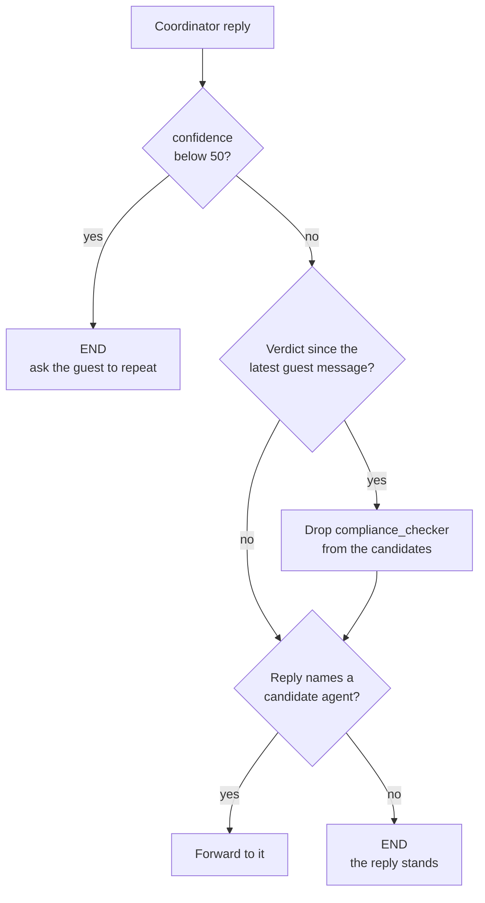
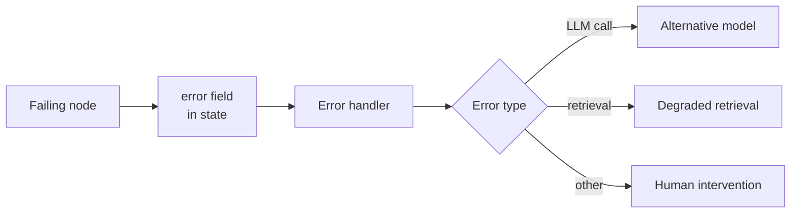

# M37.2 Theory: Hardening: edge cases, testing and system-wide error handling

*[M37 theory](../README.md) · Lesson 37.2 · Notebooks: [`02a_hotel_edge_cases_and_errors.ipynb`](../../notebook/02a_hotel_edge_cases_and_errors.ipynb), [`02b_hotel_testing_the_system.ipynb`](../../notebook/02b_hotel_testing_the_system.ipynb), [`02c_hotel_system_wide_error_handling.ipynb`](../../../optional/notebook/02c_hotel_system_wide_error_handling.ipynb) (optional) · [All theory pages](../../../../../THEORY.md)*
<!-- subtitle: Test the router without a model, read outcomes from state and the database, and give every failure a bounded way out -->

## System testing

> **What you'll learn**
>
> - **Explain** why a multi-agent system needs tests at three levels, from a pure router to end-to-end runs.
> - **Trace** the router's three rules on hand-built states, and read which threshold makes which test pass.
> - **Diagnose** a test suite that turns green by hiding a bug.
> - **Choose** a bounded recovery for each kind of failure: retry, fallback model, degraded retrieval or a person.

Lesson 37.1 built a hotel desk with a coordinator, a compliance checker and a reservation agent, and left two gaps open: the checker runs only when the coordinator names it, and the router forwards on any mention of an agent's name.

A multi-agent system fails quietly. The coordinator skips the compliance check or forwards a booking before it has dates, and the guest still gets a polite reply. **System testing** for agents means checking the decisions and the side effects, never the tone of the final message.

The build catches these failures at three levels, from cheapest to most realistic:

| Level | What it checks | Model calls | How the result is read |
|---|---|---|---|
| Router unit tests | The routing rules, on 7 hand-built states | None | The route the pure router function returns |
| A confidence gate | That an unclear request stops the turn instead of forwarding | One per guest message | A `confidence` integer in state, from structured output |
| A regression table | 5 guest requests, end to end | Every agent's | The nodes that ran and the database |

*Table 1: Three levels of tests, cheapest first.*

### The router as a pure function

The router can be unit-tested because it is a pure function of the state: no model call, no I/O. It checks three rules in order:

*Figure 1: The router's three rules. The confidence gate runs first, then the loop guard, then the name check.*

The seven tests pin each rule down. We ran the build's router on them at its threshold of 50:

| Test state | Confidence | Expected | Returned |
|---|---|---|---|
| Reply forwards to the checker | 90 | checker | checker |
| Verdict given, reply forwards to reservations | 90 | reservations | reservations |
| Loop guard: checker named again after a verdict | 90 | END | END |
| Old verdict, new guest message, checker named | 90 | checker | checker |
| Unsure reply that names the reservation agent | 20 | END | END |
| Plain answer about the gym | 95 | END | END |
| Known issue: "I can't involve the reservation assistant until you give me dates" | 70 | END | reservations |

*Table 2: The seven router tests at threshold 50, run with the shared hotel module and no model.*

The last row is a **known issue** kept on purpose: lesson 37.1's mention routing, where the refusal contains the words "reservation assistant" and the name check matches them. The suite keeps it as an expected failure, which documents the gap and flags the day a typed router fixes it.

### The confidence gate

The confidence score comes from the coordinator itself. On each new guest message it asks the model for a self-assessment, a score from 0 to 100 and a one-line reason. The assessor's prompt defines three bands:

- **80 to 100**: the intent is clear.
- **50 to 79**: the intent is clear but details are missing, such as a booking without dates.
- **0 to 49**: the model cannot tell what the guest wants.

Only the last band should stop the turn, which puts the threshold at 50. Below it the coordinator apologises and asks the guest to rephrase. The score is a heuristic, not a calibrated probability; its job is to trigger the "ask again" path.

### What a threshold can hide

The [interactive lab](interactive/router-test-bench-lab.html) runs the same router and its seven tests in the page, ported from the shared hotel module, and recomputes them at every threshold. We ran the Python router at all 101 thresholds and got the same four bands:

| Threshold | Tests passing | What changes |
|---|---|---|
| 0 to 20 | 5 of 7 | The confidence-20 reply clears the gate and forwards to the reservation agent |
| 21 to 70 | 6 of 7 | Only the known issue fails, as recorded |
| 71 to 90 | 7 of 7 | The known issue passes because the gate ends its turn before the name check runs |
| 91 to 100 | 4 of 7 | The gate blocks the three confident forwards, scored 90 |

*Table 3: Router tests passing at each threshold, from the Python router and the lab.*

All seven green at 75 is the wrong result. Mention routing is as fragile as at 50, and every guest whose booking lacks dates, which the assessor scores 50 to 79, now gets an apology instead of a question about the dates. Call this a **gate that hides the bug**: the suite passes because a different rule fires first.

<!-- lab: interactive/router-test-bench-lab.html -->

### Regression runs read from state

Unit tests cannot tell whether the model still behaves. The regression table can. Each row is a guest request with its expected outcome, run on a fresh thread after the database is rebuilt:

| Case | Confident | Verdict | Reservation agent runs | Booked |
|---|---|---|---|---|
| General question (jacuzzi) | yes | `COMPLIANT` | no | |
| Another guest's data (Bob Johnson's dates) | yes | `VIOLATION` | no | |
| Booking, dates missing | yes | `COMPLIANT` | no | |
| Complete booking (Dana Lee, Deluxe) | yes | `COMPLIANT` | yes | one row for Dana Lee |
| Ambiguous ("same as last time, but…") | no | not checked | no | |

*Table 4: The five end-to-end cases and their expected outcomes.*

The outcome comes from the final state, the nodes that ran and a row count on `reservations`, never from the reply text. Each failure names the field that broke. `verdict: expected COMPLIANT, got None` means the coordinator skipped the check; `reservation: expected False, got True` means it forwarded a booking without dates.

Model output varies between runs. A single failure is a lead, and the number to track is the pass rate over several runs after every prompt or model change. Tests show that something broke; the next section covers how the system recovers.

## Edge cases and error paths

The build pushes on three edges of the core system and puts each safeguard in code:

- **Injection-style input.** A guest hides `' OR '1'='1` in the room type. Pasted into a `WHERE`, the condition is true for every row: on a scratch copy of the hotel database, a Deluxe search widened that way returned all 8 rooms. It can only widen a read, because the query tool refuses every write and the booking tool binds its values as parameters. The durable fixes are structural: a read-only connection and a narrow write tool.
- **A violation that should reach a person.** A human review node pauses the graph with `interrupt()`: the graph saves a checkpoint and stops. The thread's state shows which node waits, and resuming with the reviewer's decision continues from that point. A resumed node runs again from its first line, so side effects such as writing to the review log go after the pause, where they run once. The checkpoint history replays the thread step by step for investigating a complaint.
- **Dates in the past.** The model extracts the dates with structured output, given today's date to resolve "next Friday", and a plain function compares them with today. That check is testable without an API call.

### Recovery by error type

Some failures do not fix themselves. A failing node catches its exception and writes a small record to an `error` field in state, with no message added. Routers read that field, so a guest who types the word "error" cannot trigger the error path. One error handler logs every failure with the thread id, and a pure decision router picks the recovery:

*Figure 2: The error path. Failures travel through state, and a pure router picks one recovery per error type.*

The three recoveries:

| Failure | Recovery | What it does |
|---|---|---|
| The coordinator's model call fails | Alternative model | Answers as the coordinator with a second model, `gpt-4o` |
| The vector store fails | Degraded retrieval | Skips the store and sends the hard-coded rules straight to the verdict node |
| Anything else, including a failing fallback | Human intervention | A stub that writes a handoff message |

*Table 5: Recovery per error type.*

A fallback that fails raises a different error type, and the router sends it to a person instead of looping. Call the trap this avoids a **fallback loop**. Every failure is injected with a simulation flag, which lets each recovery path run on every run, and a table computed from the node paths proves which one ran.

### Retries for brief outages

Transient failures get a cheaper fix first: a retry policy re-runs a node that raises. The build uses three attempts, a 0.2 s first wait and no jitter. We ran that policy on a tiny graph whose node fails a set number of times:

| Failures before success | Attempts | Waits between attempts | Result |
|---|---|---|---|
| 2 | 3 | 0.2 s, then 0.4 s | Succeeds on the third attempt |
| 3 | 3 | 0.2 s, then 0.4 s | The exception reaches the caller |

*Table 6: The retry policy on a node that fails twice and three times, measured in the scratchpad with LangGraph's RetryPolicy.*

A retry smooths over a brief outage and does not replace the error path. Without any policy, the first failure ends the whole run.

## In practice: testing Larkspur's desk

Larkspur's support desk from lesson 37.1 gets the same three levels:

1. Router unit tests on hand-built states, including the billing refusal that names the billing agent, kept as a known issue until a typed router lands.
2. A regression table of handbook requests (a refund inside the window, a refund outside it, another account's data, an ambiguous "do the same as last month"), read from node paths and the refunds table.
3. A pass rate per case over several runs, tracked after every prompt or model change.
4. Error recovery by type: a second model for a failed call, the hard-coded policy text when the vector store is down, a person for anything else.

Lesson 37.3 adds agents in parallel and a memory that outlives the context window.

## Key Takeaways

- Test at three levels: unit tests on the pure router with no model calls, a confidence gate that stops unclear turns, and an end-to-end regression table read from the nodes that ran and the database.
- A threshold that turns every test green can still be wrong. At 75 all seven router tests pass, yet every booking that lacks dates gets an apology instead of a question about the dates.
- Record failures in an `error` field in state and let a pure router pick the recovery, with a failed fallback raising a different error so it reaches a person. Keep retries for brief outages.

## Check yourself

1. Why can the router be unit-tested without a model call, and what does the regression table catch that those tests cannot?

The router is a pure function of the state, with no model call and no I/O, and seven hand-built states pin down its rules. The unit tests cannot tell whether the model still behaves. The regression table runs 5 guest requests end to end and reads the nodes that ran and the `reservations` table, never the reply text.

2. In the router test bench lab, a threshold of 75 makes all seven tests pass. Should you set the confidence threshold to 75?

No. The known issue passes only because the gate ends its turn before the name check runs, and mention routing is as fragile as at 50. Every guest whose booking lacks dates, which the assessor scores 50 to 79, would also get an apology instead of a question about the dates.

3. A regression run fails with verdict expected COMPLIANT but got None. What happened, and is one such failure enough to act on?

The coordinator skipped the compliance check, and no verdict was recorded. Model output varies between runs, which makes a single failure a lead to investigate, not a conclusion. The number to track is the pass rate over several runs, re-run after every prompt or model change.

---
*Previous: [37.1 Hotel system: environment, coordinator, reservation agent, compliance](../01_hotel_system_environment_coordinator_reservation_agent_compliance/README.md). Next: [37.3 Scaling: parallel agents, memory merging, language and sentiment, web search](../../../optional/theory/03_scaling_parallel_agents_memory_merging_language_and_sentiment_web_search/README.md).*
