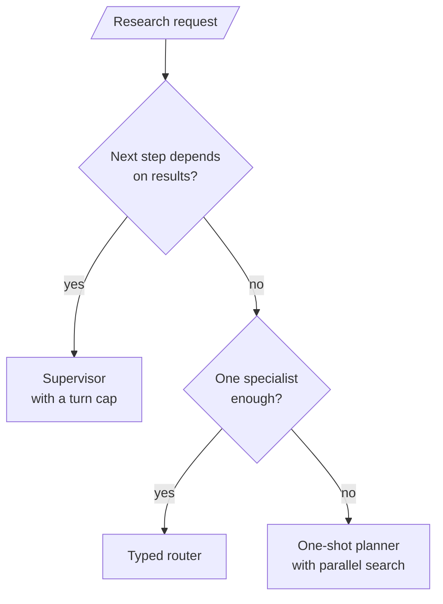
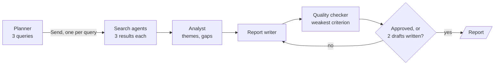

# M37.4 Theory: Research systems: supervisor financial research, summarisation, full research system

*[M37 theory](../README.md) · Lesson 37.4 · Notebooks: [`04c_multi_agent_research_system.ipynb`](../../notebook/04c_multi_agent_research_system.ipynb), [`04a_supervisor_financial_research.ipynb`](../../../optional/notebook/04a_supervisor_financial_research.ipynb) (optional), [`04b_multi_agent_research_summarization.ipynb`](../../../optional/notebook/04b_multi_agent_research_summarization.ipynb) (optional) · [All theory pages](../../../../../THEORY.md)*
<!-- subtitle: Pick who decides the next step, keep every finding tied to its source, and stop the review loop in code -->

## The project: a research team

> **What you'll build**
>
> - A one-shot planner that splits a topic into a fixed number of search queries and runs one search agent per query, in parallel.
> - An analyst and a report writer that work from one shared, source-tagged findings list.
> - A quality checker that scores each draft by its weakest criterion, with a draft cap enforced in code.
> - Two smaller teams to compare against: a supervisor over a market researcher and a coder, and a typed router over web, RAG and plain-model specialists.

Lesson 37.3 merged parallel hotel agents into one reply. The research builds keep that fan-out and fan-in and change the question: who decides which agent works next, and when. The full pipeline is the mandatory build; the supervisor and the typed router are the optional builds it is compared against.

Outside a notebook, a research team fails in ways a single agent does not. Larkspur's support engineers want an answer that cites the handbook and the web, and three things go wrong in production: a search returns nothing useful, a forum post contradicts the handbook, or a provider call fails. The module's lab brief asks for exactly this team, built on the Larkspur handbook and tested on those three cases. This page covers the designs it draws on.

## Planner, supervisor or router

The three builds answer the "who decides next" question differently, and that choice sets how many model calls a request costs and what can go wrong:

| | Supervisor | Typed router | One-shot planner |
|---|---|---|---|
| Decides | After every worker report, who acts next or whether to finish | Once per question, which one specialist runs | Once, up front, the list of search queries |
| Sees results | Yes | No | No |
| Workers per request | Any number, in sequence | Exactly one, then a summarizer | One per planned query, in parallel |
| How the choice reaches the graph | The model writes `next` into state; a pure function follows it | A structured-output field whose only values are web research, RAG or the plain model | One `Send` per planned query |
| Bound in code | 6 supervisor turns | One route per question | 3 queries, and 2 drafts on the revision loop |

*Table 1: The three controllers compared, with the caps each build sets in code.*

The supervisor is the most flexible and the hardest to bound. Its build proves the turn cap with a stub supervisor that never finishes. Its researcher also returns a validated market-data object, numbers only, and the coder sees just the user's request and that object. No web text reaches the agent that runs code.

The typed router is the fix for lesson 37.1's mention routing: the choice is a field, and there is no reply text to search. Its RAG specialist answers only from chunks whose relevance score reaches 0.2, out of the top 3. When nothing clears that floor, it skips the model call and says so.

The planner never sees a result, which is what separates it from a supervisor. It cannot adapt, but its cost is known before the first search runs. The choice comes down to two questions:

*Figure 1: Choosing a controller. Adaptivity costs boundedness, so take the supervisor only when the next step really depends on what came back.*

The planner wins for a broad topic with known angles. The rest of the page follows it.

## A quality loop with a cap in code

The full pipeline has five roles. A planner splits the topic into search queries, search agents run them in parallel and append to one shared findings list, an analyst and a writer turn the findings into a report, and a quality checker sends the report back for revision until it passes or the cap is reached:

<!-- animated: diagrams/quality-loop.anim.html -->

*Figure 2: The research pipeline. The loop back to the writer ends on approval or at the draft cap, whichever comes first.*

The settings live in one place, and code enforces each of them:

| Setting | Value | Enforced by |
|---|---|---|
| Queries | 3 | The planner's list is cut to this length, so the fan-out never depends on the model counting |
| Results per query | 3 | Each DuckDuckGo search keeps this many hits |
| Quality threshold | 0.7 | Every review criterion must reach it |
| Draft cap | 2 | The quality gate ends the loop at this many reviewed drafts, whatever the scores say |

*Table 2: The pipeline's settings and the code that enforces each one.*

| Piece | What it does | Built on |
|---|---|---|
| A reducer on the findings | Lets parallel search agents append to one list | Lesson 37.3's reducer rule |
| URL verification | Each search agent extracts 2 or 3 findings tied to a result URL; code marks whether that URL is one the search actually returned | Grounding, so an invented source shows up |
| The weakest criterion decides | The reviewer scores completeness, clarity and actionability from 0.0 to 1.0, and the quality score is the minimum; code checks that the four required sections are present | A typed verdict, as in lesson 37.1 |
| Revisions see the previous draft | The writer runs at temperature 0.7 and gets its last draft and the reviewer's feedback; at temperature 0 a revision tends to repeat the draft | Generator and critic |
| The exit is code | A pure gate approves when the minimum reaches 0.7 and no section is missing, otherwise loops back, unless the draft count has reached 2 | Lesson 37.2's pure router |

*Table 3: The design details that make the loop safe, and what each reuses.*

The four required sections are Executive Summary, Key Findings, Analysis and Recommendations. The reviewer is never asked to be lenient on a later pass; the cap does that job. Call the failure it prevents a **runaway revision loop**: a strict reviewer and a writer that cannot satisfy it, revising until the recursion limit stops the run with no report.

### Proving the loop with stubs

The build proves the wiring before it spends a token. The graph factory accepts replacement nodes, and stub nodes plan four queries with two findings each. We ran the stub runs in the scratchpad:

| Stub reviewer | Search agents run | Findings kept | Drafts written | Reviews |
|---|---|---|---|---|
| Always scores 0.1 | 4 | 8 | 2 | 2 |
| Always scores 0.9 | 4 | 8 | 1 | 1 |

*Table 4: Stub runs of the research graph with no model calls.*

All eight findings survive the parallel writes, every query contributes, the never-satisfied reviewer stops at 2 drafts, and the satisfied one stops at 1. The real run is then checked against its streamed updates: one search agent per planned query, every query represented in the findings, and as many drafts as reviews, never more than 2.

## Following one refund question

A Larkspur support engineer asks the team about the refund window for annual plans, and a community forum post quotes an older window than the handbook. Here is the order of calls (*Illustrative*, since a live run's searches change):

| Step | Who | What moves |
|---|---|---|
| 1 | Planner | Three queries: the handbook policy, recent changes, customer reports |
| 2 | Three search agents, in parallel | Up to 3 hits each; 2 or 3 findings each, every one tagged with its URL and whether the search returned it |
| 3 | Analyst | Themes, gaps and contradictions across all findings, including the forum post against the handbook |
| 4 | Writer | Draft 1, citing both sources and naming the handbook as the policy |
| 5 | Quality checker | Scores each criterion; the minimum decides |
| 6 | Gate | Approves, or sends one revision back; stops after draft 2 either way |

*Table 5: One research request through the pipeline (illustrative).*

The writer can only say which source is the policy because the findings kept their sources through the parallel fan-in.

## Design choices worth copying

| Choice | Why |
|---|---|
| Cap the fan-out by cutting the planner's list in code | The model's count of queries is a request, and cost scales with queries times results |
| Tag every finding with its URL and verify it | An invented source becomes visible before the writer cites it |
| List contradictions before anyone writes | A conflict between a forum post and the handbook reaches the report as a stated conflict, with both sources |
| Skip the model when no chunk clears the relevance floor | "No results" becomes an honest answer instead of a guess |
| Record a tool failure in state and let a pure router pick a fallback, with a cap on retries | Lesson 37.2's error path, reused for search and data providers |
| Stop review at a fixed draft count | A strict reviewer cannot keep the run going |

*Table 6: Choices from the three builds and the risk each one addresses.*

## Limits

The cap hides quality problems from the user: a run stopped at draft 2 still ships a report. Log whether each run ended approved or capped, and treat a rising share of capped runs as a sign that the writer or the sources got worse. URL verification only proves the search returned the link; it does not prove the page says what the finding claims. The supervisor build's market data comes from OpenBB and Tavily, and the research builds need an OpenAI key and web search access, so none of them run offline beyond their stub checks.

## Key Takeaways

- A supervisor sees results and can adapt but is hardest to bound. A typed router picks one specialist per question, and a one-shot planner fixes its queries up front, which makes its cost known before the first search.
- Tie every finding to its source and mark whether the URL is one the search returned. When a forum post and the handbook disagree, the writer can then cite both and say which is the policy.
- End a quality loop in code. Score each draft by its weakest criterion, check the required sections in code, stop at 2 drafts whatever the reviewer says, and prove the wiring with stub nodes first.

## Check yourself

1. What separates the one-shot planner from the supervisor, and what does each give up?

The supervisor decides after every worker report. It can adapt, but it is the hardest to bound and needs a cap of 6 supervisor turns. The planner decides the list of queries once, up front, and never sees a result: it cannot adapt, but its cost is known before the first search runs.

2. The reviewer scores a first draft 0.9 for completeness, 0.8 for clarity and 0.6 for actionability, with all four sections present. What does the quality gate do?

It sends the draft back to the writer. The quality score is the minimum, 0.6, which is below the 0.7 threshold. The writer gets its previous draft and the feedback, and the cap ends the loop after the second reviewed draft whatever the scores say.

3. A web forum post quotes an old Larkspur refund window while the handbook gives the current one. What must the research team preserve so the writer can handle it?

The source of every finding. The analyst lists contradictions across all findings before anyone writes, and the writer should cite both sources and say which one is the policy. It can only do that if the findings keep their sources through the parallel fan-in.

---
*Previous: [37.3 Scaling: parallel agents, memory merging, language and sentiment, web search](../../../optional/theory/03_scaling_parallel_agents_memory_merging_language_and_sentiment_web_search/README.md). Next: [M38 MCP foundations](../../../../../p11_agent_protocols/m38_mcp_foundations/mandatory/theory/README.md).*
