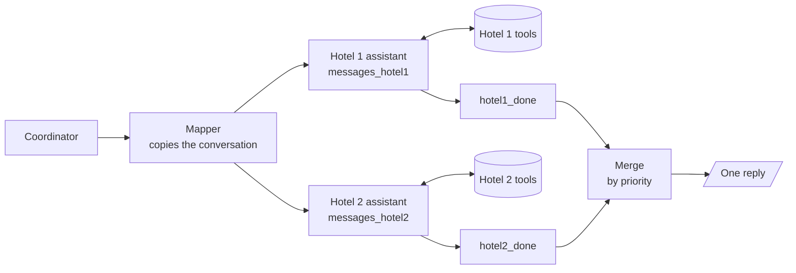
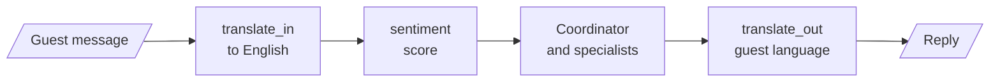

# M37.3 Theory: Scaling: parallel agents, memory merging, language and sentiment, web search

*[M37 theory](../../../mandatory/theory/README.md) · Lesson 37.3 · Notebooks: [`03a_hotel_parallel_reservation_agents.ipynb`](../../notebook/03a_hotel_parallel_reservation_agents.ipynb) (optional), [`03b_hotel_merging_and_conversation_memory.ipynb`](../../notebook/03b_hotel_merging_and_conversation_memory.ipynb) (optional), [`03c_hotel_guest_language_and_sentiment.ipynb`](../../notebook/03c_hotel_guest_language_and_sentiment.ipynb) (optional), [`03d_hotel_web_search_integration.ipynb`](../../notebook/03d_hotel_web_search_integration.ipynb) (optional) · [All theory pages](../../../../../THEORY.md)*
<!-- subtitle: Fan out to parallel agents, merge their answers into one reply, and fold old turns into a summary the thread keeps -->

## Memory merging

> **What you'll learn**
>
> - **Explain** what parallel branches need before their answers can come back together: a reducer, a key per branch and a join.
> - **Trace** two hotels' answers through a merge that writes one reply in priority order.
> - **Compare** trimming old turns with summarizing them into state.
> - **Diagnose** a sentiment score that reads raw foreign-language text as neutral.

Lesson 37.2 hardened the single-hotel desk. Now the chain has two hotels. Hotel 1 has rooms 101 to 104 and Hotel 2 rooms 105 to 108, each in its own database with its own read-only SQL tools, and a guest asking for a Deluxe room should hear about both.

Done naively, the guest gets two replies, the first missing a hotel, or one hotel's agent answers from the other hotel's database. **Memory merging** is the work of bringing several agents' outputs back into one state: the answers of parallel branches into one reply, and old turns into something smaller than the full transcript. The shape that works:

*Figure 1: Fan-out to two hotel assistants, each with its own message key and tools, then a join and one merge.*

### Three wiring failures

The build reaches that shape in three attempts, and each failure is a LangGraph rule. Its stub graphs need no model, and we ran them in the scratchpad:

| Attempt | What the stub showed | The rule |
|---|---|---|
| Two nodes write one plain key in the same step | `InvalidUpdateError`: the key can receive only one value per step | A key written by parallel nodes needs a reducer, such as list concatenation |
| Both tool loops share one message list | Hotel 1's call never got a result; Hotel 2's agent received both results, one from Hotel 1's database | One message key per branch, for the tool node and for the condition that routes to it |
| Each branch's end goes straight to the merge node | The merge ran twice: first with Hotel 1 unfinished, then again | A sync node at the end of each branch and a join edge that waits for both |

*Table 1: The three attempts and what each stub run printed.*

The shared-key failure is the dangerous one. A tool node answers the latest tool call in its list, which may belong to the other branch. With the real SQL tools both hotels have a tool called `run_query`, and the wrong database answers without any error. Call it **crossed tool results**.

The merge-twice failure has a plain cause. A conditional edge fires the merge every time any branch reaches it, and the Hotel 1 branch in the stub takes two tool rounds while Hotel 2 takes one. With the sync nodes and the join, the merge ran once, after both branches finished.

Two more choices keep the branches honest. Both assistants come from one factory, which binds each to its own hotel's tools; copying the first assistant to make the second is how Hotel 2's agent ends up reading Hotel 1's database. And the branches cannot book. Both run the same request at the same time, and a booking tool in each would create two reservations. They report availability and prices, and booking waits until the guest picks a hotel.

### Merging by priority

The merge itself is an agent. It reads the guest's request and each hotel's final answer, listed in a fixed priority order (Hotel 1, then Hotel 2), and writes one reply under three rules:

1. Recommend the first hotel that can help and offer the other as an alternative.
2. Ignore a hotel that cannot help, unless none can.
3. Keep room numbers, prices and dates exactly as the assistants gave them.

Only the merged reply enters the shared conversation; each branch's tool calls stay in its own key. The two test turns:

| Guest asks | Ground truth from SQLite | The reply should |
|---|---|---|
| A Deluxe room in two months | Hotel 1 room 104, Hotel 2 room 108 | Name 104 before 108 |
| The Family Suite during Bob's stay | None free: Hotel 1 has no Family Suite, Hotel 2's is booked | Say plainly that none is free |

*Table 2: The merge's two test turns and the ground truth each is checked against.*

Code checks the first case by the position of the room numbers in the reply, against free rooms computed from the databases, never against the model's claim.

### Summarizing old turns into state

Every turn now adds several agent messages to the thread. The second half of the build keeps it small by **summarizing into state**. A summarize node runs at the start of each turn when the stored conversation has more than 6 messages:

1. It keeps the last guest turn word for word; everything before it is old. The cut is always at a guest message, so no tool call is separated from its result.
2. It asks the model to fold the old messages into a running `summary` field, keeping every concrete fact: names, room types and numbers, prices, dates, what was offered and refused.
3. It returns a removal marker for each old message id, and the message reducer deletes them.

The summary goes into the coordinator's and assistants' prompts as a system message, never into the guest's reply. The test turn asks *Remind me: which Deluxe room did you recommend, and at what price?* after every earlier message was removed. The model can only answer from the summary. The new graph continues the same thread because both graphs share one checkpointer.

The two ways to shrink a thread differ in what they lose:

| | Trimming (M33) | Summarizing into state |
|---|---|---|
| What changes | What the model sees on this call | What the thread stores |
| Old turns | Dropped from view, still stored | Folded into `summary`, deleted by id |
| Cost | No model call | One model call when the thread passes the limit |
| Risk | Facts outside the window are forgotten | Facts the summary leaves out are gone for good |

*Table 3: Trimming compared with summarizing into state.*

Call the summarizer's risk **lossy folding**: a fact it drops cannot be recovered from the thread. That is why its prompt lists the fact types to keep and why the test asks for a specific room and price. With merging in place, new capabilities can attach to the core without touching it.

## Adding agents around the core

The last two builds add capabilities without changing the coordinator, the checker or the reservation agent. Each adds its capability to the core from lesson 37.1 on its own; no build composes all of them into one graph.

*Figure 2: The language and sentiment build. Translation wraps the core, and the coordinator reads the sentiment score.*

### Language and sentiment

The inbound node detects the guest's language and replaces the message with an English version, using one structured-output call for the language code and the text. A sentiment node then scores the English text with TextBlob's word lexicon. The coordinator adds a de-escalation instruction only when the message reads as negative, and the outbound node translates the final reply back.

The language is a per-thread state field. A global language variable breaks the moment two guests write at once, which is a form of **shared global state** across threads.

The order of translation and scoring matters, because the lexicon is English-only and word-level. We scored the build's own sample reviews with TextBlob, using its thresholds of -0.1 and +0.1:

| Text | Human label | Lexicon label | Polarity | Words scored |
|---|---|---|---|---|
| The service is terrible and the room was dirty. | negative | negative | -0.80 | terrible, dirty |
| Die Bedienung ist schrecklich und das Zimmer war schmutzig. | negative | neutral | 0.00 | none |
| Das Personal war wunderbar und das Frühstück war köstlich. | positive | neutral | 0.00 | personal |
| Le personnel était merveilleux et le petit-déjeuner délicieux. | positive | neutral | 0.00 | none |
| Great, another cold shower. Just what I needed. | negative | positive | +0.10 | great, cold |

*Table 4: TextBlob on raw text, from the build's sample reviews.*

Raw German scores nothing, so an angry German guest never triggers de-escalation. Sarcasm fools the lexicon in English too. Scoring the translation fixes the first problem and leaves the second.

### Web search

A web search assistant with Tavily, capped at 3 results per search, answers questions about the neighbourhood, which no hotel database holds. It is one more tool loop and one more name the coordinator can route to. The test checks which node ran for a nearby-places question and for a booking question.

## In practice: Larkspur in two regions

Larkspur runs billing in two regions, each with its own database:

1. A question about plan prices fans out to both regional agents, each with its own message key and read-only tools.
2. A join waits for both, and the merge answers in a fixed region order, keeping figures exactly as each agent gave them.
3. Any refund or plan change happens once, after the customer picks a region, never inside a branch.
4. Long support threads fold into a summary that must keep account ids, amounts and dates, and a test asks for one of them after the fold.

Lesson 37.4 swaps the hotel agents for a research team and asks who decides which agent runs next.

## Key Takeaways

- Parallel branches need a reducer on any key they share, a separate message key per tool loop and a join that waits for every branch. Without the join, the merge runs once per branch.
- Keep branches read-only when they run the same request at once, and merge their answers by a fixed priority. Check the merged reply against ground truth from the database, never the model's claim.
- Summarizing into state deletes old turns and keeps a running summary, at one model call when the thread passes its limit. Facts the summary leaves out are gone for good, where trimming only hides them.

## Check yourself

1. Why does each parallel hotel branch need its own message key instead of sharing one message list?

A tool node answers the latest tool call in its list, which may be the other branch's. Both hotels have a tool called `run_query`, and the wrong database can answer with no error. In the stub run one branch's call never got a result while the other branch received both.

2. For a Deluxe room in two months, Hotel 1 has room 104 free and Hotel 2 has room 108. What should the merged reply say, and how is it checked?

It should recommend Hotel 1 first, because Hotel 1 comes first in the priority order, and offer Hotel 2 as the alternative with numbers, prices and dates exactly as the assistants gave them. Code checks that 104 appears before 108 in the reply, against free rooms computed from the databases, never against the model's claim.

3. In the two-hotel graph, the guest gets two replies and the first one misses a hotel. What is wrong with the wiring?

Each branch's end goes straight to the merge node, and a conditional edge fires the merge every time any branch arrives. Add a sync node at the end of each branch and a join edge from both sync nodes to the merge, which then waits for both.

---
*Previous: [37.2 Hardening: edge cases, testing and system-wide error handling](../../../mandatory/theory/02_hardening_edge_cases_testing_and_system_wide_error_handling/README.md). Next: [37.4 Research systems: supervisor financial research, summarisation, full research system](../../../mandatory/theory/04_research_systems_supervisor_financial_research_summarisation_full_research_system/README.md).*
