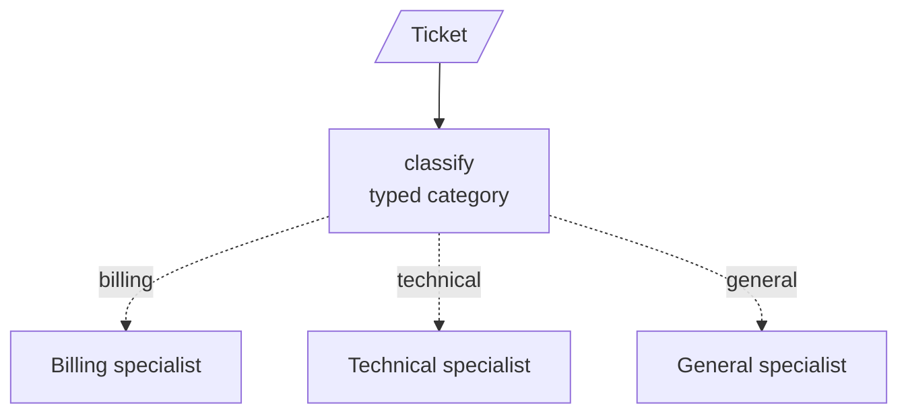
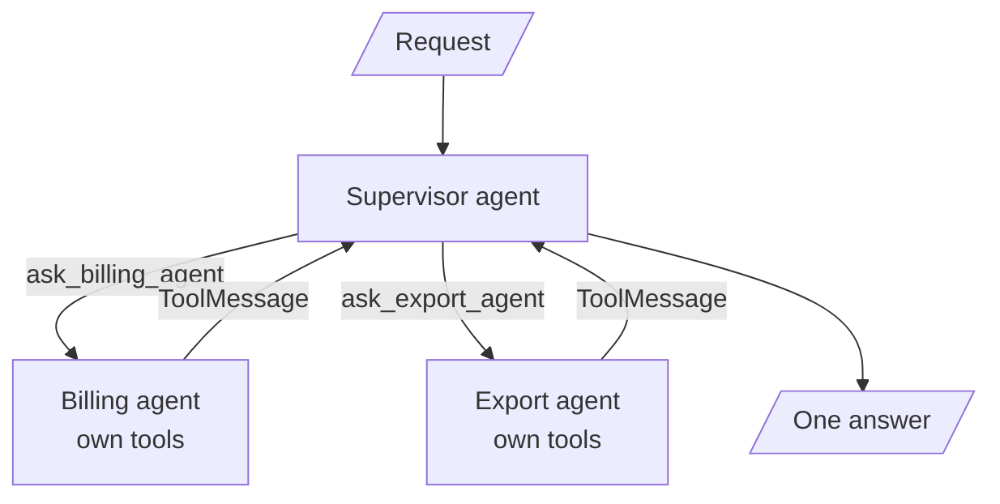
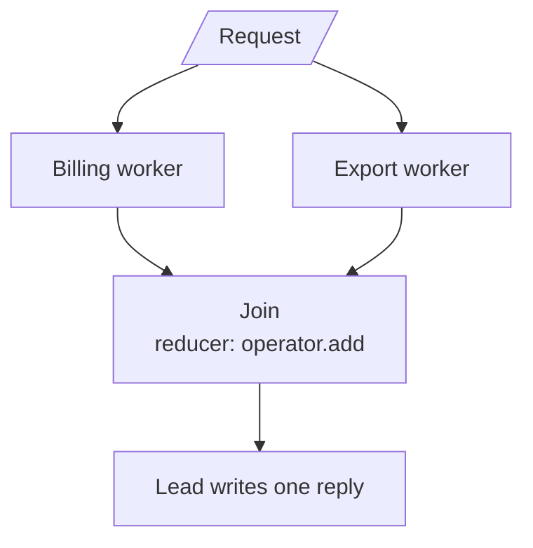
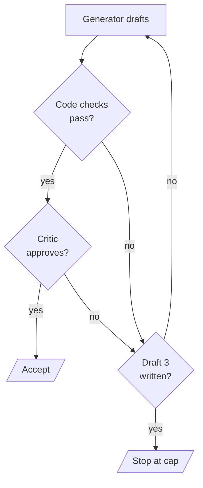
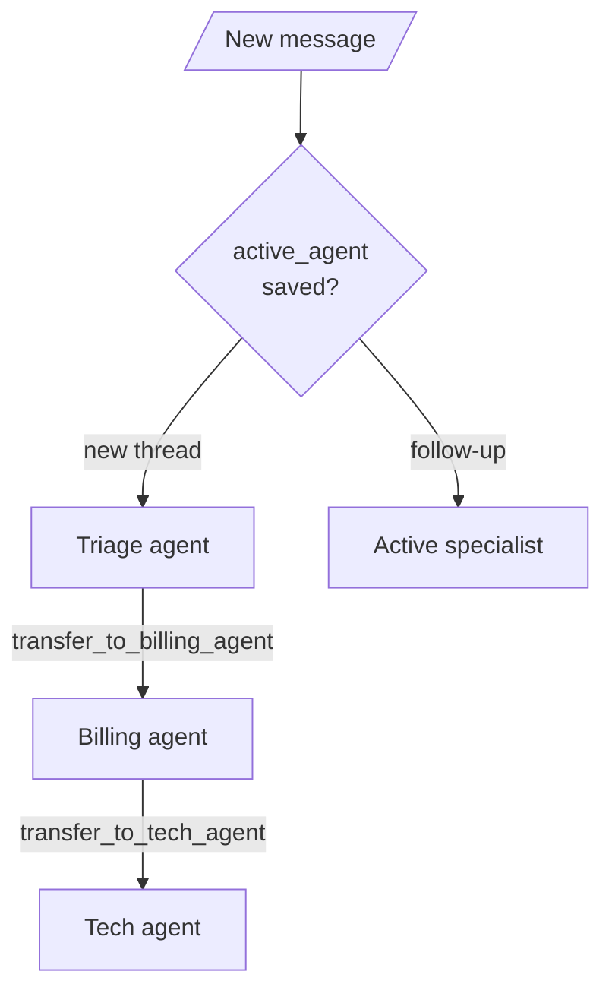

# M37.5 Theory: Five practical agent patterns, side by side

*[M37 theory](../../../mandatory/theory/README.md) · Lesson 37.5 · Notebooks: [`05a_sequential_and_conditional_workflows.ipynb`](../../notebook/05a_sequential_and_conditional_workflows.ipynb) (optional), [`05b_supervisor_agents_as_tools.ipynb`](../../notebook/05b_supervisor_agents_as_tools.ipynb) (optional), [`05c_parallel_fan_out_fan_in.ipynb`](../../notebook/05c_parallel_fan_out_fan_in.ipynb) (optional), [`05d_generator_critic_loop.ipynb`](../../notebook/05d_generator_critic_loop.ipynb) (optional), [`05e_handoffs_with_swarm.ipynb`](../../notebook/05e_handoffs_with_swarm.ipynb) (optional) · [All theory pages](../../../../../THEORY.md)*
<!-- subtitle: A fixed workflow, a supervisor, parallel workers, a refinement loop and handoffs, and who decides the next step in each -->
<!-- format: approved -->

## Start with one message that asks for two things

> **What you'll learn**
>
> - **Explain** who decides the next step in each of five patterns: the graph, a supervisor, a join, a loop rule or the agent holding the conversation.
> - **Trace** one Larkspur request through all five and see what each does with its second question.
> - **Diagnose** the failure each pattern invites, from a dropped question to an endless handoff.
> - **Choose** the simplest pattern that fits a task, and the cap that keeps it bounded.

Lessons 37.1 to 37.4 built whole systems. This lesson steps back to the five coordination patterns they are made from, one notebook each, every agent a prebuilt `create_agent`.

Priya's team bought a Larkspur annual plan 20 days ago and has used 40 GB of outbound traffic. She writes one message: "We're cancelling. Please refund the annual plan, and tell us how to export our database before you delete anything." The handbook answers both halves. A full refund is allowed within 30 days of purchase under 100 GB, and takes 5 to 10 business days to appear. Exports run from Settings, then Data, and a cancelled plan's data is kept for 30 days. The question for this lesson is what each pattern does with the second half.

*Priya and her message are a scripted example; the mechanisms come from the notebooks.*

## Who decides the next step

Every pattern here calls a model several times. They differ in who chooses what runs next:

| Pattern | Who picks the next step | Notebook's example |
|---|---|---|
| Sequential / conditional workflow | The graph you wrote: edges and branch functions | Research, draft, review; a ticket router |
| Supervisor, agents as tools | A supervisor model, through tool calls | A trip planner over flight and hotel agents |
| Parallel fan-out / fan-in | Nobody: every worker runs, then a join | Three product analysts and a lead |
| Generator–critic loop | A rule in code reading the critic's verdict | A 50-word charger description |
| Handoffs | The agent that holds the conversation | A storage company's support desk |

*Table 1: The five patterns and their deciders.*

The more of that choice a model makes, the more paths the system can take, and the more it needs a cap.

## Sequential and conditional workflows

A **sequential** workflow is plain `add_edge` calls: research, then draft, then review, for every input. Stages pass work through typed state fields (`notes`, `draft`, `final`), never through each other's messages. Two different topics in notebook 05a both print the path `research → draft → review`; the content changes, the path cannot.

A **conditional** workflow adds a fork. The notebook splits the decision in two: a classifier agent with `response_format=ToolStrategy(TicketRoute)` returns a validated category, one of three `Literal` values, and `route_ticket`, plain code, maps it to a node listed in advance in `add_conditional_edges`. The agent can pick a branch; it cannot invent a fourth.

*Figure 1: The conditional workflow. Exactly one dotted edge fires per run, so each ticket runs two nodes.*

A branch condition can also be plain code. The notebook's length gate counts the draft's words and sends it to `shorten` only when it is over the limit: a 90-word draft takes `research → draft → review` at a limit of 150 and `research → draft → shorten → review` at 40.

The cost of a fixed fork is the input it did not plan for. `TicketRoute` holds one category: Priya's message reaches billing or technical, never both. We call this the **single-label drop**: the reply is correct and answers half the request.

## Supervisor with agents as tools

A supervisor is a `create_agent` agent whose tools are other agents. Notebook 05b wraps each specialist in a `@tool` that runs it and returns its last message as a string. A delegation is then an ordinary tool call and the answer comes back as a `ToolMessage`. Two details carry the design:

- **The tool's docstring is the routing rule.** "Ask the flight specialist about flights" is the only routing logic the supervisor reads.
- **The specialist sees only the request the supervisor writes.** This **context isolation** keeps each specialist's prompt short, but the supervisor must pass every detail: cities, budget, or for Priya, plan type, purchase date and traffic.

*Figure 2: Supervisor with agents as tools. Control returns to the supervisor after every specialist.*

The notebook's three requests call both specialists, only the hotel agent, or none. No branch function decided that; the supervisor's tool calls did. The cap is `recursion_limit` in the run config. We replayed the supervisor with a scripted model: answering with no specialist needs a limit of 2, and one round of delegation runs three node steps (model, tools, model) and needs a limit of 4. The notebook's `recursion_limit=2` therefore stops the full-trip request with `GraphRecursionError`.

## Parallel fan-out and fan-in

When the pieces of work do not need each other, run them at the same time. Notebook 05c sends one product idea to three analysts: three edges leave `START`, and `add_edge([...three analysts...], "product_lead")` is a join that runs the lead once, after all three. Our replay of its graph with stubbed agents puts all three analysts in super-step 1 and the lead in super-step 2.

*Figure 3: Fan-out and fan-in. Workers share a super-step; the lead runs once after every worker.*

Parallel writes to one field need a **reducer**. With `Annotated[list, operator.add]` the two writes concatenate; without one, LangGraph raises `InvalidUpdateError: At key 'results': Can receive only one value per step`. The notebook proves this with two plain functions and no model.

When the number of workers depends on the input, a fan-out function returns one `Send("summarize", payload)` per item: five reviews start five summarize tasks, two start two, and the graph does not change. Parallelism saves wall-clock time, roughly the slowest worker plus the lead. It does not save model calls: every worker pays for its own, even on a request that needed only one of them.

## Generator–critic loop

A generator writes, a critic judges, and the draft is revised until it passes or a cap is reached. Notebook 05d starts from the acceptance criteria and splits them. Rules code can check (at most 50 words, the exact price `₹2,499`, no exclamation marks) run first; only a draft that passes all of them reaches the critic agent, which returns a validated `Review` with an `approved: bool`. `should_continue` is plain code with three exits: accept, revise, or stop at `MAX_REVISIONS = 3`.

*Figure 4: The refinement loop. A draft that breaks a code rule never costs a critic call.*

For Priya, the loop wraps the reply rather than routing it. Step through a run with code checks for the handbook's facts (the scripted drafts are ours; the loop is the notebook's):

Follow Priya's reply through the notebook's loop, with code checks for "5 to 10 business days", "30 days" and no exclamation marks.

<button type="button" data-step="0" aria-pressed="false" aria-controls="critic-step-0">1. Draft 1</button><button type="button" data-step="1" aria-pressed="false" aria-controls="critic-step-1">2. Draft 2</button><button type="button" data-step="2" aria-pressed="false" aria-controls="critic-step-2">3. A stuck generator</button>

<section id="critic-step-0" class="step-panel" aria-labelledby="critic-heading-0"><h4 id="critic-heading-0">1. Draft 1 breaks two code rules</h4><dl><dt>Draft</dt><dd>"Done! Your refund is on its way and your data is safe."</dd><dt>Code checks</dt><dd>Missing the refund time and the 30-day window; contains an exclamation mark</dd><dt>Critic</dt><dd>Not called: the feedback is the list of failures</dd><dt>Calls so far</dt><dd>1</dd></dl></section><section id="critic-step-1" class="step-panel" aria-labelledby="critic-heading-1"><h4 id="critic-heading-1">2. Draft 2 passes and is approved</h4><dl><dt>Draft</dt><dd>Names the full refund, 5 to 10 business days, Settings then Data, and the 30-day window</dd><dt>Code checks</dt><dd>All pass</dd><dt>Critic</dt><dd>Approves; the loop exits through accept</dd><dt>Calls in total</dt><dd>3: two drafts and one critique</dd></dl></section><section id="critic-step-2" class="step-panel" aria-labelledby="critic-heading-2"><h4 id="critic-heading-2">3. A generator that never improves</h4><dl><dt>Notebook's proof</dt><dd>A stand-in generator writes the same 80-word draft with exclamation marks every time</dd><dt>Result</dt><dd>3 drafts, 3 critique entries, never approved, critic never called</dd><dt>Lesson</dt><dd>The cap, not the critic, guarantees the loop ends</dd></dl></section>

<button type="button" data-walk="previous">Previous</button>

<button type="button" data-walk="next">Next step</button>

We replayed both paths with the notebook's own `critique` and `should_continue`. A run that ends at the cap returns its last draft, which was never approved.

## Handoffs

In a handoff, the agent holding the conversation passes it on, and the receiver keeps it. Notebook 05e uses `langgraph-swarm`: `create_handoff_tool(agent_name="billing_agent")` builds a `transfer_to_billing_agent` tool that returns `Command(goto=..., graph=Command.PARENT)` and sets `active_agent`, and `create_swarm(..., default_active_agent="triage_agent")` routes every new message to whoever is active.

*Figure 5: Handoffs in a swarm. The receiver becomes the active agent, and a checkpointer remembers it.*

Compiled with `InMemorySaver`, the swarm saves `active_agent` per thread. We replayed the notebook's three-turn script with a scripted model: turn 1 runs triage then billing, turn 2 starts at billing with no triage, and turn 3 hands off sideways to tech. Unlike the supervisor's tool call, a handoff forwards the whole conversation: billing never asks for the invoice number again.

No node in a swarm can say stop. If agents keep transferring to each other, only `recursion_limit` ends it: the notebook's scripted triage, billing, tech cycle raises `GraphRecursionError` after 10 handoffs at a limit of 10. We call this the **handoff ping-pong**.

## Priya's message through all five

The same request, five deciders. Pick a pattern to see what happens to the export question:

Pick a pattern and follow Priya's two-part message. Call counts assume one tool call per specialist; they follow each notebook's graph and are not a model run.

<button type="button" data-mode="workflow" aria-pressed="false" aria-controls="pattern-workflow">Conditional workflow</button>
<button type="button" data-mode="supervisor" aria-pressed="false" aria-controls="pattern-supervisor">Supervisor</button>
<button type="button" data-mode="parallel" aria-pressed="false" aria-controls="pattern-parallel">Fan-out</button>
<button type="button" data-mode="critic" aria-pressed="false" aria-controls="pattern-critic">Generator–critic</button>
<button type="button" data-mode="handoff" aria-pressed="false" aria-controls="pattern-handoff">Handoffs</button>

<section id="pattern-workflow" class="mode-panel" data-announcement="Conditional workflow selected. One branch runs; the export question is dropped."><h4>Conditional workflow</h4><ul><li>The classifier picks one category, say billing; only that branch runs.</li><li>The refund is answered, the export question is not: the single-label drop.</li><li>2 model calls, the cheapest and most predictable.</li></ul></section>
<section id="pattern-supervisor" class="mode-panel" data-announcement="Supervisor selected. Both specialists answer; requests must carry every detail."><h4>Supervisor</h4><ul><li>The supervisor calls the billing and export agents and combines their answers.</li><li>Billing sees only the request the supervisor writes: if it leaves out "annual, 20 days, 40 GB", billing cannot apply the 30-day rule.</li><li>About 6 model calls: two for the supervisor, two per specialist.</li></ul></section>
<section id="pattern-parallel" class="mode-panel" data-announcement="Fan-out selected. Both workers always run, then one lead reply."><h4>Fan-out</h4><ul><li>Billing and export workers run in the same super-step; the lead merges them once.</li><li>Both questions are answered; a refund-only message still pays for the export worker.</li><li>3 model calls with tool-free workers, about the time of the slower worker plus the lead.</li></ul></section>
<section id="pattern-critic" class="mode-panel" data-announcement="Generator–critic selected. It checks the reply, it does not route it."><h4>Generator–critic</h4><ul><li>It checks the reply another pattern produced; it routes nothing.</li><li>Code checks catch a missing "5 to 10 business days" or "30 days" before the critic runs.</li><li>3 calls on the accept path, at most 6 at the cap of 3 drafts.</li></ul></section>
<section id="pattern-handoff" class="mode-panel" data-announcement="Handoffs selected. Billing then tech, and tech stays active."><h4>Handoffs</h4><ul><li>Triage transfers to billing, which files the refund and transfers to tech for the export.</li><li>Tech sees the whole conversation and stays active; Priya's next "did the refund go through?" starts at tech, which must hand it back.</li><li>At least 6 model calls: triage 1, billing 3, tech 2.</li></ul></section>

## Choosing a pattern

Start with the most fixed pattern that covers the task, and move control toward a model only when the steps cannot be listed in advance:

- **Workflow** when the stages and branches are known before the run. For Priya's desk, let the classifier return a list of categories and fan out over it, which fixes the single-label drop without giving up a fixed graph.
- **Supervisor** when a request may need any subset of specialists, and one place should write the answer.
- **Fan-out** when the work is independent and the merge rule is clear. Use `Send` when the worker count follows the input.
- **Generator–critic** when "done" can be written down and feedback can improve a draft. Put every rule code can check in code.
- **Handoffs** when a specialist should own the rest of the conversation, as in support triage.

The patterns combine: lesson 37.4's research team is a supervisor whose workers fan out and whose report passes a capped review loop. Give each model-driven choice a cap in code.

## Limits of this evidence

- **No notebook run is recorded.** Notebooks ship without outputs. Paths, steps, reducer errors, loop exits, active agents and handoff counts come from replaying the notebooks' own graph code with stubbed agents or a scripted model (langgraph 1.2.18, langchain 1.4.7, langgraph-swarm 0.1.0). What gpt-4o-mini writes, and whether it calls the right specialists, is not measured.
- **Priya's request is scripted.** Its call counts follow each graph with one tool call per specialist; a live run can make more.
- **The examples are small.** Two or three specialists over in-memory data; production versions add retries, timeouts and tracing.

## References

1. Anthropic (2024). [Building effective agents](https://www.anthropic.com/research/building-effective-agents): sequential workflows, parallelisation, orchestrator-workers and evaluator-optimizer.
2. LangChain, [Multi-agent](https://docs.langchain.com/oss/python/langchain/multi-agent): subagents called as tools and handoffs.
3. LangGraph, [Graph API](https://docs.langchain.com/oss/python/langgraph/graph-api): reducers, `Send`, `Command` and `recursion_limit`.
4. LangChain, [langgraph-swarm](https://github.com/langchain-ai/langgraph-swarm-py): `create_handoff_tool` and `create_swarm`.

## Key Takeaways

- The five patterns differ in who picks the next step: the graph, a supervisor's tool calls, a join, a rule reading a critic's verdict, or the agent holding the conversation.
- Each has a typical failure: the single-label drop, a supervisor request missing the facts a specialist needs, fan-out paying every worker, an uncapped loop, and handoff ping-pong.
- Prefer the most fixed pattern that fits, check in code whatever code can check, and cap every model-driven choice: `recursion_limit` stopped the scripted handoff cycle after 10 handoffs and the stuck generator after 3 drafts.

## Check yourself

1. What is the difference between a supervisor calling a specialist as a tool and an agent handing off to a specialist?

After a tool call, control returns to the supervisor, and the specialist saw only the request the supervisor wrote. After a handoff, the specialist becomes the active agent, sees the whole conversation and receives the user's next message. A checkpointer is what keeps `active_agent` between turns.

2. Priya asks for a refund and an export in one message, and the ticket router answers only the refund. Why, and what is the smallest fix?

`TicketRoute` holds one `Literal` category, so the conditional edge fires exactly one branch: the single-label drop. Let the classifier return a list of categories and fan out to one specialist per category, joining their answers in one reply. The graph stays fixed, and the second question gets an answer.

3. A generator–critic loop sometimes runs forever on hard tasks. Which part of the notebook's design prevents that, and what does a capped run return?

`should_continue` is plain code with a stop exit at `MAX_REVISIONS = 3`, so the loop ends even if the critic never approves; the stuck-generator proof stops after three drafts. A capped run returns the last draft, which was never approved, so the caller should treat it as unapproved.

---
*Previous: [37.4 Research systems: supervisor financial research, summarisation, full research system](../../../mandatory/theory/04_research_systems_supervisor_financial_research_summarisation_full_research_system/README.md). Next: [M38 MCP foundations](../../../../../p11_agent_protocols/m38_mcp_foundations/mandatory/theory/README.md).*
