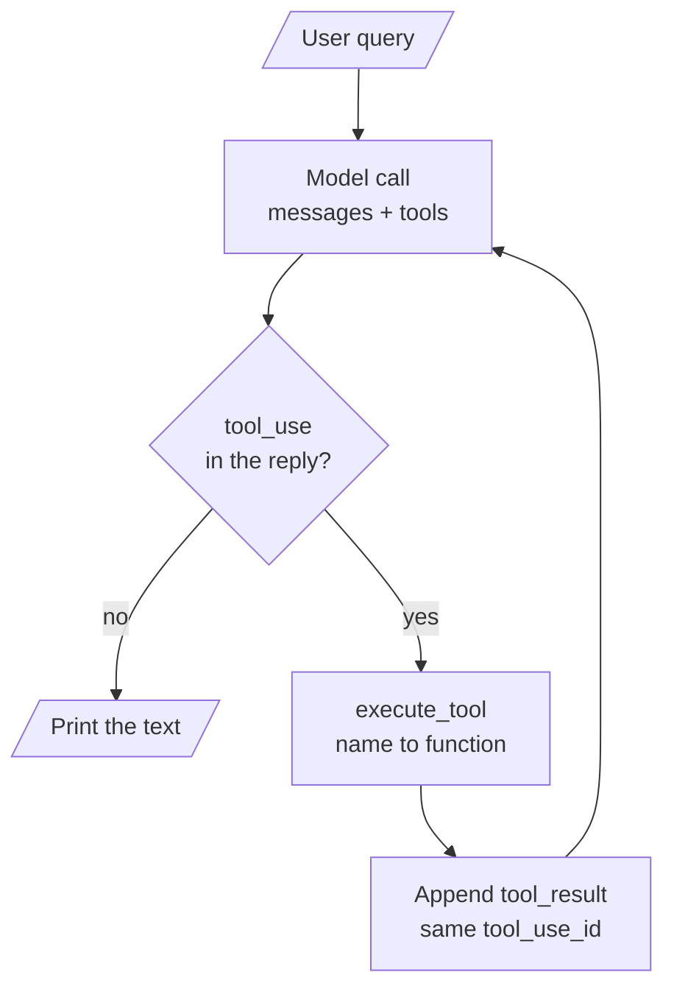
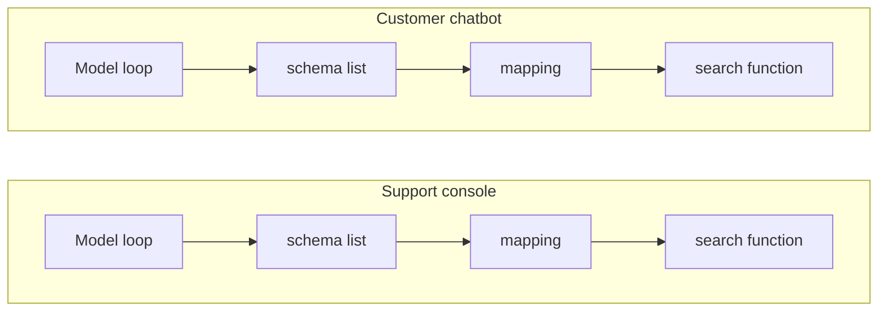
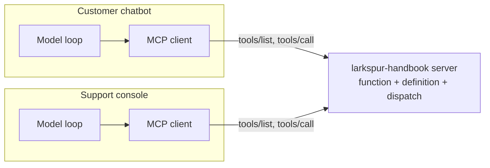

# M38.1 Theory: From a tool-calling chatbot to MCP

*[M38 theory](../README.md) · Lesson 38.1 · Notebooks: [`01a_chatbot_example.ipynb`](../../notebook/01a_chatbot_example.ipynb), [`01b_chatbot_example_openai_walkthrough.ipynb`](../../../optional/notebook/01b_chatbot_example_openai_walkthrough.ipynb) (optional) · [All theory pages](../../../../../THEORY.md)*
<!-- subtitle: A tool-calling chatbot writes every tool three times over; MCP keeps the model loop and moves the tools behind a server any host can reuse -->
<!-- format: approved -->

## Start with a tool copied into two hosts

> **What you'll learn**
>
> - **Name** the three pieces every embedded tool needs: the function, its schema and its dispatch entry.
> - **Trace** one request through the tool loop that stays in the chatbot.
> - **Compare** an embedded tool with the same tool behind an MCP server.
> - **Explain** why one server can serve an Anthropic chatbot and an OpenAI one.

Larkspur's support team wants handbook search in two places: the customer chatbot and the internal support console. With tools written into each application, the team writes the search function, its schema and the code that dispatches to it once per host, then keeps the copies in step. When the console's copy changes a parameter name and the chatbot's does not, the two hosts answer the same question differently.

The notebooks build that kind of chatbot for arXiv research. This lesson finds what moves out of it when MCP arrives, and what stays.

## What moves out of the chatbot

The chatbot in notebook 01a has two tools. `search_papers` queries arXiv and saves the results to `papers_info.json` in a folder per topic; `extract_info` looks a paper up by its id in those files. Each tool needs three pieces written by hand inside the chatbot:

1. **The function** that does the work.
2. **A schema** in the `tools` list: a name, a description and an `input_schema` the model reads to decide when and how to call it.
3. **An entry in `mapping_tool_function`**, so `execute_tool` can turn the name the model picked back into a Python call and the result into a string.

Two tools mean six pieces in one host. A second host means six more.

### The loop that stays

Around the three pieces sits the loop in `process_query`. It sends the question and the `tools` list to the model (`claude-3-7-sonnet-20250219`, `max_tokens=2024`). While the reply asks for a tool, it runs the tool, appends a `tool_result` with the same `tool_use_id` and calls the model again.

*Figure 1: The 01a tool loop. MCP leaves this loop in the chatbot.*

Here is one request through it, the notebook's own example: *Search for 2 papers on "LLM interpretability"*. The replies are scripted, but the loop is the notebook's `process_query` cell, run unchanged against a stub client.

Step through one request in the 01a loop. Each stage names the piece of code that acts.

<button type="button" data-step="0" aria-pressed="false" aria-controls="loop-step-0">1. Ask</button><button type="button" data-step="1" aria-pressed="false" aria-controls="loop-step-1">2. Tool request</button><button type="button" data-step="2" aria-pressed="false" aria-controls="loop-step-2">3. Dispatch</button><button type="button" data-step="3" aria-pressed="false" aria-controls="loop-step-3">4. Result</button><button type="button" data-step="4" aria-pressed="false" aria-controls="loop-step-4">5. Answer</button>

<section id="loop-step-0" class="step-panel" aria-labelledby="loop-heading-0"><h4 id="loop-heading-0">1. The chatbot asks the model</h4><dl><dt>Sent</dt><dd>the user message and the whole <code>tools</code> list, both schemas</dd><dt>Model call</dt><dd>1</dd></dl></section><section id="loop-step-1" class="step-panel" aria-labelledby="loop-heading-1"><h4 id="loop-heading-1">2. The reply asks for a tool</h4><dl><dt>Reply</dt><dd>a <code>tool_use</code> block: name <code>search_papers</code>, input topic and <code>max_results</code> 2, an id</dd><dt>Chatbot</dt><dd>appends the reply to the messages as the assistant turn</dd></dl></section><section id="loop-step-2" class="step-panel" aria-labelledby="loop-heading-2"><h4 id="loop-heading-2">3. The chatbot dispatches</h4><dl><dt>Lookup</dt><dd><code>mapping_tool_function</code> turns the name into the Python function</dd><dt>Result</dt><dd>a list of paper ids, joined into one string with commas</dd></dl></section><section id="loop-step-3" class="step-panel" aria-labelledby="loop-heading-3"><h4 id="loop-heading-3">4. The result goes back</h4><dl><dt>Appended</dt><dd>a user turn holding a <code>tool_result</code> with the same <code>tool_use_id</code></dd><dt>Model call</dt><dd>2, with the messages and the <code>tools</code> list again</dd></dl></section><section id="loop-step-4" class="step-panel" aria-labelledby="loop-heading-4"><h4 id="loop-heading-4">5. The model answers in text</h4><dl><dt>Reply</dt><dd>one text block, which the chatbot prints</dd><dt>Stop rule</dt><dd>the loop ends only when the reply is exactly one text block; 2 model calls in all</dd></dl></section>

<button type="button" data-walk="previous">Previous</button>

<button type="button" data-walk="next">Next step</button>

The stop rule is stricter than Figure 1 suggests. The loop ends when the reply is a single text block. We replayed a reply of two text blocks with no tool request: the loop printed the same reply again and again and never called the model, and our two-second timer stopped it. Any reply shape the code does not expect becomes a hang, not an error.

### Two designs for the same tool

The embedded design keeps all three pieces in each host:

*Figure 2: Embedded tools. Each host carries its own copy of the function, its schema and the dispatch entry.*

With MCP each host keeps only its loop and a client. The function, its definition and the dispatch move behind one server:

*Figure 3: The same tool behind an MCP server. Hosts discover the definition and send calls; the server runs them.*

In the notebooks, notebook 03a makes that move for the research chatbot:

| Piece | 01a: inside the chatbot | 03a: with MCP |
|---|---|---|
| Tool functions | defined in the application | in `research_server.py`, behind `@mcp.tool()` |
| Tool schemas | written by hand in `tools` | fetched with `session.list_tools()` |
| Name to function | `mapping_tool_function` and `execute_tool` | `session.call_tool(name, arguments=...)` |
| The loop and the model | `process_query`, `chat_loop` | unchanged, now methods of `MCP_ChatBot` |

*Table 1: Where each piece lives before and after MCP.*

The model still only asks for work. MCP does not make the model run functions; it changes who owns them.

The split pays when the tool changes. Follow one change, a new `k` parameter for handbook search, through each design:

Choose a design to see what the team edits when handbook search gains a parameter.

<button type="button" data-mode="embedded" aria-pressed="false" aria-controls="design-embedded">Embedded in each host</button>
<button type="button" data-mode="server" aria-pressed="false" aria-controls="design-server">Behind one MCP server</button>

<section id="design-embedded" class="mode-panel" data-announcement="Embedded selected. Three pieces change in every host."><h4>Embedded in each host</h4><ul><li>The function, the schema and the mapping change in the chatbot.</li><li>The same three change again in the support console.</li><li>A host that misses the change keeps sending the old schema to its model.</li></ul></section>
<section id="design-server" class="mode-panel" data-announcement="Server selected. One function changes on the server."><h4>Behind one MCP server</h4><ul><li>The function changes once, on the server; the definition is generated from it.</li><li>Each host sees the new parameter the next time its client lists the tools.</li><li>No host code changes, because no host holds a schema or a mapping.</li></ul></section>

For Larkspur, the M10 retriever becomes one server, `larkspur-handbook`, and every assistant the support team builds connects to it instead of copying it.

### One server, two model providers

The optional notebook 01b runs the same chatbot on OpenAI's `gpt-4o`. Only the wrapper around each tool and each result changes:

| Field | Anthropic (01a) | OpenAI (01b) |
|---|---|---|
| Schema wrapper | the schema itself: `name`, `description`, `input_schema` | `{"type": "function", "function": {...}}` around the same fields |
| Argument schema key | `input_schema` | `parameters` |
| Arguments the model sends | a dict in `content.input` | a JSON string the code parses with `json.loads` |
| Result sent back | a user turn with a `tool_result` block and `tool_use_id` | a `tool` message with `tool_call_id` |

*Table 2: The provider wrapper around one tool. The JSON Schema inside is the same.*

Because the argument schema is the same JSON Schema under a different key, an MCP client can wrap one server definition for either provider. Lesson 38.3 shows the client doing exactly that.

## Limits of this evidence

- **No model was called.** The traced request and the two-text-block hang come from the 01a `process_query` cell run unchanged against scripted replies; a live model decides for itself when to ask for a tool.
- **No arXiv search ran.** The research tools need the network; the trace uses fixed paper ids.
- **The provider table reads the notebooks' code.** Both providers change their tool formats over time; check the current documentation before porting.

## References

1. Model Context Protocol, [Architecture overview](https://modelcontextprotocol.io/docs/learn/architecture).
2. Model Context Protocol, [Specification 2025-11-25](https://modelcontextprotocol.io/specification/2025-11-25).
3. Anthropic, [Tool use with Claude](https://platform.claude.com/docs/en/agents-and-tools/tool-use/overview).
4. OpenAI, [Function calling](https://developers.openai.com/api/docs/guides/function-calling).

## Key Takeaways

- Without MCP, every tool needs three hand-written pieces in each host: the function, its schema in `tools`, and a name-to-function mapping.
- MCP keeps the model loop in the host and moves the tools to a server. The client fetches schemas with `session.list_tools()` and runs them with `session.call_tool()`.
- Put a tool behind one server when a second chatbot, an IDE or an agent framework needs it, so each one connects instead of copying the code.

## Check yourself

1. The model replies with a tool_use block. What must the 01a chatbot do before it calls the model again, and when does the loop stop?

It runs the tool through `execute_tool`, appends a `tool_result` with the same `tool_use_id`, and calls the model again with the messages and the `tools` list. The loop stops only when a reply is exactly one text block, which the chatbot prints. A reply of two text blocks never stops it.

2. You add a third tool to the 01a chatbot. Which three pieces do you write by hand, and where does each come from in the 03a version?

The function, its schema in the `tools` list, and an entry in `mapping_tool_function`. In 03a the function sits in `research_server.py` behind `@mcp.tool()`, the schema comes from `session.list_tools()`, and the call goes through `session.call_tool(name, arguments=...)`. A second host then reuses the same server instead of copying all three.

3. Your Anthropic chatbot works, but the OpenAI port fails when it reads the tool arguments. What differs between the two providers?

Only the wrapper. In 01b each schema sits inside `{"type": "function", "function": {...}}` with `parameters` in place of `input_schema`, and the arguments arrive as a JSON string the code must parse with `json.loads`. The JSON Schema inside is the same, which is why one MCP server can serve either provider.

---
*Previous: [M38 overview](../README.md). Next: [38.2 Building an MCP server](../02_building_an_mcp_server/README.md).*
