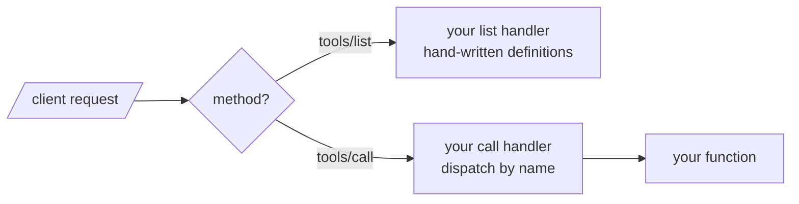
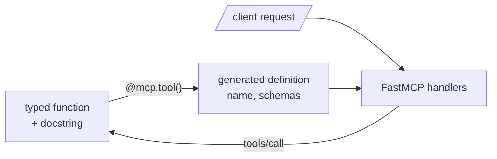

# M38.2 Theory: Building an MCP server

*[M38 theory](../README.md) · Lesson 38.2 · Notebooks: [`02a_creating_an_mcp_server.ipynb`](../../notebook/02a_creating_an_mcp_server.ipynb) · [All theory pages](../../../../../THEORY.md)*
<!-- subtitle: FastMCP turns a typed Python function into a tool definition any MCP client can discover, and what it reads from the function decides what the model sees -->
<!-- format: approved -->

## Start with a search function no client can see

> **What you'll learn**
>
> - **Contrast** the low-level MCP server with FastMCP by who answers the protocol requests.
> - **Read** a generated tool definition and name where each field comes from.
> - **Fix** a schema that hides parameter help, by putting the help in the type.
> - **Explain** the output schema and why every result arrives twice.

Larkspur's handbook search is a Python function. A model can call it only through a definition: a name, a description and a JSON Schema for its arguments. In lesson 38.1 the chatbot wrote that definition by hand. An MCP server publishes it instead, and every client that connects reads the same one.

The catch is that the definition is generated. Whatever the server leaves out of the function's signature, the model never sees as structure.

## From a function to a tool definition

A server that offers tools answers two requests: list the tools, and call one. The MCP Python SDK gives two ways to build it.

The **low-level `Server`** hands you the requests. You write the handler for `ListToolsRequest` that returns each definition, and the handler for `CallToolRequest` that dispatches by name:

*Figure 1: The low-level server. You write both handlers and keep the definitions in step with the code.*

**`FastMCP`**, which notebook 02a uses, writes both handlers for you. You create the server, decorate functions with `@mcp.tool()` and run it. The decorator reads each function and stores a generated definition:

*Figure 2: FastMCP. The function is the single source; the definition and the dispatch are derived from it.*

Choose the low-level server when you need control over every request, for example definitions that change at run time. Choose FastMCP when the tools are ordinary functions, which is every server in this module.

### What FastMCP reads from the function

Notebook 02a decorates the two research functions from lesson 38.1 and nothing else. We imported its `research_server.py` with MCP Python SDK 1.30.0 and listed the tools, without starting a server or searching arXiv. Here is the definition of `search_papers`, field by field:

| Field | Value generated | Taken from |
|---|---|---|
| `name` | `search_papers` | the function name |
| `description` | the whole docstring: a leading newline, the indentation, the `Args:` and `Returns:` blocks | the docstring, unparsed |
| `inputSchema.properties.topic` | `{"title": "Topic", "type": "string"}` | the type hint `str` |
| `inputSchema.properties.max_results` | `{"default": 5, "title": "Max Results", "type": "integer"}` | the hint `int` and the Python default |
| `inputSchema.required` | `["topic"]` | parameters without a default |
| `inputSchema.title` | `search_papersArguments` | the argument model FastMCP builds |
| property descriptions | none | nothing: the `Args:` lines stay inside `description` |

*Table 1: The generated definition of `search_papers` in SDK 1.30.0.*

The last row is the trap. The docstring says what `topic` and `max_results` mean, but the model receives that only as free text in the tool description. The schema itself carries a title and a type for each argument and no help.

### Generated against hand-written schemas

Lesson 38.1's chatbot wrote the same two definitions by hand. Measured as compact JSON in the shape the chatbot sends (name, description, input schema), the two pairs differ:

Compare the two definitions of the research tools the model would receive.

<button type="button" data-mode="hand" aria-pressed="false" aria-controls="schema-hand">Hand-written (01a)</button>
<button type="button" data-mode="generated" aria-pressed="false" aria-controls="schema-generated">Generated by FastMCP</button>

<section id="schema-hand" class="mode-panel" data-announcement="Hand-written selected. 614 characters, help on every argument."><h4>Hand-written, 614 characters</h4><ul><li>One-line tool descriptions.</li><li>Each argument has its own description, for example "The topic to search for".</li><li>No titles; the default for <code>max_results</code> is 5.</li></ul></section>
<section id="schema-generated" class="mode-panel" data-announcement="Generated selected. 968 characters, no help on any argument."><h4>Generated, 968 characters</h4><ul><li>The whole docstring as each tool description, indentation included.</li><li>No argument has a description; each gets a title such as "Max Results".</li><li>Required arguments and the default of 5 match the hand-written pair.</li></ul></section>

The generated pair is 354 characters longer and says less in structured form. The fix is to put parameter help where the schema generator looks: in the type. Declared as `Annotated[int, Field(description="Number of chunks to return", ge=1, le=12)]`, a Larkspur `k` argument comes out in SDK 1.30.0 with `description`, `minimum: 1` and `maximum: 12` on the property itself, beside its default and title. A one-line docstring then serves as the tool description.

### Trace one tool from decorator to call

The handbook server in this module's lab declares one tool, `search_handbook(query: str, k: int = 4) -> str`. Follow it through FastMCP:

Step through what FastMCP does with the handbook tool, from registration to a call.

<button type="button" data-step="0" aria-pressed="false" aria-controls="tool-step-0">1. Register</button><button type="button" data-step="1" aria-pressed="false" aria-controls="tool-step-1">2. Arguments</button><button type="button" data-step="2" aria-pressed="false" aria-controls="tool-step-2">3. Output</button><button type="button" data-step="3" aria-pressed="false" aria-controls="tool-step-3">4. Listed</button><button type="button" data-step="4" aria-pressed="false" aria-controls="tool-step-4">5. Called</button>

<section id="tool-step-0" class="step-panel" aria-labelledby="tool-heading-0"><h4 id="tool-heading-0">1. The decorator registers the function</h4><dl><dt>Stored</dt><dd>the name <code>search_handbook</code> and the one-line docstring as description</dd></dl></section><section id="tool-step-1" class="step-panel" aria-labelledby="tool-heading-1"><h4 id="tool-heading-1">2. The signature becomes the input schema</h4><dl><dt>Properties</dt><dd><code>query</code> a string; <code>k</code> an integer with default 4</dd><dt>Required</dt><dd><code>query</code> only</dd></dl></section><section id="tool-step-2" class="step-panel" aria-labelledby="tool-heading-2"><h4 id="tool-heading-2">3. The return type becomes the output schema</h4><dl><dt>Output schema</dt><dd>an object with one required string, <code>result</code>, titled <code>search_handbookOutput</code></dd></dl></section><section id="tool-step-3" class="step-panel" aria-labelledby="tool-heading-3"><h4 id="tool-heading-3">4. A client lists the tools</h4><dl><dt>Reply</dt><dd>one definition with both schemas, 528 bytes on the wire</dd></dl></section><section id="tool-step-4" class="step-panel" aria-labelledby="tool-heading-4"><h4 id="tool-heading-4">5. A client calls it</h4><dl><dt>Arguments</dt><dd>validated against the input schema before the function runs</dd><dt>Result</dt><dd>the text in <code>content</code> and again under <code>result</code> in <code>structuredContent</code></dd></dl></section>

<button type="button" data-walk="previous">Previous</button>

<button type="button" data-walk="next">Next step</button>

### The output contract

FastMCP also infers an **output schema** from the return type, and a tool with one sends its result twice: once as content blocks for the model and once as `structuredContent` for code. For `str` that is one text block plus `{"result": "..."}`. For `search_papers`, which returns `List[str]`, the output schema is an array of strings, and the content is one text block per paper id.

That second shape matters to the client. We called a two-result list tool through an in-memory session: the content held 2 blocks, one id each. A client that reads only the first block, as notebook 03a's OpenAI client does, hands the model 1 of the 2 ids. Lesson 38.3 traces that client.

### Run the server outside the notebook

Notebook 02a writes the server with `%%writefile`: the cell saves `research_server.py` instead of running it. The server starts later, from a terminal or from a client. On `stdio` it reads requests from its standard input and writes replies to its standard output, one JSON-RPC message per line.

Test a server before writing a client. The MCP Inspector launches it the way a client would, `npx @modelcontextprotocol/inspector uv run research_server.py`, and lets you list and call tools by hand. If a tool works in the Inspector and fails in the chatbot, look in the client first.

## Limits of this evidence

- **The definitions are SDK 1.30.0's.** The fields FastMCP generates, the output schema included, change between SDK versions; list the tools again after an upgrade.
- **No arXiv search ran.** We imported `research_server.py` with a stub `arxiv` module and listed its tools; the list-tool call used a stand-in that returns two fixed ids.
- **Character counts are not tokens.** 968 against 614 compares JSON size; a provider's tokeniser and its own formatting of tool definitions decide what the model is billed for.

## References

1. Model Context Protocol, [Tools](https://modelcontextprotocol.io/specification/2025-11-25/server/tools), specification 2025-11-25.
2. Model Context Protocol, [Build an MCP server](https://modelcontextprotocol.io/docs/develop/build-server).
3. Model Context Protocol, [MCP Inspector](https://modelcontextprotocol.io/docs/tools/inspector).
4. Python Package Index, [mcp 1.30.0](https://pypi.org/project/mcp/1.30.0/), the MCP Python SDK.
5. Pydantic, [Fields](https://pydantic.dev/docs/validation/latest/concepts/fields/).

## Key Takeaways

- `FastMCP` builds each tool definition from the function: the name, the whole docstring as description, types and `required` from the hints, and defaults from Python.
- Docstring `Args:` lines never become property descriptions. Put parameter help and limits in the type with `Annotated[..., Field(...)]` so they appear in the schema.
- Test a new server in the MCP Inspector before writing a client. If a tool passes there and fails in the chatbot, the fault is in the client.

## Check yourself

1. Where does FastMCP take each part of a tool definition from, and where do the docstring's parameter descriptions end up?

The name comes from the function name, the description from the whole docstring, the types and `required` from the type hints, and `default` from the Python default. Nothing fills the property descriptions: the `Args:` lines stay inside the tool description, so the model reads parameter help only as free text.

2. The Larkspur search tool needs a chunk count between 1 and 12 that the model can see in the schema. How do you declare it?

Put the help and the limits in the type: `Annotated[int, Field(description="Number of chunks to return", ge=1, le=12)]`. SDK 1.30.0 then adds `description`, `minimum` and `maximum` to that property. An `Args:` line in the docstring would only add free text to the tool description.

3. A tool works when you call it by hand in the MCP Inspector but fails inside your chatbot. Where do you look first?

In the client. The Inspector launches the server the way a client would and calls the tool directly, so a pass there shows the server and the tool work. A client that reads only the first content block of a list result is one such fault.

---
*Previous: [38.1 From a tool-calling chatbot to MCP](../01_from_a_tool_calling_chatbot_to_mcp/README.md). Next: [38.3 Building an MCP client](../03_building_an_mcp_client/README.md).*
