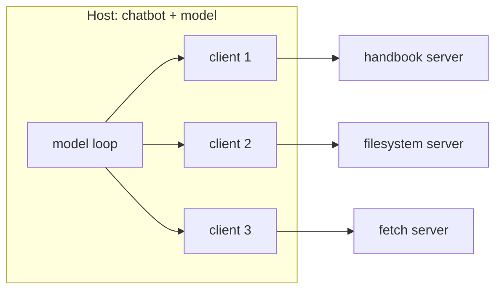

# M38.3 Theory: Building an MCP client

*[M38 theory](../README.md) · Lesson 38.3 · Notebooks: [`03a_creating_an_mcp_client.ipynb`](../../notebook/03a_creating_an_mcp_client.ipynb) · [All theory pages](../../../../../THEORY.md)*
<!-- subtitle: The client inside a host opens one session per server, learns the tools in a handshake, and translates every definition and result for its model -->
<!-- format: approved -->

## Start with a client that has never seen the tool

> **What you'll learn**
>
> - **Separate** the host, the client and the server, and say which one the model talks to.
> - **Trace** a recorded session: the handshake, the tool list and one call, message by message.
> - **Diagnose** a session from its version, capability and id fields.
> - **Spot** where a client loses part of a tool result while translating it for the model.

Lesson 38.2 put handbook search behind a server. The Larkspur chatbot now knows nothing about the tool: not its name, not its arguments. Before the model can ask for it, the chatbot has to start the server, agree on what the session can do, and fetch the definitions. Notebook 03a writes that missing piece, the client.

## MCP server / client

MCP names three roles. The **host** is the application the user talks to, here the chatbot with its model. The **client** is the piece inside the host that holds one connection to one server. The **server** offers tools, resources and prompts.

*Figure 1: One host, three servers, three clients. Each client holds one session with one server.*

The model never talks to a server. It sees definitions and asks for calls, and the host decides which client sends each one. Lesson 38.4 connects a host to several servers and shows what goes wrong when two of them offer the same tool name.

Notebook 03a wraps the lesson 38.1 loop in an `MCP_ChatBot` class and adds one client. Its `connect_to_server_and_run` method does four things in order:

| Call | What it does |
|---|---|
| `StdioServerParameters(command="uv", args=["run", "research_server.py"])` | describes how to start the server; nothing runs yet |
| `stdio_client(server_params)` | starts the server as a subprocess and returns its read and write streams |
| `ClientSession(read, write)` then `session.initialize()` | opens the session and runs the handshake |
| `session.list_tools()` | fetches the definitions, which the chatbot wraps for its model before `chat_loop` starts |

*Table 1: The client set-up in notebook 03a, in call order.*

With `stdio` the client owns the server's life. `stdio_client` starts the process, and leaving its `async with` block ends the session and stops the process. Nothing has to be running beforehand, and nothing keeps running afterwards. A remote server, in lesson 38.6, is the opposite: it runs on its own and the client connects by URL.

### Trace a recorded session

We recorded one session against the `larkspur-handbook` server from this module's lab, over stdio with MCP Python SDK 1.30.0. A proxy between client and server logged every line; sizes are the bytes of each JSON-RPC message as sent. The question is the M10 golden one, *How long does a refund take?*

Step through the seven messages of the recorded session, in order.

<button type="button" data-step="0" aria-pressed="false" aria-controls="session-step-0">1. Initialise</button><button type="button" data-step="1" aria-pressed="false" aria-controls="session-step-1">2. Capabilities</button><button type="button" data-step="2" aria-pressed="false" aria-controls="session-step-2">3. Initialised</button><button type="button" data-step="3" aria-pressed="false" aria-controls="session-step-3">4. List</button><button type="button" data-step="4" aria-pressed="false" aria-controls="session-step-4">5. Definitions</button><button type="button" data-step="5" aria-pressed="false" aria-controls="session-step-5">6. Call</button><button type="button" data-step="6" aria-pressed="false" aria-controls="session-step-6">7. Result</button>

<section id="session-step-0" class="step-panel" aria-labelledby="session-heading-0"><h4 id="session-heading-0">1. The client proposes a version</h4><dl><dt>Message</dt><dd><code>initialize</code> request, id 0, client to server, 152 bytes</dd><dt>Carries</dt><dd>protocol version 2025-11-25, no client capabilities, the client's name</dd></dl></section><section id="session-step-1" class="step-panel" aria-labelledby="session-heading-1"><h4 id="session-heading-1">2. The server answers with what it offers</h4><dl><dt>Message</dt><dd>result for id 0, server to client, 276 bytes</dd><dt>Carries</dt><dd>the agreed version; capabilities for tools, resources and prompts, each with <code>listChanged</code> false; server name <code>larkspur-handbook</code>, version 1.30.0</dd></dl></section><section id="session-step-2" class="step-panel" aria-labelledby="session-heading-2"><h4 id="session-heading-2">3. The client confirms</h4><dl><dt>Message</dt><dd><code>notifications/initialized</code>, client to server, 54 bytes</dd><dt>Carries</dt><dd>no id, and no reply comes: the session is open</dd></dl></section><section id="session-step-3" class="step-panel" aria-labelledby="session-heading-3"><h4 id="session-heading-3">4. The client asks for the tools</h4><dl><dt>Message</dt><dd><code>tools/list</code> request, id 1, 46 bytes</dd><dt>Carries</dt><dd>nothing but the method</dd></dl></section><section id="session-step-4" class="step-panel" aria-labelledby="session-heading-4"><h4 id="session-heading-4">5. The server sends one definition</h4><dl><dt>Message</dt><dd>result for id 1, 528 bytes</dd><dt>Carries</dt><dd><code>search_handbook</code> with its description, an input schema (<code>query</code> required, <code>k</code> default 4) and an output schema</dd></dl></section><section id="session-step-5" class="step-panel" aria-labelledby="session-heading-5"><h4 id="session-heading-5">6. The client calls the tool</h4><dl><dt>Message</dt><dd><code>tools/call</code> request, id 2, 135 bytes</dd><dt>Carries</dt><dd>the name and one argument, the query; <code>k</code> is left to its default</dd></dl></section><section id="session-step-6" class="step-panel" aria-labelledby="session-heading-6"><h4 id="session-heading-6">7. The server returns four passages</h4><dl><dt>Message</dt><dd>result for id 2, 3,145 bytes</dd><dt>Carries</dt><dd>one text block of 1,491 characters with 4 passages, the same text in <code>structuredContent</code>, <code>isError</code> false</dd></dl></section>

<button type="button" data-walk="previous">Previous</button>

<button type="button" data-walk="next">Next step</button>

The four passages came from `02_refunds.md`, `04_outages_and_status.md`, `02_refunds.md` and `12_sla_credits.md`. The second is about rebooting a server, which the lab's TF-IDF retriever ranked high, not anything MCP did. The protocol carries what the tool returns; retrieval quality stays the server's problem.

### Diagnose a session from its fields

Three details in that trace matter when you debug:

- **The handshake fixes what the session can do.** The server declared `tools`, `resources` and `prompts`, each with `listChanged: false`. This client will not be told if the tool list changes; it has to list again.
- **Requests and replies pair by `id`.** The client numbered its requests 0, 1 and 2, and the server echoed each id. The notification carries none, because nothing answers it.
- **`serverInfo.version` was `1.30.0`**, the SDK version, because the server never set one. In SDK 1.30.0 the `FastMCP` constructor takes no version argument; the low-level `Server` takes one. Set it if clients should be able to tell your releases apart.

### Translate definitions and results for the model

The client also translates for the model, in both directions. Notebook 03a's live code runs on OpenAI; an Anthropic version is kept in comments. Both read the same `inputSchema`, and they differ in what they send back:

| Step | OpenAI client (live) | Anthropic client (in comments) |
|---|---|---|
| Definition sent to the model | `{"type": "function", "function": {"name", "description", "parameters": tool.inputSchema}}` | `{"name", "description", "input_schema": tool.inputSchema}` |
| Call made | `session.call_tool(tool_name, arguments=tool_args)` after `json.loads` on the arguments | the same call with the arguments dict as given |
| Result sent back | `result.content[0].text` in a `tool` message | the whole `result.content` in a `tool_result` block |

*Table 2: How the notebook's two clients translate one tool for their model.*

The last row hides a defect. A tool that returns a list, like `search_papers`, comes back as one content block per item. We called a two-result list tool through an in-memory session and applied the OpenAI client's expression: the model received the first paper id and never saw the second. The Anthropic version passes every block. A client that flattens results should join all text blocks, or read `structuredContent` when the definition has an output schema.

## Limits of this evidence

- **The recorded session is the lab server's, not the notebook's.** The research server sends two definitions and calls arXiv; the message sizes here hold for `larkspur-handbook` with SDK 1.30.0 and this query.
- **No model was called.** The translation rows and the lost list item come from the notebook's code and an in-memory session with a stand-in tool returning two fixed ids.
- **Sizes move with versions.** A newer SDK or protocol version changes the handshake and the schemas, and with them every byte count.

## References

1. Model Context Protocol, [Architecture overview](https://modelcontextprotocol.io/docs/learn/architecture).
2. Model Context Protocol, [Lifecycle](https://modelcontextprotocol.io/specification/2025-11-25/basic/lifecycle), specification 2025-11-25.
3. Model Context Protocol, [Transports](https://modelcontextprotocol.io/specification/2025-11-25/basic/transports), specification 2025-11-25.
4. Model Context Protocol, [Build an MCP client](https://modelcontextprotocol.io/docs/develop/build-client).
5. JSON-RPC Working Group, [JSON-RPC 2.0 Specification](https://www.jsonrpc.org/specification).

## Key Takeaways

- The host holds one client per server, and the model never reaches a server directly. It reads definitions and asks for calls; the host routes them.
- Over `stdio` the client starts and stops the server. The `initialize` handshake then fixes what the session can do: with `listChanged: false`, list the tools again to see changes.
- Translate every result block for the model. Passing only `content[0]` drops all but the first item of a list result.

## Check yourself

1. A host uses three MCP servers. How many clients does it hold, and does the model ever talk to a server directly?

Three clients, each holding one connection to one server. The model never talks to a server: it sees definitions and asks for calls, and the host decides which client sends them.

2. In the recorded Larkspur session, the notifications/initialized message gets no reply. How do replies pair with requests, and why is this message different?

Requests and replies pair by `id`: the client numbered its requests 0, 1 and 2, and the server echoed each id. `notifications/initialized` is a notification, so it carries no id and nothing answers it; it tells the server the session is open.

3. The research chatbot asks for two papers, the server finds two, but the OpenAI version of the model only ever mentions one. Where is the second id lost?

In the client. A list result comes back as one content block per item, and notebook 03a's OpenAI client sends only `result.content[0].text` to the model. Join every text block, or read `structuredContent`, before building the `tool` message.

---
*Previous: [38.2 Building an MCP server](../02_building_an_mcp_server/README.md). Next: [38.4 Connecting to reference servers](../04_connecting_to_reference_servers/README.md).*
