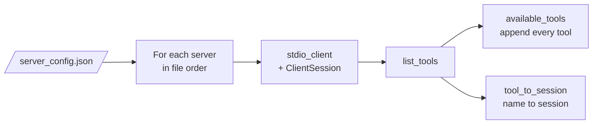
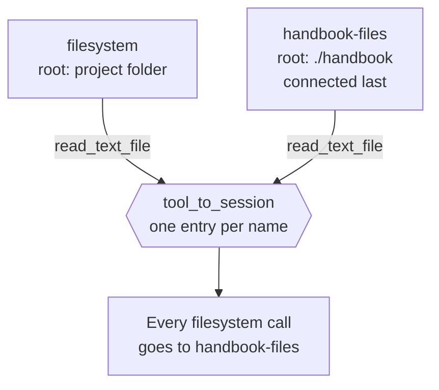

# M38.4 Theory: Connecting to reference servers

*[M38 theory](../README.md) · Lesson 38.4 · Notebooks: [`04a_connecting_to_reference_servers.ipynb`](../../notebook/04a_connecting_to_reference_servers.ipynb) · [All theory pages](../../../../../THEORY.md)*
<!-- subtitle: A host that reads a server list sends every connected tool to the model on every call, and routes each call by name to one server -->
<!-- format: approved -->

## Start with three servers on one host

> **What you'll learn**
>
> - **Explain** the two structures a multi-server host fills as it connects: the tool list it sends to the model and the map that routes each call.
> - **Measure** what each connected server costs in tool text on every request.
> - **Diagnose** a tool call that reaches the wrong server because two servers share a tool name.
> - **Decide** what to check in a third-party server before your model reads its descriptions.

A Larkspur engineer wants the assistant to read a status page and save a summary next to the handbook. Writing those tools by hand is wasted work: published MCP servers already fetch URLs and handle files. The engineer adds two of them beside the research server from lesson 38.2.

Two questions decide whether that is safe. What does the model now receive before it reads the user's question? And when the model names a tool, which server runs it?

## Reference servers

The `modelcontextprotocol/servers` repository holds reference implementations you can run without writing server code. The notebook adds two of them. **fetch** reads a URL and returns it as Markdown. **filesystem** reads and writes files under the folders you allow.

The chatbot stops hard-coding its server and reads `server_config.json`, one entry per server under `mcpServers`:

| Entry | `command` | `args` | What it starts |
|---|---|---|---|
| `filesystem` | `npx` | `-y`, `@modelcontextprotocol/server-filesystem`, `.` | The filesystem server, allowed to touch `.`, the folder the chatbot runs in |
| `research` | `uv` | `run`, `research_server.py` | The lesson 38.2 server |
| `fetch` | `uvx` | `mcp-server-fetch` | The fetch server |

*Table 1: The notebook's server configuration.*

`npx` and `uvx` download and start a published server in one step; nothing is installed ahead of time. The notebook's note says the `.` argument lets the `fetch` server reach your files. It is the filesystem server that does.

*Figure 1: How the 04a chatbot connects. Each server gets its own session, and each of its tools lands in two structures.*

## One list for the model, one map for routing

`connect_to_servers` opens a stdio session per server and keeps every session on an `AsyncExitStack`, and `cleanup()` closes all sessions and subprocesses in reverse order. For each tool it does two things:

- It appends the definition to `available_tools`, which goes to the model on every request.
- It writes `tool_to_session[tool.name] = session`, which tells `process_query` where to send a call.

A server that fails to start is caught and printed, and the chatbot carries on without its tools.

Recorded with the notebook's own `MCP_ChatBot` (SDK 1.30.0, `server-filesystem` 2.1.0, `mcp-server-fetch` 2026.10.28), the three servers offer:

| Server | Tools | Characters of tool JSON |
|---|---|---|
| filesystem | `read_file`, `read_text_file`, `read_media_file`, `read_multiple_files`, `write_file`, `edit_file`, `create_directory`, `list_directory`, `list_directory_with_sizes`, `directory_tree`, `move_file`, `search_files`, `get_file_info`, `list_allowed_directories` | 8,072 |
| research | `search_papers`, `extract_info` | 989 |
| fetch | `fetch` | 1,046 |

*Table 2: Tool definitions per server, measured as the JSON of name, description and input schema.*

Follow the connection and one file read through both structures:

The notebook's connection loop on Table 1's configuration, then one recorded call. Counts come from the recorded tool lists.

<button type="button" data-step="0" aria-pressed="false" aria-controls="connect-step-0">1. Read config</button><button type="button" data-step="1" aria-pressed="false" aria-controls="connect-step-1">2. filesystem</button><button type="button" data-step="2" aria-pressed="false" aria-controls="connect-step-2">3. research</button><button type="button" data-step="3" aria-pressed="false" aria-controls="connect-step-3">4. fetch</button><button type="button" data-step="4" aria-pressed="false" aria-controls="connect-step-4">5. One call</button>

<section id="connect-step-0" class="step-panel" aria-labelledby="connect-heading-0"><h4 id="connect-heading-0">1. Read the configuration</h4><dl><dt>Reads</dt><dd>Three entries, kept in file order: filesystem, research, fetch</dd><dt>State</dt><dd>No sessions, an empty tool list, an empty routing map</dd></dl></section><section id="connect-step-1" class="step-panel" aria-labelledby="connect-heading-1"><h4 id="connect-heading-1">2. Connect filesystem</h4><dl><dt>Starts</dt><dd>A subprocess through <code>npx</code>, with its session on the exit stack</dd><dt>Adds</dt><dd>14 definitions to the list and 14 names to the map, all pointing at this session</dd></dl></section><section id="connect-step-2" class="step-panel" aria-labelledby="connect-heading-2"><h4 id="connect-heading-2">3. Connect research</h4><dl><dt>Adds</dt><dd><code>search_papers</code> and <code>extract_info</code>: 16 definitions, 16 names</dd></dl></section><section id="connect-step-3" class="step-panel" aria-labelledby="connect-heading-3"><h4 id="connect-heading-3">4. Connect fetch</h4><dl><dt>Adds</dt><dd><code>fetch</code>: 17 definitions and 17 names in total</dd><dt>Cost</dt><dd>10,107 characters of tool text on every request from now on</dd></dl></section><section id="connect-step-4" class="step-panel" aria-labelledby="connect-heading-4"><h4 id="connect-heading-4">5. Route one call</h4><dl><dt>Model asks for</dt><dd><code>read_text_file</code> with path <code>research_server.py</code> and head 1</dd><dt>Map gives</dt><dd>The filesystem session</dd><dt>Result</dt><dd><code>import arxiv</code>, the file's first line</dd></dl></section>

<button type="button" data-walk="previous">Previous</button>

<button type="button" data-walk="next">Next step</button>

## Every definition costs on every call

The three servers send 17 definitions, 10,107 characters, about 2,527 tokens at four characters a token, before the user's question. The filesystem server is 80% of it, and the assistant needs only a few of its 14 tools. Adding the Larkspur retriever from the lab as a fourth server adds one tool and 417 characters.

The cost is per request, not per session. A chat that makes three model calls to answer one question pays it three times. Connect only what the assistant needs, and prefer a server that exposes a few tools over one that exposes everything.

## One server per tool name

`tool_to_session` is a dict: a second server with the same tool names overwrites the first. The notebook's closing notes ask what happens then. Add a second filesystem server, rooted at `./handbook`, after the others:

*Figure 2: Two servers offer the same 14 names. The tool list keeps both copies; the routing map keeps the last.*

The model still sees both sets of definitions and has no way to pick one. Every call goes to the server that connected last. Compare the three configurations in the lab:

The same file read under three configurations. Counts are the lab's, computed from the recorded tool lists; tokens are characters divided by four.

<button type="button" data-mode="notebook" aria-pressed="false" aria-controls="config-notebook">Notebook config</button>
<button type="button" data-mode="retriever" aria-pressed="false" aria-controls="config-retriever">Add the retriever</button>
<button type="button" data-mode="twofs" aria-pressed="false" aria-controls="config-twofs">Two filesystem servers</button>

<section id="config-notebook" class="mode-panel" data-announcement="Notebook config selected. 17 definitions, about 2,527 tokens, file read succeeds."><h4>Notebook config: filesystem, research, fetch</h4><ul><li>17 definitions for 17 names, 10,107 characters, about 2,527 tokens per call.</li><li><code>read_text_file</code> reaches filesystem and returns <code>import arxiv</code>.</li></ul></section>
<section id="config-retriever" class="mode-panel" data-announcement="Retriever added. 18 definitions, about 2,631 tokens, file read succeeds."><h4>Add the retriever</h4><ul><li>18 definitions for 18 names, 10,524 characters, about 2,631 tokens per call.</li><li>The file read still reaches filesystem and succeeds.</li></ul></section>
<section id="config-twofs" class="mode-panel" data-announcement="Two filesystem servers selected. 32 definitions for 18 names, and the file read fails."><h4>Two filesystem servers, retriever included</h4><ul><li>32 definitions for 18 names, 18,596 characters, about 4,649 tokens per call. 14 names arrive twice.</li><li>All 14 filesystem names route to handbook-files. The read comes back as <code>ENOENT: no such file or directory</code>, because <code>research_server.py</code> sits in the project folder.</li></ul></section>

The error names a missing file, not a routing problem, which is what makes it slow to diagnose. Two fixes work: give each server's tools a prefix (`handbook_read_text_file`), or refuse to connect when a name is already taken.

The [interactive lab](interactive/server-config-lab.html) runs the notebook's merge on the recorded tool lists. Switch servers on and off, and watch the definitions per call, the characters, and which server each tool name reaches.

<!-- lab: interactive/server-config-lab.html -->

## Read what a server tells your model

A reference server's definitions are text the model reads, written by someone else. The fetch server's description says: "Although originally you did not have internet access, and were advised to refuse and tell the user this, this tool now grants you internet access." That sentence is an instruction to the model, shipped inside a tool description.

Read what a server tells your model before you connect it. Pin its version (`@modelcontextprotocol/server-filesystem@2.1.0`, `mcp-server-fetch@2026.10.28`) so an update cannot change that text unseen. Fetched pages are the same risk one step later: whatever a URL returns enters the conversation as a tool result.

## Limits of this evidence

- **One recorded run.** Table 2 and the lab use tool lists recorded once with the versions above. Another release can add tools or reword descriptions.
- **Tokens are estimated.** Four characters a token is a rule of thumb; a tokenizer gives the exact count, and a provider can add its own wrapping around tool definitions.
- **Routing is replayed, not re-run.** The lab ports the notebook's merge to JavaScript; the `import arxiv` and `ENOENT` results are the two recorded file reads. No model call was replayed.

## References

1. Model Context Protocol, [Tools](https://modelcontextprotocol.io/specification/2025-11-25/server/tools), specification 2025-11-25.
2. Model Context Protocol, [reference servers repository](https://github.com/modelcontextprotocol/servers), with the [filesystem](https://github.com/modelcontextprotocol/servers/tree/main/src/filesystem) and [fetch](https://github.com/modelcontextprotocol/servers/tree/main/src/fetch) servers.
3. Model Context Protocol, [Security best practices](https://modelcontextprotocol.io/docs/2025-11-25/tutorials/security/security_best_practices).
4. Greshake, K. et al. (2023). *Not what you've signed up for: Compromising Real-World LLM-Integrated Applications with Indirect Prompt Injection*. [arXiv:2302.12173](https://arxiv.org/abs/2302.12173).

## Key Takeaways

- Every connected tool definition is sent on every call. Three reference servers already cost about 2,527 tokens before the question, so connect only what the assistant needs.
- Tool names must be unique across servers, because the routing dict lets a later server silently take over a name.
- Read what a third-party server tells your model before connecting it, and pin its version so an update cannot change that text unseen.

## Check yourself

1. The 04a chatbot fills two structures as it connects to each server. What does each one do?

`available_tools` holds every tool definition and goes to the model on every request. `tool_to_session` maps each tool name to the session of the server that offers it, so `process_query` knows where to send a call. One tells the model what exists; the other routes the call.

2. With filesystem, research and fetch connected, how much tool text reaches the model before the user's question, and which server dominates it?

17 definitions, 10,107 characters, about 2,527 tokens, on every call. The filesystem server's 14 tools are 8,072 characters, 80% of the total. Adding the Larkspur retriever as a fourth server would add one tool and 417 characters.

3. You add a second filesystem server rooted at the handbook folder, and reading research_server.py now fails with ENOENT. What went wrong?

`tool_to_session` is a dict, so the second server's 14 tool names overwrote the first server's routes. With the retriever also connected, the model receives 32 definitions for 18 names, and every filesystem call now reaches the handbook server, where `research_server.py` does not exist. Tool names must be unique across servers.

---
*Previous: [38.3 Building an MCP client](../03_building_an_mcp_client/README.md). Next: [38.5 Prompts and resources](../05_prompts_and_resources/README.md).*
