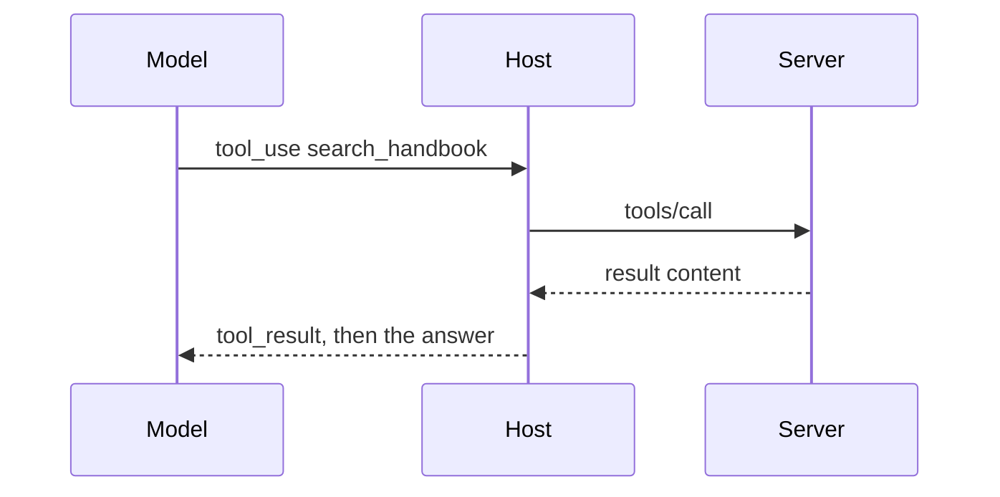
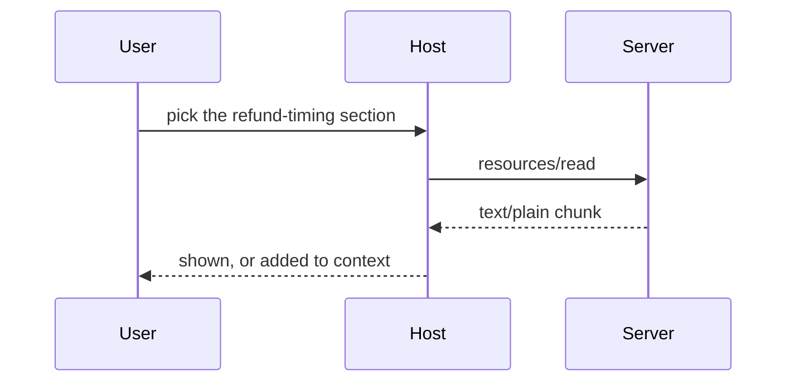
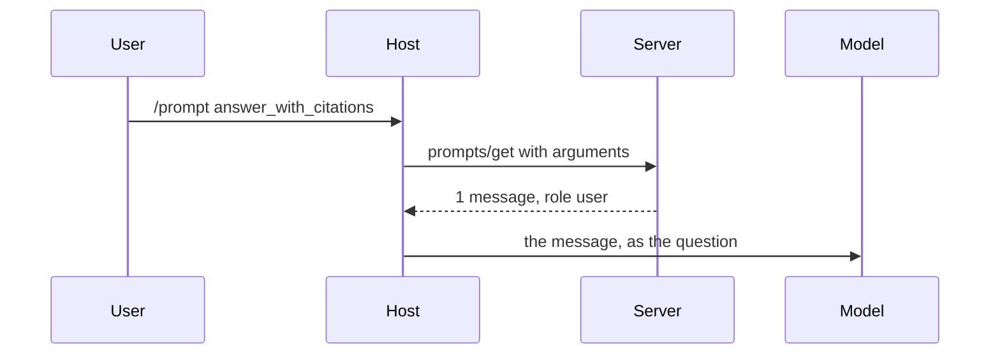
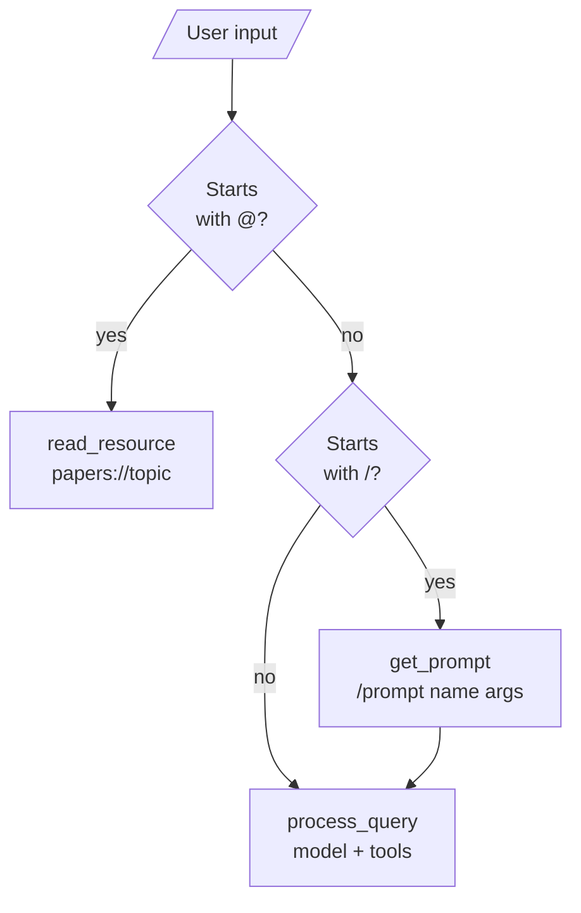

# M38.5 Theory: Prompts and resources

*[M38 theory](../README.md) · Lesson 38.5 · Notebooks: [`05a_adding_prompt_and_resource_features.ipynb`](../../notebook/05a_adding_prompt_and_resource_features.ipynb) · [All theory pages](../../../../../THEORY.md)*
<!-- subtitle: A server offers three kinds of thing, and who decides to use each one, model or user, decides which kind a feature should be -->
<!-- format: approved -->

## Start with three ways into one answer

> **What you'll learn**
>
> - **Explain** how tools, resources and prompts differ in who invokes them and what comes back.
> - **Distinguish** a static resource URI from a URI template, and list both.
> - **Trace** what the lesson 7 chatbot forwards to the model for `@topic`, `/prompt` and a plain question.
> - **Choose** the right kind for a server feature, using Larkspur's handbook as the example.

A Larkspur support engineer answering "How long does a refund take?" can get handbook text into the answer three ways. They can let the model search the handbook mid-answer. They can attach the refund-timing section themselves. Or they can start a reply template the team wrote, which tells the model to search and cite.

All three reach the same handbook through the same server. What differs is who decides, and what the model ends up reading.

## Tools, resources, prompts

A server can offer three kinds of thing. They differ in who decides to use them, and that decides which one a feature should be.

| | Tool | Resource | Prompt |
|---|---|---|---|
| FastMCP decorator | `@mcp.tool()` | `@mcp.resource("papers://folders")` | `@mcp.prompt()` |
| Listed with | `tools/list` | `resources/list`, `resources/templates/list` | `prompts/list` |
| Used with | `tools/call` | `resources/read` | `prompts/get` |
| In the lesson 7 chatbot, chosen by | the model | the user, typing `@topic` | the user, typing `/prompt name arg=value` |
| Returns | content for the model | data the app shows or adds to context | messages to send to the model |

*Table 1: The three server primitives.*

The spec calls tools model-controlled, resources application-driven and prompts user-controlled. A **tool** is something the model decides to call while it writes an answer, with arguments it chooses:

*Figure 1: A tool. The model decides, mid-answer.*

A **resource** is data the user or the application picks by URI. The host decides what to do with it:

*Figure 2: A resource. The user picks it, and no model is involved in fetching it.*

A **prompt** is a message template the server owns. The user starts it, and its output becomes the model's input:

*Figure 3: A prompt. The user starts it; the server writes the instruction.*

Send the refund question through each kind on a small Larkspur server, replayed in memory with SDK 1.30.0:

One question, "How long does a refund take?", through each primitive. Server responses come from the in-memory replay; the model's behaviour is described, not recorded.

<button type="button" data-mode="tool" aria-pressed="false" aria-controls="primitive-tool">Tool</button>
<button type="button" data-mode="resource" aria-pressed="false" aria-controls="primitive-resource">Resource</button>
<button type="button" data-mode="prompt" aria-pressed="false" aria-controls="primitive-prompt">Prompt</button>

<section id="primitive-tool" class="mode-panel" data-announcement="Tool selected. The model decides to search."><h4>Tool: search_handbook</h4><dl><dt>Decided by</dt><dd>The model, which writes the query itself</dd><dt>Request</dt><dd><code>tools/call</code> with a query and <code>k</code></dd><dt>Model reads</dt><dd>The returned chunks, as a tool result inside its own answer loop</dd></dl></section>
<section id="primitive-resource" class="mode-panel" data-announcement="Resource selected. The engineer attaches a section."><h4>Resource: the refund-timing section</h4><dl><dt>Decided by</dt><dd>The engineer, who picks the section</dd><dt>Request</dt><dd><code>resources/read</code> on <code>handbook://section/refund-timing</code></dd><dt>Returns</dt><dd>The chunk as <code>text/plain</code></dd><dt>Model reads</dt><dd>Nothing in the lesson 7 chatbot, which prints it; a host that adds it to context makes it evidence</dd></dl></section>
<section id="primitive-prompt" class="mode-panel" data-announcement="Prompt selected. The engineer starts a server template."><h4>Prompt: answer_with_citations</h4><dl><dt>Decided by</dt><dd>The engineer, who starts the template on purpose</dd><dt>Request</dt><dd><code>prompts/get</code> with the question as its argument</dd><dt>Returns</dt><dd>One message, <code>role: "user"</code>, asking the model to call <code>search_handbook</code> and cite chunk ids</dd><dt>Model reads</dt><dd>That message as the question, and then usually calls the tool</dd></dl></section>

## Resources: one URI or a family

**Resources** are read-only data, like GET endpoints in a REST API: they return data and should not change anything. Each has a URI the server chooses. A static URI names one thing: `papers://folders`, the list of topic folders. A template names a family: `papers://{topic}`, the papers saved under one topic, with the client filling in the parameter at read time.

Static resources and templates are listed separately. In the Larkspur replay:

| Request | Returned |
|---|---|
| `resources/list` | Only the static resource, `handbook://sections` |
| `resources/templates/list` | The template, `handbook://section/{chunk_id}` |
| `resources/read` on `handbook://section/refund-timing` | That chunk, as `text/plain` |

*Table 2: Listing and reading Larkspur's resources (SDK 1.30.0, in-memory session).*

A client that calls only `resources/list` never learns the template exists.

## Prompts: templates the server owns

**Prompts** are templates the server owns. The notebook's `generate_search_prompt(topic, num_papers=5)` returns a long instruction to search for papers on the topic, extract each paper's details and summarise the field. FastMCP takes the prompt's name from the function, its arguments from the signature and its description from the docstring. `prompts/get` returns the filled-in text as messages.

In the replay, `prompts/get` for `answer_with_citations` with `question = "How long does a refund take?"` returned one message with `role: "user"`. The wording lives on the server. Every engineer who starts it sends the same instruction, and a fix to the template reaches all of them.

## How the lesson 7 chatbot routes input

The lesson 7 chatbot routes user input before the model sees it:

*Figure 4: The lesson 7 chatbot's input routing. Only prompts and plain questions reach the model.*

`/prompts` only prints the list. A prompt fetched with `/prompt` goes to `process_query` like a typed question, and only its first message is used. A resource is printed for the user and never reaches the model in this chatbot; another host could add it to the context instead. Two details in the chatbot's code are worth knowing before you copy it:

- **It lists only static resources.** `connect_to_server` calls `list_resources()`, which does not return templates. `papers://{topic}` never enters the routing table, and `get_resource` works around it: for an unknown `papers://` URI it uses any session that has a `papers://` resource. With two servers using that scheme it picks the first.
- **One dict routes all three kinds.** `self.sessions` maps tool names, prompt names and resource URIs to sessions. A prompt named like another server's tool overwrites the route, the same collision the lab in lesson 38.4 shows for tools.

## Choosing the kind for a feature

Ask who should decide to use the feature, and when:

- **The model, mid-answer, with arguments it writes:** a tool. Larkspur's `search_handbook` is one, because the query depends on the conversation.
- **A person or the app, by name, as data:** a resource. The handbook sections are resources, for a support console that lets an engineer attach a section.
- **A person, on purpose, as a ready-made instruction:** a prompt. `answer_with_citations` is one, started when an engineer wants a cited reply.

A feature can be offered twice. A section the model should find by itself and a person should be able to pin is both a search result from a tool and a resource.

## Limits of this evidence

- **A reconstructed server.** Table 2 and the switcher come from a small Larkspur server written for this page and replayed in memory with SDK 1.30.0. The notebook's own research server was not run over stdio.
- **No model in the loop.** What the model does with a tool result or a prompt message is described, not recorded.
- **One host's choices.** Printing a resource rather than adding it to context is the lesson 7 chatbot's design, not a protocol rule.

## References

1. Model Context Protocol, [Tools](https://modelcontextprotocol.io/specification/2025-11-25/server/tools), [Resources](https://modelcontextprotocol.io/specification/2025-11-25/server/resources) and [Prompts](https://modelcontextprotocol.io/specification/2025-11-25/server/prompts), specification 2025-11-25.
2. Model Context Protocol, [Understanding MCP servers](https://modelcontextprotocol.io/docs/2026-07-28/learn/server-concepts), the three primitives and who controls each.
3. Model Context Protocol, [Python SDK](https://github.com/modelcontextprotocol/python-sdk), the FastMCP decorators.

## Key Takeaways

- Choose the kind by who decides to use it. The model picks tools mid-answer; the user picks resources (read-only data by URI) and prompts (server-owned message templates).
- A static resource URI names one thing and a template such as `papers://{topic}` names a family. `list_resources()` does not return templates, so list them separately.
- Routing tools, prompts and resource URIs through one dict lets a name on one server overwrite a route on another.

## Check yourself

1. What decides whether a server feature should be a tool, a resource or a prompt?

Who decides to use it. The model chooses a tool mid-answer through `tools/call`. The user chooses a resource, read-only data fetched with `resources/read`, and a prompt, a server-owned template fetched with `prompts/get`; in the lesson 7 chatbot that means typing `@topic` or `/prompt name arg=value`.

2. Why is search_handbook a tool on the Larkspur server, while the handbook sections are resources and answer_with_citations is a prompt?

`search_handbook` is a tool because the model needs it mid-answer, with a query it writes. The sections are resources because they are data a support console lets an engineer attach (`handbook://sections` and the template `handbook://section/{chunk_id}`). `answer_with_citations` is a prompt because the engineer starts it on purpose.

3. The lesson 7 chatbot never puts the papers topic template in its routing table. Why, and how does reading a topic still work?

`connect_to_server` calls `list_resources()`, which returns static resources but not templates, so `papers://{topic}` never enters the table. `get_resource` works around it: for an unknown `papers://` URI it uses any session that has a `papers://` resource. With two servers using that scheme, it picks the first.

---
*Previous: [38.4 Connecting to reference servers](../04_connecting_to_reference_servers/README.md). Next: [38.6 Remote servers and deployment](../06_remote_servers_and_deployment/README.md).*
