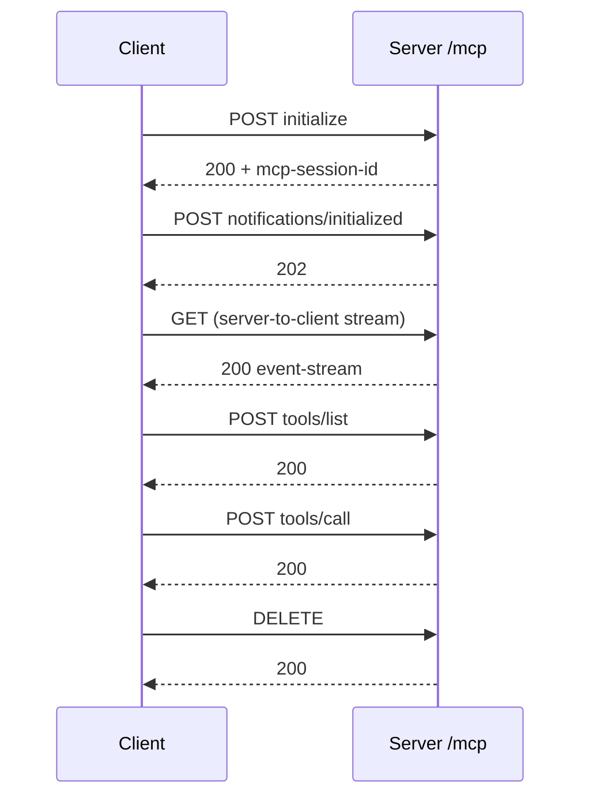

# M38.6 Theory: Remote servers and deployment

*[M38 theory](../README.md) · Lesson 38.6 · Notebooks: [`06a_creating_and_deploying_remote_servers.ipynb`](../../notebook/06a_creating_and_deploying_remote_servers.ipynb) · [All theory pages](../../../../../THEORY.md)*

## Remote transport

Larkspur moves its handbook server from a local subprocess to a remote endpoint. You will compare SSE and Streamable HTTP exchanges, inspect the session headers and distinguish a working container command from an externally reachable service.

### Step 1: Compare local ownership with a remote service

A stdio server is a subprocess: the client starts it, owns it, and talks over its standard input and output. A remote server is a process of its own, often on another machine, that must already be running when the client connects by URL. The tools, resources and prompts do not change. With FastMCP only the last line does:

Implementation excerpt from the configured application. The practice material supplies its models, data and session setup:

```text
mcp = FastMCP("research", port=8001)   # notebook 06a
...
mcp.run(transport="sse")               # or "streamable-http", or "stdio"
```

The reference implementation deploys over SSE because, when the course was filmed, Streamable HTTP was still being built into the Python SDK; it adds notes for Streamable HTTP. SDK 1.30.0 ships both. Recorded against the Larkspur server running each way (initialize, list tools, one `tools/call`, close):

| | SSE | Streamable HTTP | Streamable HTTP, `stateless_http=True` |
|---|---|---|---|
| Endpoints | `GET /sse`, then `POST /messages/?session_id=…` | `/mcp` for everything | `/mcp` |
| Reply to a request | `202 Accepted`; the answer arrives on the `/sse` stream | `200` with the answer in the response (`text/event-stream`) | `200` with the answer |
| Session | id in the query string | `mcp-session-id` header, set on the `initialize` reply | none |
| Close | close the stream | `DELETE /mcp` | nothing to close |


<!-- animated: diagrams/streamable-http.anim.html -->

### Step 2: Track stateful session headers

After `initialize`, every request in the stateful run carried two headers: `mcp-session-id` (32 characters) and `mcp-protocol-version: 2025-11-25`. The session id is what lets a stateful server remember a client between requests; it is also why a stateful server behind several replicas needs sticky routing, while a stateless one can answer from any replica and cannot keep anything between calls.

### Step 3: Choose the correct endpoint and SDK setting

Paths and names to get right in SDK 1.30.0:

- **Defaults.** `FastMCP` listens on `127.0.0.1:8000`, with SSE at `/sse` and `/messages/` and Streamable HTTP at `/mcp`. The example's `port=8001` still works as a constructor argument.
- **The URL.** The example says to append `/mcp/`. The server answers `POST /mcp/` with `307` and a `Location` of `/mcp`; the 1.30.0 client follows a same-origin `307` for a POST, so either works, and `/mcp` saves the round trip.
- **The client function.** The example imports `streamablehttp_client`. In 1.30.0 it is marked deprecated with “Use `streamable_http_client` instead.”; the new one takes the URL and an optional `httpx.AsyncClient` for headers and auth. `sse_client(url)` still takes the URL as the example passes it.

## Deploying a remote server

### Step 1: Test the bind address and server-owned files

The lesson 9 project ships a `Dockerfile`: `python:3.11-slim`, `uv pip install --system .`, `EXPOSE 8001`, then `uv run research_server.py`. Two things change once the server leaves your laptop.

### Step 2: Test reachability using the actual SDK defaults

The project's own `uv.lock` pins mcp 1.8.0, whose FastMCP default host is `0.0.0.0`, reachable through the container's mapped port. The course environment's 1.30.0 defaults to `127.0.0.1`, which only the container itself can reach. Set `host="0.0.0.0"` in the constructor and the server behaves the same under both.

### Step 3: Locate persistent data on the server

The research server keeps papers in a `papers/` folder beside it. In the reference implementation's hosted server that folder is empty, so the resources list no topics. On a fresh copy, recorded with 1.30.0, `papers://folders` returns “No topics found.” and `extract_info` fails with `[Errno 2] No such file or directory: 'papers'`, because it lists the folder without checking that it exists. A remote server needs storage that outlives the container, and tools that handle an empty start.

Before anyone outside can reach the server, it needs what a stdio server never did: authentication, because anyone who can reach the URL can call the tools; TLS; and logs of which client called what. The 1.30.0 `FastMCP` constructor takes `auth` settings and a `token_verifier` for the first. The reference implementation's optional section deploys to Render, and its resources link Cloudflare's guide to remote MCP servers.

### Try it yourself

Compare the project's SDK 1.8.0 default bind address with the course SDK 1.30.0 default. Check that exposing container port 8001 does not make a process bound to 127.0.0.1 reachable through that mapping. Inspect the configured host, endpoint and session mode before testing authentication or model behaviour.

### Practice notebook

Run the complete implementation from the practice material after checking the trace or calculation above. Use its stated environment for live model or server calls; recorded model choices and timings are observations, not guaranteed outputs.

- [Creating and deploying remote](../../notebook/06a_creating_and_deploying_remote_servers.ipynb).

## Key Takeaways

- Moving from `stdio` to a remote server changes only the transport line. A remote server must already be running when the client connects by URL.
- Streamable HTTP uses one `/mcp` endpoint. Stateful mode tracks clients with `mcp-session-id` and needs sticky routing across replicas; stateless mode answers from any replica but keeps nothing between calls.
- Set `host="0.0.0.0"` in a container, keep server files on storage that outlives it, and add authentication, TLS and call logs before exposing the URL.

## Check yourself

<details>
<summary>1. Why does a stateful Streamable HTTP server behind several replicas need sticky routing, while a stateless one does not?</summary>

A stateful server remembers a client through the `mcp-session-id` header set on the `initialize` reply, so every request in that session must reach the replica that holds it. With `stateless_http=True` there is no session: any replica can answer, but the server cannot keep anything between calls.

</details>

<details>
<summary>2. The lesson 9 Dockerfile runs fine with mcp 1.8.0, but with SDK 1.30.0 nothing outside the container reaches it. What changed, and what is the fix?</summary>

The FastMCP default host. In 1.8.0 it is `0.0.0.0`, reachable through the container's mapped port; in 1.30.0 it is `127.0.0.1`, which only the container itself can reach. Set `host="0.0.0.0"` in the constructor and the server behaves the same under both.

</details>

<details>
<summary>3. On a fresh deployment the folders resource says No topics found and extract_info fails with No such file or directory. What is wrong?</summary>

The research server keeps papers in a `papers/` folder beside it, and a fresh copy has none; `extract_info` lists the folder without checking that it exists. A remote server needs storage that outlives the container, and tools that handle an empty start.

</details>

---
*Previous: [38.5 Prompts and resources](../05_prompts_and_resources/README.md). Next: [M38 interview questions](../README.md#interview-spotlight-5-questions-you-might-get-asked).*
