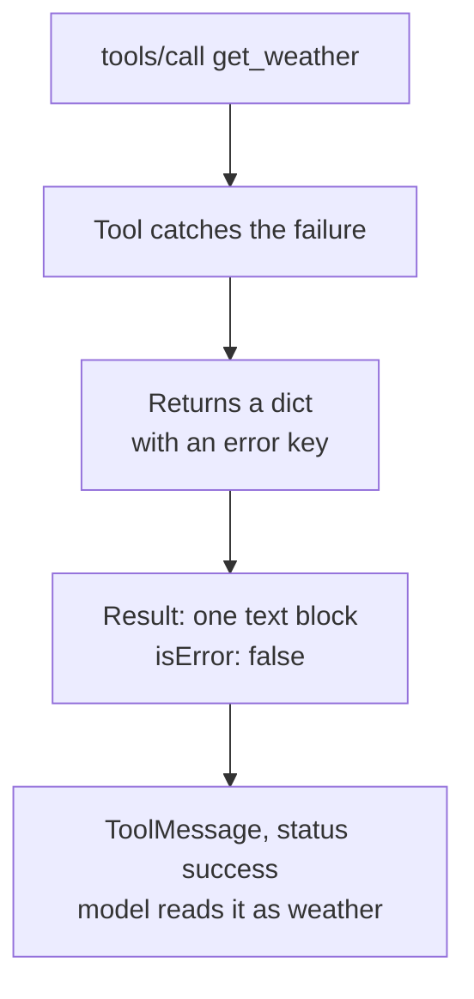
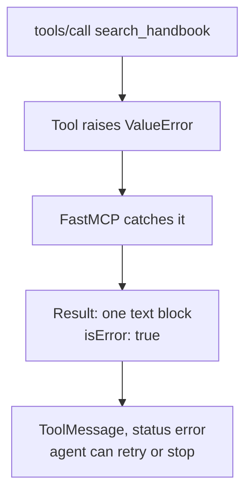
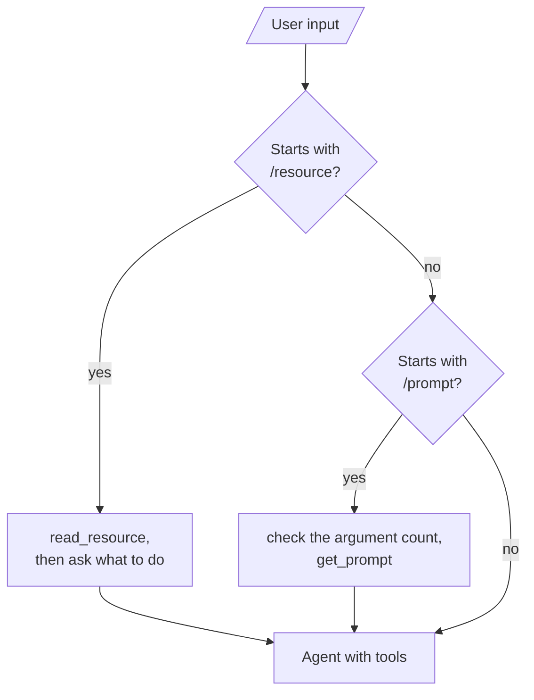

# M39.1 Theory: Single-server MCP, with resources

*[M39 theory](../README.md) · Lesson 39.1 · Notebooks: [`01_single_server_mcp`](../../../projects/01_single_server_mcp), [`02_single_server_mcp_with_resources`](../../../projects/02_single_server_mcp_with_resources) · [All theory pages](../../../../../THEORY.md)*
<!-- subtitle: A tool that catches its own failure reports success, and the client decides what a prompt or a resource becomes in the model's context -->
<!-- format: approved -->

## Start with a missing key that looks like weather

> **What you'll learn**
>
> - **Read** an MCP tool result as two separate signals: the content blocks and the `isError` flag.
> - **Choose** between returning an error as data and raising it, and predict what the model sees for each.
> - **Predict** the content blocks and schema a FastMCP server produces from a function's return type.
> - **Trace** how a client turns a prompt or a resource into a message for the model.

Larkspur's support assistant calls `search_handbook`. One day the server's index has not loaded. The assistant answers anyway, confidently, from a message that says the index is missing, because the protocol told the client the call worked.

The course projects show the same failure with weather instead of handbook chunks. Run the weather server with no API key and ask for the weather in Dublin: the tool returns an error message, and the result arrives marked as a success. This page separates what a server sends from what the protocol says about it, then follows prompts and resources into the model's context.

## What comes back from a server

Both projects build one FastMCP weather server and a LangGraph client that talks to it over stdio. Project 01 gives the server a tool, `get_weather`, and a prompt, `compare_weather_prompt`. Project 02 swaps the prompt for a resource, `file://delivery_log`, which reads a ten-line order log from `delivery_log.txt`. [Lesson 38.5](../../../../m38_mcp_foundations/mandatory/theory/05_prompts_and_resources/README.md) explains who chooses each kind of feature. This page is about what each one returns, because the client has to handle every shape.

| Request | What the client gets |
|---|---|
| `tools/call get_weather {"location": "Dublin"}` | One text block holding `{"error": "OpenWeatherMap API key is not configured on the server."}`, with `isError: false` and no `structuredContent` |
| `prompts/get compare_weather_prompt` | One message, `role: "user"`, holding the filled-in instructions; both arguments are required |
| `prompts/get` with only `location_a` | An `McpError`: "Missing required arguments: {'location_b'}" |
| `resources/list` | One resource, listed as `file://delivery_log/` with a trailing slash, MIME type `text/plain` |
| `resources/read file://delivery_log` | One text block holding a JSON array of the ten log lines |

*Table 1: Replayed with MCP SDK 1.30.0 against copies of the two servers, no API key set.*

A result has two parts that do not depend on each other. The **content** is a list of blocks (text, images, embedded resources) meant for the model. **`isError`** is the protocol's own verdict on whether the call worked. A server can put the word "error" in the content and still report `isError: false`.

The old version of this page counted nine log lines. The file holds ten orders, #10583 to #10592; `wc -l` reports 9 because the last line has no newline.

## Return an error, or raise it

A tool can fail in two ways, and the client sees two different results.

**Approach A: return the error as data.** `get_weather` wraps its body in `try` and returns a dict with an `error` key for every failure: no key, a 404, a 401, a network fault, an unexpected payload. FastMCP serialises that dict as an ordinary result.

*Figure 1: An error returned as data. The protocol reports a successful call.*

**Approach B: raise.** A Larkspur `search_handbook` that raises `ValueError("index not loaded")` lets FastMCP catch the exception at the protocol boundary and mark the result.

*Figure 2: A raised failure. The protocol and the adapter both mark the call as failed.*

Compare the two on the same request:

One request, <code>search_handbook {"query": "refund"}</code>, with the index not loaded. The raised result was replayed with MCP SDK 1.30.0 and <code>langchain-mcp-adapters</code> 0.3.2; the returned one follows the <code>get_weather</code> replay in Table 1.

<button type="button" data-mode="returned" aria-pressed="false" aria-controls="error-returned">Returned as data</button>
<button type="button" data-mode="raised" aria-pressed="false" aria-controls="error-raised">Raised</button>

<section id="error-returned" class="mode-panel" data-announcement="Returned as data selected. The call reports success."><h4>Returned as data</h4><dl><dt>Content</dt><dd>One text block: <code>{"error": "index not loaded"}</code></dd><dt><code>isError</code></dt><dd><code>false</code></dd><dt>Adapter</dt><dd>A <code>ToolMessage</code> with the default status, success</dd><dt>Model</dt><dd>Reads the message as handbook evidence and may answer from it</dd></dl></section>
<section id="error-raised" class="mode-panel" data-announcement="Raised selected. The call reports failure."><h4>Raised</h4><dl><dt>Content</dt><dd>One text block: "Error executing tool search_handbook: index not loaded"</dd><dt><code>isError</code></dt><dd><code>true</code></dd><dt>Adapter</dt><dd>A <code>ToolMessage</code> with <code>status="error"</code></dd><dt>Model</dt><dd>Sees a failed call and can try another tool, retry or say the handbook is unavailable</dd></dl></section>

The rule: raise when the call failed, return data when it worked. "No chunks matched" is a successful search with an empty answer; "index not loaded" is a failure. A catch-all `try` in a tool erases that difference, and nothing downstream can recover it.

The project 03 copy of the weather server shows how far a returned error can travel. It ships with `OPENWEATHERMAP_API_KEY = "{{OPENWEATHERMAP_API_KEY}}"`. The guard rejects only an empty key or the literal `YOUR_OPENWEATHERMAP_API_KEY`, which lets the placeholder through. The API answers HTTP 401, and the tool returns `{"error": "Authentication failed. The API key is likely invalid or inactive."}`, again as a success.

## The return type decides the shape

FastMCP builds the result from the Python function's return type, and tools and resources treat the same type differently:

| Function | Content blocks | `outputSchema` and `structuredContent` |
|---|---|---|
| Resource `delivery_log_resource() -> list[str]` | One text block: the whole list as one JSON array | Resources have neither |
| Tool `list_tasks() -> List[str]`, two tasks | Two text blocks, one per item | Schema with an array field `result`; `{"result": [...]}` |
| Tool `add_task(...) -> str` | One text block | Schema with a string field `result`; `{"result": "Task ... added"}` |
| Tool `get_weather(...) -> dict` | One text block: the dict as JSON | No schema, no `structuredContent` |

*Table 2: Content and schema by return type, replayed with MCP SDK 1.30.0 on the project 02 and 03 servers.*

Two consequences follow. A client that reads a resource and pastes its text into a message gives the model one JSON array, not ten lines. And a tool typed `-> dict` gives the client nothing to validate against; a typed return, such as a Pydantic model, publishes a schema the client can check every result against.

## What reaches the model

The server only answers requests. The client decides which request to send and how to wrap the answer. Both project clients read a command prefix before falling through to the agent:

*Figure 3: Command routing in the project clients. Project 01 handles `/prompt`, project 02 handles `/resource`; anything else goes to the agent.*

Follow one resource from the order log into the conversation:

The project 02 client loading the delivery log. Each stage names the request sent and what the client keeps.

<button type="button" data-step="list" aria-pressed="false" aria-controls="resource-step-list">1. List</button><button type="button" data-step="read" aria-pressed="false" aria-controls="resource-step-read">2. Read</button><button type="button" data-step="task" aria-pressed="false" aria-controls="resource-step-task">3. Ask for a task</button><button type="button" data-step="wrap" aria-pressed="false" aria-controls="resource-step-wrap">4. Wrap</button><button type="button" data-step="keep" aria-pressed="false" aria-controls="resource-step-keep">5. Keep</button>

<section id="resource-step-list" class="step-panel" aria-labelledby="resource-heading-list"><h4 id="resource-heading-list">1. <code>/resources</code> lists what the server offers</h4><dl><dt>Request</dt><dd><code>resources/list</code></dd><dt>Shown</dt><dd><code>file://delivery_log/</code> and the function's docstring as its description</dd></dl></section><section id="resource-step-read" class="step-panel" aria-labelledby="resource-heading-read"><h4 id="resource-heading-read">2. <code>/resource file://delivery_log</code> reads it</h4><dl><dt>Request</dt><dd><code>resources/read</code></dd><dt>Received</dt><dd>One text block; the client joins every text block it receives into one string</dd></dl></section><section id="resource-step-task" class="step-panel" aria-labelledby="resource-heading-task"><h4 id="resource-heading-task">3. The client asks what to do with it</h4><dl><dt>Input</dt><dd>A task such as "Which orders went to Texas?", or Enter for none</dd><dt>Server calls</dt><dd>None: this is client logic</dd></dl></section><section id="resource-step-wrap" class="step-panel" aria-labelledby="resource-heading-wrap"><h4 id="resource-heading-wrap">4. The client wraps the text</h4><dl><dt>With a task</dt><dd><code>CONTEXT from a loaded resource</code>, the JSON array, then <code>TASK:</code> and the task</dd><dt>Without one</dt><dd>A request to acknowledge the context and remember it</dd></dl></section><section id="resource-step-keep" class="step-panel" aria-labelledby="resource-heading-keep"><h4 id="resource-heading-keep">5. The checkpointer keeps it</h4><dl><dt>Stored</dt><dd>The wrapped message, in the <code>MemorySaver</code> thread <code>weather-session</code></dd><dt>Effect</dt><dd>Every later turn in the thread carries the log, and its tokens</dd></dl></section>

<button type="button" data-walk="previous">Previous</button>

<button type="button" data-walk="next">Next step</button>

A prompt takes the other branch. The project 01 client lists the prompt's arguments, checks that the user gave one value for each, and sends `prompts/get`. The returned user message goes to the agent as if the user had typed it; its instructions tell the model to fetch the weather for both cities before comparing them.

Both servers open files by relative path (`python weather_server.py`, `Path("delivery_log.txt")`). The client only works when it is started from the project folder.

## A contract for each Larkspur feature

The same rules give one decision per feature:

| Feature | Kind | Contract |
|---|---|---|
| `search_handbook` | Tool | Raise when the index is missing; return chunk ids and text, or an empty list, when the search ran |
| Refund policy | Resource | A support engineer attaches it on purpose; the client wraps it with the engineer's task |
| `answer_with_citations` (M38) | Prompt | The engineer starts it; the client checks its arguments before sending |

*Table 3: One contract per feature for the Larkspur server.*

## Limits of this evidence

- **Replays, not live runs.** Tables 1 and 2 and the switcher come from copies of the project servers called offline with MCP SDK 1.30.0. Only the 401 for the placeholder key came from the live weather API.
- **The adapter version matters.** `status="error"` on a raised failure is `langchain-mcp-adapters` 0.3.2 behaviour; other clients may surface `isError` differently.
- **Model behaviour is not measured.** That a model treats a returned error as evidence is the risk this page argues from, not a rate it measured.

## References

1. Model Context Protocol, [Tools](https://modelcontextprotocol.io/specification/2025-06-18/server/tools): content blocks, `isError`, `outputSchema` and `structuredContent`.
2. Model Context Protocol, [Resources](https://modelcontextprotocol.io/specification/2025-06-18/server/resources) and [Prompts](https://modelcontextprotocol.io/specification/2025-06-18/server/prompts).
3. LangChain, [Model Context Protocol](https://docs.langchain.com/oss/python/langchain/mcp): `langchain-mcp-adapters` and `MultiServerMCPClient`.

## Key Takeaways

- Raise when a tool call failed and return data when it worked. A caught error returned as a dict carries `isError: false`, and the model reads it as a real result.
- The return type decides the shape: a resource's `list[str]` becomes one JSON array, a tool's list becomes one block per item, and a tool typed `-> dict` publishes no `outputSchema`.
- The client, not the server, decides what a prompt or a resource becomes in the model's context, and a checkpointer keeps it for every later turn.

## Check yourself

1. With no API key set, get_weather returns an error message with isError false. Why, and why is that a problem for the model?

`get_weather` catches every failure and returns a dict with an `error` key, which FastMCP sends as a successful result. The model reads the message as weather data. A tool that raises comes back with `isError: true`, and `langchain-mcp-adapters` turns it into a `ToolMessage` with `status="error"`.

2. The delivery log resource function returns a list of ten strings. What does the model see after the client reads it?

One JSON array. FastMCP serialises a resource's `list[str]` as one text block, and the client joins the blocks and pastes the result into a message wrapped as `CONTEXT … TASK: <what you asked>`. The `MemorySaver` checkpointer keeps it for the rest of the thread.

3. You want the client to check get_weather results against a schema. Why does the server give it nothing to check, and what change fixes that?

`get_weather` is typed `-> dict`, and FastMCP lists it with no `outputSchema`, so its results carry no `structuredContent`. Tools typed `-> str` or `-> List[str]` do get a schema. A typed return, such as a Pydantic model, gives the client a schema to check every result against.

---
*Previous: [M39 overview](../README.md). Next: [39.2 Multi-server MCP](../02_multi_server_mcp/README.md).*
