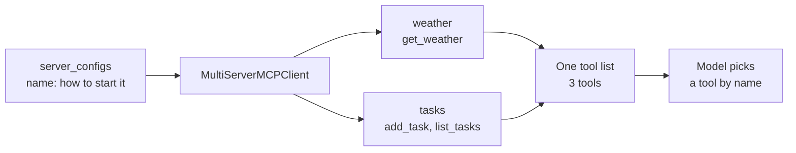
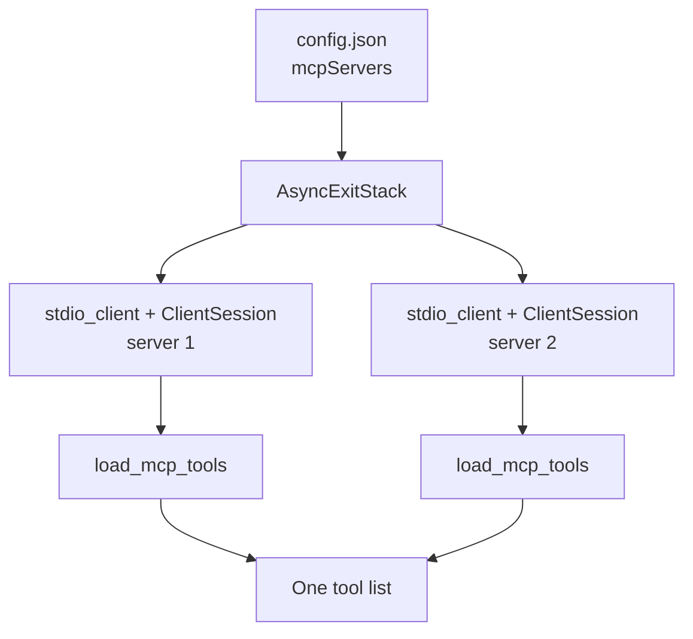
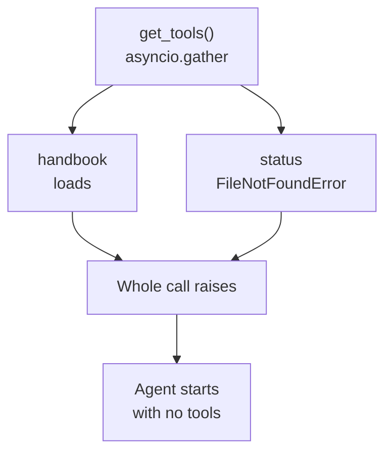
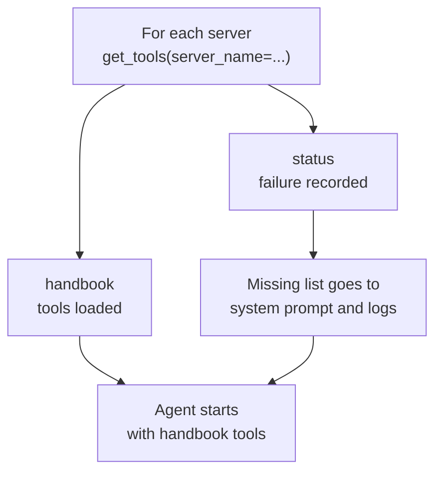

# M39.2 Theory: Multi-server MCP

*[M39 theory](../README.md) · Lesson 39.2 · Notebooks: [`03_multi_server_mcp`](../../../projects/03_multi_server_mcp) · [All theory pages](../../../../../THEORY.md)*
<!-- subtitle: One client, several servers, one flat tool list: names must be unique, descriptions do the routing, and one dead server can take every tool with it -->
<!-- format: approved -->

## Start with a status server that will not start

> **What you'll learn**
>
> - **Explain** how one client merges the tools of several servers into the single list the model sees.
> - **Prevent** tool-name collisions, and write descriptions that route questions to the right server.
> - **Choose** between all-or-nothing loading and a degraded start when one server is down.
> - **Separate** a failure during discovery from a failure during a call.

Larkspur runs two MCP servers for its support assistant. The handbook server answers policy questions; the status server reads live status pages. One morning the status server's command is missing from the host. The assistant starts with no tools at all, and refund questions it could have answered from the handbook go unanswered too.

The lesson's project combines two small servers behind one client. Replaying it, with a Larkspur handbook and status server alongside, shows where the tool list comes from, where it breaks, and what to decide before it does.

## Multi-server

Project 03 puts the weather server next to a second server, a task server whose `add_task` and `list_tasks` tools keep a to-do list in `tasks.txt`. The client names both in one dict and hands it to `MultiServerMCPClient` from `langchain-mcp-adapters`:

| Key | `command` | `args` | `transport` |
|---|---|---|---|
| `weather` | `python` | `weather_server.py` | `stdio` |
| `tasks` | `python` | `task_server.py` | `stdio` |

*Table 1: The project's `server_configs`. Each key is the client's name for a server and how to start it.*

`await client.get_tools()` starts both servers, lists their tools and returns one flat list: `get_weather`, `add_task`, `list_tasks`. The keys `weather` and `tasks` never reach the model. The list is bound to the LLM with `bind_tools`, and a LangGraph `ToolNode` runs whichever tool the model picks. When the model calls `add_task`, the adapter sends the call to the server that listed it.

*Figure 1: The adapter-managed client. Server names stay in the client; the model sees one list.*

Three rules follow from the flat list.

- **Names must be unique across servers.** `ToolNode` keeps tools in a dict keyed by name (langgraph 1.2.18). With a handbook server and a status server that both offer `search`, `get_tools()` returns `search` twice, the dict keeps one entry, and every `search` call goes to the status server, the one loaded last. Nothing warns you. `MultiServerMCPClient(..., tool_name_prefix=True)` renames each tool `<server>_<tool>`: here `weather_get_weather`, `tasks_add_task` and `tasks_list_tasks`. [Lesson 38.4](../../../../m38_mcp_foundations/mandatory/theory/04_connecting_to_reference_servers/README.md) shows the same collision in a hand-written client.
- **Descriptions do the routing.** The model chooses by name and description alone; server boundaries are invisible to it. For Larkspur, `search_handbook` says it searches the handbook's policies and `search_status` says it searches live status pages, which sends *Is there an outage right now?* to the status server. If both said "search Larkspur information", the model would have to guess.
- **Every tool costs tokens on every call.** All definitions from all servers go to the model each turn, as [M38](../../../../m38_mcp_foundations/mandatory/theory/README.md) measures. Connect the servers an agent needs, not every server you have.

### A hand-built session registry

[Project 02 under lesson 39.4](../04_your_own_client_and_a_multi_server_client/README.md) builds the same thing by hand. A `config.json` holds an `mcpServers` block; the client opens one `stdio_client` and one `ClientSession` per entry on an `AsyncExitStack`, and calls `load_mcp_tools(session)` for each.

*Figure 2: The hand-built client. The code owns one session per server and can handle each one's failure on its own.*

Its two servers run in Docker. Each `config.json` entry starts its server with `docker run -i --rm …`, where `-i` keeps standard input open so stdio works through the container, and the client starts a fresh container for every session. `docker-compose up` only needs to build the two images: the containers it also starts sit with their input open and are not the ones the client talks to. Replace the placeholder `/ABSOLUTE/PATH/TO/…` volume path in `config.json` first; as shipped, it mounts a folder that does not exist.

The second server there is MCP's reference fetch server: one `fetch` tool that returns a page as Markdown, 5,000 characters at a time by default, with a `start_index` for the next slice, and a `robots.txt` check before it fetches on the model's behalf. It is the web-search half of the module's lab brief.

## When one server fails

`get_tools()` loads every server at once with `asyncio.gather`. The first server that fails raises, and no tools load at all, from any server. Replayed with a working handbook server and a status entry whose command does not exist:

- `await client.get_tools()` raised `FileNotFoundError` for the status command and returned nothing for the healthy handbook server.
- `await client.get_tools(server_name="handbook")` returned the handbook's tools.

That is one policy, **fail closed**: if any server is missing, the agent gets nothing.

*Figure 3: All-or-nothing loading. One failed server discards the healthy one's tools.*

The other policy is a **degraded start**: load each server on its own, keep what loaded and say what did not. The hand-built client in project 02 does this. It wraps each server in its own `try`, prints `Connection failed for <name>`, and starts with the tools it got.

*Figure 4: Per-server loading. The healthy server's tools survive, and the agent is told what is missing.*

Run the same morning through each policy:

The handbook server is healthy and the status command is missing. Load results were replayed with <code>langchain-mcp-adapters</code> 0.3.2; the answers are what each policy allows, not recorded model output.

<button type="button" data-mode="gather" aria-pressed="false" aria-controls="failure-gather">get_tools() for all</button>
<button type="button" data-mode="degraded" aria-pressed="false" aria-controls="failure-degraded">Per server, degraded</button>
<button type="button" data-mode="refuse" aria-pressed="false" aria-controls="failure-refuse">Per server, refuse</button>

<section id="failure-gather" class="mode-panel" data-announcement="get_tools for all selected. No tools load."><h4>get_tools() for all</h4><dl><dt>Load result</dt><dd><code>FileNotFoundError</code>; zero tools</dd><dt>Refund question</dt><dd>Unanswered, or the process exits</dd><dt>Outage question</dt><dd>Unanswered</dd></dl></section>
<section id="failure-degraded" class="mode-panel" data-announcement="Per server, degraded selected. Handbook tools load."><h4>Per server, degraded</h4><dl><dt>Load result</dt><dd>Handbook tools; status recorded as missing</dd><dt>Refund question</dt><dd>Answered from the handbook</dd><dt>Outage question</dt><dd>The assistant says live status is unavailable, because the system prompt names the missing server</dd></dl></section>
<section id="failure-refuse" class="mode-panel" data-announcement="Per server, refuse selected. The agent does not start."><h4>Per server, refuse</h4><dl><dt>Load result</dt><dd>Handbook tools; status recorded as missing</dd><dt>Decision</dt><dd>The agent refuses to start and the logs name the status server</dd><dt>Fits</dt><dd>An agent whose every task needs both servers</dd></dl></section>

Neither is right by default. A Larkspur assistant can answer refund questions with the status server down, so it should start degraded and name the missing tools. An agent whose every task needs both servers should refuse. Either way, load per server and record which ones failed: silently dropping a server that a question needs is the outcome to avoid.

Failures during a call are a separate case. A tool that raises comes back with `isError: true`, and the adapter returns it to the model as a `ToolMessage` with `status="error"`, which lets the agent try something else. A dead process or a dropped connection is not a tool error: the adapter raises, and the agent run stops unless your code catches it.

## Limits of this evidence

- **Replays, not live runs.** The tool lists, the collision and the load failure come from copies of the project servers and two small Larkspur stand-ins, run offline with `langchain-mcp-adapters` 0.3.2 and langgraph 1.2.18. No model was called.
- **The Docker setup was read, not run.** The `config.json` and `docker-compose` claims come from the project files.
- **Token cost is cited, not remeasured.** The per-turn cost of tool definitions comes from M38's measurement.

## References

1. LangChain, [Model Context Protocol](https://docs.langchain.com/oss/python/langchain/mcp): `MultiServerMCPClient`, `get_tools` and tool-name prefixes.
2. Model Context Protocol, [Tools](https://modelcontextprotocol.io/specification/2025-06-18/server/tools): tool listing, names and `isError`.
3. Model Context Protocol, [Architecture overview](https://modelcontextprotocol.io/docs/learn/architecture): one client connection per server inside a host.

## Key Takeaways

- `MultiServerMCPClient` gives the model one flat tool list, and server names never reach it. Names must be unique across servers; use `tool_name_prefix=True` when they might clash.
- The model routes by name and description alone. Write descriptions that say what each tool searches, and connect only the servers the agent needs.
- `get_tools()` fails whole if one server fails. Load each server on its own, record which ones failed, and decide whether to start degraded or refuse.

## Check yourself

1. Two servers behind one MultiServerMCPClient both offer a tool named search. What happens, and how do you prevent it?

`get_tools()` returns `search` twice, but `ToolNode` keeps tools in a dict by name (langgraph 1.2.18). The server loaded last answers every `search` call and nothing warns you. `MultiServerMCPClient(..., tool_name_prefix=True)` renames each tool `<server>_<tool>`, such as `weather_get_weather` and `tasks_add_task`.

2. A Larkspur user asks whether there is an outage right now. What makes the model pick search_status over search_handbook?

The descriptions. The model chooses by name and description alone and cannot see server boundaries; `search_status` says it searches live status pages and `search_handbook` says it searches the handbook's policies. If both said "search Larkspur information", the model would have to guess.

3. The status server's command is missing, get_tools raises, and the Larkspur assistant starts with no tools at all. What should it do instead?

Load each server on its own with `get_tools(server_name=...)` and record which ones failed. `get_tools()` uses `asyncio.gather`, and one failure loses every server. The assistant can still answer refund questions, so it should start degraded and name the missing tools in the system prompt and the logs; an agent that needs both servers for every task should refuse to start.

---
*Previous: [39.1 Single-server MCP, with resources](../01_single_server_mcp_with_resources/README.md). Next: [39.4 Your own client and a multi-server client](../04_your_own_client_and_a_multi_server_client/README.md).*
