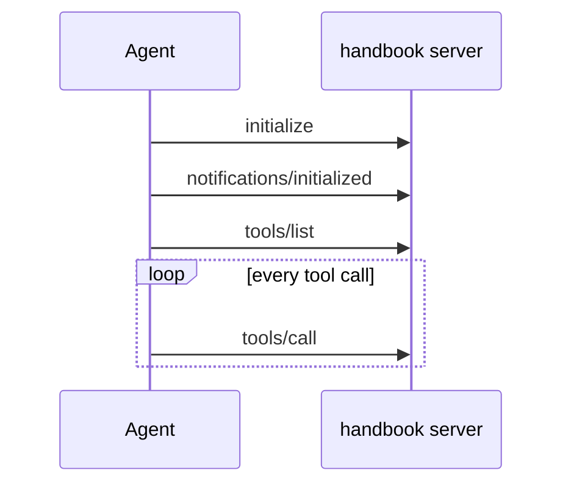
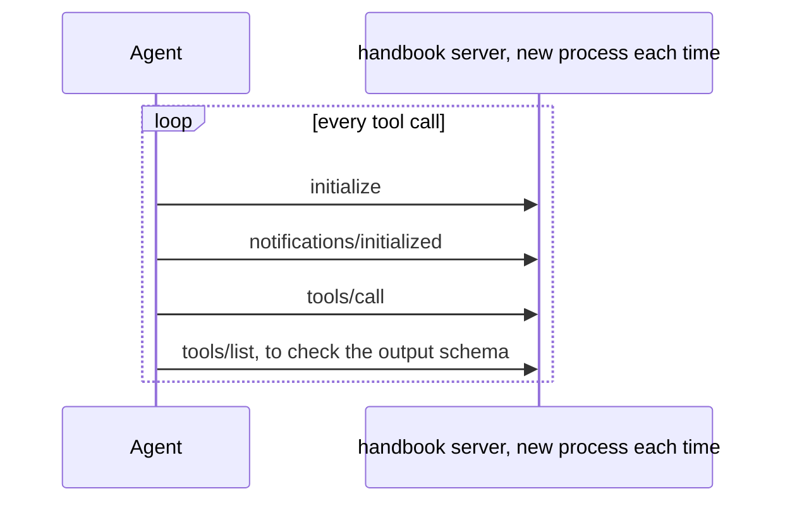
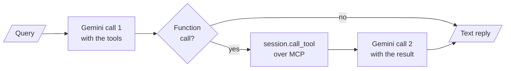

# M39.4 Theory: Your own client and a multi-server client

*[M39 theory](../README.md) · Lesson 39.4 · Notebooks: [`01_build_your_own_server_client`](../../../projects/01_build_your_own_server_client), [`02_multi_server_client`](../../../projects/02_multi_server_client) · [All theory pages](../../../../../THEORY.md)*
<!-- subtitle: A client is a transport, a session and a handshake; how long it holds the session decides what every call costs, and a hand-written client has to loop until the model stops asking for tools -->
<!-- format: approved -->

## Start with eight calls to two servers

> **What you'll learn**
>
> - **Explain** the three layers of an MCP client: the transport, the `ClientSession` and the `initialize()` handshake.
> - **Compare** a session held for the life of the agent with a session opened for every tool call, in messages, HTTP requests and processes.
> - **Diagnose** why a server's in-memory cache is empty on every call, and why a hand-written client fails when the model asks for a second tool.

Larkspur's support agent talks to two MCP servers: `handbook`, which searches the policy pages, and `status`, which reports incidents. One conversation makes 8 tool calls across them.

Wired through `MultiServerMCPClient.get_tools()` over stdio, those 8 calls start 10 server processes and send 38 protocol messages. The handbook server's result cache never warms up: every call meets a process that has just started. A hand-written client for the same servers has a different failure. It answers one tool request, and when the model's next reply asks for another tool, it crashes.

Both failures come from the client side, and neither shows up in a single test call.

## Client sessions

Every client in these projects is built from the same three layers, each an async context manager on one `AsyncExitStack`:

| Layer | Built from | What it does |
|---|---|---|
| Transport | `stdio_client(params)`, `sse_client(url)` or `streamable_http_client(url)` | Moves bytes: pipes to a child process, or HTTP |
| Session | `ClientSession(read, write)` | Speaks JSON-RPC over the transport and matches replies to requests |
| Handshake | `await session.initialize()` | Agrees the protocol version and capabilities before any other request |

*Table 1: The three layers of an MCP client, as the projects build them.*

A **session** is the unit of state in MCP. The protocol version, the capabilities and anything the server ties to the connection live for one session. Over stdio a session is also a process, because the client starts one server process per connection. How long a session lives is therefore the main design choice in a client.

Follow one session against the handbook server over stdio:

One held session against the handbook server, from the transport opening to the stack closing. Message names and versions are from MCP SDK 1.30.0.

<button type="button" data-step="0" aria-pressed="false" aria-controls="session-step-0">1. Transport</button><button type="button" data-step="1" aria-pressed="false" aria-controls="session-step-1">2. initialize</button><button type="button" data-step="2" aria-pressed="false" aria-controls="session-step-2">3. initialized</button><button type="button" data-step="3" aria-pressed="false" aria-controls="session-step-3">4. tools/list</button><button type="button" data-step="4" aria-pressed="false" aria-controls="session-step-4">5. tools/call</button><button type="button" data-step="5" aria-pressed="false" aria-controls="session-step-5">6. Close</button>

<section id="session-step-0" class="step-panel" aria-labelledby="session-heading-0"><h4 id="session-heading-0">1. Open the transport</h4><dl><dt>Client does</dt><dd>Starts the handbook server as a child process and takes its standard input and output as a read and a write stream</dd><dt>State</dt><dd>Bytes can move; no protocol has been agreed</dd></dl></section><section id="session-step-1" class="step-panel" aria-labelledby="session-heading-1"><h4 id="session-heading-1">2. Send initialize</h4><dl><dt>Client sends</dt><dd>Its protocol version, <code>2025-11-25</code>, and its capabilities</dd><dt>Server replies</dt><dd>Its own version, capabilities and name</dd></dl></section><section id="session-step-2" class="step-panel" aria-labelledby="session-heading-2"><h4 id="session-heading-2">3. Confirm with a notification</h4><dl><dt>Client sends</dt><dd><code>notifications/initialized</code>, which has no reply</dd><dt>State</dt><dd>The session is open; ordinary requests may follow</dd></dl></section><section id="session-step-3" class="step-panel" aria-labelledby="session-heading-3"><h4 id="session-heading-3">4. List the tools</h4><dl><dt>Client sends</dt><dd><code>tools/list</code></dd><dt>Client keeps</dt><dd>Each tool's name, description, input schema and output schema, for the model and for checking results</dd></dl></section><section id="session-step-4" class="step-panel" aria-labelledby="session-heading-4"><h4 id="session-heading-4">5. Call a tool, as often as needed</h4><dl><dt>Client sends</dt><dd><code>tools/call</code> with the tool name and arguments</dd><dt>Cost per call</dt><dd>1 message, on a process that keeps whatever it cached on the previous call</dd></dl></section><section id="session-step-5" class="step-panel" aria-labelledby="session-heading-5"><h4 id="session-heading-5">6. Close the stack</h4><dl><dt>Client does</dt><dd>Closes the session, then the transport</dd><dt>Result</dt><dd>The stdio server process exits; a Streamable HTTP client would send <code>DELETE</code> to end the session on the server</dd></dl></section>

<button type="button" data-walk="previous">Previous</button>

<button type="button" data-walk="next">Next step</button>

### A session held for the life of the agent

Project 02 holds one session per server for as long as the agent runs, all on one `AsyncExitStack`. Setup is paid once per server, and each later call is a single message:

*Figure 1: A held session. One process, one handshake, then one message per call.*

### A session opened for every call

`MultiServerMCPClient.get_tools()` in project 03 holds none. Its docstring in langchain-mcp-adapters 0.3.2 says it plainly: "A new session will be created for each tool call". Each call starts a session, initialises it, calls the tool and closes it. With SDK 1.30.0 the fresh session also sends `tools/list` after the call, because `call_tool` checks the result against the tool's output schema and a new session has not listed its tools yet.

*Figure 2: A session per call. Four messages and, over stdio, a fresh process for every call.*

### What eight calls cost

The [interactive lab](interactive/session-wire-lab.html) drives the two Larkspur servers through both clients over every transport and shows each recorded message. For 8 tool calls:

| Transport | Held sessions | A session per call |
|---|---|---|
| stdio | 2 processes, 14 messages | 10 processes, 38 messages |
| SSE | 14 messages, 16 HTTP requests | 38 messages, 48 HTTP requests |
| Streamable HTTP | 14 messages, 18 HTTP requests | 38 messages, 58 HTTP requests |
| Streamable HTTP, stateless | 14 messages, 14 HTTP requests | 38 messages, 38 HTTP requests |

*Table 2: Recorded wire cost of 8 tool calls across two servers, MCP SDK 1.30.0.*

Held sessions pay 6 messages once (an `initialize`, a notification and a `tools/list` per server) and then 1 per call. The per-call client lists both servers' tools once to build its tool list, the same 6 messages, and then pays 4 per call. Over stdio the cost is also processes: 8 calls were answered by 8 different server processes. A cache, a loaded index or a counter in server memory starts empty every time. Over HTTP the server process stays up and keeps its memory, but nothing tied to a session survives.

<!-- lab: interactive/session-wire-lab.html -->

### Holding an adapter session explicitly

To keep the convenience of `MultiServerMCPClient` and still hold the session, open it yourself and load the tools from it:

| Step | Call | Effect |
|---|---|---|
| 1 | `MultiServerMCPClient(connections)` | Records how to reach each server; opens nothing |
| 2 | `async with client.session("handbook") as session` | Opens and initialises one session, held until the block ends |
| 3 | `load_mcp_tools(session)` | Builds LangChain tools bound to that session |
| 4 | `create_agent(model, tools)` | Every tool call from the agent reuses the held session |

*Table 3: Holding a session through the adapter.*

A session per call is the right choice in one case: a stateless server behind several replicas, where any request may land anywhere and holding a session buys nothing. Everywhere else, hold one session per server and reopen it when it drops.

## A client written by hand

Project 01's `client.py` connects Gemini to a terminal server without LangChain, which shows the work an adapter otherwise does. After the handshake it lists the server's tools and turns each into a Gemini `FunctionDeclaration`:

| MCP tool field | Gemini declaration field | Change |
|---|---|---|
| `name` | `name` | Copied |
| `description` | `description` | Copied |
| `inputSchema` | `parameters` | Every `title` key removed, recursively |

*Table 4: The hand-written schema conversion.*

FastMCP's schema for `get_weather` in lesson 39.1 shows what gets stripped: `"title": "get_weatherArguments"` on the object and `"title": "Location"` on the property.

Each query then runs one round:

*Figure 3: The hand-written client's single round.*

The client stops after that round. It reads the text of the first part of Gemini's second reply. If that reply asks for another tool instead, the part is a function call whose `text` is `None`, and joining the reply parts raises `TypeError: sequence item 0: expected str instance, NoneType found`. The tool is never run. The client also wraps `execution_result.content`, a list of MCP content objects, in `{"result": ...}` as the function response, where the text of each item would be safer.

`langchain_mcp_client.py` in the same project replaces all of it with two calls. `load_mcp_tools(session)` converts the tools, and `create_react_agent(llm, tools)` runs the loop until the model stops asking for tools. In langgraph 1.2.18 `create_react_agent` is deprecated in favour of `create_agent` from `langchain.agents`, the ReAct loop that M23 builds.

The terminal server these clients drive runs whatever shell command the model writes, with `shell=True` in the project's own `workspace/` folder (or `WORKSPACE_PATH`) and a 30-second timeout. The working directory limits nothing: a command can reach anything its user can. Treat the tool as remote code execution. Project 02's copy runs inside a container, which limits what a bad command can reach.

## Limits of this evidence

- **Recorded runs, one SDK version.** Table 2 and the lab come from recorded runs of the two Larkspur servers with MCP SDK 1.30.0 and langchain-mcp-adapters 0.3.2. The extra `tools/list` after each per-call `tools/call` is that SDK's output-schema check; another version can send a different count.
- **No model in the loop.** The failure in the hand-written client was confirmed by running its parsing steps on a Gemini function-call part offline, not with a live Gemini reply.
- **Message counts, not latency.** The lab counts messages, requests and processes. What each costs in time depends on the network, process start-up and the server's own work.

## References

1. Model Context Protocol, [Lifecycle](https://modelcontextprotocol.io/specification/2025-11-25/basic/lifecycle), specification 2025-11-25: `initialize`, the initialized notification and shutdown.
2. Model Context Protocol, [Tools](https://modelcontextprotocol.io/specification/2025-11-25/server/tools), specification 2025-11-25: `tools/list`, `tools/call` and output schemas.
3. LangChain, [Model Context Protocol](https://docs.langchain.com/oss/python/langchain/mcp): `MultiServerMCPClient`, explicit sessions and `load_mcp_tools`.
4. Google, [Function calling with the Gemini API](https://ai.google.dev/gemini-api/docs/function-calling): function declarations and function responses.

## Key Takeaways

- A client stacks a transport, a `ClientSession` and the `initialize()` handshake. The session is the unit of state, and over stdio it is also a process.
- Hold one session per server and reopen it when it drops. A session per call costs 4 messages each time and, over stdio, a fresh process that forgets its memory.
- A hand-written client must convert schemas and loop until the model stops asking for tools. Treat a shell-running tool as remote code execution and contain it.

## Check yourself

1. Why does a session per tool call cost 4 messages per call, when a held session costs 1 per call after setup?

A held session pays its setup once (an `initialize`, a notification and a `tools/list` per server, 6 messages for two servers) and then sends only the call. A session per call opens and initialises a new session each time, and with SDK 1.30.0 also sends `tools/list` after the call, because `call_tool` checks the result against the tool's output schema and a new session has not listed its tools yet.

2. A Larkspur server keeps a cache in memory, but over stdio through get_tools the cache is empty on every call. Why, and how do you keep it?

Over stdio a session is also a process, and `get_tools()` opens a new session for each tool call: 8 calls were answered by 8 different server processes, and each started empty. Hold the session with `async with client.session("handbook") as session` and `load_mcp_tools(session)`, and every call reuses one process.

3. Gemini's second reply in the hand-written client asks for another tool. What happens, and what replaces the client's loop in the LangChain version?

The client never runs the second tool. It reads the text of the reply's first part, which is `None` for a function call, and joining the parts raises `TypeError`. `langchain_mcp_client.py` converts the tools with `load_mcp_tools(session)` and runs `create_react_agent(llm, tools)`, which loops until the model stops asking for tools; in langgraph 1.2.18 that is deprecated in favour of `create_agent`.

---
*Previous: [39.2 Multi-server MCP](../02_multi_server_mcp/README.md). Next: [39.5 Transports: SSE and streamable HTTP](../05_transports_sse_and_streamable_http/README.md).*
