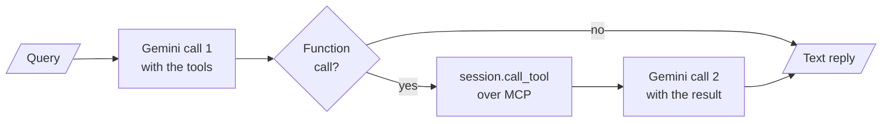

# M39.4 Theory: Your own client and a multi-server client

*[M39 theory](../README.md) · Lesson 39.4 · Notebooks: [`01_build_your_own_server_client`](../../../projects/01_build_your_own_server_client), [`02_multi_server_client`](../../../projects/02_multi_server_client) · [All theory pages](../../../../../THEORY.md)*

## Client sessions

Larkspur makes repeated calls to two MCP servers. You will follow transport, session and discovery layers, count what a fresh session repeats and inspect why a one-round handwritten client cannot execute a dependent second call.

### Step 1: Separate transport from protocol session

Every client in these projects is built from the same three layers, each an async context manager:

Implementation excerpt from the configured application. The practice material supplies its models, data and session setup:

```text
transport = await stack.enter_async_context(stdio_client(params))   # or sse_client(url), streamable_http_client(url)
read, write = transport[0], transport[1]
session = await stack.enter_async_context(ClientSession(read, write))
await session.initialize()                                           # the handshake
tools = (await session.list_tools()).tools
result = await session.call_tool("execute_shell_command", {"cmd": "ls"})
```

The transport moves bytes: pipes to a child process, or HTTP. `ClientSession` speaks JSON-RPC over it. `initialize()` sends the client's protocol version (`2025-11-25` in SDK 1.30.0) and capabilities, reads the server's, and sends the `notifications/initialized` notification. From then on the session carries requests until the `AsyncExitStack` closes, which closes the session and then the transport: a stdio server process exits, and a Streamable HTTP client sends `DELETE`.

A **session** is the unit of state in MCP. The protocol version, the capabilities and anything the server ties to the connection live for one session. Over stdio a session is also a process, because the client starts one server process per connection. That makes the question of how long a session lives the main design choice in a client.

### Step 2: Compare held and per-call sessions

Project 02 holds one session per server for the life of the agent, on one `AsyncExitStack`. `MultiServerMCPClient.get_tools()` in project 03 does not hold any. Its docstring says it plainly: "A new session will be created for each tool call". Each tool call opens a session, initializes it, calls the tool and closes it. With SDK 1.30.0 a fresh session also sends `tools/list` after the call, because `call_tool` checks the result against the tool's output schema and a new session has not listed its tools yet.

### Step 3: Read the wire cost of eight tool calls

The [interactive lab](interactive/session-wire-lab.html) drives the two Larkspur servers through both clients over every transport and shows each recorded message. For 8 tool calls:

| Transport | Held sessions | A session per call |
|---|---|---|
| stdio | 2 processes, 14 messages | 10 processes, 38 messages |
| SSE | 14 messages, 16 HTTP requests | 38 messages, 48 HTTP requests |
| Streamable HTTP | 14 messages, 18 HTTP requests | 38 messages, 58 HTTP requests |
| Streamable HTTP, stateless | 14 messages, 14 HTTP requests | 38 messages, 38 HTTP requests |

Held sessions pay 6 messages once (an `initialize`, a notification and a `tools/list` per server) and then 1 per call. A session per call pays 4 per call. Over stdio the cost is also processes: 8 calls were answered by 8 different server processes, so a cache, a loaded index or a counter in server memory starts empty every time. Over HTTP the server process stays up, so its memory survives, but nothing tied to a session does.

<!-- lab: interactive/session-wire-lab.html -->

### Step 4: Hold an adapter session explicitly

To keep the convenience of `MultiServerMCPClient` and hold the session, open it yourself:

Implementation excerpt from the configured application. The practice material supplies its models, data and session setup:

```text
client = MultiServerMCPClient(connections)
async with client.session("handbook") as session:
    tools = await load_mcp_tools(session)        # calls reuse this session
    agent = create_agent(model, tools)
    ...
```

A session per call is the right choice in one case: a stateless server behind several replicas, where any request may land anywhere and holding a session buys nothing. Everywhere else, hold one session per server and reopen it when it drops.

## A client written by hand

### Step 1: Inspect what the adapter otherwise handles

Project 01's `client.py` connects Gemini to the terminal server without LangChain, which shows the work an adapter does for you. After the handshake it lists the server's tools and turns each into a Gemini `FunctionDeclaration`: the MCP name, the description and the `inputSchema` with every `title` key removed. FastMCP's schema for `get_weather` in lesson 39.1 shows what gets stripped: `"title": "get_weatherArguments"` on the object and `"title": "Location"` on the property.

### Step 2: Inspect the handwritten client's stopping point

Then each query runs one round:



The client stops after that round. If the second reply asks for another tool, the client does not run it and returns only the first part's text. It also sends `execution_result.content`, a list of MCP content objects, as the function response, where a plain string or dict would be safer. `langchain_mcp_client.py` in the same project replaces all of it with two calls: `load_mcp_tools(session)` converts the tools and `create_react_agent(llm, tools)` runs the loop until the model stops asking for tools. In langgraph 1.2.18 `create_react_agent` is deprecated in favour of `create_agent` from `langchain.agents`, which M23 uses.

The terminal server these clients drive runs any shell command the model writes, with `shell=True` and the working directory set to `~/Desktop/github/langgraph-ai/mcp/01-build-your-own-server-client/workspace`, a path from the author's machine. Point it at a folder of your own before running it, and treat the tool as remote code execution: project 02's copy runs it inside a container, which limits what a bad command can reach.

### Try it yourself

In the lab use eight calls across two servers and compare held sessions with one session per call. Check the stdio counts of two versus ten processes and fourteen versus thirty-eight messages. Then inspect the client's second model reply: if it requests another tool, returning only text ends the loop too early.

### Practice notebook

Run the complete implementation from the practice material after checking the trace or calculation above. Use its stated environment for live model or server calls; recorded model choices and timings are observations, not guaranteed outputs.

- [Build your own server](../../../projects/01_build_your_own_server_client).
- [Multi server client](../../../projects/02_multi_server_client).

### Continue learning

- [M23](../../../../../p06_agent_foundations/m23_react_agents/mandatory/theory/README.md).

## Key Takeaways

- A client stacks a transport, a `ClientSession` and the `initialize()` handshake. The session is the unit of state, and over stdio it is also a process.
- Hold one session per server and reopen it when it drops. A session per call costs 4 messages each time and, over stdio, a fresh process that forgets its memory.
- A hand-written client must convert schemas and loop until the model stops asking for tools. Treat a shell-running tool as remote code execution and contain it.

## Check yourself

<details>
<summary>1. Why does a session per tool call cost 4 messages per call, when a held session costs 1 per call after setup?</summary>

A held session pays its setup once (an `initialize`, a notification and a `tools/list` per server, 6 messages for two servers) and then sends only the call. A session per call opens and initialises a new session each time, and with SDK 1.30.0 also sends `tools/list` after the call, because `call_tool` checks the result against the tool's output schema and a new session has not listed its tools yet.

</details>

<details>
<summary>2. A Larkspur server keeps a cache in memory, but over stdio through get_tools the cache is empty on every call. Why, and how do you keep it?</summary>

Over stdio a session is also a process, and `get_tools()` opens a new session for each tool call, so 8 calls were answered by 8 different server processes and each started empty. Hold the session with `async with client.session("handbook") as session` and `load_mcp_tools(session)`, so calls reuse one process.

</details>

<details>
<summary>3. Gemini's second reply in the hand-written client asks for another tool. What does the client do, and what replaces its loop in the LangChain version?</summary>

It stops after one round: it does not run the second tool and returns only the first part's text. `langchain_mcp_client.py` converts the tools with `load_mcp_tools(session)` and runs `create_react_agent(llm, tools)`, which loops until the model stops asking for tools; in langgraph 1.2.18 that is deprecated in favour of `create_agent`.

</details>

---
*Previous: [39.2 Multi-server MCP](../02_multi_server_mcp/README.md). Next: [39.5 Transports: SSE and streamable HTTP](../05_transports_sse_and_streamable_http/README.md).*
