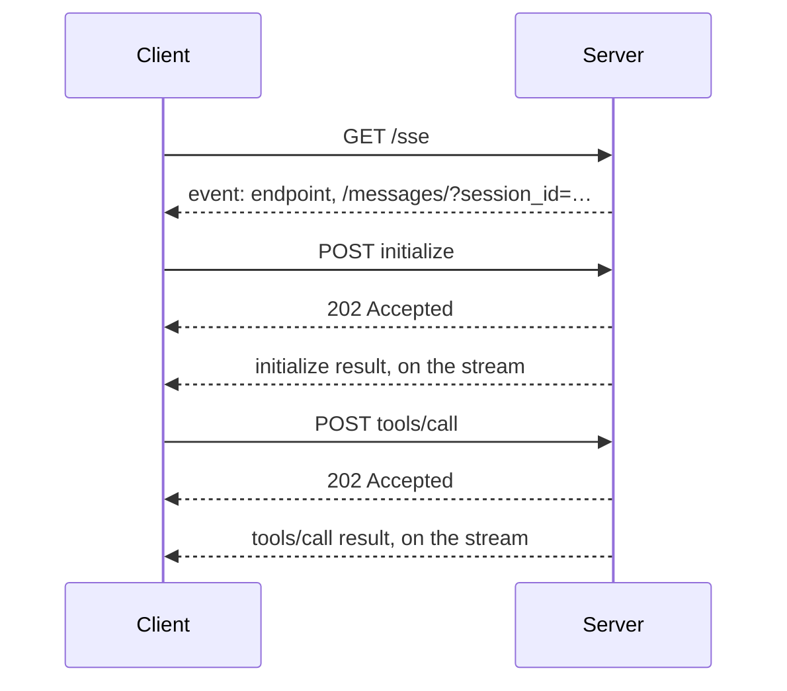
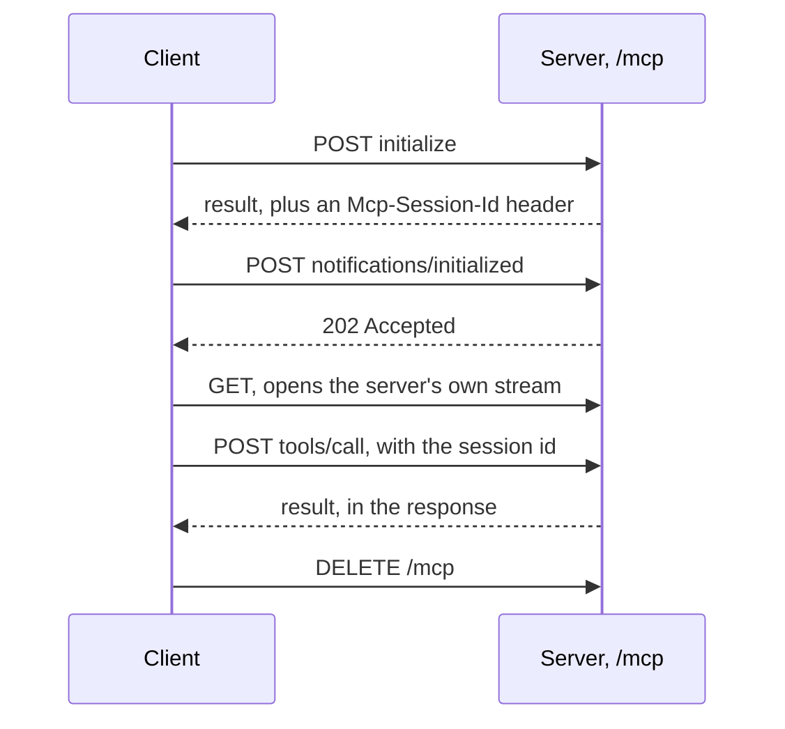
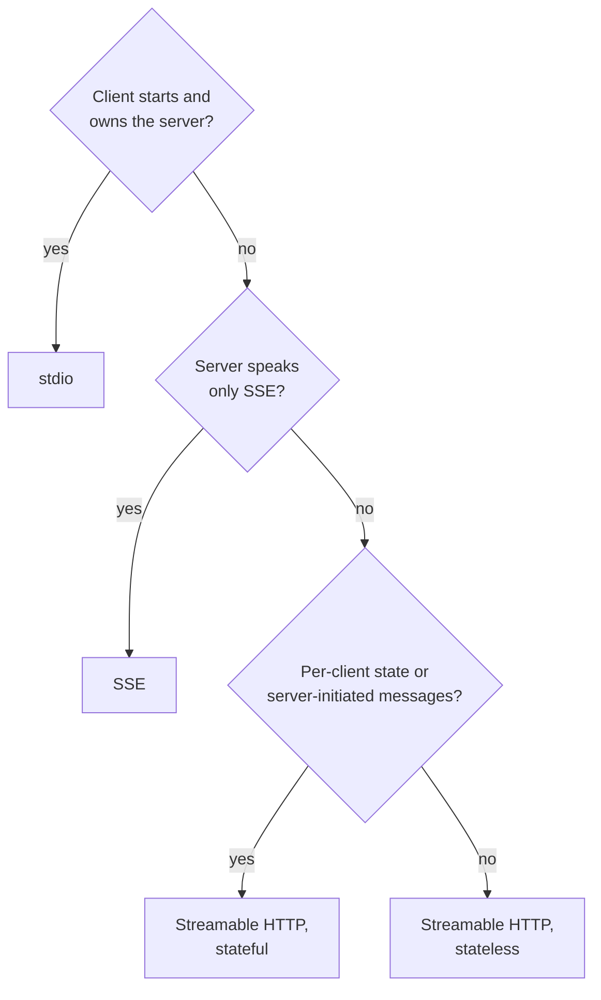

# M39.5 Theory: Transports: SSE and streamable HTTP

*[M39 theory](../README.md) · Lesson 39.5 · Notebooks: [`03_sse_transport_server_client`](../../../projects/03_sse_transport_server_client), [`04_streamable_http_client`](../../../projects/04_streamable_http_client) · [All theory pages](../../../../../THEORY.md)*
<!-- subtitle: SSE answers on a second, long-lived channel and Streamable HTTP answers on the request itself; sessions, replicas and the server's own needs decide which one to run -->
<!-- format: approved -->

## Start with an accepted POST and no answer

> **What you'll learn**
>
> - **Trace** an SSE session: the long-lived GET stream, the `202 Accepted` POSTs and the results matched by request id.
> - **Compare** Streamable HTTP in its stateful and stateless modes, in requests, session headers and what fails across replicas.
> - **Choose** a transport for a Larkspur server from who owns the process, what the server keeps per client and how it scales.

A Larkspur client sends `tools/call` to the status server over HTTP and gets `202 Accepted` back. The POST succeeded, yet its body holds no incident report. The answer arrives somewhere else, on a stream the client opened earlier.

A second Larkspur client talks to the handbook server through a load balancer. Its first calls work. Then every request gets `404 Session not found`, although the server is healthy.

Both are transport behaviour, and both follow from where a reply travels and where a session lives.

## SSE

Lesson 38.6 compares the two HTTP transports side by side. Project 03 builds the SSE one by hand, which shows how it works. The server is a Starlette app with two routes around the SDK's `SseServerTransport("/messages/")`:

| Route | Method | Handler | What it carries |
|---|---|---|---|
| `/sse` | GET | `handle_sse` | One long-lived event stream per session, with every reply |
| `/messages/` | POST | `sse.handle_post_message` | Every message the client sends, tagged with its `session_id` |

*Table 1: The two routes of project 03's SSE server.*

`handle_sse` hands the stream to the low-level server, `mcp._mcp_server.run(...)`, which serves one session for as long as the GET stays open. FastMCP builds the same app for you with `mcp.run(transport="sse")` or `mcp.sse_app()`.

<!-- animated: diagrams/sse.anim.html -->

*Figure 1: An SSE session. Requests go up as POSTs; every answer comes down the GET stream.*

The POST never carries an answer. Every request gets `202 Accepted`, and its result arrives later as an event on the GET stream, matched by JSON-RPC id. That is the first Larkspur client's puzzle: the incident report was on the stream all along.

Recorded with SDK 1.30.0 on the two Larkspur servers with held sessions, setup took 4 requests per server (the GET and three POSTs) and each tool call 1 more. Eight calls made 16 HTTP requests. Nothing closes the session but the stream: when the GET ends, the server drops the session id. The whole session rides on one long-lived connection, which a proxy that closes idle connections will cut.

Project 03 has been hardened since it was written. Its server now listens on `127.0.0.1` unless told otherwise, builds `SseServerTransport` with DNS-rebinding protection and an allow-list of local hosts, and stops each command after 30 seconds. Two problems remain before you copy it:

- **`handle_sse` returns `None`.** The SDK's own example in `mcp/server/sse.py` returns `Response()` after the stream ends and says why: without it, a client disconnect raises `TypeError: 'NoneType' object is not callable`.
- **A promise the code does not keep.** The README's security list still claims command validation and restrictions. `run_command` passes any command to the shell with `shell=True`; only the working directory and the timeout bound it.

## Streamable HTTP

Streamable HTTP puts everything on one endpoint, `/mcp`, and answers each POST in its own response. Project 04's temperature server is a FastMCP server built this way:

| Setting | Where | Value in project 04 | What it decides |
|---|---|---|---|
| `transport` | `mcp.run(...)` | `"streamable-http"` | Which transport the server speaks |
| `stateless_http` | `FastMCP(...)` | `True` | Whether the server keeps a session per client |
| `host`, `port` | `FastMCP(...)` | From the command line | Where it listens |

*Table 2: The settings behind project 04's server.*

*Figure 2: A stateful Streamable HTTP session. Each answer travels back on its own request.*

The comment beside `stateless_http=True` in the project says it enables the streamable HTTP protocol. It does not. `transport="streamable-http"` in `run()` picks the transport, and `stateless_http`, in the words of FastMCP's settings, decides "if the server should create a new transport per request". Stateful is the default. Compare the two modes on the same Larkspur run:

The two Larkspur servers, held sessions, 8 tool calls, recorded with MCP SDK 1.30.0. Choose a mode to see what each phase costs.

<button type="button" data-mode="stateful" aria-pressed="false" aria-controls="http-stateful">Stateful (default)</button>
<button type="button" data-mode="stateless" aria-pressed="false" aria-controls="http-stateless">stateless_http=True</button>

<section id="http-stateful" class="mode-panel" data-announcement="Stateful selected. 18 requests, with a session id on every one."><h4>Stateful (default)</h4><dl><dt>Setup, per server</dt><dd>4 requests: <code>initialize</code> (the reply sets <code>mcp-session-id</code>), the initialized notification (<code>202</code>), a GET for the server's own stream, <code>tools/list</code></dd><dt>Each tool call</dt><dd>1 POST, answered as an event stream</dd><dt>Close, per server</dt><dd><code>DELETE /mcp</code></dd><dt>8 calls, 2 servers</dt><dd>18 requests</dd><dt>Across replicas</dt><dd>Every request must reach the replica that holds its session</dd></dl></section>
<section id="http-stateless" class="mode-panel" data-announcement="Stateless selected. 14 requests and no session to route."><h4>stateless_http=True</h4><dl><dt>Setup, per server</dt><dd>3 requests: <code>initialize</code>, the notification, <code>tools/list</code></dd><dt>Each tool call</dt><dd>1 POST</dd><dt>Close, per server</dt><dd>Nothing</dd><dt>8 calls, 2 servers</dt><dd>14 requests</dd><dt>Across replicas</dt><dd>Any replica can answer any request</dd></dl></section>

Each POST gets its own answer in the response, as `text/event-stream` by default or JSON with `json_response=True`. The `mcp-session-id` header ties a stateful client's requests together, and the server checks it on every request. Probed against a stateful Larkspur server in SDK 1.30.0:

| Request | Status | Message |
|---|---|---|
| `GET /mcp` without `text/event-stream` in `Accept` | 406 | "Not Acceptable: Client must accept text/event-stream" |
| A `tools/list` POST with no session id | 400 | "Bad Request: Missing session ID" |
| A session id the server does not know | 404 | "Session not found" |

*Table 3: How a stateful server answers requests it cannot place.*

The 404 is the second Larkspur client's failure. Its session id came from another replica, or it expired, and the client has to initialise again. Project 04's `server_launcher.py` uses the first row as its health check: it treats a 406 as "the server is up". That only proves something answered on the port.

Stateful sessions expire after 1,800 seconds with no request being served and no open GET stream, and one server holds at most 10,000 at once; a request that would open another gets `503`. Both are FastMCP settings (`session_idle_timeout`, `max_sessions`). Stateless mode has neither, and no server-to-client stream either, so the server can only speak in answer to a request.

Project 04's client mixes transports behind one agent. `config/servers.json` lists the temperature server as `"type": "http"` with a URL and the terminal server as `"type": "stdio"` with a command. Google ADK's `MCPToolset` opens each with the matching connection parameters (`StreamableHTTPServerParams`, `StdioConnectionParams`). The agent sees one tool list, and each tool goes back over its own server's transport.

## Choosing a transport

*Figure 3: Picking a transport, one question at a time.*

- **stdio** for a server on the same machine that the client starts and owns: a desktop assistant's file tools, a local retriever over the handbook. No network, no auth, and a process per session.
- **SSE** only to reach a server that speaks nothing else, such as M38's deployed research server. It needs two endpoints and one long-lived GET per session.
- **Streamable HTTP, stateful** for a shared server that keeps something per client or sends messages between requests. With several replicas, route by `mcp-session-id`.
- **Streamable HTTP, stateless** for tools that keep no per-client state and must scale out. Larkspur's `status` search can run as many replicas as it needs, and any of them can answer any request.

Lesson 39.3's Databricks server ends with `mcp.run()`. In SDK 1.30.0 `run()` defaults to `transport="stdio"`, and as written the server reads its standard input instead of listening for HTTP. A server that a platform reaches by URL needs `transport="streamable-http"` and must listen on the host and port the platform expects.

## Limits of this evidence

- **One SDK version.** Request counts, status messages and session limits come from MCP SDK 1.30.0, recorded and probed on the two Larkspur servers. The specification leaves some of these choices to the implementation.
- **Held sessions only.** The 16, 18 and 14 request counts assume held sessions; a session per call costs far more (lesson 39.4).
- **No proxy in the loop.** The idle-connection and replica failures follow from how the transports work and from the 404 probe; no proxy or load balancer was run here.

## References

1. Model Context Protocol, [Transports](https://modelcontextprotocol.io/specification/2025-11-25/basic/transports), specification 2025-11-25: stdio, Streamable HTTP, session ids and `DELETE`.
2. Model Context Protocol, [Transports](https://modelcontextprotocol.io/specification/2024-11-05/basic/transports), specification 2024-11-05: the HTTP with SSE transport and its endpoint event.
3. WHATWG, [Server-sent events](https://html.spec.whatwg.org/multipage/server-sent-events.html), HTML Living Standard: the `text/event-stream` format.
4. [JSON-RPC 2.0 Specification](https://www.jsonrpc.org/specification): request ids and how responses are matched to requests.

## Key Takeaways

- SSE answers every POST with `202` and sends the result on one long-lived GET stream, and an idle-closing proxy can cut the whole session.
- In Streamable HTTP, `transport="streamable-http"` picks the transport and `stateless_http` picks the mode. Stateful sessions expire after 1,800 idle seconds and need routing by `mcp-session-id` across replicas.
- Use stdio for a local server the client owns, stateful HTTP for per-client state, and stateless HTTP for tools that must scale out.

## Check yourself

1. Over SSE, every POST the client sends gets 202 Accepted. Where does the answer arrive, and what does that mean for the session?

On the long-lived `GET /sse` stream, as an event matched by JSON-RPC id. The whole session lives on that one connection: when the GET ends, the server drops the session id, and a proxy that closes idle connections will cut it.

2. Two Larkspur servers with held sessions make 8 tool calls over Streamable HTTP. How many HTTP requests do stateful and stateless mode use, and where does the gap come from?

18 stateful and 14 stateless. Stateful setup takes 4 requests per server (`initialize`, the notification, a GET for the server's own stream, `tools/list`) and a `DELETE /mcp` to close; stateless takes 3 and has nothing to close. Each tool call is 1 POST in both modes.

3. A stateful Streamable HTTP client behind a load balancer starts getting 404 Session not found. What happened, and what do you change?

The server does not know the session id: it came from another replica, or it expired after 1,800 seconds with no request being served. The client has to initialise again. With several replicas, route by `mcp-session-id`, or run stateless if the tools keep no per-client state.

---
*Previous: [39.4 Your own client and a multi-server client](../04_your_own_client_and_a_multi_server_client/README.md). Next: [M39 interview questions](../README.md#interview-spotlight-5-questions-you-might-get-asked).*
