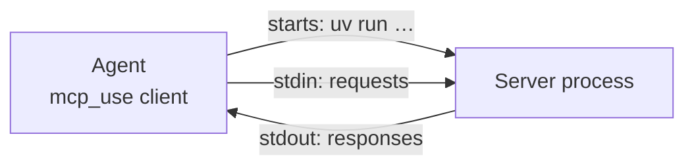
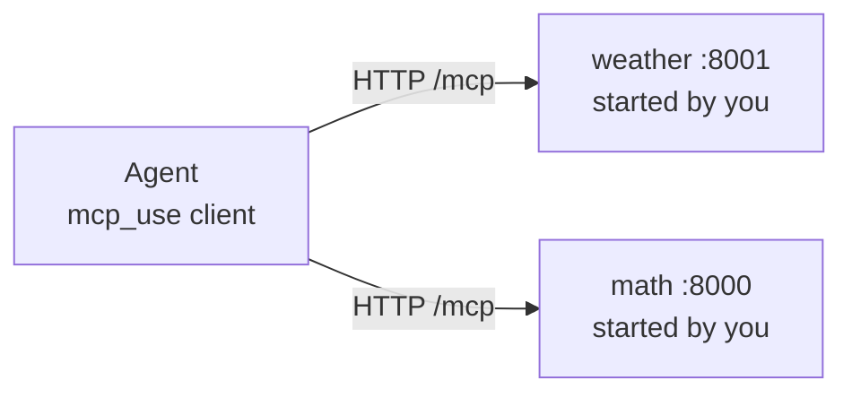
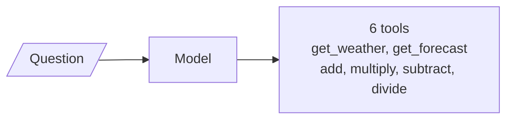
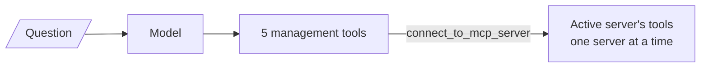

# M40.1 Theory: Your first MCP server and a local agent

*[M40 theory](../README.md) · Lesson 40.1 · Notebooks: [`01_build_your_first_mcp_server`](../../../projects/01_build_your_first_mcp_server), [`02_mcp_servers_and_local_agent`](../../../projects/02_mcp_servers_and_local_agent) · [All theory pages](../../../../../THEORY.md)*
<!-- subtitle: A local model reaches MCP servers by command or by URL, spends a step budget on every tool call, and gets an exception when a tool breaks its own return type -->
<!-- format: approved -->

## Start with a laptop agent that never answers

> **What you'll learn**
>
> - **Explain** the two ways a host reaches a server: it starts the server itself, or it connects to a URL you started.
> - **Trace** a multi-tool question through an agent's step budget, with and without a server manager.
> - **Diagnose** a tool whose return value breaks its own output schema.
> - **Choose** between raising an error and widening a return type.

Larkspur's on-call engineer wants an assistant on a laptop that can check the weather at a data-centre region and do a quick sum, with no API key and no cloud model. The first attempt hangs at start-up. The second answers the weather and stops before the sum. The third turns a division by zero into a crash in the client library. Each failure comes from a different layer, and this lesson takes them one at a time.

The two projects supply the parts. The first serves two FastMCP servers over streamable HTTP: `demo-server`, with one `add` tool, and `weather`, with `get_weather` and `get_forecast`, which call the public wttr.in API. Each comes with a plain client. `client_fastmcp.py` uses FastMCP's `Client`; `client_mcp.py` uses the SDK's `streamablehttp_client` and `ClientSession`, and prints the session id before and after `initialize`: `None`, then a 32-character hex id the server assigned during the handshake (M39 covers that header). The second project hands a weather server and a math server (`add`, `multiply`, `subtract`, `divide`) to an agent running on local Ollama models: `qwen3:8b` in `agentic_client.py` and `gpt-oss:20b` in `advanced_agentic_client.py`.

## A local agent over MCP

`mcp_use` turns a server map into tools for a LangChain chat model. It reads the map in the shape Claude Desktop uses (lesson 40.2), connects to each server, and runs an agent loop over the result. The model runs on the laptop; the weather tools still call wttr.in over the internet.

| Setting | In the advanced client | Default in mcp-use 1.7.1 | What it does |
|---|---|---|---|
| Server map | `mcp-http.json` | none | Which servers exist and how to reach them |
| `llm` | `ChatOllama`, `gpt-oss:20b` at `localhost:11434` | none | The local model that plans and calls tools |
| `max_steps` | 30 | 5 | Caps model calls, through a model-call limit; the graph's recursion limit is twice this |
| `use_server_manager` | `True` | `False` | Hides servers' tools behind management tools |

*Table 1: The agent's settings, read from `advanced_agentic_client.py` and the installed mcp-use source.*

### Two ways to reach a server

The project ships two server maps. In `mcp.json` each entry is a command, `uv run --directory …/servers weather_server.py`, and the agent starts the server as a subprocess that speaks over stdin and stdout:

*Figure 1: Command entry. The host owns the server's life: it starts it, talks over stdio, and stops it.*

In `mcp-http.json` each entry is a URL: weather at `http://localhost:8001/mcp`, math at `:8000/mcp`. You start both servers in other terminals first, and the agent connects over streamable HTTP:

*Figure 2: URL entry. The servers outlive the agent, and several clients can share them.*

The shipped servers fit only the second map. Their `__main__` block runs `mcp.run(transport="streamable-http", ...)`, with the `stdio` line commented out. Launched as a stdio subprocess, the math server started Uvicorn on port 8000 and wrote nothing to stdout, and a scratch probe with the mcp 1.30.0 client got no reply to `initialize` within 8 seconds. That is the engineer's hang at start-up. Before using `mcp.json`, switch the servers to the commented `stdio` line.

### The step budget

`max_steps` counts model calls, and every tool call costs one, plus the final answer. The advanced query asks: *What's the weather in New York and the 3-day forecast? Also, what's 12 multiplied by 342?*

With the server manager off, the model sees the servers' six tools directly:

*Figure 3: Server manager off. Every tool from every server is in the prompt.*

With `use_server_manager=True`, the model sees five management tools instead: `list_mcp_servers`, `connect_to_mcp_server`, `get_active_mcp_server`, `search_mcp_tools` and `disconnect_from_mcp_server`. Connecting makes one server active, and only that server's tools are added:

*Figure 4: Server manager on. The prompt stays small; reaching a tool costs a connection first.*

Step through the advanced query with the server manager on, one tool call per model turn. The sequence is structural, not a recorded run: a model may batch calls or take detours.

<button type="button" data-step="0" aria-pressed="false" aria-controls="budget-step-0">1. Weather server</button><button type="button" data-step="1" aria-pressed="false" aria-controls="budget-step-1">2. Two lookups</button><button type="button" data-step="2" aria-pressed="false" aria-controls="budget-step-2">3. Math server</button><button type="button" data-step="3" aria-pressed="false" aria-controls="budget-step-3">4. Answer</button>

<section id="budget-step-0" class="step-panel" aria-labelledby="budget-heading-0"><h4 id="budget-heading-0">1. Connect to the weather server</h4><dl><dt>Tool call</dt><dd><code>connect_to_mcp_server</code> with <code>weather</code></dd><dt>Tools now visible</dt><dd>5 management tools plus <code>get_weather</code> and <code>get_forecast</code></dd><dt>Model calls so far</dt><dd>1</dd></dl></section><section id="budget-step-1" class="step-panel" aria-labelledby="budget-heading-1"><h4 id="budget-heading-1">2. Current weather and forecast</h4><dl><dt>Tool calls</dt><dd><code>get_weather</code>, then <code>get_forecast</code>, each with New York</dd><dt>Network</dt><dd>Both call wttr.in, even though the model is local</dd><dt>Model calls so far</dt><dd>3</dd></dl></section><section id="budget-step-2" class="step-panel" aria-labelledby="budget-heading-2"><h4 id="budget-heading-2">3. Switch to the math server and multiply</h4><dl><dt>Tool calls</dt><dd><code>connect_to_mcp_server</code> with <code>math_server</code>, then <code>multiply</code> with 12 and 342</dd><dt>Tools now visible</dt><dd>5 management tools plus the math server's four; the weather tools are gone</dd><dt>Model calls so far</dt><dd>5, the whole default budget</dd></dl></section><section id="budget-step-3" class="step-panel" aria-labelledby="budget-heading-3"><h4 id="budget-heading-3">4. Write the answer</h4><dl><dt>Model call</dt><dd>The sixth: forecast plus 4,104</dd><dt>With the default of 5</dt><dd>The run stops before this call: the engineer's missing sum</dd><dt>With 30</dt><dd>Room for retries and detours</dd></dl></section>

<button type="button" data-walk="previous">Previous</button>

<button type="button" data-walk="next">Next step</button>

The server manager trades prompt size for turns. With two servers and six tools it costs two extra calls; with the thirteen servers of the 40.2 config it keeps dozens of tool definitions out of every prompt. Without the manager the same question needs four model calls (three tools and the answer) and fits the default of 5 with one to spare. Both clients raise `max_steps` to 30, which leaves room for either mode and for retries.

## Return types are part of the contract

FastMCP builds a tool's schemas from its signature. In fastmcp 3.4.11, `add(a: int, b: int) -> int` lists as:

| Schema | Fields |
|---|---|
| `inputSchema` | `a` integer, `b` integer, both required; `additionalProperties: false` |
| `outputSchema` | `result` integer, required; marked `x-fastmcp-wrap-result: true` |

*Table 2: The schemas a client receives for `add`, from a scratch `list_tools` call.*

A call to `add` with 5 and 7 returns two things: the text `12` and the structured content `{"result": 12}`. The client keeps the output schema and checks every structured result against it.

The math server's `divide` breaks its own schema. It is annotated `-> float` and returns the string `"Error: Division by zero"` when `b` is 0. The server sends that result, and the mcp 1.30.0 client raises `RuntimeError: Invalid structured content returned by tool divide: 'Error: Division by zero' is not of type 'number'`. The friendly message never reaches the model. The host gets an exception from its own client library instead of a tool result it could show the model.

Three ways to write <code>divide</code>, all called with 1 and 0 through the mcp 1.30.0 client. Pick one to see what the host receives.

<button type="button" data-mode="string" aria-pressed="false" aria-controls="divide-string">Return a string</button>
<button type="button" data-mode="raise" aria-pressed="false" aria-controls="divide-raise">Raise ToolError</button>
<button type="button" data-mode="nocheck" aria-pressed="false" aria-controls="divide-nocheck">No check</button>

<section id="divide-string" class="mode-panel" data-announcement="Return a string selected. The client raises."><h4>Return <code>"Error: Division by zero"</code> from a <code>-&gt; float</code> tool</h4>
The client raises <code>RuntimeError</code>: the string is not of type number. No tool result exists for the model to read, and the agent loop sees a crash.
</section>
<section id="divide-raise" class="mode-panel" data-announcement="Raise ToolError selected. An error result reaches the model."><h4><code>raise ToolError("Division by zero")</code></h4>
The result arrives with <code>isError: true</code> and the text <code>Division by zero</code>. The model reads it and can tell the user or try again.
</section>
<section id="divide-nocheck" class="mode-panel" data-announcement="No check selected. An error result with the exception text."><h4>Plain <code>a / b</code></h4>
Python raises <code>ZeroDivisionError</code>; FastMCP catches it and returns <code>isError: true</code> with <code>Error calling tool 'divide': division by zero</code>. Safe for the client, though the text exposes an internal message.
</section>

The other fix keeps the string and widens the annotation to `-> float | str`. The schema then accepts both, and every client must tell a number from an error message on its own. Raising keeps the error inside the protocol, where `isError` already says what happened.

> **Pitfall: a friendly error string in a typed tool.** It reads well in the server's code and never reaches the model: the client rejects it before the agent sees it.

## Limits of this evidence

- The schemas, results and exceptions come from scratch runs of the projects' own servers with fastmcp 3.4.11 and mcp 1.30.0, over stdio, with no model. Other client libraries may handle a schema mismatch differently.
- The step sequence in the walkthrough is structural. No Ollama model ran here, and a real model may batch tool calls, call `search_mcp_tools` first, or wander.
- The mcp-use defaults and the five management tools come from the installed 1.7.1 source; later releases may change them.

## References

- Model Context Protocol specification (2025-06-18): [Tools](https://modelcontextprotocol.io/specification/2025-06-18/server/tools), including output schemas and `isError`, and [Transports](https://modelcontextprotocol.io/specification/2025-06-18/basic/transports).
- FastMCP documentation: [Tools](https://gofastmcp.com/servers/tools), on output schemas and `ToolError`.
- mcp-use on PyPI: [mcp-use](https://pypi.org/project/mcp-use/), the `MCPAgent` and `MCPClient` used by the second project.

## Key Takeaways

- A host reaches a server by command, starting it as a stdio subprocess, or by URL, where you start the server first. The shipped servers run HTTP, so they fit `mcp-http.json`; switch them to `stdio` before using `mcp.json`.
- `max_steps` caps model calls, one per tool call plus the answer. `use_server_manager=True` keeps the prompt small but adds a connection call for each server the question touches, which pushes the three-tool question past the default of 5.
- The return annotation is a contract the client enforces. Raise `ToolError` for failures instead of returning a string from a tool typed `-> float`.

## Check yourself

1. What does use_server_manager=True change about what the model sees, and what does it trade?

The model no longer sees the servers' tools directly. It gets five management tools and must call `connect_to_mcp_server` before a server's tools appear, one active server at a time. The prompt stays small when many servers are configured, at the price of extra model turns.

2. The advanced query asks for New York's weather, its 3-day forecast and 12 times 342. Why does it fail with the default max_steps of 5?

`max_steps` caps model calls. With the server manager on and one call per turn, the query takes two connections and three tool calls, five calls in all, and the answer needs a sixth. The run stops before the sum is reported, which is why both clients raise the cap to 30.

3. Calling divide with b equal to 0 gives the host a RuntimeError about invalid structured content instead of a tool result. Why, and how do you fix it?

`divide` is annotated `-> float` but returns the string `"Error: Division by zero"`, and the mcp 1.30.0 client checks structured results against the output schema. Raise `ToolError("Division by zero")`, which comes back with `isError: true`. Annotating `-> float | str` also works but moves the job of telling numbers from errors to every client.

---
*Previous: [M40 overview](../README.md). Next: [40.2 MCP servers with Claude Desktop](../../../optional/theory/02_mcp_servers_with_claude_desktop/README.md).*
