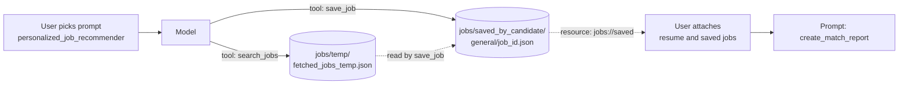
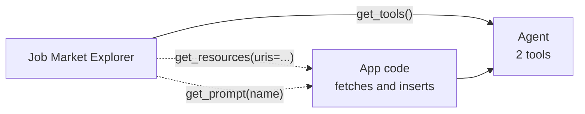

# M40.4 Theory: Tools, resources and prompts together

*[M40 theory](../README.md) · Lesson 40.4 · Notebooks: [`05_mcp_tools_resources_and_prompts`](../../../projects/05_mcp_tools_resources_and_prompts) · [All theory pages](../../../../../THEORY.md)*
<!-- subtitle: Tools for the model, resources for the application and prompts for the user meet in one server, and two of them quietly share a temp file -->
<!-- format: approved -->

## Start with one server that three people drive

> **What you'll learn**
>
> - **Explain** who triggers each of a server's three primitives, and which of them can change anything.
> - **Trace** one session that uses all three, through the files they share on the server's disk.
> - **Diagnose** a host that loads only tools and leaves a prompt with nothing to read.
> - **Find** hidden coupling between tools before a second user finds it.

Larkspur's support server could offer three different things: a handbook search the model runs when it needs a fact, a customer's plan record the agent's screen attaches, and a "refund reply" template a support agent picks from a menu. Each has a different owner, and MCP gives each its own primitive. The Job Market Explorer server in this project is the worked case: one server with all three, and a design flaw that only shows with two users.

## One server, three controllers

M38 introduced the three things a server can offer. This server uses all three at once, which shows how they divide the work. The project's presentation names who controls each: tools are "Model-controlled", resources "Application-controlled" and prompts "User-controlled".

| Primitive | In this server | Who triggers it | Side effects |
|---|---|---|---|
| Tool | `search_jobs(role, location, max_results=5)`, `save_job(job_id, salary=None)` | The model, when it decides to | Calls the JSearch API on RapidAPI; writes JSON files |
| Resource | `resume://default` (text from `resume/resume.pdf`), `jobs://saved` (every saved job as Markdown) | The application, usually because the user attached it | None: they only read |
| Prompt | `analyze_job_market(role, location, num_jobs=5)`, `personalized_job_recommender()`, `create_match_report()` | The user, by picking it | None: they return instructions |

*Table 1: The server's seven features. A scratch `list_tools`, `list_resources` and `list_prompts` call returned exactly these.*

The prompts are scripts for the model. `personalized_job_recommender` says to read the resume, "Call job search mcp tool", then "Optionally call save job mcp tool on top matches". `create_match_report` starts "Given the attached jobs data and resume", and it only works once the user has attached both resources. The server writes the workflow; the host has to support every step of it.

## A session through all three

A full session uses all three in order, and the pieces meet in files on the server's disk:

*Figure 1: One session. Tools write files; a resource reads them back; the second prompt reads the resources.*

Step through the session in Figure 1. Each stage names who acted, which primitive ran and what changed on disk.

<button type="button" data-step="0" aria-pressed="false" aria-controls="session-step-0">1. Pick a prompt</button><button type="button" data-step="1" aria-pressed="false" aria-controls="session-step-1">2. Search</button><button type="button" data-step="2" aria-pressed="false" aria-controls="session-step-2">3. Save</button><button type="button" data-step="3" aria-pressed="false" aria-controls="session-step-3">4. Attach and report</button>

<section id="session-step-0" class="step-panel" aria-labelledby="session-heading-0"><h4 id="session-heading-0">1. The user picks a prompt</h4><dl><dt>Who</dt><dd>The user, from the host's prompt menu</dd><dt>Primitive</dt><dd><code>personalized_job_recommender</code>: instructions, no side effects</dd><dt>On disk</dt><dd>Nothing yet</dd></dl></section><section id="session-step-1" class="step-panel" aria-labelledby="session-heading-1"><h4 id="session-heading-1">2. The model searches</h4><dl><dt>Who</dt><dd>The model, following the prompt</dd><dt>Primitive</dt><dd><code>search_jobs</code>: one JSearch request, results returned to the model</dd><dt>On disk</dt><dd>The full results overwrite <code>jobs/temp/fetched_jobs_temp.json</code></dd></dl></section><section id="session-step-2" class="step-panel" aria-labelledby="session-heading-2"><h4 id="session-heading-2">3. The model saves a match</h4><dl><dt>Who</dt><dd>The model, if it decides a job is a top match</dd><dt>Primitive</dt><dd><code>save_job(job_id)</code>: looks the id up in the temp file, not in the conversation</dd><dt>On disk</dt><dd>A new file in <code>jobs/saved_by_candidate/general/</code></dd></dl></section><section id="session-step-3" class="step-panel" aria-labelledby="session-heading-3"><h4 id="session-heading-3">4. The user attaches resources and asks for a report</h4><dl><dt>Who</dt><dd>The user attaches <code>resume://default</code> and <code>jobs://saved</code>, then picks <code>create_match_report</code></dd><dt>Primitives</dt><dd>Two resource reads and one prompt; nothing is written</dd><dt>Model sees</dt><dd>Resume text, every saved job as Markdown, and the report instructions</dd></dl></section>

<button type="button" data-walk="previous">Previous</button>

<button type="button" data-walk="next">Next step</button>

## What a tools-only host sees

Hosts differ in how much of that they support. A desktop host such as Claude Desktop (lesson 40.2) shows prompts in a menu and lets the user attach resources. A LangGraph app built with langchain-mcp-adapters 0.3.2 gets less: `load_mcp_tools` and `MultiServerMCPClient.get_tools()` load tools only. A scratch run of `load_mcp_tools` on this server returned `search_jobs` and `save_job` and nothing else, 2 of its 7 features.

*Figure 2: In a tools-only host, resources and prompts reach the model only if the application fetches them and puts them in the conversation.*

The adapter's client has the calls: `get_resources(server_name, uris=...)` returns the resources as blobs, and `get_prompt(server_name, prompt_name, arguments=...)` returns the prompt as messages. Nothing calls them for you. An app that skips them still runs, but `create_match_report` arrives with nothing attached and the model writes a match report about a resume it never saw.

## Two users, one temp file

The server is built for one person at a time, in two ways:

- **Hidden coupling between tools.** `save_job` only works after `search_jobs`, because it reads the single file `fetched_jobs_temp.json`, not the results in the conversation.
- **Shared folders.** Every saved job goes into `jobs/saved_by_candidate/general/`, and `jobs://saved` lists every file there. On a shared server each user's match report reads everyone's saved jobs.

A scratch replay ran the server's own code over stdio, with the JSearch request stubbed to return three jobs per search. User A searched for data analyst roles and user B for nurse roles, in that order, before either saved:

| Step | Call | Result |
|---|---|---|
| 1 | A: `search_jobs("data analyst", "Leeds")` | Temp file holds `data-0` to `data-2` |
| 2 | B: `search_jobs("nurse", "Leeds")` | Temp file now holds `nurse-0` to `nurse-2` |
| 3 | A: `save_job("data-0")` | "Job ID data-0 not found in fetched data." |
| 4 | B: `save_job("nurse-1")` | Saved to `general/nurse-1.json` |

*Table 2: Two users on one server, replayed with a stubbed API. A's job vanished because B's search replaced the file.*

The fix is to keep state per user or per request: return everything `save_job` needs inside the search result, or key the temp file and the saved folder by a session id. One more design point compounds the problem: `BASE_DIR = Path(".")` puts `jobs/` and `resume/` wherever the server process starts. The Claude Desktop entry passes `uv --directory`, which sets it (40.2); anchor paths on `Path(__file__).parent` instead, as the 06 and 07 servers do.

> **Pitfall: state that lives between tool calls.** If one tool reads what another wrote to a shared place, the server holds conversation state that MCP knows nothing about.

## Limits of this evidence

- The feature lists, the tools-only load and the two-user replay come from scratch runs of the project's `server.py` over stdio with mcp 1.30.0 and langchain-mcp-adapters 0.3.2. The JSearch API was stubbed; no RapidAPI key was used.
- The session in the walkthrough follows the prompts' own instructions. No model ran, and a model may skip the optional save.
- Whether a given desktop host supports prompts and resource attachment depends on the host and its version.

## References

- Model Context Protocol specification (2025-06-18): [Tools](https://modelcontextprotocol.io/specification/2025-06-18/server/tools), [Resources](https://modelcontextprotocol.io/specification/2025-06-18/server/resources) and [Prompts](https://modelcontextprotocol.io/specification/2025-06-18/server/prompts), on who controls each primitive.
- LangChain documentation: [Model Context Protocol](https://docs.langchain.com/oss/python/langchain/mcp), on loading tools, resources and prompts with langchain-mcp-adapters.

## Key Takeaways

- Tools are model-controlled and may have side effects; resources are application-controlled and only read; prompts are user-controlled and return instructions.
- Many hosts load tools only. The application must fetch resources and prompts itself, or a prompt that expects attached data has nothing to read.
- Avoid hidden coupling through shared temp files and paths relative to the working directory. Anchor paths on `Path(__file__).parent` and keep per-user state apart.

## Check yourself

1. Who triggers each of the Job Market Explorer server's three primitives, and which of them have side effects?

Tools are model-controlled and have side effects: `search_jobs` calls the JSearch API and writes a temp file, and `save_job` writes JSON files. Resources are application-controlled and only read. Prompts are user-controlled and return instructions, so they change nothing.

2. A LangGraph app loads this server with get_tools only. How much of the server does it see, and what happens to the match report?

2 of its 7 features: in langchain-mcp-adapters 0.3.2, `get_tools()` loads tools only. `create_match_report` starts "Given the attached jobs data and resume", and it has nothing to read unless the app fetches the resources with `get_resources` and the prompt with `get_prompt` and puts them in the conversation itself.

3. Two users share one Job Market Explorer server, and one of them gets "not found" when saving a job from their own search. Why?

`save_job` reads the single file `fetched_jobs_temp.json`, and each `search_jobs` call overwrites it. When the second user searches before the first one saves, the first user's job ids are gone. Keep that state per user or per request instead of in one shared file.

---
*Previous: [40.3 MCP servers for data analysis](../../../optional/theory/03_mcp_servers_for_data_analysis/README.md). Next: [40.5 RAG over MCP with LangChain](../05_rag_over_mcp_with_langchain/README.md).*
