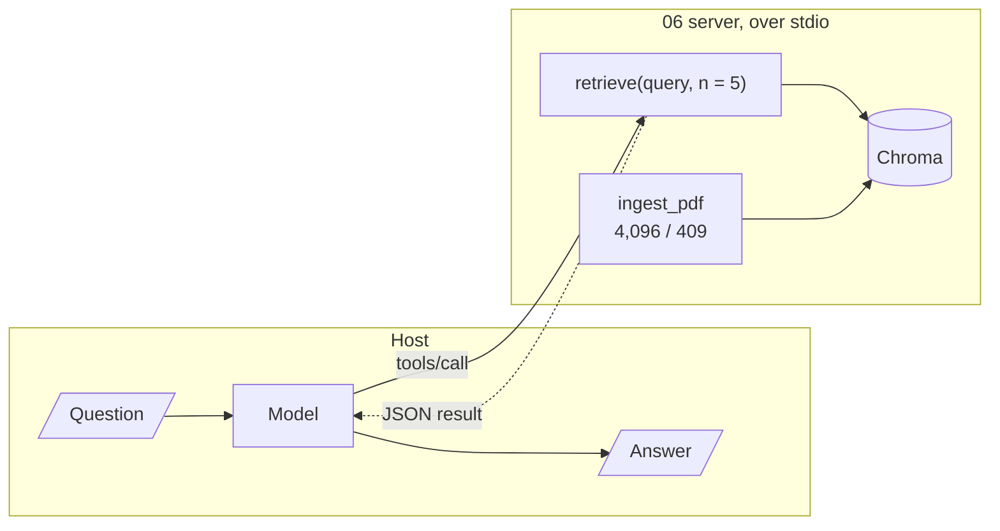

# M40.5 Theory: RAG over MCP with LangChain

*[M40 theory](../README.md) · Lesson 40.5 · Notebooks: [`06_mcp_rag_with_langchain`](../../../projects/06_mcp_rag_with_langchain) · [All theory pages](../../../../../THEORY.md)*

## RAG over MCP

Larkspur moves indexing behind an MCP server, but the host still needs to interpret retrieval scores correctly. You will inspect server-owned chunking and persistence, then compare Chroma distance with the similarity value returned to clients.

### Step 1: Separate server retrieval policy from host decisions

The 06 server puts a whole LangChain RAG index behind four MCP tools: `ingest_pdf(source)` for a PDF file, a folder of PDFs or a URL; `retrieve(query, n=5)`; `db_info()`; and `clear_db()`. Inside it is the pipeline from M10 to M14: PyPDF2 extracts the text, `RecursiveCharacterTextSplitter` cuts it, Ollama's `nomic-embed-text` embeds it, and Chroma persists it in `chroma_db/` beside `server.py`. The Streamlit `app.py` is the client: a LangGraph ReAct agent on Ollama's `qwen3` that loads the server's tools for each question.


<!-- animated: diagrams/rag-over-mcp.anim.html -->

Serving retrieval this way moves every retrieval decision to the server, where all hosts share it, and leaves every question decision with the host. The server decides chunking, embeddings, the distance metric and the shape of the result. The host's model decides when to ingest, what query to write, how many chunks to ask for, and whether to call `clear_db`, which empties the collection with no confirmation.

Calculate the conversion on known unit vectors before choosing a cutoff. These are exact synthetic vectors, not embedding-model measurements.

```python
query = (1.0, 0.0)
for name, vector in [("east", (1.0, 0.0)), ("north", (0.0, 1.0)), ("west", (-1.0, 0.0))]:
    cosine = sum(a * b for a, b in zip(query, vector))
    squared_l2 = sum((a - b) ** 2 for a, b in zip(query, vector))
    print(name, cosine, squared_l2, 1 - squared_l2)
```

**Expected output**

```text
east 1.0 0.0 1.0
north 0.0 2.0 -1.0
west -1.0 4.0 -3.0
```

### Step 2: Inspect the actual indexing settings

The server's choices, read from its code:

- **Chunk size is in characters.** `CHUNK_SIZE = 4096` with `length_function=len`, and 409 characters of overlap. The project's presentation calls them "4096 tokens". At that size the whole Larkspur handbook, 1,415 characters, is a single chunk, so every question retrieves the entire handbook; M12 is about choosing the size for the corpus.
- **Chunk ids are positions.** Each chunk is stored as `<file stem>_chunk_<i>`, and langchain-chroma 1.1.0's `add_documents` upserts. In a probe, ingesting three chunks and then a two-chunk new version of the same file left three chunks: the two new ones and the old third. Two PDFs with the same name in different folders overwrite each other.
- **Results are whole chunks.** `retrieve` returns `text`, `metadata`, `similarity_score` and `distance` for each of `n` chunks, so a default call can put up to 5 × 4,096 characters into the model's context.

### Step 3: Check compatibility before starting the server

One fix is needed before the project runs in this course's environment: `server.py` imports `RecursiveCharacterTextSplitter` from `langchain.text_splitter`, which raises `ModuleNotFoundError` under langchain 1.4.7. The class lives in `langchain_text_splitters`.

### Step 4: Trace session startup per question

The client opens its MCP session inside the request handler, so each question starts the server again: a new process, a new Chroma client, a new handshake. With one question that costs nothing extra. With a conversation it adds up, as the [lab in lesson 40.6](../06_research_assistant_with_mcp_and_langgraph/interactive/session-lifetime-lab.html) counts.

## Distance is not similarity

### Step 1: Identify the metric before using a cutoff

### Step 2: Identify the metric behind the reported score

`retrieve` calls `similarity_search_with_score`, which returns Chroma's distance, and reports `similarity_score = 1 - distance`. A collection created without a metric uses squared L2 distance (the configuration reads `'space': 'l2'` in chromadb 1.5.9). On unit vectors squared L2 is `2 - 2 × cosine`, so the reported score is `2 × cosine - 1`, a number from -3 to 1. A probe with four unit vectors and the query pointing east:

| Chunk vector | Cosine to the query | Chroma distance | 06's `similarity_score` | With `hnsw:space` cosine |
|---|---|---|---|---|
| east | 1.000 | 0.000 | 1.000 | 1.000 |
| north-east | 0.707 | 0.586 | 0.414 | 0.707 |
| north | 0.000 | 2.000 | −1.000 | 0.000 |
| west | −1.000 | 4.000 | −3.000 | −1.000 |

The ranking is right, because the score falls as the distance grows. The scale is not: a client that keeps chunks with a "similarity" above 0.5 is asking for cosine above 0.75, and if the embedding model does not return unit vectors, the scale moves with vector length and changes when the model does. The 07 server prints the same `1 - score` into its result text, so there the model reads it too.

### Step 3: Choose a metric and a meaningful threshold

Two fixes, both checked with langchain-chroma 1.1.0:

- **Create the collection with the metric you mean.** `Chroma(..., collection_metadata={"hnsw:space": "cosine"})` makes the distance `1 - cosine`, and `1 - distance` is then the cosine (last column).
- **Return what you computed, and say what it is.** Send `distance` and the metric name, and leave thresholds to the server, where one person owns them.

### Try it yourself

Use the east-vector comparison and compute one minus the default Chroma distance. Check that ranking can remain correct while the value is not cosine similarity. Before applying a 0.5 cutoff, state whether the collection uses squared L2 or cosine distance and verify the conversion on known vectors.

### Practice notebook

Run the complete implementation from the practice material after checking the trace or calculation above. Use its stated environment for live model or server calls; recorded model choices and timings are observations, not guaranteed outputs.

- [MCP RAG with langchain](../../../projects/06_mcp_rag_with_langchain).

### Continue learning

- [M12](../../../../../p04_rag_foundations/m12_chunking/mandatory/theory/README.md).

## Key Takeaways

- Serving retrieval over MCP puts chunking, embeddings, the metric and the result shape on the server, shared by every host. The host's model still chooses queries, chunk counts and destructive calls.
- Check units and ids. `CHUNK_SIZE = 4096` counts characters, and position-based chunk ids leave stale chunks behind when a shorter version is re-ingested.
- Chroma's default distance is squared L2, so `1 - distance` is not cosine. Create the collection with `hnsw:space` cosine, or return the distance and its metric.

## Check yourself

<details>
<summary>1. When retrieval is served over MCP, which decisions move to the server and which stay with the host?</summary>

The server decides chunking, embeddings, the distance metric and the shape of the result, and every host shares those choices. The host's model decides when to ingest, what query to write, how many chunks to ask for, and whether to call `clear_db`, which empties the collection with no confirmation.

</details>

<details>
<summary>2. A client keeps chunks whose reported similarity_score is above 0.5. What cosine does that threshold really require, and why?</summary>

Above 0.75. The collection uses squared L2 by default, which on unit vectors is `2 - 2 × cosine`, so `1 - distance` reports `2 × cosine - 1`. Creating the collection with `collection_metadata={"hnsw:space": "cosine"}` makes `1 - distance` the cosine.

</details>

<details>
<summary>3. You re-ingest a PDF whose new version splits into two chunks instead of three, and retrieve still returns text the new version dropped. Why?</summary>

Chunk ids are positions, `<file stem>_chunk_<i>`, and langchain-chroma 1.1.0's `add_documents` upserts. The two new chunks replace ids 0 and 1, and the old third chunk stays. For the same reason, two PDFs with the same name in different folders overwrite each other.

</details>

---
*Previous: [40.4 Tools, resources and prompts together](../04_tools_resources_and_prompts_together/README.md). Next: [40.6 Research assistant with MCP and LangGraph](../06_research_assistant_with_mcp_and_langgraph/README.md).*
