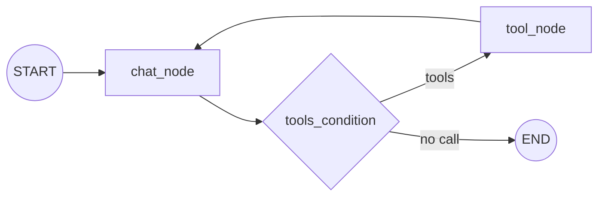
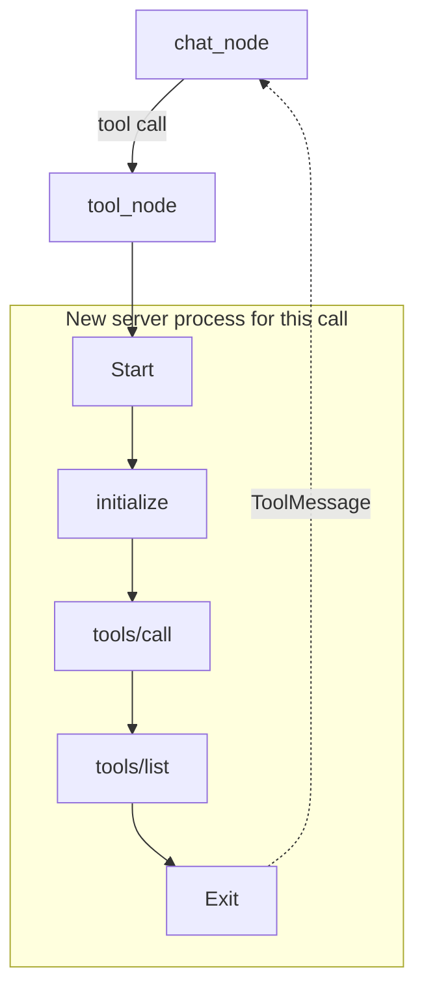
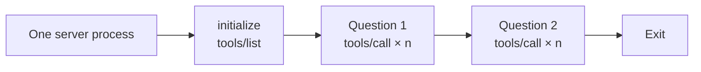
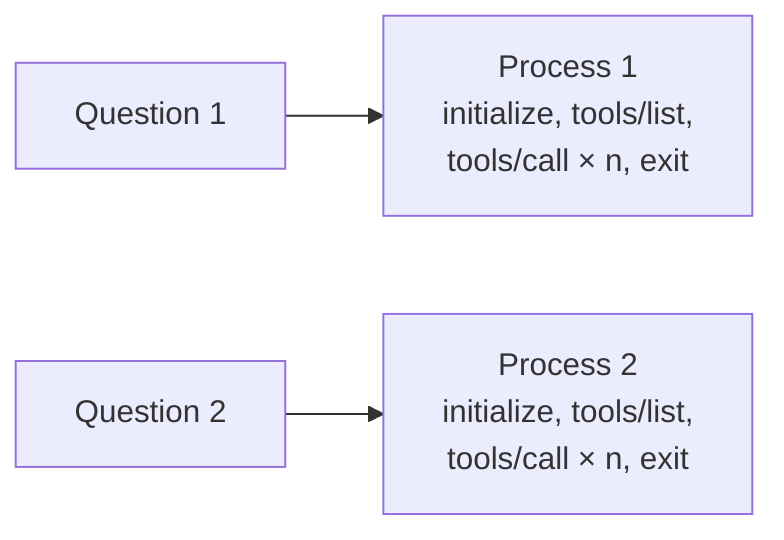

# M40.6 Theory: Research assistant with MCP and LangGraph

*[M40 theory](../README.md) · Lesson 40.6 · Notebooks: [`07_research_assistant_with_mcp_and_langgraph`](../../../projects/07_research_assistant_with_mcp_and_langgraph) · [All theory pages](../../../../../THEORY.md)*
<!-- subtitle: The graph thinks and the servers act; the conversation and the research live in different processes, and the session lifetime decides how often a server starts -->
<!-- format: approved -->

## Start with a server that starts ten times

> **What you'll learn**
>
> - **Explain** how a LangGraph tool loop uses tools that come from two MCP servers, and what MCP changes in that loop.
> - **Locate** the assistant's two memories, the conversation and the saved research, and say how long each lasts.
> - **Compare** three session lifetimes by process starts, messages and bytes, using recorded traffic.
> - **Choose** a session lifetime for a conversation, and measure start-ups on your own server.

Larkspur's support team builds a research assistant. It keeps findings about the product, such as refund rules and status-page history, in a searchable store, and crawls the web for anything new. An analyst asks three follow-up questions, and the assistant answers each with three tool calls.

With the client's default tools, each of those nine calls opens a new session. Recorded on the course's handbook server, that conversation shape starts the server ten times and exchanges 68 messages. A client that holds one session starts it once and sends 23. The code that decides this is one line long.

## MCP + LangGraph

The research assistant splits into a graph that thinks and servers that act. `client.py` builds the graph; two MCP servers, both launched over stdio from `mcp.json`, supply every tool it can call:

- **`research_server`** (this project's `server.py`) keeps research in Chroma, one database per topic under `research_chroma_dbs/<topic>/`. Its five tools: `save_research_data(content, topic)` with `content` a list of texts, `search_research_data(query, topic, max_results=5)`, `list_research_topics()`, `get_topic_info(topic)` and `delete_research_topic(topic)`. Saving skips any text whose MD5 hash is already in the topic's `content_hashes.json`.
- **`firecrawl_server`** is the published `firecrawl-mcp` package, started with `npx -y`, which scrapes the web. The client copies `FIRECRAWL_API_KEY` from its environment into that server's `env` before it connects.

The graph is the tool loop from [M22](../../../../../p06_agent_foundations/m22_agent_loop_and_tools/mandatory/theory/README.md) and [M31](../../../../../p08_agentic_rag/m31_rag_as_agent_tool/mandatory/theory/README.md), unchanged:

*Figure 1: The assistant's graph. MCP supplies the tools; the loop is the ordinary LangGraph one.*

MCP changes only where the tools come from. `MultiServerMCPClient(mcp_json).get_tools()` turns every tool of both servers into a LangChain tool. `llm.bind_tools(tools)` shows them to Ollama's `qwen3`, `ToolNode(tools=tools)` runs whichever the model picks, and `tools_condition` routes. A system prompt tells the model to search saved research before crawling, and to save what it finds.

Step through one question:

A scripted trace of one question, read from <code>client.py</code>, <code>server.py</code> and <code>mcp.json</code>. No model ran; the question, topic and tool choices are illustrative.

<button type="button" data-step="0" aria-pressed="false" aria-controls="ra-step-0">1. Search</button><button type="button" data-step="1" aria-pressed="false" aria-controls="ra-step-1">2. Run</button><button type="button" data-step="2" aria-pressed="false" aria-controls="ra-step-2">3. Crawl</button><button type="button" data-step="3" aria-pressed="false" aria-controls="ra-step-3">4. Save</button><button type="button" data-step="4" aria-pressed="false" aria-controls="ra-step-4">5. Answer</button>

<section id="ra-step-0" class="step-panel" aria-labelledby="ra-heading-0"><h4 id="ra-heading-0">1. chat_node: search first</h4><dl><dt>Input</dt><dd>"What have we saved about Larkspur's refund window, and is there anything newer?"</dd><dt>Decision</dt><dd>Following the system prompt, the model calls <code>search_research_data</code> with topic <code>larkspur_refunds</code></dd><dt>Route</dt><dd><code>tools_condition</code> sees a tool call and goes to <code>tool_node</code></dd></dl></section><section id="ra-step-1" class="step-panel" aria-labelledby="ra-heading-1"><h4 id="ra-heading-1">2. tool_node: a session for one call</h4><dl><dt>What happens</dt><dd>The adapter opens a new session to <code>research_server</code>: a new process, a handshake, the call, then <code>tools/list</code>, then exit</dd><dt>Returns</dt><dd>Saved results as text, each with a "Similarity" line computed as <code>1 - distance</code> (lesson 40.5)</dd></dl></section><section id="ra-step-2" class="step-panel" aria-labelledby="ra-heading-2"><h4 id="ra-heading-2">3. chat_node, then tool_node: crawl</h4><dl><dt>Decision</dt><dd>The model wants newer sources and calls a Firecrawl scrape tool</dd><dt>What happens</dt><dd><code>npx -y firecrawl-mcp</code> starts Node for this one call, with the API key in its environment</dd></dl></section><section id="ra-step-3" class="step-panel" aria-labelledby="ra-heading-3"><h4 id="ra-heading-3">4. chat_node, then tool_node: save</h4><dl><dt>Decision</dt><dd>The model calls <code>save_research_data</code> with the new texts and the same topic</dd><dt>Server state</dt><dd>New texts are embedded and stored; texts whose MD5 hash is already saved are skipped</dd></dl></section><section id="ra-step-4" class="step-panel" aria-labelledby="ra-heading-4"><h4 id="ra-heading-4">5. chat_node: answer</h4><dl><dt>Route</dt><dd>No tool call, so <code>tools_condition</code> goes to END</dd><dt>Client state</dt><dd><code>MemorySaver</code> checkpoints the conversation under thread <code>research_session</code></dd></dl></section>

<button type="button" data-walk="previous">Previous</button>

<button type="button" data-walk="next">Next step</button>

The assistant has two memories, held in different processes:

| Memory | Held by | Lasts | Seen by |
|---|---|---|---|
| The conversation | The client's `MemorySaver`, thread `research_session` | Until `client.py` exits | This client only |
| Saved research | The research server's Chroma databases on disk | Across sessions and restarts | Any host that connects, Claude Desktop included (the `research_server` entry in the [40.2 config](../../../optional/theory/02_mcp_servers_with_claude_desktop/README.md#claude-desktop)) |

*Table 1: Where each memory lives.*

Topic names come from the model and become directory names. The server checks every one with `topic_dir`: it accepts 3 to 63 letters, digits, `_` and `-`, starting with a letter or digit, and refuses any path that resolves outside `research_chroma_dbs`. [Lesson 40.7](../../../optional/theory/07_deploying_an_mcp_server_on_ec2/README.md#deployment) shows what that check stops once the server is shared.

One fix is needed before the client runs here. `client.py` imports `ChatPromptTemplate` and `MessagesPlaceholder` from `langchain.prompts`, which raises `ModuleNotFoundError` under langchain 1.4.7; they live in `langchain_core.prompts`.

## How long a session lives

`MultiServerMCPClient.get_tools()` returns tools with no open connection behind them. Its docstring in langchain-mcp-adapters 0.3.2 says: "A new session will be created for each tool call". For a stdio server, a new session is a new process.

<!-- animated: diagrams/session-per-call.anim.html -->

*Figure 2: A session per tool call, the `get_tools()` default. Every call starts, initialises and lists tools again.*

The `tools/list` after the call comes from the SDK. mcp 1.30.0's `ClientSession` validates each tool result against the tool's output schema, and a session that has not cached that tool's schema lists the tools first. A held session pays for that listing once; a session per call pays for it every time.

The other two lifetimes keep a session open longer. **Hold one session** for the whole conversation: open it with `async with client.session("research_server") as session:`, then load its tools with `load_mcp_tools(session)`.

*Figure 3: Hold one session. One start and one discovery for the whole conversation.*

**Session per question** opens a session inside the request handler, as the 06 `app.py` does in lesson 40.5:

*Figure 4: Session per question. Questions are isolated from each other, at one start each.*

The [interactive lab](interactive/session-lifetime-lab.html) records the real JSON-RPC traffic of the Larkspur handbook server under all three patterns, with a scripted model so every run makes the same calls. Pick a pattern for three questions with two tool calls each:

Three questions, two tool calls each. Counts from the lab's recorded traffic (mcp 1.30.0, fastmcp 3.4.11, langchain-mcp-adapters 0.3.2).

<button type="button" data-mode="hold" aria-pressed="false" aria-controls="session-hold">Hold one session</button>
<button type="button" data-mode="question" aria-pressed="false" aria-controls="session-question">Per question</button>
<button type="button" data-mode="call" aria-pressed="false" aria-controls="session-call">Per tool call</button>

<section id="session-hold" class="mode-panel" data-announcement="Hold one session selected. One start, 17 messages."><h4>Hold one session</h4><ul><li>1 server start, 17 messages, 6,966 bytes.</li><li>One <code>tools/list</code> for the whole conversation.</li><li>Server-side state stays in memory between questions.</li></ul></section>
<section id="session-question" class="mode-panel" data-announcement="Session per question selected. Three starts, 27 messages."><h4>Session per question</h4><ul><li>3 server starts, 27 messages, 9,136 bytes.</li><li>One handshake and one <code>tools/list</code> per question.</li><li>Fits a request handler such as Streamlit's.</li></ul></section>
<section id="session-call" class="mode-panel" data-announcement="Session per tool call selected. Seven starts, 47 messages."><h4>Session per tool call</h4><ul><li>7 server starts, 47 messages, 13,476 bytes.</li><li>One start for the initial <code>get_tools()</code> listing, then one per call, each followed by its own <code>tools/list</code>.</li><li>No lifecycle code, which is why it is the quickstart.</li></ul></section>

The gap grows with the conversation:

| Questions × calls per question | Hold one session | Session per question (06 `app.py`) | Session per tool call (07 client) |
|---|---|---|---|
| 1 × 1 | 1 start, 7 messages | 1 start, 7 messages | 2 starts, 12 messages |
| 3 × 2 | 1 start, 17 messages | 3 starts, 27 messages | **7 starts, 47 messages** |
| 3 × 3 | 1 start, 23 messages, 9,963 bytes | 3 starts, 33 messages, 12,131 bytes | **10 starts, 68 messages, 19,726 bytes** |

*Table 2: The lab's recorded counts at three conversation sizes.*

<!-- lab: interactive/session-lifetime-lab.html -->

Each pattern has a reason to exist:

- **Hold one session** for a conversation. One process, one handshake, and server-side state kept in memory for as long as the session lives.
- **Session per question** isolates questions from each other and suits a request handler, at the price of one start per question.
- **Session per tool call** needs no lifecycle code, and it is the costliest. The lab counts messages; on a real server each start also pays for the work done at import time. The research server builds its Ollama embeddings client at every start, and `npx -y firecrawl-mcp` starts Node for every crawl.

Message counts are not latency, and the lab times nothing, because start-up cost depends on the machine and the server. Measure your own: log one line on the server's stderr at start-up, never stdout, and count the lines per conversation.

## Limits of this evidence

- **Recorded traffic from another server.** The lab records the Larkspur handbook server, not the research server or Firecrawl, through a tap on stdin and stdout. The pattern counts carry over; byte totals depend on each server's tool schemas and results.
- **Scripted model, scripted trace.** The lab's model makes fixed calls, and the walkthrough follows the code with no model run. A real `qwen3` may skip the search, crawl twice or save nothing.
- **No timings.** Process start-up and import cost were not measured.

## References

1. Model Context Protocol, [Lifecycle](https://modelcontextprotocol.io/specification/2025-06-18/basic/lifecycle), the initialise handshake every new session repeats.
2. LangChain, [Model Context Protocol (MCP)](https://docs.langchain.com/oss/python/langchain/mcp), `MultiServerMCPClient`, stateless tools and explicit sessions.
3. LangGraph, [Persistence](https://docs.langchain.com/oss/python/langgraph/persistence), checkpointers and threads.

## Key Takeaways

- MCP changes only where the tools come from. The LangGraph tool loop stays the same, with the graph thinking and the servers acting.
- Conversation memory lives in the client's checkpointer and ends with the process; research saved by the server persists on disk for every host that connects.
- Hold one session for a conversation. A session per tool call needs no lifecycle code but restarts the server on every call, so measure start-ups with one stderr line.

## Check yourself

1. The research assistant has two memories. Where does each live, and how long does it last?

The client's `MemorySaver` keeps the conversation for the thread `research_session` and loses it when `client.py` exits. The research server keeps findings in Chroma on disk, across sessions and for any host that connects, Claude Desktop included.

2. For 3 questions with 3 tool calls each, what does the lab record for holding one session versus a session per tool call?

Holding one session: 1 start, 23 messages, 9,963 bytes. A session per tool call, as in the 07 client: 10 starts, 68 messages, 19,726 bytes. A session per question sits between, at 3 starts, 33 messages and 12,131 bytes.

3. You turn the research assistant into a chat that holds long conversations. Which session pattern should the client use, and why not the get_tools default?

Hold one session per conversation: `async with client.session("research_server") as session:` then `load_mcp_tools(session)`, for one process and one handshake. The `get_tools()` default opens a session per tool call, the costliest pattern: every start rebuilds the Ollama embeddings client, and `npx -y firecrawl-mcp` starts Node for every crawl. Log one stderr line at server start-up to count the starts.

---
*Previous: [40.5 RAG over MCP with LangChain](../05_rag_over_mcp_with_langchain/README.md). Next: [40.7 Deploying an MCP server on EC2](../../../optional/theory/07_deploying_an_mcp_server_on_ec2/README.md).*
