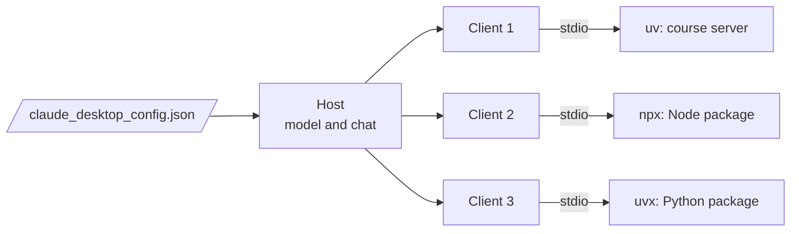
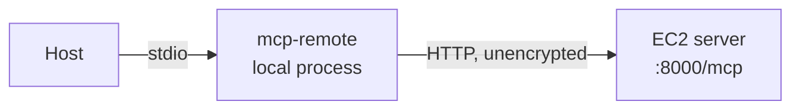
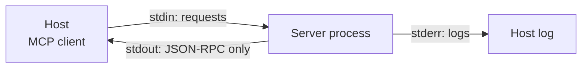

# M40.2 Theory: MCP servers with Claude Desktop

*[M40 theory](../../../mandatory/theory/README.md) · Lesson 40.2 · Notebooks: [`03_mcp_servers_with_claude_desktop`](../../../projects/03_mcp_servers_with_claude_desktop) (optional) · [All theory pages](../../../../../THEORY.md)*
<!-- subtitle: A desktop host starts every server from one config file, and a stdio server that prints anything but JSON-RPC to stdout corrupts its own channel -->
<!-- format: approved -->

## Start with a server that works in the terminal and fails in the host

> **What you'll learn**
>
> - **Explain** what a desktop host does with each entry in its server config.
> - **Diagnose** an entry that starts in the wrong folder, leaks a secret or fetches new code at every launch.
> - **Connect** a stdio host to a remote server through a bridge, and name what the bridge exposes.
> - **Keep** stdout for the protocol and send every log line to stderr.

Larkspur's support team wants the handbook server inside Claude Desktop, where staff can ask about refund windows while they work. The server passes every test in a terminal. In the host it writes its files somewhere unexpected, and a second build that prints a start-up banner only fails some of the time. Both problems come from how a host launches and talks to a server, not from the server's tools.

## Claude Desktop

Claude Desktop is an MCP host: it owns the model, the chat window and one MCP client per server. It learns about servers from `claude_desktop_config.json`, a map under `mcpServers` from a name to the command that starts the server. At launch the host runs every command as a subprocess and speaks to it over stdio:

*Figure 1: One client per server. Each config entry becomes a subprocess the host starts and talks to over stdio.*

The project's config is the course's whole MCP toolbox in one file, thirteen entries:

| Launcher | Entries | What it starts |
|---|---|---|
| `uv` | 5 | The course's own servers: `weather`, `math_server`, `job_search` (40.4), `chroma_db_rag` (40.5), `research_server` (40.6) |
| `npx` | 5 | Published Node packages: `playwright`, `airbnb`, `notionApi`, `filesystem`, and `remote-research-server` through `mcp-remote` |
| `uvx` | 2 | Published Python packages: `ppt`, and `sqlite` straight from a Git URL |
| `cmd` | 1 | `excel`, as `cmd /c npx --yes @negokaz/excel-mcp-server`, which only runs on Windows |

*Table 1: The thirteen entries in `claude_desktop_config.json`, grouped by launcher.*

A Larkspur entry for the handbook server takes the same shape as the course's own:

| Field | Value | Why |
|---|---|---|
| Name | `larkspur-handbook` | The label the host shows for the server |
| `command` | `uv` | The launcher on the host's `PATH` |
| `args` | `--directory`, `/ABSOLUTE/PATH/TO/larkspur-handbook`, `run`, `server.py` | Sets the working directory, then runs the server |
| `env` | only the keys this server needs | Each server sees its own secrets and no others |

*Table 2: A handbook entry, written as fields. Every course entry ships with an `/ABSOLUTE/PATH/TO/…` placeholder to replace.*

## What each entry decides

The config is short, and each line decides something the server's code cannot:

- **The working directory.** The host, not the server, chooses the folder a process starts in, and relative paths resolve there. The 40.4 server writes to `Path(".") / "jobs"`; `uv --directory` makes that land inside the project. That was the handbook server's stray files.
- **Secrets, per server.** `notionApi` gets `NOTION_TOKEN` in its own `env` block and nothing else does. `excel` sets a paging limit, `EXCEL_MCP_PAGING_CELLS_LIMIT`, to 4000 cells (lesson 40.3).
- **Which code runs.** `@playwright/mcp@latest` takes whatever version is current at each launch, and the `sqlite` entry installs from a Git repository whenever `uvx` needs it. Pin versions for anything you depend on.
- **What the model is offered.** Thirteen servers means thirteen sets of tool definitions in every request; M38 measures what connected servers cost in tokens, and lesson 40.1's server manager is one way to hide them.

### Reaching a remote server

Claude Desktop launches local commands. The config reaches the EC2 server from lesson 40.7 through a bridge, `npx mcp-remote http://<EC2_PUBLIC_IP>:8000/mcp --allow-http`: a local stdio process that forwards every message to the remote URL.

*Figure 2: The bridge turns a URL into a command the host can start. The hop after it is plain HTTP.*

The mcp-remote README allows `--allow-http` only on trusted private networks. Here it points at a public address, and every request and result crosses the internet unencrypted. Put the server behind HTTPS, or keep it on a private network.

## Stdout belongs to the protocol

Over stdio, the host writes requests to the server's stdin and reads responses from its stdout, one JSON-RPC message per line. The specification says a server must not write anything to stdout that is not a valid MCP message. Anything else the server writes there arrives in the same stream.

*Figure 3: Two output streams. Only stdout is the protocol; stderr goes to the host's log.*

The 06 server breaks this rule. Its `main()` prints a banner before `mcp.run(transport="stdio")`, and `ingest_pdf` prints progress lines while it works. A scratch probe used mcp 1.30.0's stdio client and a server that prints the same way: two banner lines at start-up and one line per file inside a tool call.

The same printing server, called once with a two-file ingest. Pick the buffering mode to see what the client received.

<button type="button" data-mode="unbuffered" aria-pressed="false" aria-controls="buffer-unbuffered">Unbuffered</button>
<button type="button" data-mode="buffered" aria-pressed="false" aria-controls="buffer-buffered">Default buffering</button>

<section id="buffer-unbuffered" class="mode-panel" data-announcement="Unbuffered selected. Four stray lines reached the client."><h4>Unbuffered (<code>PYTHONUNBUFFERED=1</code>)</h4>
All four stray lines reached the client. It logged <code>Failed to parse JSONRPC message from server</code> four times, dropped each line and carried on. The tool result, <code>Added 2 files</code>, still arrived.
</section>
<section id="buffer-buffered" class="mode-panel" data-announcement="Default buffering selected. No stray line reached the client."><h4>Default buffering</h4>
Python block-buffers stdout when it is a pipe. The prints sat in the buffer and none reached the client during the short session: 0 parse failures. The bug was there and did not show.
</section>

The Python client is forgiving. Another host may treat a bad line as a broken connection. In a longer session, such as a big ingest, the buffer fills and flushes mid-session, and the stray lines arrive then: a failure that comes and goes with the workload. The fix is the one the MCP server guide gives: keep `print()` out of a stdio server, and log through the `logging` module, whose default handler writes to stderr, or with `print(..., file=sys.stderr)`.

> **Pitfall: testing a stdio server only in a short session.** Buffering hides stray prints until a flush. A clean test run proves nothing about stdout.

## Limits of this evidence

- The config facts come from reading the project's `claude_desktop_config.json`. No Claude Desktop instance ran here, and the host's own handling of a bad stdout line was not tested.
- The buffering results come from one scratch probe with the mcp 1.30.0 Python client and a stand-in server that prints like the 06 server, not from the 06 server itself, which needs Ollama and Chroma.
- Versions taken by `@latest` and Git installs change over time; this page cannot say what they install today.

## References

- Model Context Protocol: [Connect to local MCP servers](https://modelcontextprotocol.io/docs/develop/connect-local-servers), on `claude_desktop_config.json`, and [Build an MCP server](https://modelcontextprotocol.io/docs/develop/build-server), on logging in stdio servers.
- Model Context Protocol specification (2025-06-18): [Transports](https://modelcontextprotocol.io/specification/2025-06-18/basic/transports), on newline-delimited messages and stdout.
- mcp-remote: [project README](https://github.com/geelen/mcp-remote), on `--allow-http`.

## Key Takeaways

- In `claude_desktop_config.json`, use absolute paths with `uv --directory`, give each server only its own secrets in `env`, and pin versions instead of `@latest`.
- A remote server reaches a stdio host through a bridge such as `mcp-remote`. Keep `--allow-http` to trusted private networks, and use HTTPS for anything public.
- Over stdio, stdout carries only JSON-RPC. Send logs to stderr, because buffering can hide stray prints in testing that break a stricter host.

## Check yourself

1. How does the Claude Desktop config reach the remote EC2 server, and what does its --allow-http flag risk?

Through `npx mcp-remote http://<EC2_PUBLIC_IP>:8000/mcp --allow-http`, a local stdio process that forwards to the remote URL. The mcp-remote README allows `--allow-http` only on trusted private networks. Here it points at a public address, and every request and result crosses the internet unencrypted.

2. The 40.4 server writes to a jobs folder relative to its working directory. Why does its Claude Desktop entry pass uv an absolute directory?

`uv --directory` sets the working directory, so `Path(".") / "jobs"` resolves inside the project. Without it, the folder lands wherever the host starts the process. Every course entry ships with an `/ABSOLUTE/PATH/TO/…` placeholder you must replace.

3. The 06 server prints a banner to stdout, yet a short test session shows no parse errors. Is the server safe to ship?

No. Python block-buffers stdout when it is a pipe, so the prints sat in the buffer and never reached the client. Unbuffered, every stray line reached the client, which logged a parse failure for each. Send logs to stderr and keep stdout for the protocol, because another host may be less forgiving.

---
*Previous: [40.1 Your first MCP server and a local agent](../../../mandatory/theory/01_your_first_mcp_server_and_a_local_agent/README.md). Next: [40.3 MCP servers for data analysis](../03_mcp_servers_for_data_analysis/README.md).*
