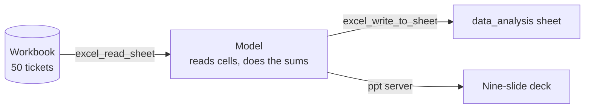
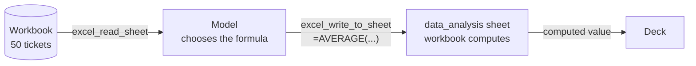

# M40.3 Theory: MCP servers for data analysis

*[M40 theory](../../../mandatory/theory/README.md) · Lesson 40.3 · Notebooks: [`04_mcp_servers_for_data_analysis`](../../../projects/04_mcp_servers_for_data_analysis) (optional) · [All theory pages](../../../../../THEORY.md)*
<!-- subtitle: Spreadsheet and slide servers move cells, the model does the sums, and its two wrong figures look exactly like its right ones -->
<!-- format: approved -->

## Start with a deck that looks finished

> **What you'll learn**
>
> - **Explain** which part of an MCP analysis session computes the figures and which parts only move data.
> - **Trace** a wrong headline figure back to the cell it was copied from.
> - **Diagnose** a verdict that contradicts the data's own target.
> - **Choose** a set-up where every figure keeps a derivation you can inspect.

Larkspur's support lead asks for a review of last month's tickets and gets back a polished nine-slide deck within minutes. One slide says only 42.9% of critical tickets were resolved, and a meeting is booked to discuss it. Nobody has checked where that number came from. This project is the same situation with real files, and it rewards one question: which part of the system did the arithmetic?

## Checking the agent's numbers

This project has no code. It ships the input and the output of one analysis run in Claude through MCP, the job the `excel` and `ppt` entries in the 40.2 config are there for:

- `support_tickets_data.xlsx`, with 50 support tickets in a `support_tickets_data` sheet (12 columns, from `ticket_id` to `resolved`) and the model's findings written back as a `data_analysis` sheet.
- `Support_Tickets_Analysis_Report.pptx`, nine slides that end "Analysis completed using Claude MCP Analysis".

*Figure 1: The run as shipped. The servers move cells and slides; every figure is computed inside the model.*

Recomputing the deck's figures from the ticket sheet with pandas takes one cell:

| Figure | Deck and analysis sheet | From the 50 tickets |
|---|---|---|
| Resolved tickets | 23 of 50, 46% | 23 of 50, 46% |
| Average satisfaction | 2.84 / 5 | **2.82 / 5** (141 / 50) |
| Average response time | 2.2 hours, "MEETING TARGET" | 2.17 hours, against the sheet's own target of "Under 2 hours" |
| Agent A001 satisfaction | 2.14 / 5 | 2.14 / 5 |
| Agent A004 share of tickets | 36% | 18 of 50, 36% |
| Data Import and Billing share | 44% | 22 of 50, 44% |
| Critical tickets resolved | "Only 42.9%" | **71.4%** (5 of 7) |

*Table 1: The deck against a recomputation. Bold marks the two figures that disagree.*

Most figures are right, and the two wrong ones look the same as the rest. The verdict on response time is wrong too: 2.17 hours misses the "Under 2 hours" target that the analysis sheet sets in its own success-metrics block, and the deck calls it on target.

### Where 42.9% came from

Follow the critical-ticket figure from the slide back to its source. Each stage uses only the shipped files.

<button type="button" data-step="0" aria-pressed="false" aria-controls="trace-step-0">1. The claim</button><button type="button" data-step="1" aria-pressed="false" aria-controls="trace-step-1">2. Recompute</button><button type="button" data-step="2" aria-pressed="false" aria-controls="trace-step-2">3. Find the number</button><button type="button" data-step="3" aria-pressed="false" aria-controls="trace-step-3">4. Consequence</button>

<section id="trace-step-0" class="step-panel" aria-labelledby="trace-heading-0"><h4 id="trace-heading-0">1. The slide's claim</h4><dl><dt>Deck</dt><dd>"Critical Ticket Problems: Only 42.9% of critical tickets resolved"</dd><dt>Analysis sheet</dt><dd>The same sentence under its key-problems heading</dd></dl></section><section id="trace-step-1" class="step-panel" aria-labelledby="trace-heading-1"><h4 id="trace-heading-1">2. Recompute from the tickets</h4><dl><dt>Filter</dt><dd><code>priority</code> is Critical: 7 tickets</dd><dt>Resolved among them</dt><dd>5, which is 71.4%</dd><dt>Verdict</dt><dd>The slide's figure does not come from these rows</dd></dl></section><section id="trace-step-2" class="step-panel" aria-labelledby="trace-heading-2"><h4 id="trace-heading-2">3. Search the analysis sheet for 42.9</h4><dl><dt>Match</dt><dd>Agent A001: "7 tickets, 42.9% resolved, 2.14/5 satisfaction", one block up</dd><dt>Check</dt><dd>A001 resolved 3 of its 7 tickets: 42.9%</dd><dt>Cause</dt><dd>An agent's rate, copied into the critical-ticket line; both groups happen to hold 7 tickets</dd></dl></section><section id="trace-step-3" class="step-panel" aria-labelledby="trace-heading-3"><h4 id="trace-heading-3">4. What the error drives</h4><dl><dt>Slide finding</dt><dd>A "Critical Ticket Problems" section built on the wrong rate</dd><dt>Real picture</dt><dd>Critical tickets resolve better than the 46% overall rate</dd></dl></section>

<button type="button" data-walk="previous">Previous</button>

<button type="button" data-walk="next">Next step</button>

> **Pitfall: checking a deck by reading it.** A copied percentage looks as precise as a computed one. Only a recomputation from the source rows separates them.

## Make the tool compute

The excel server can do the sums itself. Its README says a value written through `excel_write_to_sheet` that starts with `=` is a formula. Writing `=AVERAGE(support_tickets_data!I2:I51)` would let the workbook compute the average satisfaction and keep the source of the number visible in the cell:

*Figure 2: Added for comparison. The model writes formulas and the workbook does the arithmetic. Each figure can be audited in its cell.*

The analysis sheet holds typed strings such as `2.84/5` instead. Its seven section headings begin with `=` (`==== EXECUTIVE SUMMARY ===`), and the workbook stored them as formulas with no cached value. Read with pandas, those seven cells come back empty: the one place the run used the formula path, it did so by accident.

Three rules for analysis sessions over MCP:

- **Make the tool compute.** Ask for formulas, or give the host a code or SQL tool. Each figure then has a derivation you can inspect.
- **Recompute the headline numbers** before a deck leaves the room. Here that took one pandas cell and found two wrong figures and one wrong verdict.
- **Check the paging limit against the data.** `EXCEL_MCP_PAGING_CELLS_LIMIT` is 4000 cells per read in the 40.2 config. This sheet is 612 cells with its header row, so one read covered it. A larger sheet arrives in pages, and a model that stops after the first page analyses part of the data.

Back at Larkspur, the meeting about critical tickets should be about the response-time target instead.

## Limits of this evidence

- The recomputation uses pandas and openpyxl on the shipped workbook and reads the deck's slide text; the run that produced them is not reproducible here, and its prompts are not shipped.
- How the model arrived at 42.9% is inferred from the matching agent row and the equal ticket counts. The transcript is not available.
- The formula behaviour comes from the excel-mcp-server README, not from running the server.

## References

- excel-mcp-server: [project README](https://github.com/negokaz/excel-mcp-server), on `excel_read_sheet`, `excel_write_to_sheet`, formulas and `EXCEL_MCP_PAGING_CELLS_LIMIT`.
- Model Context Protocol specification (2025-06-18): [Tools](https://modelcontextprotocol.io/specification/2025-06-18/server/tools).

## Key Takeaways

- MCP servers move cells and slides; the model does the arithmetic. Its wrong figures look the same as its right ones.
- Make the tool compute, with spreadsheet formulas or a code or SQL tool, and every figure keeps a derivation you can inspect.
- Recompute the headline numbers before a report ships, and check the server's paging limit against the data size so the model reads every page.

## Check yourself

1. In this Claude analysis run, which part does the arithmetic, and why does that make the deck hard to trust?

The model. The excel and ppt servers only move cells and slides. No figure has a derivation you can inspect, and the two wrong figures look the same as the right ones. Make the tool compute instead: ask for formulas, or give the host a code or SQL tool.

2. The deck reports that only 42.9% of critical tickets were resolved. What does the ticket sheet give, and where did 42.9% come from?

71.4%, 5 of 7. 42.9% is agent A001's resolution rate (3 of 7), one block up in the same sheet, reported as the critical-ticket rate, and it drives the slide's "Critical Ticket Problems" finding. One pandas cell recomputing the headline numbers caught it.

3. The next ticket sheet has 6,000 cells. What can go wrong when the model reads it through the excel server, and what do you check?

`EXCEL_MCP_PAGING_CELLS_LIMIT` is 4000 cells per read, so the sheet arrives in pages, and a model that stops after the first page analyses part of the data. Check the paging limit against the data size; this project's 612-cell sheet fit in one read.

---
*Previous: [40.2 MCP servers with Claude Desktop](../02_mcp_servers_with_claude_desktop/README.md). Next: [40.4 Tools, resources and prompts together](../../../mandatory/theory/04_tools_resources_and_prompts_together/README.md).*
