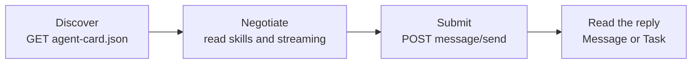

# M41.1 Theory: A2A basics: Agent Cards, tasks, messages

*[M41 theory](../README.md) · Lesson 41.1 · Notebooks: [`01a_a2a_protocol_basics.ipynb`](../../notebook/01a_a2a_protocol_basics.ipynb) · [All theory pages](../../../../../THEORY.md)*
<!-- subtitle: A client that knows only a base URL reads the Agent Card first, then sends one JSON-RPC message and learns from the reply's kind whether anything was stored -->
<!-- format: approved -->

## Start with a base URL and nothing else

> **What you'll learn**
>
> - **Read** an Agent Card and say what a client does with each required field.
> - **Find** the card at the path the installed SDK actually fetches.
> - **Trace** one request from discovery to the agent's reply.
> - **Tell** a Message reply from a Task by its `kind`, and say why only one can be polled.

Larkspur's support desk has been given the address of a handbook agent another team runs: `http://localhost:10002/`. Nothing else. The desk does not know the agent's skills, whether it streams, which content types it accepts, or even which path to post a question to. With a plain HTTP service the answer would be a wiki page and a meeting. With A2A the agent describes itself.

This lesson reads that description, the Agent Card, and then follows one question through the protocol to the agent's reply.

## Agent Card

An Agent Card is the JSON document an A2A server publishes about itself. A client that knows only a base URL fetches the card first. Everything else it needs comes from there: where to post requests, which skills the agent has, and whether it can stream.

### The eight required fields

In `a2a-sdk` 0.3.26, the version pinned in this repository, `AgentCard` has eight required fields:

| Field | What the client does with it |
|---|---|
| `name`, `description`, `version` | Shows or logs which agent, and which release of it, answered |
| `url` | Posts JSON-RPC requests here |
| `capabilities` | Checks `streaming` before calling `message/stream`; the others are `push_notifications`, `state_transition_history` and `extensions` |
| `skills` | Picks the agent for a job: each `AgentSkill` needs `id`, `name`, `description` and `tags`, and may add `examples` and its own input and output modes |
| `default_input_modes`, `default_output_modes` | Learns which content types the agent accepts and returns |

*Table 1: The required fields of an Agent Card in a2a-sdk 0.3.26.*

### Defaults, authentication and the wire names

Two fields have defaults the reference implementations never set: `protocol_version` is `0.3.0` and `preferred_transport` is `JSONRPC`. Authentication also lives on the card, in `security_schemes` and `security`. An agent can keep some skills on an authenticated extended card (`supports_authenticated_extended_card`, served at `/agent/authenticatedExtendedCard`). A scheme on the card says what the agent expects; it does not prove the server checks it.

The Python model uses snake_case, and the wire uses camelCase. This is the card the lab's handbook agent serves, recorded from a live server and laid out as a table:

| Wire field | Value |
|---|---|
| `name` | `larkspur_handbook_agent` |
| `description` | Answers questions from the Larkspur Cloud handbook. |
| `url` | `http://localhost:10002/` |
| `version` | `1.0.0` |
| `protocolVersion`, `preferredTransport` | `0.3.0`, `JSONRPC` (the defaults) |
| `capabilities` | `streaming` true |
| `defaultInputModes`, `defaultOutputModes` | `text`, `text` |
| `skills[0]` | id and name `handbook_qa`, tags `rag` and `handbook`, two example questions about exports and refunds |

*Table 2: The handbook agent's card on the wire. A local card built with no defaults set dumps `protocolVersion` 0.3.0, `preferredTransport` JSONRPC and a `defaultInputModes` key.*

### Where the card lives

The reference implementations say `/.well-known/agent.json`. In 0.3.26 the SDK's constant is `AGENT_CARD_WELL_KNOWN_PATH`, set to `/.well-known/agent-card.json`, and `A2ACardResolver` fetches that path. `A2AStarletteApplication` serves both: in our replay, both paths returned 200, and a request to the old one is logged as a deprecated endpoint. Clients written against the new SDK never touch the old path, and the reference implementations still work unchanged.

### The card is a contract

A skill description is all a calling agent's model knows about the agent, the same way a tool description is all it knows about a tool ([M31](../../../../../p08_agentic_rag/m31_rag_as_agent_tool/mandatory/theory/README.md)). Changing `streaming`, a skill id or the URL breaks callers that read the old card. Bump `version` when you do.

## From discovery to reply

The echo-server example in notebook 01a runs one server and one client in the same process. The server is an echo agent: its `AgentExecutor` puts a single agent message on the event queue. The client goes through four steps, and each maps to one HTTP call or one decision:

*Figure 1: The four client steps of an A2A exchange.*

### One question through the echo agent

Here is the support desk's question, *Can I export my data after I cancel my plan?*, sent to the echo agent. We replayed this exchange in process against `a2a-sdk` 0.3.26, with no network and no model.

Step through one question sent to the echo agent. Each stage names the call or field that matters.

<button type="button" data-step="0" aria-pressed="false" aria-controls="echo-step-0">1. Discover</button><button type="button" data-step="1" aria-pressed="false" aria-controls="echo-step-1">2. Negotiate</button><button type="button" data-step="2" aria-pressed="false" aria-controls="echo-step-2">3. Submit</button><button type="button" data-step="3" aria-pressed="false" aria-controls="echo-step-3">4. Reply</button><button type="button" data-step="4" aria-pressed="false" aria-controls="echo-step-4">5. Poll</button>

<section id="echo-step-0" class="step-panel" aria-labelledby="echo-heading-0"><h4 id="echo-heading-0">1. Fetch the card</h4><dl><dt>Call</dt><dd><code>GET /.well-known/agent-card.json</code> through <code>A2ACardResolver</code></dd><dt>Result</dt><dd>an <code>AgentCard</code> with the endpoint, the skills and the capabilities</dd></dl></section><section id="echo-step-1" class="step-panel" aria-labelledby="echo-heading-1"><h4 id="echo-heading-1">2. Decide how to call</h4><dl><dt>Read</dt><dd><code>url</code> for the endpoint and <code>capabilities.streaming</code> for the method</dd><dt>Choice</dt><dd><code>message/send</code>, one request and one reply</dd></dl></section><section id="echo-step-2" class="step-panel" aria-labelledby="echo-heading-2"><h4 id="echo-heading-2">3. Post the message</h4><dl><dt>Envelope</dt><dd>JSON-RPC 2.0: <code>jsonrpc</code>, an <code>id</code>, <code>method</code> <code>message/send</code>, and <code>params.message</code></dd><dt>Message</dt><dd><code>kind</code> message, <code>role</code> user, a client-chosen <code>messageId</code>, one text part with the question</dd></dl></section><section id="echo-step-3" class="step-panel" aria-labelledby="echo-heading-3"><h4 id="echo-heading-3">4. Read the reply</h4><dl><dt>Kind</dt><dd><code>message</code>, role <code>agent</code>, the echoed text in <code>parts</code></dd><dt>Ids</dt><dd>a <code>contextId</code> and a <code>taskId</code>, copied from the request context</dd></dl></section><section id="echo-step-4" class="step-panel" aria-labelledby="echo-heading-4"><h4 id="echo-heading-4">5. Try to poll it</h4><dl><dt>Call</dt><dd><code>tasks/get</code> with that <code>taskId</code></dd><dt>Result</dt><dd>error -32001, Task not found: no task was ever stored</dd></dl></section>

<button type="button" data-walk="previous">Previous</button>

<button type="button" data-walk="next">Next step</button>

### What a message is made of

A message has a `role` (`user` or `agent`), a client-chosen `messageId` and a list of parts. Each part is a `text`, `file` or `data` part, marked by its own `kind`. The JSON-RPC envelope around it carries the method name and a request `id` that the reply repeats, which is how a client pairs replies with requests.

### A Message reply stores nothing

The reply's `kind` is the first field to read. The echo agent answers with a Message. The request context hands the executor a `contextId`, which groups related turns, and a `taskId`, and the executor copies both into its reply. It never created a task, though. Nothing was stored, and `tasks/get` on that id fails. A Message is the whole answer; there is nothing to poll. Lesson 41.2 shows the other reply kind, a Task, which the server does store.

### The objects on each side

The server side of the example is three objects: an `AgentExecutor` with the agent logic, a `DefaultRequestHandler` that implements the JSON-RPC methods on top of it with an `InMemoryTaskStore`, and an `A2AStarletteApplication` that serves the card and the endpoint. The client side is `A2ACardResolver` and `A2AClient`.

| Side | Object | Job |
|---|---|---|
| Server | `AgentExecutor` | Runs the agent and puts messages or task events on the queue |
| Server | `DefaultRequestHandler` | Implements `message/send`, `tasks/get` and the other methods over a task store |
| Server | `A2AStarletteApplication` | Serves the card and the JSON-RPC endpoint |
| Client | `A2ACardResolver` | Fetches and parses the card |
| Client | `A2AClient` | Sends requests to the card's `url` |

*Table 3: The five SDK objects in the echo example.*

In 0.3.26, constructing `A2AClient` emits a `DeprecationWarning` that points to `ClientFactory`. The reference implementations' calls still work, and the warning is the signal to plan the move before a later release removes the class.

## Limits of this evidence

- **Replayed in process.** The card paths, error codes, reply kinds and warning come from the SDK's own server and client run over an in-memory transport, with no network and no model.
- **One SDK version.** Field names, defaults and the card path are those of `a2a-sdk` 0.3.26; the reference implementations were written against an earlier release, and later releases may change them again.
- **Authentication was not exercised.** The card can declare security schemes; nothing here shows a server enforcing them.

## References

1. A2A Protocol, [Specification](https://a2a-protocol.org/latest/specification/).
2. A2A Project, [a2a-python SDK](https://github.com/a2aproject/a2a-python).
3. JSON-RPC Working Group, [JSON-RPC 2.0 Specification](https://www.jsonrpc.org/specification).
4. M. Nottingham, [RFC 8615: Well-Known Uniform Resource Identifiers](https://www.rfc-editor.org/rfc/rfc8615).

## Key Takeaways

- A client that knows only a base URL fetches the Agent Card first. It learns the endpoint, the skills, streaming support and accepted content types from it.
- Treat the card as a contract. Skill descriptions are all a calling model knows, so bump `version` when a skill id, `streaming` or the URL changes.
- A reply that is a Message is the whole answer and stores nothing to poll. A request is a JSON-RPC `message/send` with a role, a `messageId` and parts.

## Check yourself

1. A client knows only an A2A agent's base URL. What does it fetch first, and what does it learn from it?

The Agent Card, which `A2ACardResolver` in 0.3.26 fetches from `/.well-known/agent-card.json`. The card tells it where to post requests (`url`), which skills the agent has, whether it can stream (`capabilities`), and which content types it accepts and returns.

2. The echo agent answers message/send with a Message. What happens if the client calls tasks/get with the taskId from that reply?

It gets error -32001, Task not found. The executor copied the `contextId` and `taskId` from the request context into its reply but never created a task, so nothing was stored. A Message is the whole answer; there is nothing to poll.

3. You rename the Larkspur handbook agent's skill id from handbook_qa to billing_qa. What else must change on the card, and why?

Bump `version`. The card is a contract: a calling agent's model knows the agent only through what the card says, and changing `streaming`, a skill id or the URL breaks callers that read the old card.

---
*Previous: [M41 overview](../README.md). Next: [41.2 A LangGraph agent over A2A](../02_a_langgraph_agent_over_a2a/README.md).*
