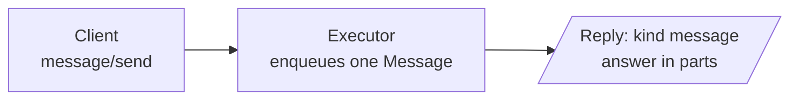
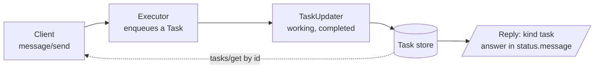
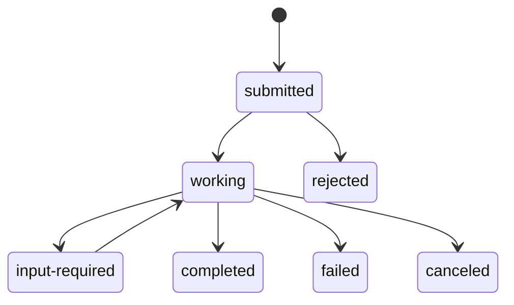
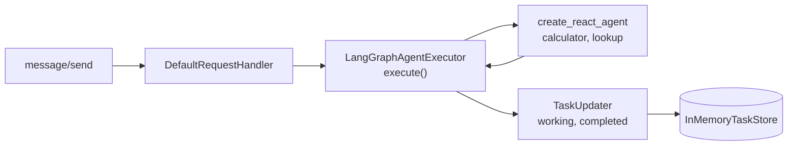

# M41.2 Theory: A LangGraph agent over A2A

*[M41 theory](../README.md) · Lesson 41.2 · Notebooks: [`02a_langgraph_agent_over_a2a.ipynb`](../../notebook/02a_langgraph_agent_over_a2a.ipynb) · [All theory pages](../../../../../THEORY.md)*
<!-- subtitle: An A2A server only calls one executor method; what that method puts on the queue decides whether the caller gets a one-shot Message or a Task it can poll, stream and see fail -->
<!-- format: approved -->

## Start with an answer that may not come at once

> **What you'll learn**
>
> - **Choose** between a Message reply and a Task reply, and find the answer in each.
> - **Read** a task's state, and tell a terminal state from a pause.
> - **Trace** the four calls a client makes against a Task, including the one that fails.
> - **Wrap** a LangGraph graph in an `AgentExecutor` without blocking the server.

The echo agent in 41.1 answered at once, in one Message. Larkspur's handbook agent is a LangGraph graph: it retrieves, reasons and sometimes calls a tool. It may take seconds, it may stream progress, and it may fail after it has started, for example when its vector index is not loaded. The caller needs to know which of those happened, and a one-shot Message cannot say.

This lesson puts a LangGraph agent behind A2A and follows what the caller sees in each case.

## Tasks & messages

A2A has two reply shapes, and the executor decides which one a caller gets.

### Two reply shapes

A Message reply is the whole answer. The executor enqueues one agent message and nothing else, as the echo agent does:

*Figure 1: A Message reply. Nothing is stored; there is nothing to poll.*

A Task reply is a record the server keeps. The executor enqueues a Task, then sends status updates through a `TaskUpdater`, and the request handler writes each one to the task store:

*Figure 2: A Task reply. The task has an id, a state and a history, and the client can fetch it again.*

| Reply | When the executor produces it | Where the answer is | Can the client poll it? |
|---|---|---|---|
| Message (`"kind": "message"`) | It enqueues one agent message and nothing else, as the echo agent in 41.1 does | `result.parts` | No: `tasks/get` answers -32001, Task not found |
| Task (`"kind": "task"`) | It enqueues a Task, then status updates through a `TaskUpdater`, as the handbook agent does | `result.status.message`, plus `artifacts` if the agent publishes any | Yes, by its `id`, for as long as the task store keeps it |

*Table 1: The two reply shapes compared.*

A Message suits a one-shot answer. A Task suits anything that takes time, can fail halfway, or needs another turn from the caller.

### Task states

`TaskState` in 0.3.26 has nine values. The SDK treats four as terminal (`completed`, `failed`, `canceled`, `rejected`): `TaskUpdater` marks their update `final` and refuses any update after one. Two are interrupted states, where the task waits for the caller: `input-required` and `auth-required`. The caller continues such a task by sending a message with the same `taskId`.

*Figure 3: The task states these pages use.*

The diagram shows the paths these pages use; `auth-required` behaves like `input-required`, and `unknown` is the ninth value. The handbook agent's executor only ever walks `submitted`, `working`, then `completed` or `failed`.

A terminal task accepts nothing more. In our replay, a follow-up message carrying the completed task's `taskId` got error -32602 (the task is in terminal state), and `tasks/cancel` got -32002. The same follow-up with only the `contextId` started a new task in the same context, which is how a conversation continues after an answer.

### Four calls against the handbook agent

The [interactive lab](interactive/a2a-exchange-lab.html) replays exchanges recorded from three agents served by `a2a-sdk` 0.3.26, each asked *Can I export my data after I cancel my plan?* The handbook agent has the notebook's executor, with a stub that returns a fixed 185-character handbook answer where the notebook calls the LangGraph graph. We replayed the same executor in process and got the same four results.

Step through the four calls a client makes against the handbook agent.

<button type="button" data-step="0" aria-pressed="false" aria-controls="calls-step-0">1. Send</button><button type="button" data-step="1" aria-pressed="false" aria-controls="calls-step-1">2. Stream</button><button type="button" data-step="2" aria-pressed="false" aria-controls="calls-step-2">3. Get</button><button type="button" data-step="3" aria-pressed="false" aria-controls="calls-step-3">4. Cancel</button>

<section id="calls-step-0" class="step-panel" aria-labelledby="calls-heading-0"><h4 id="calls-heading-0">1. message/send</h4><dl><dt>Reply</dt><dd>a Task in state <code>completed</code></dd><dt>Inside</dt><dd><code>history</code> holds the user turn and the working update; the 185-character answer is in <code>status.message</code></dd></dl></section><section id="calls-step-1" class="step-panel" aria-labelledby="calls-heading-1"><h4 id="calls-heading-1">2. message/stream</h4><dl><dt>Events</dt><dd>three server-sent events: a <code>task</code> in <code>submitted</code>, a <code>status-update</code> to <code>working</code> with final false, a <code>status-update</code> to <code>completed</code> with final true</dd></dl></section><section id="calls-step-2" class="step-panel" aria-labelledby="calls-heading-2"><h4 id="calls-heading-2">3. tasks/get</h4><dl><dt>Reply</dt><dd>the same Task that <code>message/send</code> returned, read back from the store</dd></dl></section><section id="calls-step-3" class="step-panel" aria-labelledby="calls-heading-3"><h4 id="calls-heading-3">4. tasks/cancel</h4><dl><dt>Reply</dt><dd>error -32002: the task cannot be stopped in state <code>completed</code></dd></dl></section>

<button type="button" data-walk="previous">Previous</button>

<button type="button" data-walk="next">Next step</button>

<!-- lab: interactive/a2a-exchange-lab.html -->

### A task that fails after it starts

The handbook agent's executor catches an exception, sets the task to `failed` with the error text, and then re-raises it. The lab's third agent does the same with an index that is not loaded. What the caller sees depends on that last re-raise:

Choose what the executor does after it marks the task failed, and see what each caller receives.

<button type="button" data-mode="reraise" aria-pressed="false" aria-controls="failure-reraise">Set failed, then re-raise</button>
<button type="button" data-mode="return" aria-pressed="false" aria-controls="failure-return">Set failed, then return</button>

<section id="failure-reraise" class="mode-panel" data-announcement="Re-raise selected. The send caller gets a JSON-RPC error."><h4>Set failed, then re-raise (the notebook's executor)</h4><ul><li>A <code>message/send</code> caller gets JSON-RPC error -32603 whose message is the raw exception text, <code>vector index not loaded</code>, and no task id.</li><li>A <code>message/stream</code> caller sees <code>submitted</code>, <code>working</code>, then <code>failed</code> with final true, and can fetch the failed task by its streamed id.</li></ul></section>
<section id="failure-return" class="mode-panel" data-announcement="Return selected. The send caller gets a failed Task."><h4>Set failed, then return</h4><ul><li>A <code>message/send</code> caller gets a Task in state <code>failed</code>, which it can handle like any other result.</li><li>The raw exception text stays out of a reply that may go to another team's agent.</li></ul></section>

We checked both against the same SDK. Returning keeps one reply shape for success and failure, which is the easier contract for a caller in another framework.

## The executor seam

The A2A server never sees LangGraph. It calls one method, `AgentExecutor.execute(context, event_queue)`, and serialises whatever the method puts on the queue. Everything framework-specific sits behind that method.

### What the executor does

Notebook 02a's `LangGraphAgentExecutor` does five things in order:

Step through one call to the notebook's executor.

<button type="button" data-step="0" aria-pressed="false" aria-controls="exec-step-0">1. Read</button><button type="button" data-step="1" aria-pressed="false" aria-controls="exec-step-1">2. Task</button><button type="button" data-step="2" aria-pressed="false" aria-controls="exec-step-2">3. Working</button><button type="button" data-step="3" aria-pressed="false" aria-controls="exec-step-3">4. Run graph</button><button type="button" data-step="4" aria-pressed="false" aria-controls="exec-step-4">5. Finish</button>

<section id="exec-step-0" class="step-panel" aria-labelledby="exec-heading-0"><h4 id="exec-heading-0">1. Read the question</h4><dl><dt>Call</dt><dd><code>context.get_user_input()</code> joins the text parts</dd></dl></section><section id="exec-step-1" class="step-panel" aria-labelledby="exec-heading-1"><h4 id="exec-heading-1">2. Create the task</h4><dl><dt>When</dt><dd>the request did not continue an existing task</dd><dt>Call</dt><dd><code>new_task(context.message)</code>, then enqueue it: the stream's first event</dd></dl></section><section id="exec-step-2" class="step-panel" aria-labelledby="exec-heading-2"><h4 id="exec-heading-2">3. Publish working</h4><dl><dt>Call</dt><dd><code>TaskUpdater.update_status</code> with state <code>working</code> and a short agent message</dd></dl></section><section id="exec-step-3" class="step-panel" aria-labelledby="exec-heading-3"><h4 id="exec-heading-3">4. Run the graph off the event loop</h4><dl><dt>Call</dt><dd><code>graph.invoke</code> with the question as a user message, inside <code>asyncio.to_thread</code></dd><dt>Why</dt><dd><code>invoke</code> blocks, and the server's event loop must stay free for other requests</dd></dl></section><section id="exec-step-4" class="step-panel" aria-labelledby="exec-heading-4"><h4 id="exec-heading-4">5. Publish the outcome</h4><dl><dt>Success</dt><dd>state <code>completed</code> with the last message's content</dd><dt>Exception</dt><dd>state <code>failed</code> with the error text, then re-raise</dd></dl></section>

<button type="button" data-walk="previous">Previous</button>

<button type="button" data-walk="next">Next step</button>

`cancel()` raises `ServerError(error=UnsupportedOperationError())`, which reaches the caller as error -32004 while a task is still running. The two-hop example in 41.3 uses `await agent.ainvoke(...)` instead of a thread; either keeps the loop free.

*Figure 4: The executor seam in notebook 02a. Only the executor knows the graph exists.*

### What streaming means here

The notebook's card advertises two skills, `calculator` and `lookup`, one per tool of the ReAct agent, and `streaming=True`. Streaming here means task events: the graph's `invoke` returns once, so a stream carries the three events from the walkthrough above and no partial tokens. To stream tokens, the executor would iterate the graph's own stream and publish each chunk as an artifact update or a `working` message.

The notebook builds the graph with `langgraph.prebuilt.create_react_agent`. The installed langgraph 1.2.18 marks it deprecated in favour of `langchain.agents.create_agent` ([M23](../../../../../p06_agent_foundations/m23_react_agents/mandatory/theory/README.md)); it still runs, and the executor would wrap either one the same way.

## Limits of this evidence

- **No model ran.** The lab and our replay use the notebook's executor with a stub graph that returns a fixed answer or raises; a real graph takes longer and can fail in other ways.
- **In-memory task store.** `InMemoryTaskStore` loses every task on restart, and `tasks/get` works only while the same process keeps it.
- **One SDK version.** Error codes, state names and the final flag are those of `a2a-sdk` 0.3.26.

## References

1. A2A Protocol, [Specification](https://a2a-protocol.org/latest/specification/).
2. A2A Project, [a2a-python SDK](https://github.com/a2aproject/a2a-python).
3. LangChain, [LangGraph overview](https://docs.langchain.com/oss/python/langgraph/overview).
4. Python Software Foundation, [asyncio.to_thread](https://docs.python.org/3/library/asyncio-task.html#asyncio.to_thread).

## Key Takeaways

- Reply with a Message for a one-shot answer and a Task for work that takes time, can fail or needs another turn. Only a Task can be polled.
- Terminal states accept no further updates or messages. Continue a task only from `input-required` or `auth-required`; otherwise start a new task in the same `contextId`.
- The server only calls `AgentExecutor.execute()`. Keep blocking graph calls off the event loop, and on failure set `failed` and return instead of re-raising raw exception text.

## Check yourself

1. When should an A2A executor reply with a Task rather than a Message?

When the work takes time, can fail halfway, or needs another turn from the caller. A Task can be polled by its `id` for as long as the task store keeps it, and it moves through states; a Message suits a one-shot answer, and `tasks/get` on it answers -32001.

2. After the handbook agent's task reaches completed, the caller wants to ask a follow-up. Can it send the message with the same taskId?

No. `completed` is terminal, and a message aimed at a terminal task gets error -32602. The follow-up starts a new task in the same `contextId`. Only a task in an interrupted state, `input-required` or `auth-required`, continues with the same `taskId`.

3. With the index not loaded, a message/send caller gets error -32603 carrying the raw exception text and no task id. What causes this, and what is better?

The handbook agent's executor sets the task to `failed` and then re-raises, which turns the failure into a JSON-RPC error. Set `failed` and return without re-raising: the caller gets a Task in state `failed`, handles it like any other result, and the raw exception text stays out of a reply that may go to another team's agent.

---
*Previous: [41.1 A2A basics: Agent Cards, tasks, messages](../01_a2a_basics_agent_cards_tasks_messages/README.md). Next: [41.3 Cross-framework agent interop](../03_cross_framework_agent_interop/README.md).*
