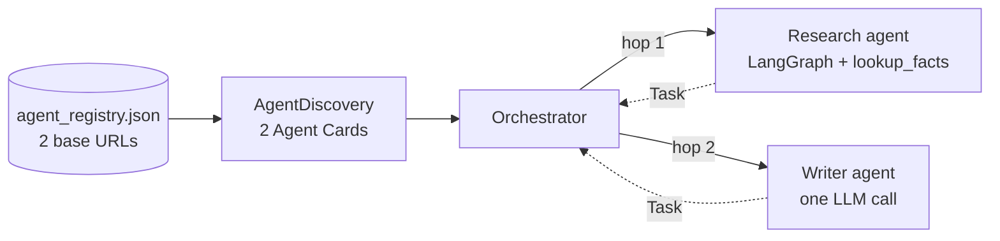
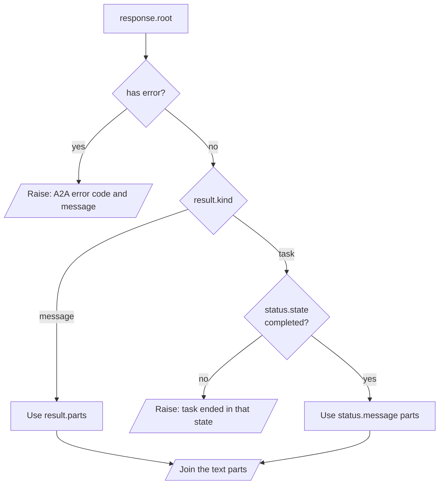

# M41.3 Theory: Cross-framework agent interop

*[M41 theory](../README.md) · Lesson 41.3 · Notebooks: [`03a_cross_framework_agent_interop.ipynb`](../../notebook/03a_cross_framework_agent_interop.ipynb) · [All theory pages](../../../../../THEORY.md)*
<!-- subtitle: Two agents that share no code can work in one pipeline when they share the card, the method and the reply objects; the hop between them breaks when the orchestrator misreads a Task -->
<!-- format: approved -->

## Start with two agents from two teams

> **What you'll learn**
>
> - **List** what two A2A agents must agree on, and what each may choose freely.
> - **Discover** agents from a registry of URLs and pick them by skill.
> - **Spot** the connector fault that forwards a Python repr instead of an answer.
> - **Read** a reply safely: errors first, then the reply kind, then the text.

A Larkspur support orchestrator needs two things for each ticket: the facts from the handbook, and a short reply a customer can read. The handbook agent belongs to the retrieval team and runs on LangGraph. The reply drafter belongs to the support writers, who want a single prompt and no framework at all. Neither team will import the other's code.

Notebook 03a builds that shape with a research agent and a writer agent. This lesson follows a topic through both hops and finds where the text going into hop 2 goes wrong.

## Cross-framework interop

### Two agents, one contract

The two-hop example serves two agents that share no code. The research agent is a LangGraph ReAct agent with one tool, `lookup_facts`, on port 10101. The writer agent is a single `get_llm(temperature=0.7).invoke(...)` call behind a copywriter prompt, with no graph and no tools, on port 10102. Each has its own `AgentExecutor` and its own Agent Card. An orchestrator reads a registry file listing the two base URLs, fetches both cards, sends a topic to the research agent (hop 1) and passes the research agent's output to the writer agent (hop 2).

<!-- animated: diagrams/two-hop.anim.html -->

*Figure 1: The two-hop example. Both agents reply with a Task.*

| Shared by both agents | Chosen by each team |
|---|---|
| The card's shape and the well-known card path | Framework: LangGraph for research, none for the writer |
| The `message/send` method | Prompt and persona |
| The Message and Task objects | Tools: `lookup_facts` for research, none for the writer |
| | Temperature: 0 for research, 0.7 for the writer |

*Table 1: The wire contract against everything else.*

The orchestrator imports none of the right-hand column. Replace the writer's single call with a CrewAI crew or a Google ADK agent, keep the card and the reply shape, and the orchestrator does not change.

On Larkspur Cloud the same layout is a support desk orchestrator, the handbook agent (the M28 to M31 agentic RAG graph, in LangGraph) as hop 1, and a reply drafter that turns the handbook answer into a customer email as hop 2. The drafter's team can pick any framework.

### Discovery from a registry

The registry holds URLs only. Capabilities come from each card at run time. A new agent joins by adding one URL, and a changed skill shows up without an orchestrator release. The notebook picks cards by `card.name`. Picking by skill (`id` or `tags`) survives a rename and lets two agents offer the same skill. The registry itself is a trust list: only agents on it get your traffic.

## Reading the reply

The orchestrator talks to both agents through an `AgentConnector` with one method, `send_task(message, session_id)`. How it reads the reply decides what hop 2 receives.

### The notebook's reader

The connector in notebook 03a does three things with a reply:

| Reply | What the connector does | What it returns |
|---|---|---|
| A Message | joins the text of every part in `result.parts` | the answer text |
| A Task | finds no `parts` attribute and falls back | `str(result)`, the Python repr of the whole Task |
| A JSON-RPC error | reading `result` raises `AttributeError`, caught by its `except` | the string `Error communicating with agent: 'JSONRPCErrorResponse' object has no attribute 'result'` |

*Table 2: The notebook's connector against each reply kind.*

Both executors in the example enqueue a Task before their answer. Every reply is therefore a Task, and a Task has no `parts`. The second row is the one that runs every time.

### Same Task, two readers

The [interactive lab](../02_a_langgraph_agent_over_a2a/interactive/a2a-exchange-lab.html) shows the result with the handbook agent from 41.2. Here is the same completed Task read both ways:

Choose a reader to see what the orchestrator forwards to hop 2 for the same completed Task.

<button type="button" data-mode="repr" aria-pressed="false" aria-controls="reader-repr">Notebook connector</button>
<button type="button" data-mode="status" aria-pressed="false" aria-controls="reader-status">Kind-aware reader</button>

<section id="reader-repr" class="mode-panel" data-announcement="Notebook connector selected. The writer receives the Task repr."><h4>Notebook connector</h4><ul><li>A Task has no <code>parts</code>; the connector returns the Python repr.</li><li>The lab's recording is 1,492 characters of <code>context_id=</code>, <code>history=[Message(</code> and <code>TaskStatus(</code> around the 185-character answer; our replay with full-length ids gave 1,509.</li><li>The writer, told to synthesise research notes, receives Pydantic field names as its notes.</li></ul></section>
<section id="reader-status" class="mode-panel" data-announcement="Kind-aware reader selected. The writer receives the answer."><h4>Kind-aware reader</h4><ul><li>It sees <code>kind</code> task and state <code>completed</code>, and reads the text parts of <code>status.message</code>.</li><li>The writer receives the 185-character answer and nothing else.</li></ul></section>

### A reader that branches on the kind

A reader that checks for an error first and then branches on the reply's kind fixes both faulty rows of Table 2:

*Figure 2: The kind-aware reader. Every failure raises; only answer text reaches the next hop.*

An agent that publishes its output as artifacts (`TaskUpdater.add_artifact`) puts it in `result.artifacts` instead; read those the same way.

### The session that never arrives

`send_task` takes a `session_id` and never sends it. Each hop gets a fresh `contextId`. The two hops of one ticket land in two unrelated conversations on the servers. To keep them together, set `context_id` on the outgoing `Message`; the server then files the new task under that context, as the follow-up in 41.2 did.

## Limits of this evidence

- **No model ran.** The repr lengths come from the 41.2 handbook agent with a stub graph; real research output changes the length but not the fault.
- **The repr length moves with the ids.** 1,492 is the lab's recording; full uuids give 1,509. The point is the field names, not the count.
- **Error path replayed in process.** The `AttributeError` string comes from reading `result` on a JSON-RPC error reply in `a2a-sdk` 0.3.26.

## References

1. A2A Protocol, [Specification](https://a2a-protocol.org/latest/specification/).
2. A2A Project, [a2a-python SDK](https://github.com/a2aproject/a2a-python).
3. A2A Project, [A2A samples](https://github.com/a2aproject/a2a-samples).
4. Pydantic, [Models](https://docs.pydantic.dev/latest/concepts/models/).

## Key Takeaways

- Agents built in different frameworks interoperate when they share the card shape, `message/send`, the Message and Task objects and the card path. The orchestrator imports none of their code.
- Keep only URLs in the registry and read capabilities from each card at run time. Pick agents by skill, and treat the registry as a trust list.
- Read replies carefully: check for an error first, branch on the reply's kind, and set `context_id` to keep hops in one conversation. Never forward `str(result)` as content.

## Check yourself

1. What must the research and writer agents agree on for one orchestrator to call both, and what may differ?

Four things: the card's shape, the `message/send` method, the Message and Task objects, and the well-known card path. Framework, prompt, tools and temperature may all differ, and the orchestrator imports none of them. A CrewAI crew could replace the writer without an orchestrator change.

2. The writer agent receives about 1,500 characters of field names and TaskStatus text instead of research notes. What went wrong in the connector?

Both executors enqueue a Task, and a Task has no `parts`, so `AgentConnector` falls through to `str(result)`, the Python repr of the whole Task around a 185-character answer. Check for an error first, then branch on `result.kind` and read the text parts of `result.status.message` for a task.

3. Why pick agents from the registry by skill id or tags rather than by card name, as the notebook does?

Picking by skill survives a rename and lets two agents offer the same skill. The registry holds URLs only and capabilities come from each card at run time, so a new agent joins by adding one URL. The registry is also a trust list: only agents on it get your traffic.

---
*Previous: [41.2 A LangGraph agent over A2A](../02_a_langgraph_agent_over_a2a/README.md). Next: [41.4 Capstone: agentic RAG with MCP and A2A](../04_capstone_agentic_rag_with_mcp_and_a2a/README.md).*
