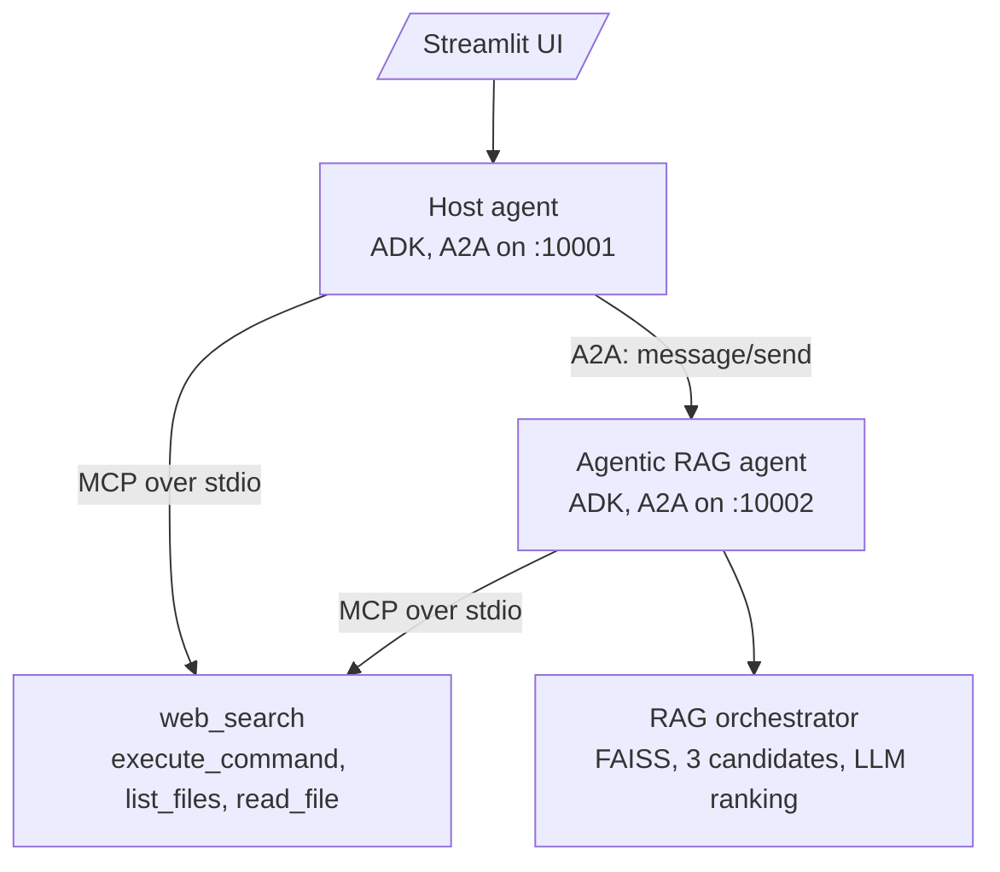
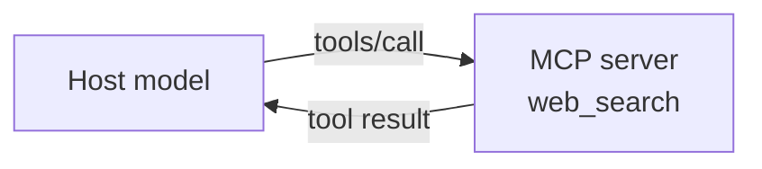
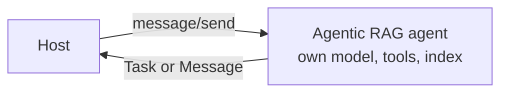

# M41.4 Theory: Capstone: agentic RAG with MCP and A2A

*[M41 theory](../README.md) · Lesson 41.4 · Notebooks: [`mcp_a2a_agentic_rag`](../../../projects/mcp_a2a_agentic_rag/README.md) (project) · [All theory pages](../../../../../THEORY.md)*
<!-- subtitle: The capstone host reaches tools over MCP and a document agent over A2A; two of its connectors turn failures into strings, so one golden question must be checked end to end -->
<!-- format: approved -->

## Start with a host that has two kinds of helper

> **What you'll learn**
>
> - **Separate** the capstone's two protocol boundaries: MCP to tools, A2A to another agent.
> - **Predict** where the host's keyword router sends a question, and where it misroutes.
> - **Trace** the document agent's multi-candidate retrieval from chunking to the chosen answer.
> - **Diagnose** the two connectors that fail without raising, and catch them with one smoke test.

Larkspur's support desk now wants one assistant that can answer from the handbook and also check live facts the handbook cannot know, such as whether a region is down. The handbook answers come from an agent another team owns. The live facts come from tools: a web search and a few read-only shell commands. The two need different protocols, and the assistant must not confuse an error from either with an answer.

The capstone project builds that assistant. This lesson separates its two boundaries and then tests what happens when one of them fails.

## MCP + A2A

The capstone runs two Google ADK agents, each behind its own A2A server, and gives both of them MCP tools. It runs in its own environment (its `requirements.txt`), with a Gemini model (`gemini-2.0-flash-exp` in `model.py`) and a Streamlit UI.

*Figure 1: The capstone's agents, servers and tools.*

### Two boundaries

Over MCP, the host calls a tool and its own model reasons over the result:

*Figure 2: The MCP boundary. One call, one result, and the host's model does the thinking.*

Over A2A, the host hands the whole question to another agent, which has its own model, tools and state:

*Figure 3: The A2A boundary. The host gets an answer, not raw material.*

| | MCP | A2A |
|---|---|---|
| Connects | An agent to tools and data | An agent to another agent |
| In the capstone | `mcp_config.json` starts two servers as subprocesses over stdio: `web_search` (SerpAPI) and `terminal` (`execute_command` from an allow-list, `list_files`, `read_file`) | The host reads `agent_registry.json` (one URL, `http://localhost:10002`), fetches the RAG agent's card and delegates to it |
| The caller gets | A tool result, which its own model reasons over | An answer from an agent with its own model, tools and state |
| Lifetime | One call | A Task, with states, that can be polled, streamed or cancelled |

*Table 1: The two protocols in the capstone.*

On Larkspur Cloud, the host is the support desk, the RAG agent holds the handbook, and the MCP web search answers what the handbook cannot. *Can I export my data after I cancel my plan?* belongs with the handbook agent over A2A; *Is the Frankfurt region down right now?* belongs with a tool over MCP.

### The host's routing

The host is an orchestrator, as in 41.3, with four function tools (`_list_agents`, `_delegate_task`, `_smart_delegate_to_rag`, `_get_model_info`) next to the MCP toolsets. It does not always ask its model where to send a question. Before the model runs, `_is_document_question` checks the text against 19 keyword phrases written for résumés and PDFs, such as `resume`, `pdf`, `file` and `tell me about`; on a match the host calls the RAG agent directly and returns its reply.

Choose a question to see where the keyword check sends it before the host's model is asked.

<button type="button" data-mode="outage" aria-pressed="false" aria-controls="route-outage">AWS outage</button>
<button type="button" data-mode="profile" aria-pressed="false" aria-controls="route-profile">Billing profile</button>
<button type="button" data-mode="export" aria-pressed="false" aria-controls="route-export">Export after cancelling</button>

<section id="route-outage" class="mode-panel" data-announcement="AWS outage selected. Misrouted to the document agent."><h4>Tell me about today's AWS outage</h4><ul><li>Matches <code>tell me about</code>.</li><li>Goes straight to the document agent, though only the web can answer it.</li></ul></section>
<section id="route-profile" class="mode-panel" data-announcement="Billing profile selected. Misrouted by a substring."><h4>How do I update my billing profile?</h4><ul><li>Matches <code>file</code>, inside the word profile.</li><li>Goes to the document agent; right destination for Larkspur, but by accident.</li></ul></section>
<section id="route-export" class="mode-panel" data-announcement="Export selected. No keyword, the model decides."><h4>Can I export my data after I cancel my plan?</h4><ul><li>Matches none of the 19 phrases.</li><li>Goes to the host's model, which must choose to delegate through <code>_delegate_task</code> or <code>_smart_delegate_to_rag</code>.</li></ul></section>

Keyword routing is fast and predictable, and it misroutes: substring matches ignore word boundaries, and a list written for one corpus misses another's questions. Model routing reads intent but costs a call and can still choose wrongly. Weigh that before skipping the model's decision.

### The document agent's retrieval

The RAG agent answers with multi-candidate retrieval, the agentic RAG of M28 to M32, now behind an A2A card instead of inside one graph.

Step through one document question inside the RAG agent's orchestrator.

<button type="button" data-step="0" aria-pressed="false" aria-controls="rag-step-0">1. Index</button><button type="button" data-step="1" aria-pressed="false" aria-controls="rag-step-1">2. Retrieve</button><button type="button" data-step="2" aria-pressed="false" aria-controls="rag-step-2">3. Answer</button><button type="button" data-step="3" aria-pressed="false" aria-controls="rag-step-3">4. Rank</button><button type="button" data-step="4" aria-pressed="false" aria-controls="rag-step-4">5. Decide</button>

<section id="rag-step-0" class="step-panel" aria-labelledby="rag-heading-0"><h4 id="rag-heading-0">1. Index the PDF</h4><dl><dt>Chunks</dt><dd>500 tokens of tiktoken <code>cl100k_base</code>, 50 tokens of overlap</dd><dt>Index</dt><dd>FAISS <code>IndexFlatL2</code></dd></dl></section><section id="rag-step-1" class="step-panel" aria-labelledby="rag-heading-1"><h4 id="rag-heading-1">2. Retrieve three candidate sets</h4><dl><dt>How</dt><dd>add Gaussian noise (standard deviation 0.01) to the query embedding three times</dd><dt>Each</dt><dd>top 5 chunks</dd></dl></section><section id="rag-step-2" class="step-panel" aria-labelledby="rag-heading-2"><h4 id="rag-heading-2">3. Answer each set</h4><dl><dt>How</dt><dd>three answers generated in parallel, one per candidate set</dd></dl></section><section id="rag-step-3" class="step-panel" aria-labelledby="rag-heading-3"><h4 id="rag-heading-3">4. Pick the best</h4><dl><dt>How</dt><dd>the model judges the three answers with their contexts and names one</dd><dt>Fallback</dt><dd>an unreadable ranking returns the first candidate</dd></dl></section><section id="rag-step-4" class="step-panel" aria-labelledby="rag-heading-4"><h4 id="rag-heading-4">5. Decide on a web search</h4><dl><dt>Prompt</dt><dd>the model replies SUFFICIENT, or SEARCH_NEEDED with a query</dd><dt>Sufficient</dt><dd>the chosen document answer is returned as it is</dd></dl></section>

<button type="button" data-walk="previous">Previous</button>

<button type="button" data-walk="next">Next step</button>

## What the capstone needs to run

The project's code runs, but two of its paths fail without raising. Both are known bugs, listed here so the symptoms make sense.

### The A2A hop returns an error as an answer

`utilities/a2a/agent_connect.py` builds `A2AClient(base_url=self.agent_card.base_url, ...)` and calls `client.send_request(...)`. In `a2a-sdk` 0.3.26 `AgentCard` has no `base_url`, and `A2AClient` takes `agent_card` or `url` and has `send_message` but no `send_request`. Run against 0.3.26, `send_task` catches the error and returns the string `Error communicating with agent: 'AgentCard' object has no attribute 'base_url'`.

The host passes that string on as the RAG agent's answer: to its model through `_delegate_task`, or, for a keyword-routed question, straight to the user. `_smart_delegate_to_rag` only checks the reply for phrases such as `no documents`, and an error string contains none of them. The connector in notebook 03a uses the current API; combine it with the kind-aware reader from 41.3.

### The RAG agent's own web search goes nowhere

Besides the MCP tools ADK loads, `rag_orchestrator.py` has a `WebSearchAgent` that posts a JSON-RPC request with method `search` to `http://localhost:8000` (or `MCP_ENDPOINT`). Nothing in the project listens there, and `search` is not an MCP method (MCP calls a tool with `tools/call`). When the decision step asks for a web search, the final prompt receives `[WebSearchAgent] Failed to obtain web data.` as its web context, and the model answers anyway.

One smaller point: `pyproject.toml` lists `a2a-python` where `requirements.txt` lists `a2a-sdk>=0.3.0`; install from `requirements.txt`.

### One golden question through both boundaries

Both failures look like answers. A smoke test that sends one handbook question through the host and checks that the reply contains handbook text, not `Error communicating`, catches the first on the first run. A second question that forces a web search, checked for anything other than `Failed to obtain web data`, catches the other.

## Limits of this evidence

- **Read from the code, not run end to end.** The project needs Gemini and SerpAPI keys; its routing, retrieval settings and connector calls are read from the current source, and the `base_url` error text was reproduced against `a2a-sdk` 0.3.26.
- **The keyword results are a replay.** We ran the 19 phrases from `_is_document_question` on the three questions above; a real host's model behaves differently on the questions it does see.
- **Multi-candidate quality is unmeasured.** Nothing here shows that three noisy retrievals and a ranking beat one retrieval on this corpus.

## References

1. A2A Protocol, [Specification](https://a2a-protocol.org/latest/specification/).
2. Model Context Protocol, [Specification 2025-11-25](https://modelcontextprotocol.io/specification/2025-11-25).
3. Google, [Agent Development Kit documentation](https://google.github.io/adk-docs/).
4. Meta, [FAISS documentation](https://faiss.ai/).

## Key Takeaways

- Use MCP to connect an agent to tools and data, returning one result its own model reasons over. Use A2A to delegate to another agent with its own model, tools and state.
- Keyword routing is fast and predictable but misroutes questions that share words with another domain. Weigh that before skipping the model's routing decision.
- Connectors that turn failures into strings pass errors on as answers. Run one golden question end to end and check for real content before trusting the system.

## Check yourself

1. In the capstone, when does the host use MCP and when does it use A2A?

MCP connects it to tools and data: `web_search` and `terminal`, started over stdio, return a tool result that the host's own model reasons over, and each use lasts one call. A2A connects it to another agent: the host reads `agent_registry.json`, fetches the RAG agent's card and delegates, getting an answer from an agent with its own model, tools and state, tracked as a Task that can be polled, streamed or cancelled.

2. A user asks the host to tell me about today's AWS outage. Where does the question go, and is that right?

To the RAG agent. `_is_document_question` matches the phrase `tell me about`, so the host calls the document agent directly, though only the web can answer. Keyword routing is fast and predictable, and it misroutes.

3. Under a2a-sdk 0.3.26 every document question comes back as a reply starting Error communicating with agent. What is wrong, and what catches it early?

`agent_connect.py` builds `A2AClient(base_url=self.agent_card.base_url, ...)` and calls `send_request`, but `AgentCard` has no `base_url` and `A2AClient` has `send_message`, not `send_request`. `send_task` returns the error string and the host passes it on as the answer. A smoke test that sends one golden question and checks for handbook text, not `Error communicating`, catches it on the first run.

---
*Previous: [41.3 Cross-framework agent interop](../03_cross_framework_agent_interop/README.md). Next: [M41 interview questions](../README.md#interview-spotlight-5-questions-you-might-get-asked).*
