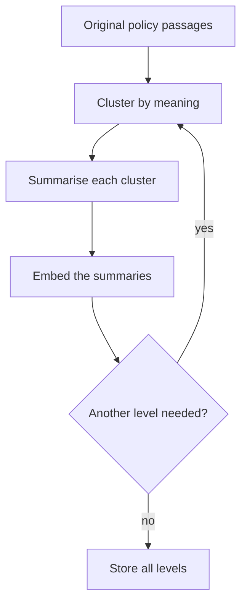
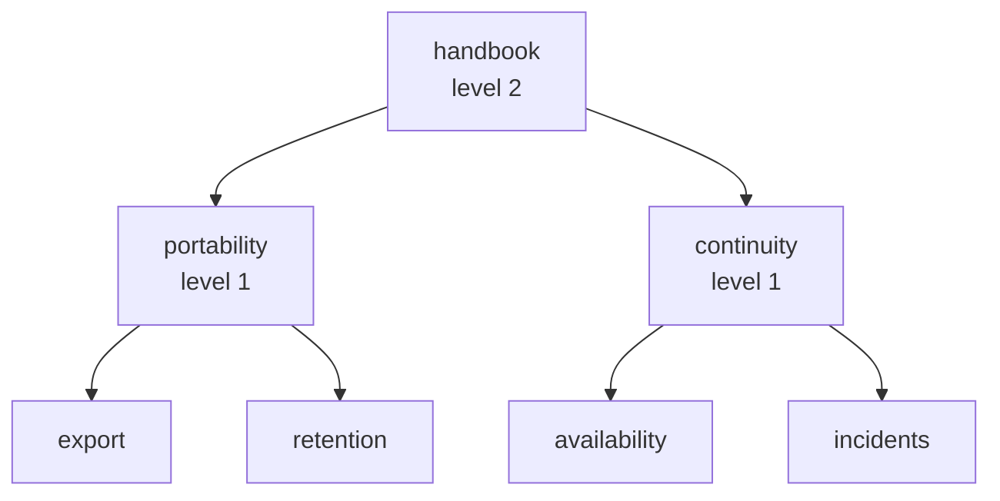
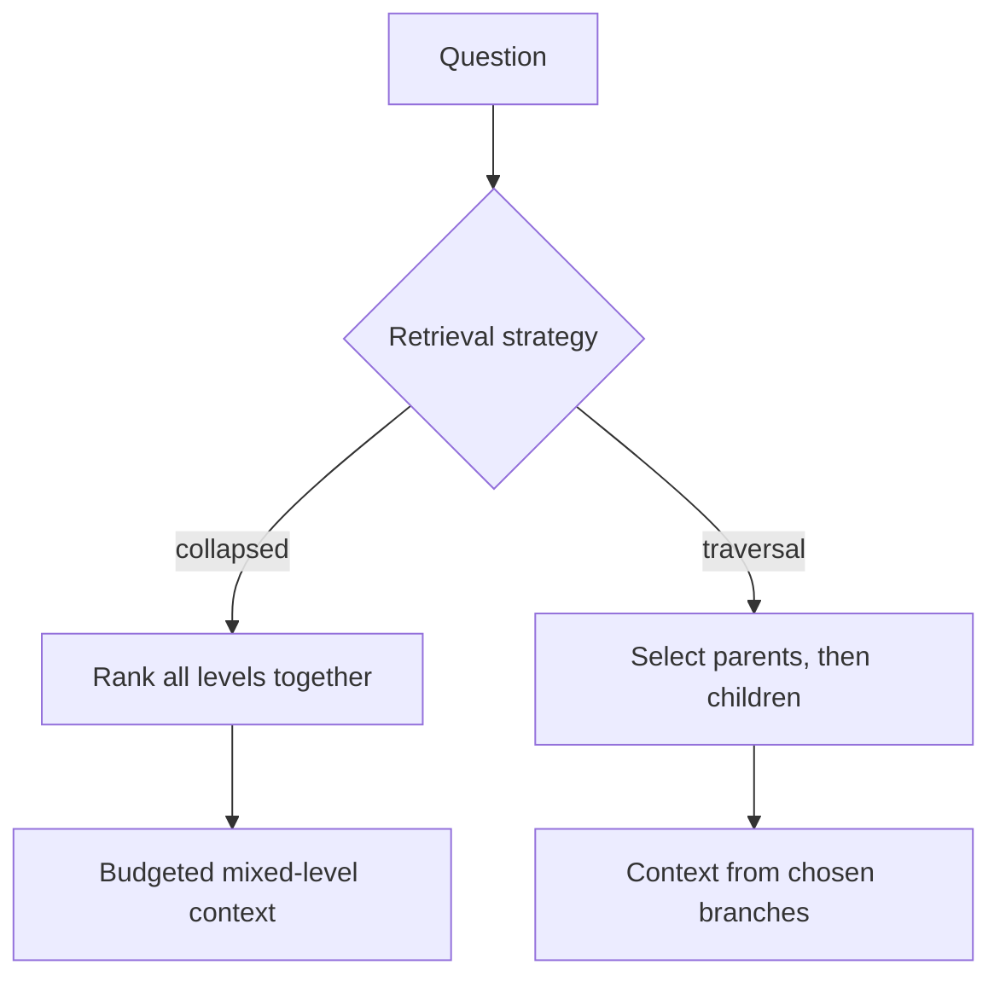
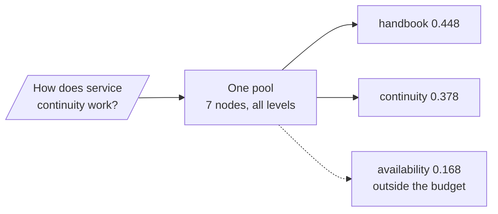
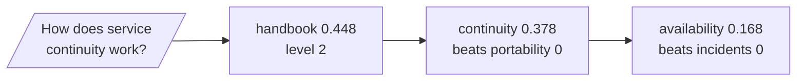

# M42.1 Theory: RAPTOR: clustering and recursive summarisation

*[M42 theory](../README.md) · Lesson 42.1 · Notebooks: [`01a_raptor.ipynb`](../../notebook/01a_raptor.ipynb) · [All theory pages](../../../../../THEORY.md)*
<!-- subtitle: How a tree of summaries lets one index answer both a theme question and a precise policy question, and where the summaries mislead -->
<!-- format: approved -->

## Start with a question no single passage answers

> **What you'll learn**
>
> - **Explain** why a passage index struggles with a question about a theme that spans several sections.
> - **Trace** how RAPTOR builds summary levels by clustering, summarising and repeating.
> - **Compare** collapsed-tree retrieval with top-down tree traversal on the same question.
> - **Diagnose** a summary that reaches the right sources and still drops the condition a customer asked about.

[M10](../../../../../p04_rag_foundations/m10_rag_lifecycle/mandatory/theory/README.md) built the flat baseline: split the handbook into passages, score each passage against the question, keep the top few. That works when one passage holds the answer.

A Larkspur Cloud operations lead asks *How does service continuity work?* The handbook never answers that in one place. Availability guarantees and outage credits sit in the SLA section, status updates in the outages section, and data protection in export and retention. A flat index scores each passage against the word "continuity", and most of them never use it.

The failure is a scoring problem. A theme is spread across passages, and no passage is about the theme as a whole. RAPTOR (Recursive Abstractive Processing for Tree-Organized Retrieval) adds new text to the index: summaries that are about the theme.

## Abstraction levels

**An abstraction level is one layer of text in the index, from the original passages at level 0 up through summaries of summaries.** A passage keeps the exact wording; a summary connects claims across passages; a summary of summaries names a broad theme.

| Level | Larkspur example | Answers |
|---|---|---|
| 0, passage | The export procedure: Settings, then Data | Where to click |
| 1, summary | Cancellation joins export, retention and billing | What happens when a plan ends |
| 2, summary of summaries | Continuity across cancellation and outages | How the handbook protects the customer |

*Table 1: One handbook at three abstraction levels.*

RAPTOR builds the levels bottom up. It embeds the current texts, groups them by meaning, writes one summary per group, then treats those summaries as the texts for the next round:

*Figure 1: The RAPTOR build loop. Each round clusters the current level and summarises every cluster into the next one.*

The notebook runs this loop over a 33-page climate report, one page per level-0 text. It clusters with a Gaussian mixture model, asks `gpt-4o-mini` to summarise each cluster, and stops after at most three rounds. Each round allows half as many clusters as it has texts, capped at 10:

| Round | Texts in | Clusters allowed | Summaries out, at most |
|---|---|---|---|
| 1 | 33 pages | min(10, 16) = 10 | 10 |
| 2 | up to 10 | min(10, 5) = 5 | 5 |
| 3 | up to 5 | min(10, 2) = 2 | 2 |

*Table 2: The tree's shape from the notebook's cluster rule. Actual counts can be lower when a mixture component receives no text.*

The notebook puts each text in exactly one cluster. That is a teaching simplification: the [RAPTOR paper](https://arxiv.org/abs/2401.18059) (Sarthi et al., 2024) uses soft clustering, where one passage can feed several summaries.

The lab's fixture is the smallest tree that shows the idea: four authored passages, two level-1 summaries and one level-2 summary, each summary listing the passages it descends from.

*Figure 2: The lab's fixture tree. The summaries are written by hand and labelled representative; no clustering runs in the browser.*

Each node needs more than its text. Store its level, the identifiers and versions of the passages it summarises, and its children. With those fields a retrieved summary leads back to its evidence, and a changed passage marks every ancestor for rebuilding.

A summary can be accurate overall and still drop the one exception a customer asks about. Call that **lossy compression**: the summary's sources cover the policy, but its text no longer carries the condition. Follow the summary back to its passages before quoting a condition or a number.

The notebook's metadata cannot support that walk yet. Its level-0 records hold `level`, `origin` and `parent_id` but no `id`, and each first-level summary builds `child_ids` by reading that missing field. Every first-level summary points at children with no identifier. Treat the notebook's tree as a sketch of the structure, not as verified provenance.

## Collapsed-tree retrieval

**Collapsed-tree retrieval puts every node, passages and summaries alike, into one pool, scores them all against the question and keeps the best within a budget.** The mix of levels then follows the question: a theme question pulls summaries, a procedure question pulls passages.

**Tree traversal** works the other way. It picks the best nodes at the top level, then searches only their children, and so on down. One early wrong branch excludes every leaf beneath the other branches.

*Figure 3: Two ways to search a tree. Collapsed search ranks every level at once; traversal commits to parents before it sees their children.*

Run both on the fixture with the continuity question, using the lab's TF-IDF scores. Collapsed search at a budget of two ranks all seven nodes and keeps the two summaries:

*Figure 4: Collapsed search on the fixture. Two summaries fill the budget and reach all four source identifiers.*

Traversal with one branch per level takes the root, the better child, then that child's better leaf:

*Figure 5: Traversal on the fixture, one branch per level. Hand-computed from the lab's scores; the lab has no traversal mode.*

On this tree both reach the continuity branch, and traversal also returns a passage. The difference shows when a parent summary misses the question's words: traversal never sees the leaves beneath it, while collapsed search can still rank them. Pick collapsed search as the default, and keep traversal for trees whose summaries are known to name their children's vocabulary.

The notebook stores every level in one FAISS index, which makes collapsed search possible. Its query helper does something in between. Step through it:

The notebook's <code>hierarchical_retrieval</code> for one question, read from its code and checked with a pass-through compressor and fake embeddings (langchain-community 0.4.2). No model ran.

<button type="button" data-step="0" aria-pressed="false" aria-controls="rq-step-0">1. Top level</button><button type="button" data-step="1" aria-pressed="false" aria-controls="rq-step-1">2. Child filter</button><button type="button" data-step="2" aria-pressed="false" aria-controls="rq-step-2">3. Level 1</button><button type="button" data-step="3" aria-pressed="false" aria-controls="rq-step-3">4. Passages and answer</button>

<section id="rq-step-0" class="step-panel" aria-labelledby="rq-heading-0"><h4 id="rq-heading-0">1. Search the top level</h4><dl><dt>Runs</dt><dd>The compression retriever with a filter on <code>level == 3</code>. The filter reaches FAISS: a probe returned only nodes of the requested level.</dd><dt>Returns</dt><dd>Up to four nodes, each rewritten by one extraction call. If the third round ended with two summaries, level 3 was never stored and nothing comes back.</dd></dl></section><section id="rq-step-1" class="step-panel" aria-labelledby="rq-heading-1"><h4 id="rq-heading-1">2. Append the children to the query</h4><dl><dt>Runs</dt><dd>The hits' <code>child_ids</code> become the text <code>AND id:(summary_2_0 OR …)</code>, appended to the question</dd><dt>Effect</dt><dd>The longer question is embedded as it stands. Nothing filters by identifier or joins parents to children.</dd></dl></section><section id="rq-step-2" class="step-panel" aria-labelledby="rq-heading-2"><h4 id="rq-heading-2">3. Search level 2, then level 1</h4><dl><dt>Runs</dt><dd>The same retriever, the next level's filter and the extended question</dd><dt>At level 1</dt><dd>Every child identifier is missing, so the question stops growing</dd></dl></section><section id="rq-step-3" class="step-panel" aria-labelledby="rq-heading-3"><h4 id="rq-heading-3">4. Passages, then one answer</h4><dl><dt>Runs</dt><dd>Level 0 with the extended question, then one answer call over every node from every level</dd><dt>Cost</dt><dd>Up to 16 retrieved nodes and 17 model calls per question: one extraction per node plus the answer</dd></dl></section>

<button type="button" data-walk="previous">Previous</button>

<button type="button" data-walk="next">Next step</button>

Check the identifiers of the nodes you get back before calling this a constrained traversal. The notebook also defines a real traversal that filters children by parent identifier. It is never called, and it would fail as written: it calls `similarity_search_by_vector_with_relevance_scores` and `docstore.values()`, neither of which exists in langchain-community 0.4.2.

The [interactive lab](interactive/collapsed-tree-lab.html) isolates the change that matters here: adding summary nodes to the pool. It scores the fixture with real TF-IDF cosine similarity, one vocabulary fitted over all seven nodes. Leaf-only mode keeps level 0; collapsed mode keeps everything.

<!-- lab: interactive/collapsed-tree-lab.html -->

At a budget of two nodes, the lab computes these results:

| Question | Candidate pool | Positive hits | Summary hits | Source identifiers reached | Context words |
|---|---|---|---|---|---|
| Service continuity | Leaves only | 1 | 0 | 1 | 16 |
| Service continuity | All levels | 2 | 2 | 4 | 24 |
| Export steps | Leaves only | 2 | 0 | 2 | 37 |
| Export steps | All levels | 2 | 0 | 2 | 37 |

*Table 3: Leaf-only against collapsed retrieval at two nodes. Scores checked against scikit-learn's TfidfVectorizer.*

For continuity, only the availability passage matches, at 0.168. With summaries in the pool, handbook (0.448) and continuity (0.378) take both places. For export steps, the export passage scores 0.387 and no summary makes the top two.

Reaching four source identifiers describes ancestry. It does not mean the context holds the source passages. The lab's third question shows the gap:

| Question at two nodes | Leaves only | All levels | What changed |
|---|---|---|---|
| When is cancelled data permanently deleted? | retention, export (37 words) | retention, portability (40 words) | The portability summary replaces the export passage |

*Table 4: Planted failure in the lab. The summary that enters has no "30 days" in its text.*

The retention passage still ranks first, at 0.594, and the answer survives here. The pattern is what to watch: a summary that matches the question's vocabulary takes a slot a passage held. Call it **summary displacement**. At a tighter budget, lossy compression would decide the answer.

The notebook build has its own planted failures, one per missing guard:

| Input | What the notebook does | Why |
|---|---|---|
| A summary's children | Records them with no identifier | Level-0 records have no `id` field |
| A single input text | Stops with a parameter error | Half of 1 is 0 clusters, and the mixture model needs at least 1 |
| A third round with two summaries | Keeps levels 0 to 2 and discards the top two summaries | Only a round that ends with one summary is stored |
| A child filter | Adds words to the query | The `AND id:` text is embedded, not applied |

*Table 5: Planted failures in the notebook's RAPTOR build.*

None of them changes the idea. For the Larkspur handbook: keep passages as level 0 with stable identifiers and versions; store each summary's sources, versions and children; search all levels at a fixed budget and log each hit's level; add a summary's source passages before quoting a condition; rebuild every ancestor when a passage changes. To evaluate, compare flat retrieval, the tree and graph retrieval at the same final budget, and count indexing calls apart from query calls.

Lesson 42.2 replaces the summary tree with a different derived representation: a memory of the corpus that writes search clues.

## Limits of this evidence

- **Fixture scale.** Tables 3 and 4 and Figures 4 and 5 come from seven hand-written nodes and TF-IDF. Embedding scores on a real handbook rank differently, and a real tree has more branches to choose wrongly between.
- **No model ran.** The notebook's tree, summaries and answers were not regenerated. The query path was checked with fake embeddings and a pass-through compressor; the failures in Table 5 were read from the code.
- **Hand-computed traversal.** Figure 5 applies one branch per level to the lab's scores. The paper's traversal keeps several nodes per level.

## References

1. Sarthi, P. et al. (2024). *RAPTOR: Recursive Abstractive Processing for Tree-Organized Retrieval*. [arXiv:2401.18059](https://arxiv.org/abs/2401.18059).
2. scikit-learn, [GaussianMixture](https://scikit-learn.org/stable/modules/generated/sklearn.mixture.GaussianMixture.html), the clustering model the notebook uses.
3. scikit-learn, [TfidfVectorizer](https://scikit-learn.org/stable/modules/generated/sklearn.feature_extraction.text.TfidfVectorizer.html), the scoring the lab reproduces.

## Key Takeaways

- RAPTOR clusters passages, summarises each cluster and repeats, so one index holds both exact wording and broad themes. Store each node's level, sources, versions and children with its text.
- Collapsed-tree retrieval ranks all levels in one pool and lets the mix follow the question; top-down traversal can lose a relevant leaf to an early wrong branch.
- A summary can reach the right sources and still drop the condition asked about. Follow it back to its passages before quoting a condition or number, and watch for summaries displacing passages at a tight budget.

## Check yourself

1. Why does collapsed-tree retrieval rank every level together instead of selecting parents first and then searching their children?

Ranking every level in one pool lets the mix of passages and summaries follow the question. Traversal commits to parents before it sees their children, and one early wrong branch excludes every leaf beneath the others. The notebook stores all levels in one FAISS index, which is what makes the collapsed search possible.

2. In the lab at a budget of two nodes, what changes when summaries join the pool for the continuity question and for the export question?

For continuity, the two summaries replace the availability passage: summary hits go from 0 to 2, source identifiers reached from 1 to 4, and context from 16 to 24 words. For export steps nothing changes: the same two passages and 37 words. Reaching more source identifiers describes ancestry, not a better answer.

3. A customer asks for the exact data-deletion condition, and the top hit is a summary linked to the retention passage. Can you quote the condition from the summary?

No. A summary can cover the right sources and still drop the condition, which is lossy compression; in the lab the portability summary has no "30 days" in its text. Follow the summary back to the retention passage and quote that. In the notebook build, the first-level child links have no identifiers, and its tree cannot yet support that walk.

---
*Previous: [M42 overview](../README.md). Next: [42.2 MemoRAG: global memory and clue-guided retrieval](../../../optional/theory/02_memorag_global_memory_and_clue_guided_retrieval/README.md).*
