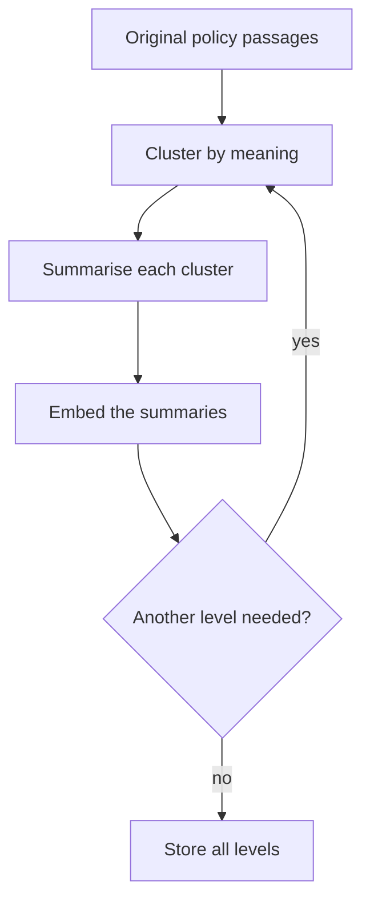
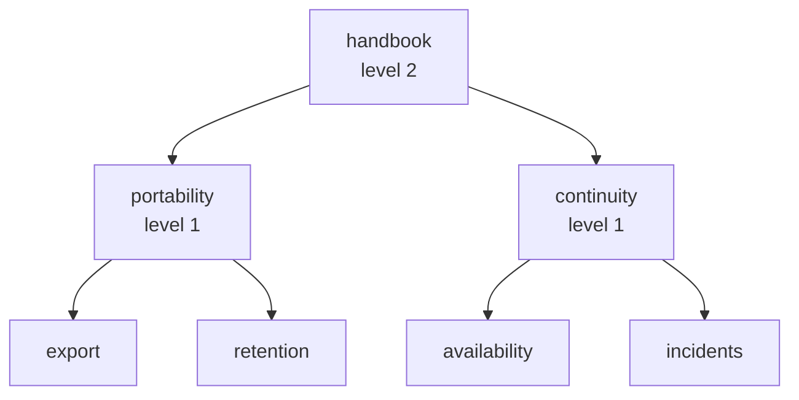
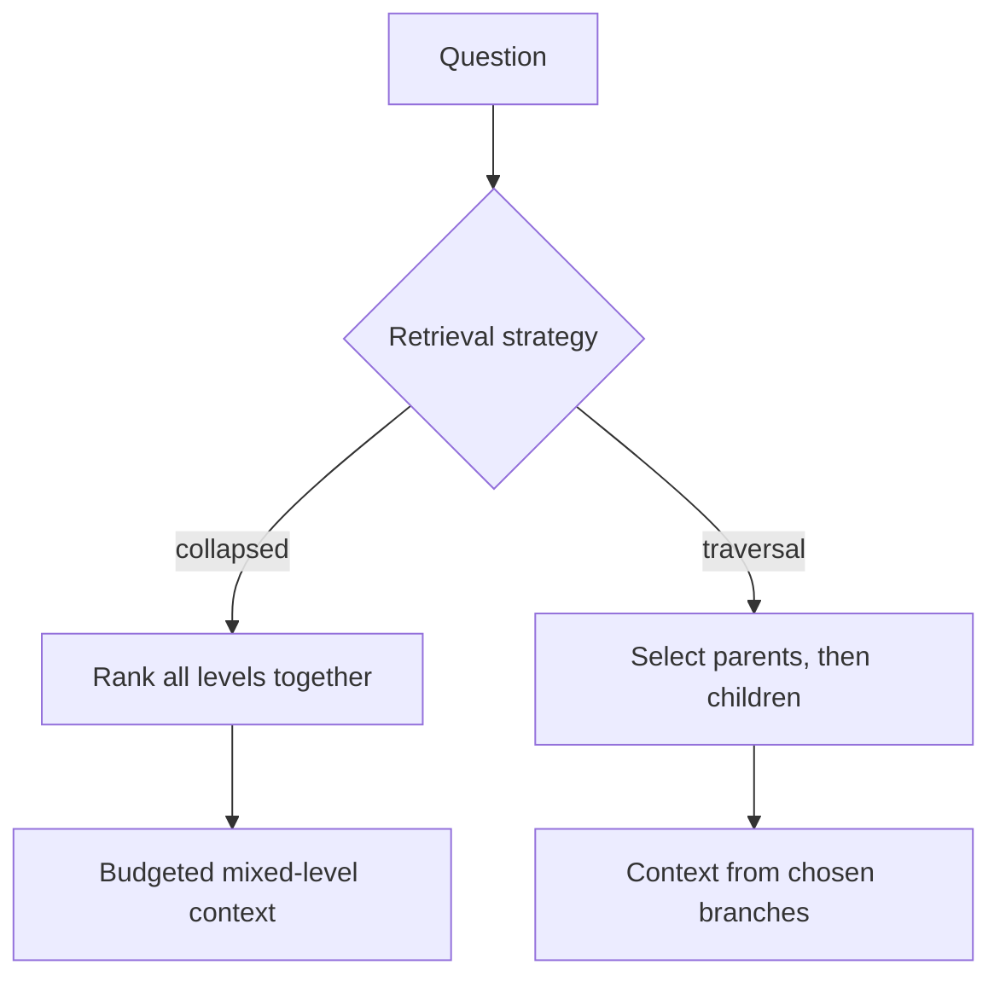

# M42.1 Theory: RAPTOR: clustering and recursive summarisation

*[M42 theory](../README.md) · Lesson 42.1 · Notebooks: [`01a_raptor.ipynb`](../../notebook/01a_raptor.ipynb) · [All theory pages](../../../../../THEORY.md)*
<!-- subtitle: How a tree of summaries lets one index answer both a theme question and a precise policy question, and where the summaries mislead -->

## Questions no single chunk answers

> **What you'll learn**
>
> - **Explain** why a passage index struggles with a question about a theme that spans several sections.
> - **Trace** how RAPTOR builds summary levels by clustering, summarising and repeating.
> - **Compare** collapsed-tree retrieval with top-down tree traversal under the same context budget.
> - **Diagnose** a summary that reaches the right sources and still drops the condition a customer asked about.

[M10](../../../../../p04_rag_foundations/m10_rag_lifecycle/mandatory/theory/README.md) built the flat baseline: split the handbook into passages, score each passage against the question, keep the top few. That works when one passage holds the answer. This module asks what to do when no single passage does.

An operations lead at Larkspur Cloud asks *How does service continuity work?* The handbook never answers that in one place. Availability guarantees and outage credits sit in the SLA section, status updates in the outages section, and data protection in export and retention. A flat index scores each of those passages against the word "continuity", and most of them never use it.

The failure is a scoring problem. A theme is spread across passages, and no passage is about the theme as a whole. RAPTOR (Recursive Abstractive Processing for Tree-Organized Retrieval) answers it by adding new text to the index: summaries that are about the theme. The rest of this page covers how those summaries are built, how retrieval searches them, and how they mislead.

## Abstraction levels

**An abstraction level is one layer of text in the index, from the original passages at level 0 up through summaries of summaries.** Each level answers a different kind of question. A passage keeps the exact wording; a summary connects claims across passages; a summary of summaries names a broad theme.

The same handbook at three levels looks like this:

| Level | Larkspur example | Answers |
|---|---|---|
| 0, passage | The export procedure: Settings, then Data | Where to click |
| 1, summary | Cancellation joins export, retention and billing | What happens when a plan ends |
| 2, summary of summaries | Continuity across cancellation and outages | How the handbook protects the customer |

*Table 1: One handbook at three abstraction levels.*

RAPTOR builds the levels bottom up. It embeds the current texts, groups them into clusters by meaning, writes one summary per cluster, then treats those summaries as the texts for the next round:

*Figure 1: The RAPTOR build loop. Each round clusters the current level and summarises every cluster into the next one.*

The notebook builds this loop over a 33-page climate report, one page per level-0 text. It clusters with a Gaussian mixture model, asks a chat model to summarise each cluster, and stops after at most three rounds. The number of clusters per round is half the number of texts, capped at 10. That rule sets an upper bound on the tree's shape:

| Round | Texts in | Clusters allowed | Summaries out, at most |
|---|---|---|---|
| 1 | 33 pages | min(10, 16) = 10 | 10 |
| 2 | up to 10 | min(10, 5) = 5 | 5 |
| 3 | up to 5 | min(10, 2) = 2 | 2 |

*Table 2: The tree's shape from the notebook's cluster rule. Actual counts can be lower when a mixture component receives no text.*

The notebook assigns each text to exactly one cluster. That is a teaching simplification: the [RAPTOR paper](https://arxiv.org/html/2401.18059v1) (Sarthi et al., 2024) uses soft clustering, where one passage can feed several summaries, and it describes both search strategies covered in the next section.

The lab's fixture is the smallest tree that shows the idea. It has four authored passages, two level-1 summaries and one level-2 summary, with each summary listing the source passages it descends from:

*Figure 2: The lab's fixture tree. The summaries are written by hand and labelled representative; no clustering runs in the browser.*

Each node needs more than its text. Store its level, the identifiers and versions of the passages it summarises, and its children. With those fields a retrieved summary can lead back to its evidence, and a changed passage can mark every ancestor for rebuilding.

A summary can be accurate overall and still drop the one exception a customer asks about. Call that **lossy compression**: the summary's sources cover the policy, but its text no longer carries the condition. For a policy answer, follow the summary back to its passages before quoting a condition or a number.

The notebook's metadata does not support that walk yet. Its level-0 records hold `level`, `origin` and `parent_id` but no `id`, and each summary builds its `child_ids` by reading that missing field. Every first-level summary therefore points at children with no identifier. Treat the notebook's tree as a sketch of the structure, not as verified provenance.

With levels in place, the next question is how retrieval chooses among them.

## Collapsed-tree retrieval

**Collapsed-tree retrieval puts every node, passages and summaries alike, into one pool, scores them all against the question and keeps the best within a budget.** The mix of levels in the context then follows the question: a theme question pulls summaries, a procedure question pulls passages.

**Tree traversal** works the other way. It picks the best nodes at the top level, then searches only their children, and so on down. One early wrong branch excludes every leaf beneath the other branches:

*Figure 3: Two ways to search a tree. Collapsed search ranks every level at once; traversal commits to parents before it sees their children.*

The notebook stores every level in one FAISS index, which is what makes collapsed search possible. Its query helper then walks the levels from the top down, passing a level filter that FAISS does apply, and returns up to four nodes per level. After each level it appends the text `AND id:(…)` with the chosen children to the query string. That text changes the query that gets embedded; it does not filter by identifier or join parents to children. Check the identifiers of the nodes you get back before calling this a constrained traversal. A compression step then rewrites each retrieved node to the parts a model judges relevant, one more transformation whose output needs a source check.

The notebook also defines a proper traversal function that filters children by parent identifier. It is never called, and it would fail as written: it calls a FAISS method that the installed library does not provide.

The [interactive lab](interactive/collapsed-tree-lab.html) isolates the one change that matters here: adding summary nodes to the pool. It scores the fixture of Figure 2 with real TF-IDF cosine similarity, one vocabulary fitted over all seven nodes. Leaf-only mode keeps level 0; collapsed mode keeps everything.

<!-- lab: interactive/collapsed-tree-lab.html -->

At a budget of two nodes, the lab computes these results for its first two questions:

| Question | Candidate pool | Positive hits | Summary hits | Source identifiers reached | Context words |
|---|---|---|---|---|---|
| Service continuity | Leaves only | 1 | 0 | 1 | 16 |
| Service continuity | All levels | 2 | 2 | 4 | 24 |
| Export steps | Leaves only | 2 | 0 | 2 | 37 |
| Export steps | All levels | 2 | 0 | 2 | 37 |

*Table 3: Leaf-only against collapsed retrieval at two nodes. Scores checked against scikit-learn's TfidfVectorizer.*

For continuity, the only passage that matches is availability, at a score of 0.168. With summaries in the pool, the handbook summary (0.448) and the continuity summary (0.378) take both places and reach all four source identifiers. For export steps, the export passage scores 0.387 and no summary makes the top two, leaving the context unchanged.

Reaching four source identifiers describes ancestry. It does not mean the context holds the source passages, and it says nothing about the answer a model would write. The lab's third question shows the gap:

| Question at two nodes | Leaves only | All levels | What changed |
|---|---|---|---|
| When is cancelled data permanently deleted? | retention, export (37 words) | retention, portability (40 words) | The portability summary replaces the export passage |

*Table 4: Planted failure in the lab. The summary that enters has no "30 days" in its text.*

The retention passage still ranks first, and the answer survives here. The pattern is what to watch: a summary that matches the question's vocabulary takes a slot a passage held. Call it **summary displacement**. At a tighter budget, or with a vaguer passage, the summary would be the only evidence, and lossy compression would decide the answer.

The notebook build has its own planted failures, one per guard it is missing:

| Input | What the notebook does | Why |
|---|---|---|
| A summary's children | Records them with no identifier | Level-0 records have no `id` field |
| A single input text | Stops with a parameter error | Half of 1 is 0 clusters, and the mixture model needs at least 1 |
| A third round with two summaries | Keeps levels 0 to 2 and discards the top two summaries | Only a round that ends with one summary is stored |
| A child filter | Adds words to the query | The `AND id:` text is embedded, not applied |

*Table 5: Planted failures in the notebook's RAPTOR build.*

These are fixes to make before trusting the tree, and none of them changes the idea. Collapsed search over a tree with real provenance is the design worth copying.

## In practice: a theme question

A Larkspur support team adding RAPTOR to the handbook would work through it in this order:

1. Keep the passage index as level 0, with stable identifiers and versions.
2. Build summaries per cluster and store each one's level, sources, versions and children.
3. Search all levels together at a fixed context budget, and log which level each hit came from.
4. When a summary ranks high, add its source passages to the context before the model quotes a condition.
5. When a passage changes, rebuild every summary above it.

To test it, freeze the corpus and a question set, then compare flat retrieval, the summary tree and graph retrieval at the same final budget. Count indexing calls apart from retrieval and generation calls. Include precise facts, cross-section comparisons, changed policies and questions the handbook cannot answer.

Lesson 42.2 replaces the summary tree with a different derived representation: a memory of the corpus that writes search clues.

## Key Takeaways

- RAPTOR clusters passages, summarises each cluster and repeats, so one index holds both exact wording and broad themes. Store each node's level, sources, versions and children with its text.
- Collapsed-tree retrieval ranks all levels in one pool and lets the mix follow the question; top-down traversal can lose a relevant leaf to an early wrong branch.
- A summary can reach the right sources and still drop the condition asked about. Follow it back to its passages before quoting a condition or number, and watch for summaries displacing passages at a tight budget.

## Check yourself

1. Why does collapsed-tree retrieval rank every level together instead of selecting parents first and then searching their children?

Ranking every level in one pool lets the mix of passages and summaries follow the question. Traversal commits to parents before it sees their children, and one early wrong branch excludes every leaf beneath the others. The notebook stores all levels in one FAISS index, which is what makes the collapsed search possible.

2. In the lab at a budget of two nodes, what changes when summaries join the pool for the continuity question and for the export question?

For continuity, the two summaries replace the availability passage: summary hits go from 0 to 2, source identifiers reached from 1 to 4, and context from 16 to 24 words. For export steps nothing changes: the same two passages and 37 words. Reaching more source identifiers describes ancestry, not a better answer.

3. A customer asks for the exact data-deletion condition, and the top hit is a summary linked to the retention passage. Can you quote the condition from the summary?

No. A summary can cover the right sources and still drop the condition, which is lossy compression; in the lab the portability summary has no "30 days" in its text. Follow the summary back to the retention passage and quote that. In the notebook build, the first-level child links have no identifiers, and its tree cannot yet support that walk.

---
*Previous: [M42 overview](../README.md). Next: [42.2 MemoRAG: global memory and clue-guided retrieval](../../../optional/theory/02_memorag_global_memory_and_clue_guided_retrieval/README.md).*
