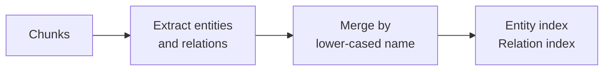
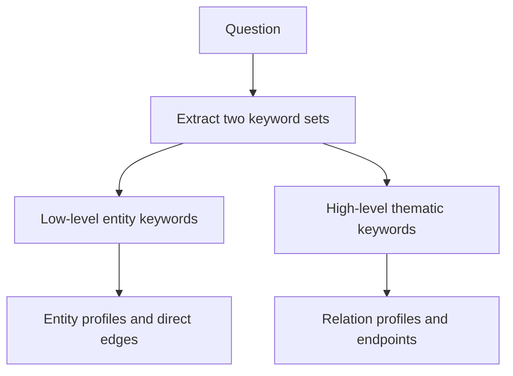
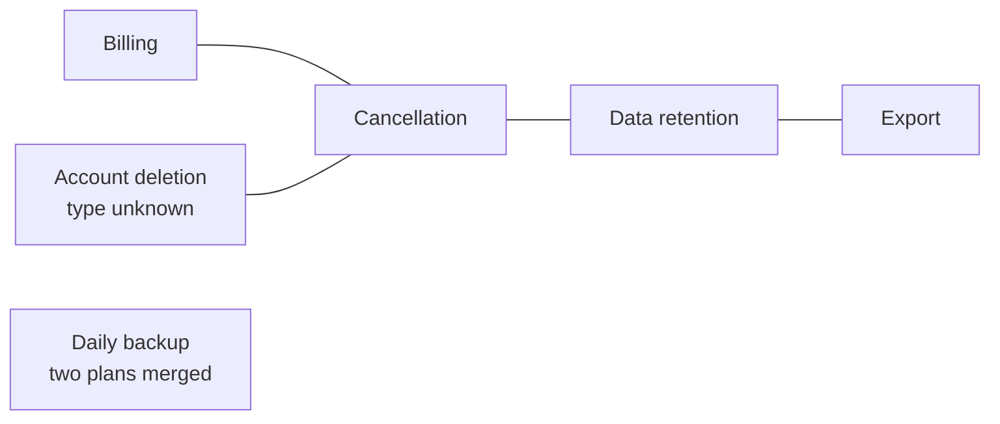
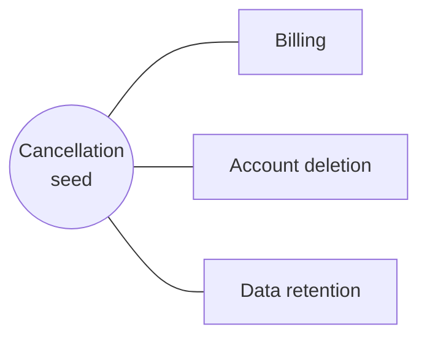
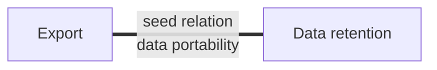

# M42.3 Theory: LightRAG: low-level and high-level graph retrieval

*[M42 theory](../README.md) · Lesson 42.3 · Notebooks: [`03a_light_rag.ipynb`](../../notebook/03a_light_rag.ipynb) · [All theory pages](../../../../../THEORY.md)*
<!-- subtitle: How a graph of entities and relationships answers a connecting question through two searches, and what merging by name loses -->
<!-- format: approved -->

## Start with a question that connects two policies

> **What you'll learn**
>
> - **Explain** how LightRAG turns passages into a graph of entity and relationship profiles.
> - **Compare** the low-level route, which searches entities, with the high-level route, which searches relationships.
> - **Trace** which entities, edges and passages each route adds to the context.
> - **Diagnose** a graph that merged two products, lost a relation's direction or kept a withdrawn policy.

Lesson 42.1 summarised the handbook into a tree, and lesson 42.2 wrote search clues from a memory of it. Both help with themes. Neither records how two things in the handbook relate.

A Larkspur customer asks *How does cancellation affect export?* The export passage explains where to click, and the retention passage says cancelled data is kept for 30 days and then deleted. The answer is the link between them: export before the window closes. A flat index may rank the export procedure first and leave the retention rule below the cut, because the procedure never mentions cancellation.

LightRAG stores that link as an edge in a graph, gives it a short text profile, and searches it like any other passage.

## Dual-level retrieval

**Dual-level retrieval searches two indexes built from one graph: entity profiles for the specific things a question names, and relationship profiles for the themes that connect them.** For the cancellation question, the **low-level** route finds the entities Cancellation and Export. The **high-level** route finds a relationship profile about data portability. Both routes add evidence to one context.

High-level here means thematic relationships. It does not mean RAPTOR's upper summary levels from lesson 42.1, or the community reports that Microsoft GraphRAG builds in [M44](../../../../m44_graphrag/mandatory/theory/README.md). The [LightRAG paper](https://arxiv.org/abs/2410.05779) (Guo et al., 2024) describes graph indexing with entity and relationship profiles, the two retrieval levels, and adding new documents without a rebuild.

The graph comes first. The notebook builds it in four stages:

*Figure 1: Building the graph. One model call per chunk extracts entities and relationships; merging folds repeats into one node or edge.*

Each relationship carries a description and a few high-level keywords. The keywords are what the high-level route searches. At question time a model splits the question into two keyword lists, one per route; an empty list falls back to the question itself:

*Figure 2: The two routes. Each keyword set searches its own index, then expands through the graph.*

| Route | Vector search target | Graph expansion | Passages added |
|---|---|---|---|
| Low level | Entity profiles | Every edge touching the entity | Every chunk the entity appears in |
| High level | Relation profiles | The edge's two endpoint entities | The chunks the relation came from |

*Table 1: What each route adds after a hit.*

The notebook builds this from scratch with NetworkX, structured extraction schemas and two FAISS indexes; it does not use the packaged LightRAG library. It splits the 33-page climate report page by page into chunks of 1,200 characters with 150 overlap, which gives 78 chunks, and keeps the first 20 to save extraction calls. Every later query can only reach those 20.

## What the merge keeps and loses

To see the merge and the routes without a model, we ran the notebook's own merge, profile and retrieval cells on five scripted extractions from the Larkspur handbook:

*Figure 3: The merged Larkspur graph from the scripted run: 6 entities and 4 relationships.*

| Extracted | What the graph holds | Why |
|---|---|---|
| "Cancellation" and "CANCELLATION " | One node, two descriptions joined | Names are trimmed and lower-cased before matching |
| Cancellation to Data retention, and Data retention to Cancellation | One edge with both descriptions | The graph is undirected; the second edge merges into the first |
| Account deletion, named only as a relation's endpoint | A node of type unknown with no description | Endpoints missing from the entity list get a stub |
| "Daily backup" for Business (kept 7 days) and "Daily Backup" for Enterprise (kept 30 days) | One node holding both retention periods, with no plan attached | Two things with the same name merge |

*Table 2: The notebook's merge on scripted extractions. Notebook code, no model calls.*

The last row hurts policy answers. Call it a **name collision**: two things share a name, and their facts merge into one profile. Lower-casing causes it here and cannot fix it. Stable identifiers, with the plan or product in the key, can.

The second row is a different loss. An undirected graph keeps that two things relate and drops which way. The notebook's graph also holds one edge per pair, so a typed model with several relations between the same two entities needs a different graph structure.

## The two routes on one graph

Fix the vector hits by hand and run the notebook's retrieval function. The low-level route seeds on an entity and pulls in every edge around it:

*Figure 4: Low-level route, seed Cancellation. Three edges and three chunks come in; only Cancellation's profile does.*

The high-level route seeds on a relationship and pulls in its two ends:

*Figure 5: High-level route, seed Export to Data retention. Two entity profiles, one edge, one chunk.*

Scripted seed hits on the Figure 3 graph, run through the notebook's <code>lightrag_retrieve</code>. No embeddings or model ran.

<button type="button" data-mode="low" aria-pressed="false" aria-controls="route-low">Low level</button>
<button type="button" data-mode="high" aria-pressed="false" aria-controls="route-high">High level</button>
<button type="button" data-mode="both" aria-pressed="false" aria-controls="route-both">Both</button>

<section id="route-low" class="mode-panel" data-announcement="Low level selected. One entity, three edges, three chunks."><h4>Low level: Cancellation</h4><ul><li>Entities in context: 1. Edges: 3. Chunks: 3.</li><li>The edge block names Billing and Account deletion; the entity block describes only Cancellation.</li><li>The retention rule arrives through its edge and chunk, not through a Data retention profile.</li></ul></section>
<section id="route-high" class="mode-panel" data-announcement="High level selected. Two entities, one edge, one chunk."><h4>High level: Export to Data retention</h4><ul><li>Entities in context: 2. Edges: 1. Chunks: 1.</li><li>The edge says to export before the retention window closes, the link the question needs.</li><li>Cancellation itself never enters.</li></ul></section>
<section id="route-both" class="mode-panel" data-announcement="Both selected. Three entities, four edges, four chunks."><h4>Both: Cancellation, Export and their relation</h4><ul><li>Entities in context: 3. Edges: 4. Chunks: 4.</li><li>Every relationship in the graph is now in the context, from two entity hits and one relation hit.</li></ul></section>

| Seed hits | Entities in context | Edges in context | Chunks in context |
|---|---|---|---|
| Low level: Cancellation | 1 | 3 | 3 |
| High level: Export to Data retention | 2 | 1 | 1 |
| Both: two entities and that relation | 3 | 4 | 4 |

*Table 3: What the routes select on the scripted graph. Cancellation touches three edges, and all three come in with one hit.*

Two things show up. First, **neighbour sprawl**: one low-level hit on a well-connected entity brings in every edge around it. The notebook's defaults are four entity hits and four relation hits; those are seed counts, not a bound on the context. In a full handbook graph, Cancellation touches every policy that mentions it.

Second, the low-level route adds the edges around a hit but not the entity profiles at their far ends. The passages behind those edges do come in: every chunk a relation came from is also recorded for both its endpoints. Check that invariant in your own build before relying on it for provenance.

Use the low-level route when a question names things, the high-level route when it names a relationship or theme, and both by default. Remove duplicates and apply a context budget after expansion. An edge description can help find a policy; it cannot replace the policy's qualifiers, which live in the passage.

For the Larkspur handbook: key entities by stable identifier with the plan or product in the key; keep relation direction where it carries meaning, such as *cancellation starts retention*; store the source passage and version behind every description; limit expansion to evidence the asker may see. When a policy is withdrawn, recompute the merged profiles as well as removing the passage, because the old wording survives inside node and edge descriptions. The notebook skips a chunk whose extraction fails and continues, and it prints only a warning: count those skips beside indexing cost.

## Limits of this evidence

- **Scripted extractions.** Tables 2 and 3 run the notebook's code on five hand-written extractions. A model extracting from real chunks names, types and links entities differently.
- **Hand-fixed vector hits.** The switcher and Table 3 choose seed hits directly. Real embeddings decide which entities and relations seed each route.
- **One corpus subset.** The notebook's graph covers 20 of 78 chunks of a climate report; its answers say nothing about a handbook-sized graph.

## References

1. Guo, Z. et al. (2024). *LightRAG: Simple and Fast Retrieval-Augmented Generation*. [arXiv:2410.05779](https://arxiv.org/abs/2410.05779).
2. NetworkX, [Graph](https://networkx.org/documentation/stable/reference/classes/graph.html), the undirected graph class the notebook uses.

## Key Takeaways

- LightRAG runs two routes over one graph: low-level search over entity profiles and their edges, and high-level search over relationship profiles and their endpoints. Both feed one budgeted context with the source passages.
- Seed counts do not bound the context, because one well-connected entity brings in every edge around it. Set a budget after expansion.
- Merging by lower-cased name collides things that share a name, and merged profiles keep old wording after a source is removed. Use stable identifiers, and recompute profiles when a policy is withdrawn.

## Check yourself

1. For the question How does cancellation affect export, what does each LightRAG route search for?

The low-level route searches entity profiles for keywords such as Cancellation and Export, then adds every edge touching each hit. The high-level route searches relationship profiles for themes such as data portability, then adds the two endpoint entities. High-level means thematic relationships, not RAPTOR's upper summary levels or GraphRAG community reports.

2. Larkspur withdraws a policy and removes its source passage from the index. Is the graph now clean?

No. Node and edge descriptions are merged across passages, and the old wording survives inside a profile. Recompute the merged profiles from the remaining passages as well as removing the source passage.

3. An Enterprise customer is told that daily backups are kept for 7 days, although Enterprise keeps them for 30. What in the graph causes this?

A name collision. The notebook merges entities by trimmed, lower-cased name, and the Business and Enterprise daily backups became one node whose profile holds both periods with no plan attached. Key entities by stable identifier with the plan in the key, then rebuild the affected profiles.

---
*Previous: [42.2 MemoRAG: global memory and clue-guided retrieval](../../../optional/theory/02_memorag_global_memory_and_clue_guided_retrieval/README.md). Next: [M42 interview questions](../README.md#interview-spotlight-5-questions-you-might-get-asked).*
