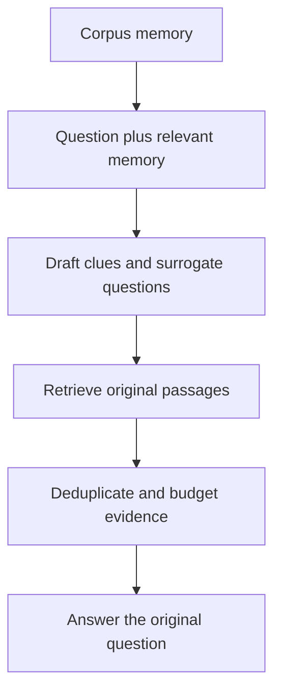
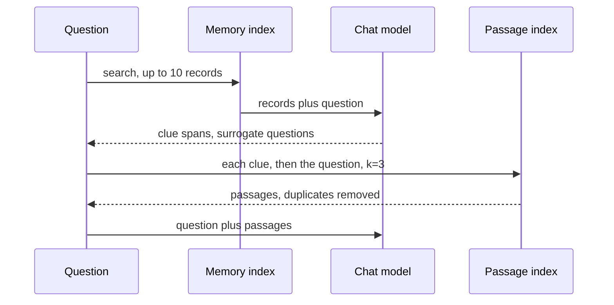

# M42.2 Theory: MemoRAG: global memory and clue-guided retrieval

*[M42 theory](../../../mandatory/theory/README.md) · Lesson 42.2 · Notebooks: [`02a_memorag.ipynb`](../../notebook/02a_memorag.ipynb) (optional) · [All theory pages](../../../../../THEORY.md)*
<!-- subtitle: How a memory of the whole corpus writes search clues for a vague question, and why every clue still has to find a real passage -->
<!-- format: approved -->

## Start with a question that has no keywords

> **What you'll learn**
>
> - **Explain** what corpus memory is and how its clues reach the retriever.
> - **Trace** one question through memory search, clue writing, retrieval and the answer.
> - **Count** the extra searches and model calls that clues add per question.
> - **Diagnose** a fluent clue that points at a product or policy the corpus does not support.

Lesson 42.1 added summaries to the index, which gave a theme question something to match. MemoRAG leaves the index alone and changes the query instead.

A Larkspur operations lead asks *How does Larkspur protect continuity?* The question names no section. Searched directly, it matches passages that share its words and misses the ones that answer it: export, retention, availability guarantees and incident reports. A reader who knew the whole handbook would turn the question into better searches first. MemoRAG gives the retriever that reader.

## Global memory

**Global memory is a compact, model-readable representation of the whole corpus that turns a vague question into specific search clues before retrieval runs.** For the continuity question, memory might suggest *export before cancellation*, *30-day retention window* and *availability guarantee and credits*. Each clue is a search, not an answer: the final answer still needs source passages that support every claim.

The [MemoRAG paper](https://arxiv.org/abs/2409.05591) (Qian et al., 2024) builds the memory with a long-range model that compresses the corpus, then has that model draft clues for the retriever. A clue can contain a wrong detail. Its job is to locate evidence, and the generator checks what comes back:

*Figure 1: Clue-guided retrieval. Memory shapes the searches; only retrieved passages reach the answer.*

Plain retrieval, the alternative, sends the question straight to the passage index:

*Figure 2: Plain retrieval. One search with the question's own words.*

The optional notebook implements a smaller approximation of Figure 1. Its memory is a list of readable text records, each a **topic** and its **details**, written by `gpt-4o-mini` reading the corpus and validated against a schema. The records are embedded and stored in a FAISS index. The memorising prompt says it mimics KV-cache creation; the records are text, not the attention key and value tensors a model keeps inside, and the analogy stops there.

| Corpus | Memorised as | Passage index for retrieval |
|---|---|---|
| A 33-page climate report | The whole text in one model call | Chunks of 1,000 characters, 200 overlap |
| A book of about 600 pages | Chunks of 50,000 characters, 5,000 overlap, one call each | The same 1,000-character chunks |

*Table 1: Memory input and passage index in the notebook. Memory sees large spans; retrieval still returns small passages.*

At question time the notebook runs one fixed sequence:

*Figure 3: One question through the notebook's pipeline. Clues come from two separate model calls.*

The clue step makes two calls: one asks for text spans likely to appear in the corpus, the other for **surrogate questions**, narrower questions that clarify the original. The notebook splits both replies into lines, drops any line of three words or fewer, and appends the original question. Each surviving line becomes one search for three passages.

Compare the two designs on the continuity question:

One vague question, two retrieval designs. The clue texts are illustrative; the counts follow the notebook's code with four clues kept.

<button type="button" data-mode="plain" aria-pressed="false" aria-controls="design-plain">Plain retrieval</button>
<button type="button" data-mode="clues" aria-pressed="false" aria-controls="design-clues">Clue-guided</button>

<section id="design-plain" class="mode-panel" data-announcement="Plain retrieval selected. One search with the question's own words."><h4>Plain retrieval</h4><ul><li>Searches: 1, with "How does Larkspur protect continuity?"</li><li>Passages: those that share "continuity" or "protect", which few policy passages do.</li><li>Model calls: 1, the answer.</li></ul></section>
<section id="design-clues" class="mode-panel" data-announcement="Clue-guided selected. Five searches, up to 15 passages before deduplication."><h4>Clue-guided</h4><ul><li>Searches: 5, one per clue such as "export before cancellation", plus the question.</li><li>Passages: up to 15 before deduplication, now including export, retention and availability.</li><li>Model calls: 3, two for clues and one for the answer, plus one memory search.</li></ul></section>

The clue-guided design reaches the passages a plain search misses, and its cost grows with the clue count:

| Clues kept | Searches | Passages before deduplication | Model calls |
|---|---|---|---|
| 0 | 1 | 3 | 3 |
| 4 | 5 | 15 | 3 |
| 8 | 9 | 27 | 3 |

*Table 2: Retrieval work per question in the notebook (illustrative clue counts). One memory search is added to every row; the three model calls are the two clue calls and the answer.*

Removing duplicate passages is the only control on context size. Deduplication drops repeats; it does not cap tokens. Eight clues that each find three new passages put 27 passages in front of the generator. Call that **clue sprawl**, and set a passage or token budget after deduplication. Choose plain retrieval when questions name what they want; choose clues when questions are vague and the corpus is long enough that a reader's overview helps.

Each stage has its own failure, and its own thing to log:

| Stage | What to inspect | Failure to test |
|---|---|---|
| Memorise | Topic and detail records, parse failures | An exception lost during extraction |
| Find memory | Retrieved records and their source versions | Stale or irrelevant memory dominates |
| Generate clues | Exact clue text beside the original query | A plausible clue invents a product |
| Retrieve | Source identifiers, ranks and deduplication | Repeated clues crowd out another policy |
| Answer | Support for each claim | The generator repeats an unsupported clue |

*Table 3: Where clue-guided retrieval fails, stage by stage.*

The invented-product row matters most. Call it the **fluent clue**: a clue that reads well and names something the corpus does not contain. If retrieval then finds a loosely related passage, the generator may treat the clue's claim as supported. The notebook's answer prompt says to use only the retrieved context and to say when it is not enough. Logging clues beside the passages they found shows whether that instruction held.

The notebook's memory store has gaps worth planting:

| Input | What the notebook does | Why |
|---|---|---|
| A second batch of records | Compares new topics with at most four existing ones | A nearest-neighbour search for an empty string returns the default four records, not the whole store |
| A model reply that is not valid JSON | Falls back to a line parser for `Topic:` and `Details:` | A schema error counts as a parse error and triggers the fallback |
| A question before anything is memorised | Stops with an error | The clue step returns no list, and the query step loops over it |

*Table 4: Planted failures in the notebook's memory store.*

A topic registry or stable record identifiers fixes the first row. The third needs a fallback that searches with the original question alone.

Memory is derived data, with the same duties as the summaries in lesson 42.1. When Larkspur changes its retention rules, update the passage index and regenerate every memory record written from those passages. Shared memory must not leak restricted documents through its records or its clues. For Larkspur, tag each record with the passages and versions it came from, cut the deduplicated passages to a fixed budget, and log each clue beside the passages it found. Report a gain over plain retrieval only when the clue-guided run finds supporting passages the plain run missed at the same budget.

Lesson 42.3 builds a third derived representation, a graph of entities and relationships, and searches it at two levels.

## Limits of this evidence

- **The notebook does not run as shipped.** It loads two prebuilt memory stores and a book PDF that are not in this repository, and the memorising cells are commented out because they are slow and paid.
- **Its comparison is broken.** The plain-RAG cells call the shared `evaluate_rag` helper with a `q_a_file_name` argument it does not accept, and they stop with a `TypeError`. Even fixed, that helper writes its own five climate questions instead of reading the question file. The notebook's own MemoRAG evaluation reads the first 5 of 44 climate questions and 15 of 16 book questions, scored by a model judge. No plain baseline on the same questions exists.
- **Illustrative counts.** Table 2 and the switcher follow the code with chosen clue counts. No model wrote clues for the Larkspur handbook here.

## References

1. Qian, H. et al. (2024). *MemoRAG: Boosting Long Context Processing with Global Memory-Enhanced Retrieval Augmentation*. [arXiv:2409.05591](https://arxiv.org/abs/2409.05591).
2. Meta AI, [Faiss](https://faiss.ai/), the similarity search library behind both the memory records and the passages.

## Key Takeaways

- Corpus memory writes clues that help the retriever find evidence. A clue can contain a wrong detail, and every claim in the answer must rest on a retrieved passage.
- Each extra clue adds a search and its passages, and deduplication alone does not bound the context. Log clue text beside the original question and set a budget after deduplication.
- Treat memory as derived data. Regenerate records when their source passages change, and check that records and clues never expose restricted documents.

## Check yourself

1. What is a MemoRAG clue for, and why must the answer still rest on retrieved passages rather than on the clue?

A clue, written from corpus memory, tells the retriever where to look, such as export, retention and availability for a continuity question. It can contain a wrong detail or name something the corpus lacks, the fluent clue. Only retrieved passages count as evidence, and each claim in the answer needs one that supports it.

2. Larkspur changes its retention rules. What has to change besides the passage index?

Every memory record written from the old retention passages has to be regenerated, because memory is derived data with dependencies. Test a deletion against both the stored memory and generated answers. Shared memory also must not expose restricted documents through its records or clues.

3. The notebook keeps eight clues for a question and retrieves three passages for each clue and for the question. What bounds the context the generator sees?

Nothing beyond deduplication. Nine searches at three passages each can return 27 passages, and removing repeats does not cap tokens. Set a passage or token budget after deduplication and log which clue found each passage.

---
*Previous: [42.1 RAPTOR: clustering and recursive summarisation](../../../mandatory/theory/01_raptor_clustering_and_recursive_summarisation/README.md). Next: [42.3 LightRAG: low-level and high-level graph retrieval](../../../mandatory/theory/03_lightrag_low_level_and_high_level_graph_retrieval/README.md).*
